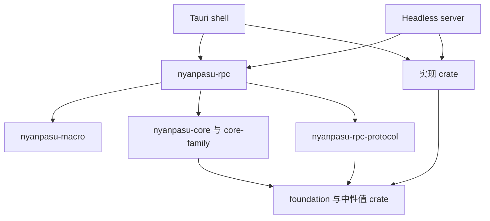
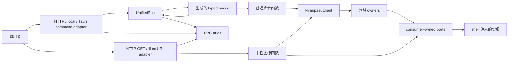
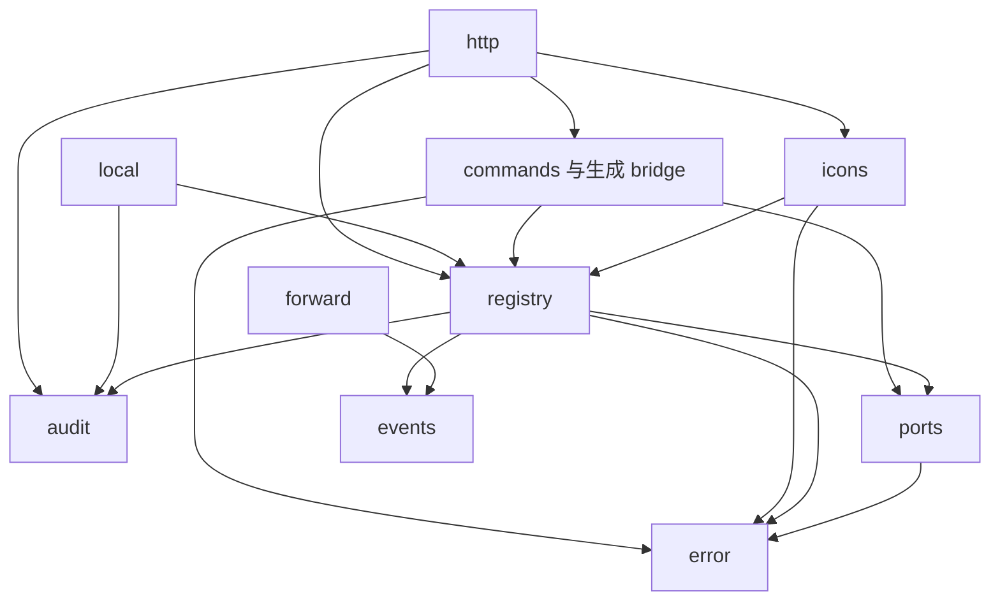
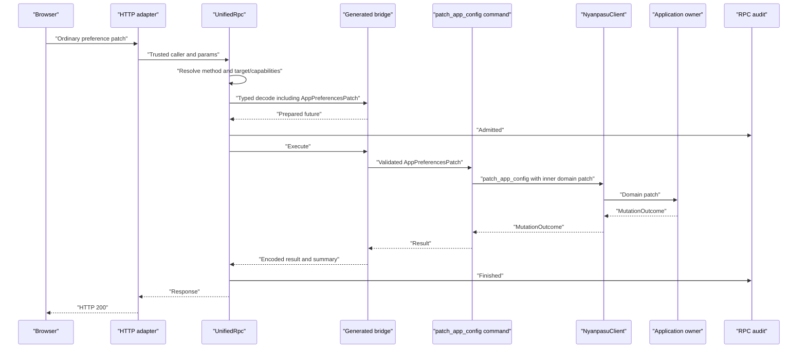
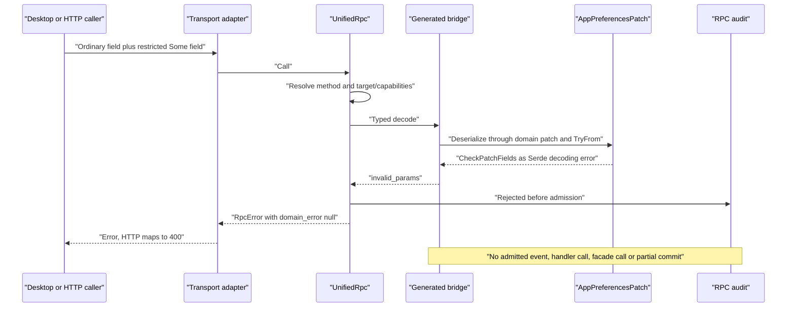
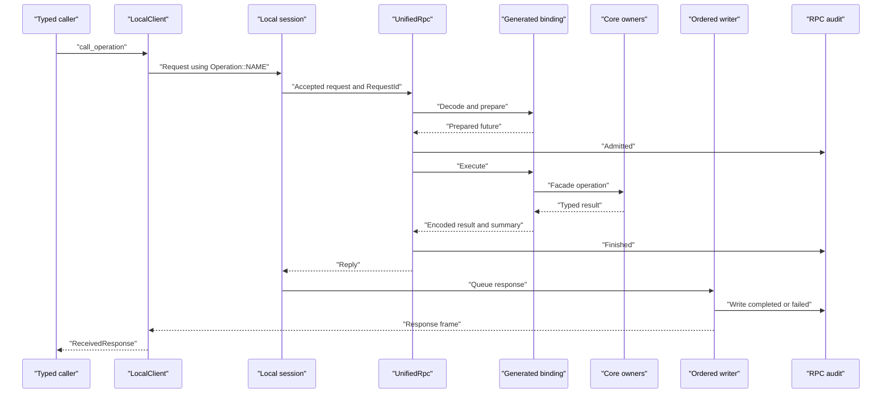
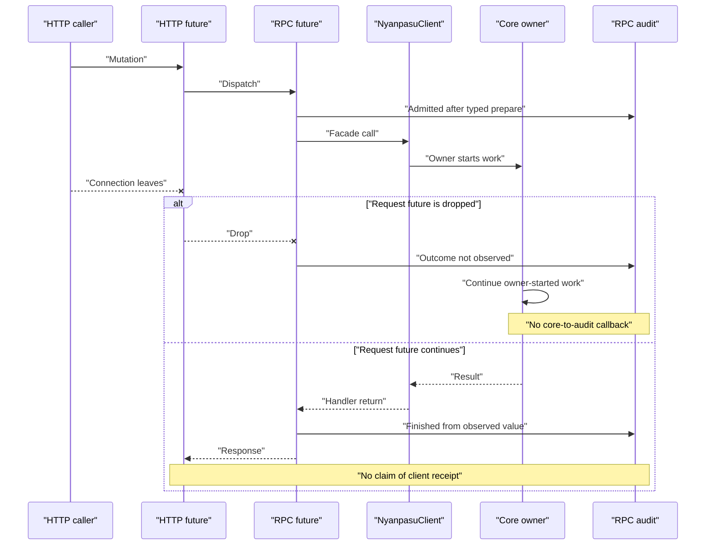

# RPC 契约设计：命令范围、类型绑定与传输边界

> **状态：主体与 R10 已实施（2026-11-12）；R2 rename 半项待实施。**
>
> 基线：`refactor/core-split-e6-server`，提交  
> **`3288f8569dff2a79783ce547fb3c8ae9e1771dd6`**。
>
> runtime 子模块基线：父提交记录的 gitlink  
> **`a27c3fcc1ed57980034f25084613baa98efc01c4`**。
>
> 原设计基于上述提交；交付校订核对当前 HEAD 的提交与源码。
> R10 的本次验收与平台限制见 §6.12；其他卡片保留原验收清单，
> 不将历史要求或未执行的平台验证记为本次通过。
>
> 设计遵循项目开发指南。
> 模块环审查采用输入报告的 Part B。
> 原始讨论仅解释参照物与设计动机，不作为上游最新状态的证明。

### 交付状态

截至 2026-11-12，下列实现提交均在当前 HEAD 历史中。
PR 编号按交付记录；未决设计选择仍见 §7。

| 卡片                    | PR 分支                                        | 状态                                                                                             |
| ----------------------- | ---------------------------------------------- | ------------------------------------------------------------------------------------------------ |
| E1／R2 strict HTTP 半项 | `refactor/core-split-e1-protocol`（#6235）     | 已实施（`c5be04a6b`）；不兼容声明编译失败，能力清单为单一基线加平台差异                          |
| E4 replacement          | `refactor/core-split-e4-wire-closure`（#6240） | 已实施（`d71af1d22`、`0e639a320`）；canonical foundation 值与 `types` 接收形状，按 V-67 收窄闭包 |
| E5／R5、R6              | `refactor/core-split-e5-typed-client`（#6241） | 已实施（`144800766`）；十三个 contract 接入既有生成器                                            |
| R0                      | `refactor/rpc-module-placement`（#6302）       | 已实施；audit 类型与 ports 归位                                                                  |
| R1                      | `fix/rpc-failure-envelope`（#6303）            | 已实施；RpcFailure 与 rpcDomainError                                                             |
| R3／R4                  | `feat/dedicated-settings-commands`（#6304）    | 已实施                                                                                           |
| R7                      | `fix/configuration-status-query`（#6305）      | 已实施                                                                                           |
| R8                      | `feat/rpc-audit-phases`（#6306）               | 已实施；生成 handler 带出摘要，drop 为 NotObserved                                               |
| R9                      | `feat/rpc-audit-delivery`（#6307）             | 已实施；delivery、observation、subscription 事实                                                 |
| R11                     | —                                              | 已被替代；模块引入时即名为 types，无需改名                                                       |
| R12                     | `feat/icon-byte-entry`（#6308）                | 已实施                                                                                           |
| R10                     | `test/rpc-contract-acceptance`                 | 已实施；D2 首个基线、命令范围矩阵与条件提权验收，执行记录见 §6.12                                |
| R2 rename 半项          | —                                              | 尚未实施                                                                                         |

---

## 1. 目标与非目标

### 1.1 核心目标

在现有统一 RPC 上明确三个边界：

1. **命令范围**：宿主相关或特权设置通过专用命令写入，由命令声明决定 transport 暴露。
2. **类型契约**：客户端 operation 与服务端 handler 通过生成 bridge 由编译器绑定。
3. **观察事实**：前端保留完整错误；审计区分调用、领域结果与交付。

继续使用：

- `UnifiedRpc`。
- `#[nyanpasu_macro::rpc]`。
- 普通 Rust 函数 handler。
- 单一 Tauri 入口 `call_rpc`。
- 现有 HTTP adapter。
- 现有 local frame protocol。
- 显式依赖注入、actor-owned state 与 shell 执行策略。

不把中性 registry 改成 axum `Router` 或 `tower::Service`。
不把 Tauri/local 调用转换为 HTTP 请求。
不增加 crate。

### 1.2 已定决策

| 决策                               | 落实                                                            |
| ---------------------------------- | --------------------------------------------------------------- |
| Scope 是命令                       | 不建立 payload 字段的 transport policy                          |
| application config 保持一个领域    | `NyanpasuAppConfig` 与 `application.yaml` 不拆分                |
| 现有领域划分保持                   | application、clash、session-state 不调整                        |
| 热键写入专用命令                   | `set_hotkeys` 去掉 `http`，body 不变                            |
| 服务模式写入专用命令               | 新增 Desktop-only `set_service_mode`                            |
| 通用 app patch 只接受普通偏好      | 请求类型解码拒绝两个受限字段的 `Some`，不依赖 transport         |
| core facade 不受此限制             | `NyanpasuClient::patch_app_config` 保持原签名和能力             |
| Hotkeys retry 不是热键修改         | HTTP `retry_configuration_effect(Hotkeys)` 保持允许             |
| 无 guard 机制                      | 无属性、trait 方法、生成调用或 admission 模块                   |
| DG-B = B1                          | 保留 shell 的 `InteractiveElevationConsent` / `RefuseElevation` |
| DG-C                               | 保留十三个 local 命令                                           |
| profile/subscription 修改保留 HTTP | 不因条件可达提权拒绝整个命令                                    |
| 服务端 typed registration 在范围内 | 宏生成参数、成功类型与 contract 的绑定                          |
| core 不依赖 RPC                    | 不新增观察 port 或 facade RPC 参数                              |
| protocol 不依赖 core-family        | contract 只使用中性类型                                         |
| DG-D = D2；DG-E/F 保持开放         | D2 首个基线已建立；E1、F1 仍为默认                              |
| RPC 合批仅属于 adapter             | 不排期；是否实施由 #5997 的真机 trace 决定                      |
| 图标改为特殊字节入口               | HTTP GET 与桌面 URI scheme 共用中性函数，不作为 command         |

### 1.3 范围与原始问题

| 原始问题                          | 本轮处理                                      |
| --------------------------------- | --------------------------------------------- |
| gap #1：宽入口范围不明确          | 专用命令与 transport-independent 请求类型约束 |
| gap #2：前端丢失错误信封          | `RpcFailure` 与消费者迁移                     |
| gap #3：调用关联不足              | 现有 caller wrapper 与实例审计序号            |
| gap #4：审计混淆执行、完成与交付  | 分阶段记录与返回值摘要                        |
| gap #5：typed decoding 未绑定操作 | 十三个 operation contract 与双端 binding      |
| gap #6：声明信息分散              | 保留目录；修正一个 query/mutation 错分        |
| gap #7：HTTP 声明可静默降级       | 不兼容 `rpc(http)` 编译失败                   |
| gap #8：方法名依靠约定            | 可选 `rename` 与 freshness gate               |

不从 gap #3 推导身份、角色或权限系统。

### 1.4 非目标

不实施：

- 新 RPC 框架、JSON-RPC 或 WIT 迁移。
- 通用 middleware、extractor 或 guard 框架。
- 多用户角色或任意权限表达式。
- core observation port。
- 新事务协调器或事务日志。
- mutation 自动重放。
- HTTP tracked invocation executor。
- 本地命令或订阅扩面。
- application 领域拆分。
- CLI 产品功能、LAN ticket login、OpenWrt。
- 无关命名、格式或错误类型清理。
- 中性 batch protocol、HTTP batch 或 local batch。
- 通用 resource registry、resource macro 或资源框架。
- 后端语法高亮及其大结果传输实现。

### 1.5 不采纳的概念

| 不采纳                                                | 原因                                               |
| ----------------------------------------------------- | -------------------------------------------------- |
| `Authority` / `Principal` / `ShellKind`               | 当前命令范围不需要角色模型                         |
| `PolicyRow` / `InvocationPolicy`                      | 命令声明已经表达暴露范围                           |
| `ExecutionAdmission`                                  | 与 DG-B = B1 冲突                                  |
| `InvocationIds` port / `policy_revision`              | 实例计数器足够，没有动态政策发布                   |
| `Permission` / `AccessRule` / `P/access.rs`           | 不新增权限 taxonomy                                |
| 每命令 `access(...)`                                  | transport 暴露继续由声明决定                       |
| `guard = ...`                                         | 普通偏好请求类型通过解码建立范围约束               |
| guard registry、trait object、生成 guard 调用         | 没有需要这些机制的政策                             |
| 字段级 transport 规则                                 | 同一命令在所有 transport 接受相同参数范围          |
| 全字段 exhaustive classifier                          | 两个例外是明确命令边界，不分类整个领域             |
| 原始 JSON 键扫描                                      | 使用实际解码字段的语义                             |
| `useSettings("a.b.c")`                                | hook 已按类型化字段访问，无需字符串路径            |
| `patch_setting(path, value)`                          | 将边界退化为未类型化值与字符串匹配规则             |
| `SurfaceDescriptor` 与 surface 模块                   | 特殊入口保留现有 adapter                           |
| `AuditClass`                                          | phase 与返回值摘要足够                             |
| core/effects observation port                         | 改变 facade 并引入反向概念依赖                     |
| operation 泛型错误包装                                | `TypedCallError` 已保留完整信封                    |
| HTTP tracked executor                                 | E1 不建立第二个执行生命周期                        |
| `IpcError` 隐藏分类位                                 | 现有参数解码路径已经提供 `invalid_params`          |
| resource registry / `#[resource]` macro               | 当前只有图标这一新增资源族，具体函数足够           |
| dispatcher batch method 或 JSON-RPC 式 batch envelope | 多个独立调用可由桌面 adapter 聚合                  |
| 桌面请求经 axum Router 转发                           | URI adapter 可直接调用中性函数，无需伪造 HTTP 请求 |

### 1.6 成功判据

1. HTTP 无法调用 `set_hotkeys` 或 `set_service_mode`。
2. local 命令集合仍为十三项。
3. `patch_app_config` 在 Desktop 与 HTTP 都在 typed decode 拒绝受限 `Some` 字段。
4. 混合 patch 整体拒绝，没有 handler、facade 调用或部分提交。
5. `false`、空数组与同值仍是字段请求。
6. 两个普通 Option 字段的 `null` 保持无操作。
7. core facade、热键验证、mutation classification 与 requested owners 不变。
8. HTTP Hotkeys retry 能进入现有 handler。
9. 通用前端设置写类型不接受两个受限 key。
10. `useSetting('enable_service_mode').value` 仍可读取。
11. service switch 使用新命令，并保留完整 `MutationOutcome`。
12. 十三个 operation 的方法、请求、成功响应由双端契约绑定。
13. 每个命令只有一个中性 registry entry。
14. 前端保留六个顶层 `RpcError` 字段。
15. audit 不把 handler 成功当作客户端收讫。
16. audit 不把 future drop 当作事务取消。
17. 无 core→RPC、protocol→core-family 新依赖。
18. 必需注释、测试、catalog 与 bindings 同步完成。

---

## 2. 总体架构

### 2.1 路径与标记约定

| 缩写 | 完整路径                               |
| ---- | -------------------------------------- |
| `P/` | `backend/nyanpasu-rpc-protocol/src/`   |
| `R/` | `backend/nyanpasu-rpc/src/`            |
| `M/` | `backend/nyanpasu-macro/src/`          |
| `C/` | `backend/nyanpasu-core/src/`           |
| `Q/` | `backend/nyanpasu-config/src/`         |
| `V/` | `backend/nyanpasu-runtime-values/src/` |
| `T/` | `backend/tauri/src/`                   |
| `S/` | `backend/nyanpasu-server/src/`         |
| `F/` | `frontend/rpc/src/`                    |
| `U/` | `frontend/query/src/`                  |
| `A/` | `frontend/nyanpasu/src/`               |

未校订的行号指原设计固定基线。
交付校订使用实际文件路径，不沿用失效行号。

标记：

- **EXISTING**：基线已有。
- **NEW**：新增设计。
- **CHANGE**：修改现有项。
- **推断**：依据源码提出的判断，未经构建验证。

草图表达接口、类型关系和关键算法，不表示已经编译。
代码块中的省略部分由任务卡补齐。

### 2.2 参照物与对应关系

| 参照思想                                                | 跟随之处                                             | 刻意不同之处                                     |
| ------------------------------------------------------- | ---------------------------------------------------- | ------------------------------------------------ |
| axum 普通函数 handler                                   | 命令保持普通函数，宏生成 bridge                      | 不使用 axum 作为中性 dispatcher                  |
| trait 连接函数与类型                                    | RpcOperation 与既有宏生成代码绑定请求/响应           | 不建立第三方 handler 扩展框架                    |
| extractor 构造上下文、拒绝无效请求                      | 注入 `RpcState`、`RpcCaller`；请求新类型在解码时校验 | 不依赖 HTTP Request 或 axum extractor            |
| router 拥有注册                                         | `UnifiedRpc` 拥有目录和调度                          | 保留 inventory/catalog                           |
| tower 执行外围分工                                      | target 检查、执行、结果观察分离                      | 不引入中性 Service stack                         |
| Tauri 宏保留源信息                                      | 名称、文档与可选 rename                              | 保持唯一 call_rpc                                |
| Tauri traits 处理参数/结果                              | 生成代码与类型检查共同工作                           | 不复制全部 Tauri 参数系统                        |
| tauri#15326 方向                                        | router/context/execution 分工                        | 不依赖草案 API                                   |
| 内部 `IpcOperation`                                     | client/server 读取同一 contract                      | 使用方法名与现有本地帧                           |
| typed client                                            | 完整错误与 unknown-outcome                           | 增加 operation-bound API，不增加连接 owner       |
| axum `IntoResponse`、Tauri custom protocol/raw response | 特殊字节入口调用中性图标函数                         | 不扩大 JSON command bridge，也不建立资源注册框架 |

锁定源码：

- `axum-0.8.9/src/handler/mod.rs:148,221,233`。
- `axum-0.8.9/src/routing/mod.rs:68,178,303,321`。
- `axum-core-0.5.6/src/extract/mod.rs:53,79`。
- `tower-0.5.3/src/builder/mod.rs:106,132`。
- `tauri-2.12.5/src/ipc/command.rs:22,66`。
- `tauri-macros-2.7.4/src/command/wrapper.rs:79,433,515`。
- runtime gitlink 的 `nyanpasu_ipc/src/api/contract.rs:36`。
- `axum-0.8.9/src/handler/mod.rs:150,212`。
- `tauri-2.12.5/src/app.rs:2335`；`src/ipc/mod.rs:190,194`。

HTTP 暴露按命令注册决定。
普通偏好的请求范围由 Serde 解码建立，不建立可组合 guard。

[tauri-apps/tauri#15326](https://github.com/tauri-apps/tauri/pull/15326) 仅作为方向参考。
按给定历史边界，它在 2026-10-27 仍是开放草案。
本文不声称重新确认其最新状态。

### 2.3 编译依赖与运行时调用

#### 2.3.1 编译期 DAG

**CHANGE／传递约简示意。**
依据：RPC crate manifests；
`R/registry.rs:23`；
`T/unified_rpc/native.rs:22`；
`S/compose.rs:54`。

箭头表示编译依赖。
省略沿已画路径可达的直接边。



保持：

- core 不依赖 RPC。
- protocol 不依赖 core-family、RPC 或 shell。
- core 生产代码不依赖实现 crate。
- 宏生成引用不等于宏 crate 的生产依赖。

图标 URI adapter 位于 Tauri shell，直接依赖 RPC 中性图标函数，
不增加 shell→HTTP adapter 的运行路径或编译要求。

#### 2.3.2 运行时调用图

**CHANGE。**
依据：`R/registry.rs:345,356,390`；
`R/commands/runtime.rs:126`；
`C/client/mod.rs:1044`；
`R/commands/icons.rs:17,30,69`。



`patch_app_config` 的 `AppPreferencesPatch` 在 bridge 解码参数时建立范围约束。
专用命令直接构造领域 patch，再调用同一 facade。

owner 不回调 RPC audit。
RPC 仅观察 handler 返回值。

图标绕过 JSON command bridge，复用中性函数、显式依赖与 audit。
local 没有图标资源入口。

### 2.4 RPC 模块 DAG

**CHANGE。**
依据：`R/registry.rs:23,70,117`；
`R/audit.rs:3`；
`R/ports.rs`；
`R/events.rs:6`；
`R/http/routes.rs:87`。



没有 `admission` 模块。
请求新类型与其范围校验直接位于 `R/commands/runtime.rs`。

| 模块       | 可导入的相关本 crate 模块                         | 禁止方向                              |
| ---------- | ------------------------------------------------- | ------------------------------------- |
| audit      | 无                                                | 不导入 registry、commands、transport  |
| ports      | error                                             | 不导入 commands、registry             |
| error      | 无新的上层模块                                    | 不导入 commands 或 registry           |
| events     | 无新的上层模块                                    | 不导入 registry                       |
| registry   | audit、ports、events、error                       | 不导入 commands 或 icons              |
| commands   | registry、ports、error                            | 不被 registry 反向导入                |
| icons      | registry、error                                   | 不导入 http、local、commands 或 Tauri |
| http/local | registry、audit 及已有必要模块；http 可导入 icons | 不被 registry 导入                    |

`TryFrom` 错误通过 Serde 的 `Display` 路径成为参数解码错误。
`R/error.rs` 不导入 command 错误，也不作任何修改。

`icons` 通过传入的 `RpcDependencies` 使用已有 icon port。
不新建资源 registry 或重新持有一套服务。

### 2.5 各包变化

| 包                  | 变化                                                                              |
| ------------------- | --------------------------------------------------------------------------------- |
| protocol            | operation trait 与十三个 contract；移除不用的 IconData                            |
| rpc                 | 专用命令、请求新类型、typed bridge、audit、中性图标函数与 HTTP 字节入口           |
| macro               | typed binding、strict HTTP；rename 待实施；没有 guard；删除三个图标命令的 fixture |
| config              | 仅必需注释与过时文档名修正                                                        |
| core/runtime-values | 公共签名和执行逻辑不变                                                            |
| Tauri               | 新 mutation 注册、查询分类、导入接线、图标 URI adapter                            |
| server              | 执行策略不变，更新移动导入；无 host icon port 时返回明确不可用                    |
| frontend RPC        | 完整 RpcFailure、图标 URL transport                                               |
| frontend query      | 写类型收窄、service mode hook、图标 URL hooks                                     |
| frontend app        | service switch 迁移、浏览器控件限制、图标展示与刷新迁移                           |

### 2.6 调用上下文

**已实施。**
依据：`R/registry.rs`、`R/audit.rs` 与
`M/unified_command.rs`。

RpcCaller 在声明层包装 transport 提供的 RpcOwner，
从请求 schema 中排除。
宏调用实现时直接传入 RpcOwner；
资源命令继续使用其 label 与既有 owner 隔离规则。
没有包含 transport/request_id 的新 caller wrapper。

transport、method 与可选 local request id
由 adapter 传给 audit，写入 AuditHeader。
请求不能覆盖这些值；
字段范围检查也不接收 transport。

caller 属于一次调用，不属于一次 transport request。
同一 transport request 将来可以承载多个 invocation；
这些调用可共享 owner，但各自拥有 audit invocation id。
request_id 仍仅表示已有 local frame id，不扩展为 batch id。

### 2.7 请求流程

1. adapter 解析外层协议并构造 caller。
2. registry 解析方法。
3. 检查 target 与 required capabilities。
4. bridge typed decode，包括请求新类型的 `TryFrom` 校验。
5. prepare 成功。
6. 记录 admitted。
7. 执行 handler。
8. handler 调用 facade。
9. 返回结果与 completion summary。
10. 编码、记录 finished。
11. adapter 记录可观察的 delivery。

`patch_app_config` 的范围错误是 typed decode 失败。
它发生在 admitted 前，不创建可执行的 prepared future。
记录 `Rejected`；没有 handler、facade 调用或 completion summary。

不新增流程步骤。
基线解码映射依据：`M/unified_command.rs:433–446`。
prepare 与审计分界按 §3.3、§3.4 实施。

### 2.8 各入口位置

| 入口                        | 本轮行为                                                                   |
| --------------------------- | -------------------------------------------------------------------------- |
| Tauri native                | 保留 call_native 的 target/capability 与 typed prepare                     |
| Tauri shared                | 与 HTTP 使用同一请求类型及解码规则                                         |
| HTTP 普通命令               | target 决定可达性；typed decode 建立参数范围                               |
| local 普通命令              | 保留十三项和资源限制；可达命令复用同一解码机制                             |
| HTTP archive                | 保留既有认证与响应构造；无新增检查                                         |
| HTTP events/details         | 保留既有订阅规则；无新增检查                                               |
| local subscribe/unsubscribe | 保留 feature、stream、resource 与 teardown                                 |
| HTTP icons                  | listener 认证后，公共 parser → 中性图标函数 → 字节 Response                |
| Desktop icons               | URI adapter 取得 webview owner，公共 parser → 同一中性图标函数 → responder |

没有适用规则的入口不调用 no-op check。
依据：`R/http/routes.rs:77,87,146,197,271`；
`R/local/server.rs:253,315,407`。
图标入口依据：`R/commands/icons.rs:11,23,62`；
`tauri-2.12.5/src/app.rs:2335`。

**核对修正：`patch_app_config` 没有 local target；实际 local 调用先被 target 检查拒绝，不能声称该生产入口返回新类型的解码错误。**
依据：`R/commands/runtime.rs:121`。
local 可达命令的解码错误同样使用 `RpcError::invalid_params`；
本设计不为验证新类型而扩展 local 命令集合。

---

## 3. 详细设计

### 3.1 命令范围与 HTTP 暴露

#### 3.1.1 问题与边界

对应 gap #1。

`patch_app_config` 接收整个领域 patch。
但热键与 service mode 的写入需要不同的命令暴露。

保持领域类型完整，收紧 RPC 命令的输入范围：

- 普通偏好 → `patch_app_config`。
- 热键 → `set_hotkeys`。
- 服务模式 → `set_service_mode`。

这个约束在所有 transport 相同。
HTTP 通过 target 无法访问两个专用写命令。

Hotkeys retry 只是重新应用已保存配置。
它不接受新的热键列表，保持 HTTP 可用。

依据：

- `R/commands/runtime.rs:121,126,130`。
- `R/commands/storage.rs:45,47,54`。
- `R/commands/status.rs:41,43,48`。

#### 3.1.2 已有命令级限制

| required capability    | 方法                                             | 目录依据                     |
| ---------------------- | ------------------------------------------------ | ---------------------------- |
| Elevation              | flush_system_dns_cache                           | `P/command_catalog.rs:18`    |
| Elevation              | install/uninstall/start/stop/restart_service     | `P/command_catalog.rs:44`    |
| Elevation              | Windows invoke_uwp_tool                          | `P/command_catalog.rs:41`    |
| Lifecycle/Elevation 等 | Windows set_custom_app_dir                       | `P/command_catalog.rs:36`    |
| Lifecycle              | restart_application                              | `P/command_catalog.rs:37`    |
| Lifecycle              | simulate_crash / quit_application                | `P/command_catalog.rs:65,67` |
| AppUpdate              | get_app_update_state                             | `P/command_catalog.rs:55`    |
| AppUpdate              | check/download/cancel/install/discard app update | `P/command_catalog.rs:57`    |

这些命令目前均为 Desktop-only。
非 Windows stub 也保持 Desktop-only，不能只用 Windows capability 断言覆盖。

`update_core` 二进制更新同样没有 HTTP target。
它不是 `change_clash_core`。
依据：`P/command_catalog.rs:28`。

新增目录 gate 固化事实。
不新增权限机制。

#### 3.1.3 入口枚举

| 入口                                   | 范围                                  | HTTP 默认           |
| -------------------------------------- | ------------------------------------- | ------------------- |
| `set_hotkeys`                          | 写热键列表                            | unsupported         |
| `set_service_mode`                     | 写 service mode                       | unsupported         |
| app patch 的 hotkeys/service mode Some | 请求类型拒绝；所有可达 transport 相同 | invalid_params，400 |
| app patch 的两个字段 None/null         | 没有对应字段请求                      | allow               |
| `retry_configuration_effect(Hotkeys)`  | 重应用已保存热键                      | allow               |
| service install/start/stop 等          | 直接服务控制                          | 维持 unsupported    |
| DNS flush / UWP tool                   | privileged utility                    | 维持 unsupported    |
| app restart/quit/crash                 | 应用生命周期                          | 维持 unsupported    |
| AppUpdate 命令                         | 应用更新控制                          | 维持 unsupported    |
| auto-launch/system proxy/guard/PAC     | 非提权 OS 集成                        | allow               |
| 其他 effect retry                      | 重试既有目标                          | allow               |
| TUN enablement/params/stack            | 核心运行配置                          | allow，待确认       |
| controller/ports/channel               | 核心通信配置                          | allow，待确认       |
| app patch core / change_clash_core     | 核心选择                              | allow，待确认       |
| restart_sidecar                        | 代理核心重建                          | allow，待确认       |
| retry_configuration_runtime            | 重试已有运行目标                      | allow，待确认       |
| app_singleton_port                     | 启动偏好                              | allow，待确认       |
| 四个 updater 偏好                      | 驱动 updater                          | allow，待确认       |
| window_close/silent start/legacy UI    | 窗口展示偏好                          | allow               |
| profile/subscription 修改              | 业务配置                              | allow               |
| enhance_profiles                       | 按配置重建                            | allow               |
| storage 写入                           | 现有 web key 范围                     | allow               |
| get_hotkeys/functions                  | 只读                                  | allow               |

依据：

- `Q/application/mod.rs:89,115,118,124,143,147,170,174,180,184,200`。
- `Q/clash/config/mod.rs:35`。
- `R/commands/runtime.rs:145,154,197,208`。
- `R/commands/status.rs:35,41`。
- `R/commands/storage.rs:65`。

#### 3.1.4 updater 偏好

四个字段：

- `enable_auto_check_update`。
- `enable_auto_download_update`。
- `release_channel`。
- `update_sources`。

它们会被传入 updater，不是无效果存储值。
依据：`C/client/mod.rs:625`；
`C/client/app_update/mod.rs:626,635,667,669,672`。

是否禁止 HTTP 修改仍待确认。
四个同类字段构成一个政策组。
若决定限制，应评估独立领域与命令，不继续扩展通用 patch 的例外列表。

#### 3.1.5 实际 elevation consent 调用点

| 实现               | 调用依据                                     | 行为                     |
| ------------------ | -------------------------------------------- | ------------------------ |
| OS service         | `backend/nyanpasu-os/src/service.rs:94`      | Service operation        |
| Windows DNS        | `backend/nyanpasu-os/src/system_dns.rs:70`   | DNS flush                |
| macOS DNS          | 同文件 `:92`                                 | DNS flush                |
| core copy fallback | `backend/nyanpasu-os/src/core_install.rs:85` | 普通复制失败后的提权复制 |

service 安装、卸载、启动、停止、更新复用 `run_elevated`。
依据：`service.rs:87,147,166,199,214,229,244`。

不是每次上层操作都会请求提权。
capability 注解不能替代执行路径证据。

#### 3.1.6 HTTP 条件可达路径

| 入口族                                                      | 条件路径                                    | 默认          |
| ----------------------------------------------------------- | ------------------------------------------- | ------------- |
| profile create/import/update/delete/activate                | runtime workflow → host/service convergence | allow         |
| transforms/valid fields/remote options/definition/file save | 重建 runtime                                | allow         |
| enhance_profiles                                            | reconcile_core                              | allow         |
| 允许的 app runtime 字段                                     | application workflow                        | allow         |
| clash patch/runtime overrides                               | application workflow                        | allow         |
| change_clash_core                                           | update_core facade → app patch              | allow，待确认 |
| restart_sidecar                                             | reconcile_core                              | allow，待确认 |
| retry_configuration_runtime                                 | retry/recovery                              | allow，待确认 |

依据：

- `R/commands/profiles.rs:32,39,66,183,249`。
- `P/command_catalog.rs:104,116,118,119,120,122,123,125`。
- `C/client/mod.rs:909,921,1044,1055`。
- `C/client/application_workflow/tcc.rs:285,307,722,727,735,1307`。
- `C/actor_v2/facade.rs:608,623,630`。
- `C/actor_v2/service_actor.rs:562,576,581,590`。

普通保存不意味着总会安装或启动 service。
已有恢复、补偿和宿主状态仍可能触达 consent。

启动期间 service compatibility/update 不归因于 HTTP invocation。
依据：`C/actor_v2/service_actor.rs:638,651`。

#### 3.1.7 shell 策略

Desktop：

- `InteractiveElevationConsent`。
- 进入现有 OS 执行器。
- 交互由现有实现完成。

依据：`T/adapters/elevation.rs:5,8`；
`T/setup.rs:289,309,512,518`。

Headless：

- `RefuseElevation`。
- service、DNS、binary install 使用该策略。

依据：`S/compose.rs:54,75,77,78`。

不向 actor 消息传 transport。
不按请求替换 core consent。
不宣称 HTTP 条件路径已经全部不可达。

### 3.1.8 专用命令与归属

**核对结论：现有 service 控制命令在 `T/ipc.rs:576` 的内联 `service` 模块；基线没有 `R/commands/service.rs`。**

新命令是中性 facade adapter，放在现有 `R/commands/host.rs`，
靠近 `get_service_install_prompt`。
不新增 service 模块，也不把中性命令放回 Tauri。

依据：`R/commands/host.rs:1,25`。

**NEW／命令草图。**

```rust
// NEW: R/commands/host.rs
// Basis: R/commands/host.rs:25;
//        R/commands/runtime.rs:121;
//        C/client/mod.rs:1044.
use nyanpasu_config::application::NyanpasuAppConfigPatch;
use nyanpasu_core::client::NyanpasuClient;
use nyanpasu_runtime_values::runtime::MutationOutcome;

// See commands/runtime.rs::AppPreferencesPatch for the command-scope and domain-split rule.
#[nyanpasu_macro::rpc(
    optional_capabilities(elevation, os_integration, presentation)
)]
#[specta::specta]
pub async fn set_service_mode(
    client: RpcState<'_, NyanpasuClient>,
    enabled: bool,
) -> Result<MutationOutcome<()>> {
    Ok(client
        .patch_app_config(NyanpasuAppConfigPatch {
            enable_service_mode: Some(enabled),
            ..Default::default()
        })
        .await?)
}
```

没有 `http`、没有 `local`，所以是 Desktop-only。
不是因为 required Elevation 才成为 Desktop-only。

选择 optional Elevation：

- 当前 app patch 将 elevation 视为条件效果。
- service-mode workflow 不保证每次都执行提权动作。
- `enabled: false`、已满足目标等情况不能因 capability 注解被误解释。
- 现有直接 install/start/stop 命令仍使用 required Elevation。

依据：`R/commands/runtime.rs:121`；
`T/ipc.rs:580,596,612`；
`P/command.rs:60`。

`T/specta_export.rs` 的 mutation 列表增加
`commands::host::set_service_mode`，放在 service 控制相关条目附近。
依据：`T/specta_export.rs:184` 附近的 service 注册。

必须重新生成：

- catalog。
- 平台 capability inventory。
- 三个 frontend bindings。

### 3.1.9 通用命令的参数范围

新增 `AppPreferencesPatch`，表示普通应用偏好的请求 patch。
它属于 RPC 命令输入，不属于持久化领域类型。
放在 `R/commands/runtime.rs`，紧邻 `patch_app_config`。

通过 `#[serde(try_from = "NyanpasuAppConfigPatch")]` 先按现有领域类型解码，
再用两个 named `is_some()` 检查建立不变量。
不检查 transport，不增加宏支持，不新增模块。

**NEW／请求类型与模块错误；CHANGE／命令参数。**
依据：`R/commands/runtime.rs:2,17,121–130`；
`Q/application/mod.rs:115,147`；
`M/unified_command.rs:433–446`；
`docs/development/rust.md` §5.2、§5.3、§7.2。

以下为必须落地的 literal comment：

```rust
// NEW: R/commands/runtime.rs
// Basis: R/commands/runtime.rs:126;
//        Q/application/mod.rs:115,147.

/// A patch of ordinary application preferences.
///
/// Settings whose privilege class differs from ordinary preferences get a
/// dedicated command and are rejected here on every RPC transport.
/// This list is limited to hotkeys and service mode. Before adding another
/// such field, or a group that needs its own transport policy, split the
/// domain instead of extending this list:
/// - move the config type and its struct-patch derive in nyanpasu-config;
/// - move the persisted document and add a nyanpasu-migration module;
/// - update state/application.rs and state/mutation/impact.rs, and move
///   the corresponding requested_owners inputs;
/// - move the RPC command and its declaration, and the frontend hook.
///
/// Start that split from this newtype: it becomes the derived patch of the
/// split-out ordinary application preferences domain.
/// The core facade still accepts domain patches; this limits only the
/// public patch_app_config command.
#[derive(Debug, serde::Deserialize)]
#[serde(try_from = "NyanpasuAppConfigPatch")]
pub struct AppPreferencesPatch(NyanpasuAppConfigPatch);

/// Errors while validating runtime command inputs.
#[derive(Debug, snafu::Snafu)]
pub enum Error {
    #[snafu(display(
        "patch_app_config cannot write {fields:?}; \
         use set_hotkeys for hotkeys and set_service_mode for enable_service_mode"
    ))]
    CheckPatchFields {
        fields: Vec<&'static str>,
    },
}

impl TryFrom<NyanpasuAppConfigPatch> for AppPreferencesPatch {
    type Error = Error;

    fn try_from(
        patch: NyanpasuAppConfigPatch,
    ) -> std::result::Result<Self, Self::Error> {
        let mut fields = Vec::new();

        if patch.hotkeys.is_some() {
            fields.push("hotkeys");
        }

        if patch.enable_service_mode.is_some() {
            fields.push("enable_service_mode");
        }

        if !fields.is_empty() {
            return Err(Error::CheckPatchFields { fields });
        }

        Ok(Self(patch))
    }
}

#[nyanpasu_macro::rpc(
    http,
    optional_capabilities(os_integration, presentation, elevation)
)]
#[specta::specta]
pub async fn patch_app_config(
    client: RpcState<'_, NyanpasuClient>,
    patch: AppPreferencesPatch,
) -> Result<nyanpasu_runtime_values::runtime::MutationOutcome<()>> {
    // AppPreferencesPatch establishes the command's input scope during decoding.
    Ok(client.patch_app_config(patch.0).await?)
}
```

`Error` 是本模块的 snafu 错误，variant 按检查步骤命名。
它作为公开 `TryFrom` 的关联错误类型需要相应可见性；
不导出到协议或 bindings，也不转换为 `IpcError`。

新类型字段保持私有。
不提供绕过校验的 `From<NyanpasuAppConfigPatch>`、公开 tuple field 或可变内层访问。
命令与新类型同模块，直接消费 `patch.0`，无需额外 accessor。

**EXISTING／实际解码形状。**
宏把非注入参数放入 `Args`，采用 camelCase 外层参数名。
`patch` 的实际类型就是命令签名中的新类型。
依据：`M/unified_command.rs:231,433–446`。

```rust
// EXISTING generation shape with the NEW parameter type.
// Basis: M/unified_command.rs:442–446.
#[derive(serde::Deserialize)]
#[serde(rename_all = "camelCase")]
struct Args {
    patch: AppPreferencesPatch,
}

let Args { patch } = serde_json::from_value(params)
    .map_err(|error| {
        nyanpasu_rpc_protocol::RpcError::invalid_params(error.to_string())
    })?;
```

Serde 的 `try_from` 失败调用 `serde::de::Error::custom`，
使用错误的 `Display`。
依据：锁定的 `serde_derive-1.0.229/src/de.rs:434–439`；
版本见 `backend/Cargo.lock:10454`。

这是一遍参数解码加两个 typed presence 检查。
没有第二遍 JSON 解码，也没有原始键扫描。
混合 patch 整体失败；handler 和 facade 都不会运行。

**NEW／Specta 直接委托。**

锁定版本为 `specta 2.0.0-rc.25`：
`backend/Cargo.lock:11194–11195`。
该版本支持 transparent 和 container type override，
但普通 derive 仍有自己的 named type 注册路径。
依据：

- `specta-macros-2.0.0-rc.25/src/lib.rs:41–47`。
- `specta-macros-2.0.0-rc.25/src/type/mod.rs:152,329,359,367`。

本设计选择最明确的零新类型名方案：
手写 `Type`，完整委托给内层类型。
该版本的 trait 签名已经核验：
`specta-2.0.0-rc.25/src/type.rs:30–35`。

```rust
// NEW: R/commands/runtime.rs
// Basis: specta-2.0.0-rc.25/src/type.rs:30–35;
//        Q/application/mod.rs:83–85.
impl specta::Type for AppPreferencesPatch {
    fn definition(
        types: &mut specta::Types,
    ) -> specta::datatype::DataType {
        <NyanpasuAppConfigPatch as specta::Type>::definition(types)
    }
}
```

不同时 derive `specta::Type`。
不添加 exporter 替换或 SDK 名称映射。
内层类型仍负责注册自身及所有依赖，符合该 trait 的不变量。

因此参数的 TypeScript 表示继续使用原 `NyanpasuAppConfigPatch` 类型及其现有导出形式；
三个 bindings 不应新增 `AppPreferencesPatch` 类型名、tuple 形状或对象包装。
仅此参数类型变化的 bindings 预算是零差异。
其他已声明差异仍按 §3.5.7。

**实际检查边界：**

- E4 replacement 按 V-67 收窄协议闭包；
  AST 签名 oracle 与全命令闭包清单已删除。
- `patch_app_config` 不在十三个 local operation 内；
  不在 protocol 中镜像其请求，不增加表示类型规范化。
- RPC 侧解码与 Specta 等价测试直接约束
  `AppPreferencesPatch` 的范围和表示。
- `M/command_catalog.rs` 根据命令声明生成 metadata，
  不生成请求 schema；新类型本身不改变 catalog。
  专用命令和 capability 调整仍正常 regenerate。

错误是这个命令的无效参数，不是 caller 权限不足。

### 3.1.10 领域与 facade 保持完整

core facade 不变：

```rust
// EXISTING, unchanged.
// Basis: C/client/mod.rs:1044.
pub async fn patch_app_config(
    &self,
    patch: NyanpasuAppConfigPatch,
) -> Result<nyanpasu_runtime_values::runtime::MutationOutcome<()>> {
    if let Some(hotkeys) = patch.hotkeys.as_deref() {
        hotkey::validate_bindings(
            hotkeys,
            self.inner.accelerators.as_deref(),
        )?;
    }

    let client = self.inner.application.clone();
    Ok(client.patch(patch).await?.outcome())
}
```

保持：

- hotkey validation：`C/client/mod.rs:1048`。
- requested owners：`C/client/effects/plan.rs:1083,1096`。
- runtime requested fields：`C/state/mutation/impact.rs:185,187`。
- explicit switch classification：`C/state/application.rs:94`。
- application persistence：`C/state/application.rs:16,54`。

专用命令调用 facade，不调用受限 RPC command。
core/server tests 继续直接使用 facade。

未来拆分触点确实存在：

| 触点                        | 依据                                                             |
| --------------------------- | ---------------------------------------------------------------- |
| config type 与 Patch derive | `Q/application/mod.rs:82–87`                                     |
| persisted path              | `backend/nyanpasu-paths/src/lib.rs:114`                          |
| document/format/migration   | `backend/nyanpasu-migration/src/modules/application.rs:40,48,55` |
| 现有拆分迁移                | `backend/nyanpasu-migration/src/modules/typed_config.rs:273,456` |
| mutation classification     | `C/state/application.rs:89,94`                                   |
| runtime impact              | `C/state/mutation/impact.rs:185`                                 |
| requested owners            | `C/client/effects/plan.rs:1083`                                  |
| RPC 声明                    | `R/commands/runtime.rs:121`                                      |
| frontend hook               | `U/ipc/use-settings.ts:116,126,147`                              |

本轮只记录拆分路径，不实施新 document 或 migration。

### 3.1.11 `null` 与字段请求

`hotkeys`、`enable_service_mode` 在 generated patch 中分别是普通
`Option<Vec<String>>`、`Option<bool>`，没有 double-option。
依据：`Q/application/mod.rs:115,147`；
`struct-patch-derive-0.14.4/src/patch.rs:1439,1463`。
缺失和显式 `null` 都是 `None`，因此不请求这两个字段；
`false`、`[]` 和同值仍为 `Some`，请求新类型拒绝。
这不改变领域类型、serde alias 或 core 执行语义。

### 3.1.12 capability 与 Hotkeys retry

`patch_app_config`：

- 删除 optional `hotkey`。
- 保留 optional `elevation`。
- 保留 `os_integration`、`presentation`。

删除 hotkey 的依据：

- 命令不再允许修改 hotkeys。
- facade 验证只在 hotkeys Some 时执行。
- requested owners 只在 hotkeys Some 时加入 Hotkeys。
- effect diff 由保存的热键变化产生。

依据：`C/client/mod.rs:1048`；
`C/client/effects/plan.rs:436,809,1096`；
`C/client/effects/actor.rs:371`。

保留 elevation 的依据：

- core、builtin enhanced 等允许字段仍可驱动 runtime workflow。
- 已有 host recovery、service convergence 和补偿路径不消失。
- 不把“去掉直接 service-mode 字段”误写为“无法条件到达提权”。

Hotkeys retry 保持原声明和 body：

```rust
// EXISTING, unchanged.
// Basis: R/commands/status.rs:41.
#[nyanpasu_macro::rpc(
    http,
    optional_capabilities(hotkey, os_integration, presentation)
)]
#[specta::specta]
pub fn retry_configuration_effect(
    client: RpcState<'_, NyanpasuClient>,
    kind: EffectKind,
) -> Result<()> {
    let kind = kind.into_application();
    Ok(client.retry_effect_now(kind)?)
}
```

HTTP 可以请求重新注册已保存热键。
是否成功仍由现有 effects owner 和 shell 能力决定。
不保证 headless 有热键实现。

### 3.1.13 解码拒绝信封

`TryFrom` 的 `Display` 经 Serde 原样成为参数解码错误 message。
现有 bridge 使用 `RpcError::invalid_params(error.to_string())`，
HTTP 使用既有 400 映射。
依据：`M/unified_command.rs:446`；
`P/error.rs:25,35`；
`R/http/routes.rs:131`。

两个字段同时被拒绝时：

- `kind = "invalid_params"`。
- HTTP 400。
- `message = "patch_app_config cannot write [\"hotkeys\", \"enable_service_mode\"]; use set_hotkeys for hotkeys and set_service_mode for enable_service_mode"`。
- `code = null`。
- `retryable = null`。
- `operation_id = null`。
- `domain_error = null`。

只有一个字段时，message 中的字段列表仅含该字段。
字段顺序固定为 hotkeys、enable_service_mode。

当前 `RpcError` 的 Option 字段没有省略序列化属性，
因此在线 JSON 中是明确的 `null`，不是 IpcError 对象。
依据：`P/error.rs:8–15`。

Desktop `call_rpc` 的 error branch 保留同一 `RpcError`；
HTTP 返回该对象与 400。
依据：`T/unified_rpc/native.rs:57,70,82`。
local 可达命令采用相同解码映射；`patch_app_config` 本身不对 local 开放。

`R/error.rs` 完全不变。
没有新 constructor、隐藏分类位、downcast 分支或 domain-error 投影。
前端不解析 message 执行业务分支，也不自动改发专用命令。

### 3.1.14 HTTP 映射保持

**EXISTING，不增加 403 分支。**
依据：`R/http/routes.rs:131`。

```rust
// EXISTING, unchanged.
// Basis: R/http/routes.rs:131.
fn http_status(error: &RpcError) -> StatusCode {
    match error.kind {
        "invalid_params" => StatusCode::BAD_REQUEST,
        "unknown_method" => StatusCode::NOT_FOUND,
        "unsupported" => StatusCode::NOT_IMPLEMENTED,
        _ => StatusCode::INTERNAL_SERVER_ERROR,
    }
}
```

区分：

| 情况                                             | kind           | HTTP |
| ------------------------------------------------ | -------------- | ---- |
| 通用 patch 携带受限 Some 字段，typed decode 拒绝 | invalid_params | 400  |
| HTTP 调用专用 Desktop-only 命令                  | unsupported    | 501  |
| 未知方法                                         | unknown_method | 404  |

没有字段级 permission_denied payload。
六个顶层字段保持不变。

### 3.1.15 目录与命令范围测试

**NEW／目录测试。**
依据：`P/command.rs:23,60`；
`P/command_catalog.rs`。

```rust
// NEW: protocol catalog test
// Basis: P/command.rs:60; P/command_catalog.rs.
#[test]
fn required_privileged_commands_are_not_http_targets() {
    use nyanpasu_rpc_protocol::{
        COMMAND_CATALOG,
        RpcTarget,
        ShellCapability,
    };

    for command in COMMAND_CATALOG {
        let restricted = command.capabilities.iter().any(|capability| {
            matches!(
                capability,
                ShellCapability::Elevation
                    | ShellCapability::Lifecycle
                    | ShellCapability::AppUpdate
            )
        });

        if restricted {
            assert!(
                !command.targets.contains(&RpcTarget::Http),
                "{} must not expose HTTP",
                command.name,
            );
        }
    }
}
```

另加明确集合测试：

- set_hotkeys 无 HTTP/Local。
- set_service_mode 无 HTTP/Local。
- local 集合仍为十三。
- Hotkeys retry 的命令仍有 HTTP。
- profile 修改仍有 HTTP。

Desktop/HTTP dispatch 分别测试两个受限字段。
断言解码失败、handler 和 facade 未调用、没有 commit。
不再测试 guard 属性或全字段 classifier。
另外验证新类型的 Specta 表示与原 patch 完全一致。

### 3.1.16 必需代码注释与热键声明

#### A. config 文档与字段

**CHANGE，以下为必须落地的 literal comment。**
依据：`Q/application/mod.rs:82,115,147`。

过时 schema 文档改为：

```rust
/// `application.yaml` schema.
```

service-mode 字段：

```rust
/// Service mode, stored in the application domain.
/// RPC writes use only `set_service_mode`: this setting can request privileged
/// host state and must never be writable over HTTP. Core domain patches remain
/// supported.
pub enable_service_mode: bool,
```

hotkeys 字段：

```rust
/// Global shortcut bindings, stored in the application domain.
/// RPC writes use only `set_hotkeys`: these host-bound bindings must never be
/// writable over HTTP. Core domain patches remain supported.
/// Format: `{function},{key}`.
pub hotkeys: Vec<String>,
```

这些注释限定 RPC 写入口，不声称 core owner、迁移或内部 domain patch 必须调用 RPC。

#### B. `set_hotkeys`

**CHANGE，body 保持。**
依据：`R/commands/storage.rs:45–58`。

```rust
// See commands/runtime.rs::AppPreferencesPatch for the command-scope and domain-split rule.
#[nyanpasu_macro::rpc(optional_capabilities(hotkey))]
#[specta::specta]
pub async fn set_hotkeys(
    client: RpcState<'_, NyanpasuClient>,
    hotkeys: Vec<String>,
) -> Result<nyanpasu_runtime_values::runtime::MutationOutcome<()>> {
    // Existing body remains unchanged.
}
```

set_service_mode 使用 §3.1.8 的同一行交叉引用注释。
范围与拆分规则只在 §3.1.9 的新类型文档中详细陈述一次。

#### C. RPC guide

`docs/development/rpc.md` 增加以下两句：

```text
A setting whose privilege class differs from ordinary preferences uses a dedicated command, with transport exposure declared on that command. General `patch_*` commands accept ordinary preferences only; reject out-of-scope fields while decoding their request types, and split the domain when another such field or a policy group would grow the exception list.
```

不在 guide 引入 guard、字段权限表或 transport 参数校验。

### 3.1.17 前端调用清单、类型与 UI

#### A. 已有调用者核对

**核对结论：固定基线中，唯一通过通用 RPC patch 写 service mode 的生产前端调用是 service switch；未发现通过它写 hotkeys 的生产调用。**

扫描范围包括全部 frontend packages、测试，以及 Tauri tray/widget 相关代码。
生成 binding 和测试 mock 不是额外生产写入口。

| 调用者                                             | 基线行为                                 | 变化                           |
| -------------------------------------------------- | ---------------------------------------- | ------------------------------ |
| service switch `:42`                               | `useSetting(...).upsert` 写 service mode | 改用 `useServiceMode().mutate` |
| hotkey manager `:158,185`                          | useHotkeys → set_hotkeys                 | 写路径不变；浏览器不可编辑     |
| fallback warning `:15`                             | 只读 service mode                        | 不变                           |
| clash AI page `:20`                                | 只读 service mode                        | 不变                           |
| `U/ipc/use-settings.ts:130`                        | 通用 patch adapter                       | 收窄写类型                     |
| `U/tests/use-settings.browser.test.tsx:83,105,208` | core/theme 等普通 patch 与 mock          | 保留；增加类型与范围测试       |
| app fallback warning test `:39`                    | 返回 service-mode 读取 fixture           | 保留                           |
| configuration-status mutation 集合                 | 包含 patchAppConfig/setHotkeys           | 增加 setServiceMode            |
| legacy UI、tray/webview menus、widgets             | 未发现两个字段的额外 RPC patch 写入      | 不新增替代入口                 |

真实路径：

- `A/pages/(main)/main/settings/system/service/_modules/system-service-switch.tsx:17,42`。
- `A/pages/(main)/main/settings/nyanpasu/shortcuts/_modules/hotket-manager.tsx:158,185`。
- `A/components/settings/service-fallback-warning.tsx:15`。
- `A/pages/(main)/main/settings/clash/ai/index.tsx:20`。
- `U/provider/configuration-status-provider.tsx:37,41`。
- `A/pages/(main)/main/settings/debug/_modules/configuration-status.tsx:67,71`。

widgets 使用的是 system proxy/core 等字段：
`A/components/widgets/widget-shortcut.tsx:45,292`。
它们不是 service-mode/hotkeys 写入口。

后端直接 facade 调用不迁移：

- `S/compose/tests.rs:258,259`。
- `T/adapters/hotkey/tests.rs:106,158`。
- `T/ipc.rs:1237,1261`。
- `C/client/hotkey/tests.rs:274,277`。

现有 RPC audit 测试只写普通偏好，但其 optional Hotkey 断言需要删除。
依据：`R/registry/audit_tests.rs:193–204`。

#### B. 写类型收窄，读取保持

基线 `useTypedConfigField` 的 `K` 同时受 config 与 patch keys 限制。
只改 Omit 会破坏 service-mode 读取。
因此同时放宽读取 key，并令不可写 key 的 upsert 参数为 never。

**CHANGE／literal frontend comment 与类型。**
依据：`U/ipc/use-settings.ts:63,116,147`。

```ts
/**
 * Ordinary application preferences only. Host-bound hotkeys and privileged
 * service mode use `set_hotkeys` and `set_service_mode`; reads keep the full
 * application config. Keep nested patches optional when they are untouched.
 */
type AppConfigPatch = Partial<
  Omit<NyanpasuAppConfigPatch_Serialize, 'hotkeys' | 'enable_service_mode'>
>
```

**CHANGE／泛型约束与参数类型。**
保留现有 hook body、query 读取方式及 update 调用。

```ts
// CHANGE: U/ipc/use-settings.ts
// Basis: U/ipc/use-settings.ts:63.
const useTypedConfigField = <
  TConfig,
  TPatch,
  K extends keyof TConfig,
  TClearable extends keyof TPatch = never,
>(
  { query, upsert: update }: ReturnType<typeof useTypedConfig<TConfig, TPatch>>,
  key: K,
) => {
  const data = query.data
  const value = data?.[key]

  const upsert = async (
    value: K extends keyof TPatch
      ? K extends TClearable
        ? Exclude<TPatch[K], undefined>
        : NonNullable<TPatch[K]>
      : never,
  ) => {
    if (!data) return
    await update.mutateAsync({ [key]: value } as TPatch)
  }

  return {
    value,
    upsert,
    isPending: update.isPending,
    refetch: query.refetch,
  }
}

export const useSetting = <K extends keyof NyanpasuAppConfig_Serialize>(
  key: K,
) => useTypedConfigField(useSettings(), key)
```

实施时保留现有关于 nested patch、clearable null 与 query render 的注释。
上例只展示变化所需部分。

效果：

- `useSetting('enable_service_mode').value` 合法。
- 对其 `upsert` 传 boolean 是类型错误。
- hotkeys 同理。
- 普通字段写入类型保持。
- `useClashSetting` 原有 key/clearable 约束保持。

Omit 是调用便利层限制，不替代后端请求类型校验。
TypeScript 结构类型、旧客户端或显式断言不能成为安全边界。

#### C. service-mode hook

放在 `U/hooks/use-service-mode.ts`，由 hooks/index 导出。
符合 query package 对 application data access 的职责。
依据：`U/hooks/use-hotkeys.ts:6`；
`docs/development/frontend-packages.md:5`。

**NEW／草图。**

```ts
// NEW: U/hooks/use-service-mode.ts
// Basis: U/hooks/use-hotkeys.ts:6;
//        U/ipc/use-settings.ts:42,54.
import { unwrapResult } from '@nyanpasu/rpc'
import { useMutation, useQueryClient } from '@tanstack/react-query'
import { invokeMutation } from '../ipc/query-options'
import { useSetting } from '../ipc/use-settings'
import { useQueryApi } from '../provider/rpc-provider'

export function useServiceMode() {
  const api = useQueryApi()
  const queryClient = useQueryClient()
  const setting = useSetting('enable_service_mode')
  const command = api.mutations.setServiceMode

  const update = useMutation({
    mutationKey: command.mutationKey,
    // Keep the whole outcome so committed_degraded remains a committed result.
    mutationFn: async (enabled: boolean) =>
      unwrapResult(await invokeMutation(command, [enabled])),
    // Wait for saved values before allowing the next toggle.
    onSuccess: () =>
      queryClient.invalidateQueries({
        queryKey: api.queries.getAppConfig().queryKey,
      }),
  })

  return {
    value: setting.value,
    mutate: update.mutateAsync,
    isPending: update.isPending,
  }
}
```

返回完整 MutationOutcome。
onSuccess 返回 invalidation promise，与 useTypedConfig 一致。
不把 degraded 成功转成失败或丢弃成 void。

service switch 最小变化：

```ts
// CHANGE: service switch
// Basis: A/pages/(main)/main/settings/system/service/_modules/system-service-switch.tsx:17,42.
const serviceMode = useServiceMode()

// Existing install/compatibility checks remain.
await serviceMode.mutate(!serviceMode.value)
```

保留安装状态、兼容性、loading、错误提示与 fallback warning。
两个 configuration mutation 集合加入 `setServiceMode`，
以保留最新配置操作状态观察。

#### D. 浏览器 UI

复用 `@nyanpasu/platform` 与已有 desktop-only 展示模式。
依据：`frontend/platform/src/index.ts:1,6`；
update-preferences-card `:15,33`。

| 控件                 | 浏览器行为                 |
| -------------------- | -------------------------- |
| 热键编辑             | 不可用，命令无 HTTP target |
| service mode switch  | 不可用，命令无 HTTP target |
| 热键、服务状态读取   | 保留                       |
| Hotkeys effect retry | 保留，不增加阻止逻辑       |

不新增权限查询 API。
不把 UI 限制当作后端约束。

### 3.1.18 兼容性结论

行为变化：

- set_hotkeys HTTP → unsupported。
- 新增 Desktop-only set_service_mode。
- patch_app_config 的请求类型在所有可达 transport 拒绝两个 Some 字段。
- service switch 改用专用命令。
- 通用 hook 写类型收窄。

保持：

- application 领域与持久化。
- core facade。
- null 无操作。
- Hotkeys HTTP retry。
- profile/subscription HTTP。
- local 十三项。
- 六字段错误信封。
- shell 提权策略。
- 原 patch 的 TypeScript 参数表示。
- `R/error.rs` 及 IpcError 模型。

---

### 3.2 前端 `RpcFailure`

#### 3.2.1 问题

对应 gap #2。

`F/command-transport.ts:50,65` 当前抛出
`domain_error ?? envelope`，会丢失外层关联信息。

保留完整 envelope，领域提取另做。
与 Rust typed client 一致。

#### 3.2.2 错误对象

**NEW。**
依据：`F/command-transport.ts:9`；
`P/error.rs:8`。

```ts
// NEW: F/rpc-failure.ts
// Basis: F/command-transport.ts:9.
export interface RpcError {
  kind: string
  message: string
  code?: string | null
  retryable?: boolean | null
  operation_id?: string | null
  domain_error?: unknown
}

export class RpcFailure extends Error {
  readonly method: string
  readonly envelope: Readonly<RpcError>

  constructor(method: string, envelope: RpcError) {
    super(envelope.message, { cause: envelope.domain_error })
    this.name = 'RpcFailure'
    this.method = method
    this.envelope = Object.freeze({ ...envelope })
  }
}
```

envelope 类型归低层模块。
不反向导入 transport。
只浅冻结顶层。

不变量：远端错误对象只由 method 与 envelope 构造。
不持有 HTTP status、transport handle、response 或 batch 容器。
未来 adapter 可以把一份 transport 响应中的各项分别转换为 RpcFailure。

#### 3.2.3 transport

**CHANGE。**
依据：`F/command-transport.ts:50,65`。

```ts
if (!response.ok) {
  if (isRpcError(body)) {
    throw new RpcFailure(method, body)
  }
  throw new Error(`RPC failed with HTTP ${response.status}`)
}
```

```ts
const result = await tauriCommands.callRpc(method, params)

if (result.status === 'error') {
  throw new RpcFailure(method, result.error)
}

return result.data as T
```

网络和非 JSON 错误仍是普通 Error。
generated typedError 已重新抛出 Error：
`F/rpc-bindings.ts:5880`。
不手改生成代码。

### 3.2.4 领域提取

**NEW。**
依据：`R/error.rs:155`；
`F/result.ts:36`。

```ts
export function rpcDomainError(error: unknown): unknown {
  if (!(error instanceof RpcFailure)) return undefined

  return error.envelope.kind === 'application_error'
    ? error.envelope.domain_error
    : undefined
}
```

invalid_params 保留 envelope 和 message。
不将它误当成领域失败。
不解析 message 来决定自动重试或选择专用命令。

不再增加字段 permission-denial helper。

### 3.2.5 消费者

| 消费者                                    | 保持行为                    |
| ----------------------------------------- | --------------------------- |
| `A/utils/index.ts:10`                     | 领域本地化与 Error fallback |
| `A/utils/notification.ts:119,139,153,173` | 提示与完整诊断复制          |
| `U/ipc/use-clash-logs.ts:163`             | cursor_expired 恢复         |
| connection-details provider `:151`        | 晚到订阅释放                |
| clash-ws provider `:134,217`              | 生命周期与错误              |
| kv-storage provider `:87,161`             | 失败不误报成功              |
| settings/service hook                     | 失败不进入成功路径          |

transport 与消费者原子迁移。
诊断显式复制 method/envelope，不依赖 `JSON.stringify(Error)`。

### 3.2.6 兼容性

Rust 公开信封不变。
前端远端失败统一成为 RpcFailure rejected promise。
普通 transport Error 保留。
成功 Result 与 MutationOutcome 不变。

---

### 3.3 双端 typed operations

#### 3.3.1 问题

当前 API 可错误组合方法、请求与响应：

```rust
// EXISTING
// Basis: P/client/typed.rs:60.
pub async fn call_typed<T: serde::de::DeserializeOwned>(
    &self,
    method: &str,
    params: impl serde::Serialize,
) -> Result<T, TypedCallError>;
```

需要双端读取同一 contract。
服务端由既有宏生成代码完成编译绑定，不依赖 source oracle。

#### 3.3.2 统一注册

所有命令使用一个生成形状：

- 既有宏生成器。
- typed decode。
- typed invocation。
- result erasure。
- 一个 CommandEntry。

十三个 local 命令读取 protocol contract。
其他命令用私有 Args 与声明的成功类型。

无 guard 方法、属性或调用。
native shell wrapper 保留现有补充表。

特殊字节入口不是命令，不适用这一注册形状。
图标不为三次读取扩大 JSON command bridge。

#### 3.3.3 operation trait

**NEW。**
依据：内部 contract `:36`；
`P/client/typed.rs:60`；
`P/types/errors.rs`。

```rust
// NEW: P/operation.rs
use serde::{Serialize, de::DeserializeOwned};

pub trait RpcOperation {
    const NAME: &'static str;

    type Request: Serialize + DeserializeOwned + Send + 'static;
    type Response: Serialize + Send + 'static;
    type ReceivedResponse: DeserializeOwned + Send + 'static;
    type DomainError: DeserializeOwned + Send + 'static;
}
```

Response 与 ReceivedResponse 分开支持 serialize-only MutationOutcome。
不重建 operational sources。

#### 3.3.4 元数据

contract 拥有名称与四项类型关联。
target/capability 仍来自声明。
不复制第二份能力表。

entry 继续使用函数声明名。
const 检查 Operation::NAME 与函数标识符相同。
rename 半项尚未实施。
catalog freshness 继续同步生成目录。

#### 3.3.5 十三个操作

| operation              | Request                  | Response / ReceivedResponse                 | DomainError      |
| ---------------------- | ------------------------ | ------------------------------------------- | ---------------- |
| GetProfiles            | `()`                     | config Profiles / 同型                      | receive IpcError |
| CreateProfile          | CreateProfileRequest     | MutationOutcome<ProfileId> / receive 对应型 | receive IpcError |
| DeleteProfile          | DeleteProfileRequest     | MutationOutcome<()> / receive 对应型        | receive IpcError |
| ReadProfileFile        | ReadProfileFileRequest   | String / 同型                               | receive IpcError |
| GetConfigurationStatus | `()`                     | ConfigurationStatus / 同型                  | NoDomainError    |
| GetCoreStatus          | `()`                     | CoreStatusInfo / 同型                       | receive IpcError |
| GetStorageItem         | GetStorageItemRequest    | StorageItem<String> / 同型                  | receive IpcError |
| SetStorageItem         | SetStorageItemRequest    | StorageRevision / 同型                      | receive IpcError |
| RemoveStorageItem      | RemoveStorageItemRequest | StorageRevision / 同型                      | receive IpcError |
| ListLogFiles           | ListLogFilesRequest      | Vec<LogFileInfo> / 同型                     | LogError         |
| OpenLogSession         | OpenLogSessionRequest    | LogSession / 同型                           | LogError         |
| QueryLogs              | QueryLogsRequest         | LogPage / 同型                              | LogError         |
| CloseLogSession        | CloseLogSessionRequest   | `()` / 同型                                 | LogError         |

依据：

- `R/commands/profiles.rs:18,66,183,249`。
- `R/commands/status.rs:29`。
- `R/commands/runtime.rs:95`。
- `R/commands/storage.rs:16,25,35`。
- `R/commands/logs.rs:13,23,37,51`。

实际类型归属：

- Profiles、ProfileId：`nyanpasu_config::profile`。
- MutationOutcome：`nyanpasu_runtime_values::runtime`。
- receiving：`nyanpasu_rpc_protocol::types`。
- ConfigurationStatus：`nyanpasu_runtime_values::configuration`。
- CoreStatusInfo：`nyanpasu_runtime_values::core_status`。
- storage：`nyanpasu_runtime_values::storage`。
- NewProfileRequest：`nyanpasu_config::profile`。
- LogSource：`nyanpasu_contracts::logs`。
- logs 结果与 LogError：`nyanpasu_logging`。

set_service_mode 不加入该表。

#### 3.3.6 请求结构

**NEW。**
依据：上述 handler；`M/unified_command.rs:442`。

```rust
// NEW: P/operations.rs
// Basis: R/commands/profiles.rs:66,183,249.
use nyanpasu_config::profile::ProfileId;
use serde::{Deserialize, Serialize};

#[derive(Debug, Serialize, Deserialize)]
#[serde(rename_all = "camelCase")]
pub struct CreateProfileRequest {
    pub request: nyanpasu_config::profile::NewProfileRequest,
    pub file_data: Option<String>,
}

#[derive(Debug, Serialize, Deserialize)]
#[serde(rename_all = "camelCase")]
pub struct DeleteProfileRequest {
    pub uid: ProfileId,
}

#[derive(Debug, Serialize, Deserialize)]
#[serde(rename_all = "camelCase")]
pub struct ReadProfileFileRequest {
    pub uid: ProfileId,
}
```

```rust
// NEW: P/operations.rs
// Basis: R/commands/storage.rs:16,25,35.
#[derive(Debug, Serialize, Deserialize)]
#[serde(rename_all = "camelCase")]
pub struct GetStorageItemRequest {
    pub key: String,
}

#[derive(Debug, Serialize, Deserialize)]
#[serde(rename_all = "camelCase")]
pub struct SetStorageItemRequest {
    pub key: String,
    pub value: String,
}

#[derive(Debug, Serialize, Deserialize)]
#[serde(rename_all = "camelCase")]
pub struct RemoveStorageItemRequest {
    pub key: String,
}
```

```rust
// NEW: P/operations.rs
// Basis: R/commands/logs.rs:13,23,37,51.
#[derive(Debug, Serialize, Deserialize)]
#[serde(rename_all = "camelCase")]
pub struct ListLogFilesRequest {
    pub source: nyanpasu_contracts::logs::LogSource,
}

#[derive(Debug, Serialize, Deserialize)]
#[serde(rename_all = "camelCase")]
pub struct OpenLogSessionRequest {
    pub source: nyanpasu_contracts::logs::LogSource,
    pub request: nyanpasu_logging::OpenLogs,
}

#[derive(Debug, Serialize, Deserialize)]
#[serde(rename_all = "camelCase")]
pub struct QueryLogsRequest {
    pub source: nyanpasu_contracts::logs::LogSource,
    pub request: nyanpasu_logging::QueryLogs,
}

#[derive(Debug, Serialize, Deserialize)]
#[serde(rename_all = "camelCase")]
pub struct CloseLogSessionRequest {
    pub source: nyanpasu_contracts::logs::LogSource,
    pub session: String,
}
```

不新增 deny_unknown_fields。
嵌套 DTO 保持自己的 serde 名称。

### 3.3.7 contract 示例

**NEW。**
依据：`R/commands/runtime.rs:95`；
`R/commands/profiles.rs:183`。

```rust
pub struct GetCoreStatus;

impl crate::operation::RpcOperation for GetCoreStatus {
    const NAME: &'static str = "get_core_status";
    type Request = ();
    type Response = nyanpasu_runtime_values::core_status::CoreStatusInfo;
    type ReceivedResponse = nyanpasu_runtime_values::core_status::CoreStatusInfo;
    type DomainError = crate::types::IpcError;
}

pub struct DeleteProfile;

impl crate::operation::RpcOperation for DeleteProfile {
    const NAME: &'static str = "delete_profile";
    type Request = DeleteProfileRequest;
    type Response =
        nyanpasu_runtime_values::runtime::MutationOutcome<()>;
    type ReceivedResponse =
        crate::types::MutationOutcome<()>;
    type DomainError = crate::types::IpcError;
}
```

其余可用私有声明式表生成。
NoDomainError 是空 enum，不拦截 protocol/transport error。

### 3.3.8 client API

**NEW。**
依据：`P/client/typed.rs:60,79`。

```rust
impl LocalClient {
    pub async fn call_operation<O>(
        &self,
        request: O::Request,
    ) -> Result<O::ReceivedResponse, TypedCallError>
    where
        O: crate::operation::RpcOperation,
    {
        self.call_typed(O::NAME, request).await
    }

    pub async fn call_operation_with_timeout<O>(
        &self,
        request: O::Request,
        timeout: std::time::Duration,
    ) -> Result<O::ReceivedResponse, TypedCallError>
    where
        O: crate::operation::RpcOperation,
    {
        self.call_typed_with_timeout(O::NAME, request, timeout)
            .await
    }
}
```

保留 call_typed。
不新增连接 owner、retry 或 reconnect replay。

编码失败未发送。
decode reply 失败保持关闭连接与 unknown-outcome。
依据：`P/client/typed.rs:94`。

### 3.3.9 领域错误

**NEW。**
依据：`P/types/errors.rs`；
`P/client/typed.rs:12`。

```rust
pub fn operation_domain_error<O>(
    error: &TypedCallError,
) -> Result<Option<O::DomainError>, serde_json::Error>
where
    O: crate::operation::RpcOperation,
{
    let TypedCallError::Remote { error } = error else {
        return Ok(None);
    };

    if error.kind != "application_error" {
        return Ok(None);
    }

    error.decode_domain_error()
}
```

保持非泛型 TypedCallError。
不将 invalid_params 误当领域错误。

### 3.3.10 宏属性

**CHANGE。**
依据：`M/unified_command.rs:6,126`；
相关 handler。

```rust
#[nyanpasu_macro::rpc(
    local,
    http,
    operation = nyanpasu_rpc_protocol::operations::GetCoreStatus
)]
#[specta::specta]
pub async fn get_core_status(
    client: RpcState<'_, NyanpasuClient>,
) -> Result<nyanpasu_runtime_values::core_status::CoreStatusInfo> {
    Ok(client.core_status().into())
}
```

```rust
#[nyanpasu_macro::rpc(
    local,
    http,
    operation = nyanpasu_rpc_protocol::operations::DeleteProfile,
    optional_capabilities(elevation, os_integration, presentation)
)]
#[specta::specta]
pub async fn delete_profile(
    client: RpcState<'_, NyanpasuClient>,
    uid: ProfileId,
) -> Result<nyanpasu_runtime_values::runtime::MutationOutcome<()>> {
    // Existing body remains unchanged.
}
```

operation 不替代 target、capability、owner 或 result alias 提示。
没有 guard 属性。

### 3.3.11 扩展既有生成器

**已实施。**
依据：`M/unified_command.rs` 的 `expand_with_options`、`parser`、
`output_value` 与 `completion_summary`。

`operation = path` 扩展原宏生成器。
不增加 HandlerBinding trait、ResultValue trait、erase_prepared 或第二套生成器。

有 operation 时，contract Request 替代私有 Args；
成功值赋给 contract Response；
const 检查 NAME 与函数名一致。
无 operation 时继续使用私有 Args 与声明成功类型。

### 3.3.12 注入值与普通参数

| 参数                            | 来源                 | Request 字段 |
| ------------------------------- | -------------------- | ------------ |
| RpcState                        | 显式依赖             | 否           |
| RpcCaller                       | adapter 提供的 owner | 否           |
| native AppHandle/Window/Webview | Tauri adapter        | 否           |
| native channel                  | 现有 channel id 转换 | 保持现有表示 |
| 普通参数                        | args object          | 是           |

依据：`M/unified_command.rs` 的参数分类。
共享声明的 RpcState 在实现调用中使用借用依赖；
`rpc(owner)` 把 transport 提供的 RpcOwner 传入实现。
不把依赖容器交给业务函数，不新增 RpcState 构造 API。

### 3.3.13 query 展开

**已实施／关键生成片段。**
依据：`M/unified_command.rs`；`R/commands/runtime.rs`。

零参数 parser 接受 null 或空对象，再检查 unit Request：

```rust
let (): <nyanpasu_rpc_protocol::operations::GetCoreStatus
    as nyanpasu_rpc_protocol::operation::RpcOperation>::Request = ();
```

返回的未执行 future 内调用原实现，并绑定成功类型：

```rust
let output: <nyanpasu_rpc_protocol::operations::GetCoreStatus
    as nyanpasu_rpc_protocol::operation::RpcOperation>::Response =
    __unified_impl_get_core_status(&dependencies.client)
        .await
        .map_err(nyanpasu_rpc::error::application_error)?;
```

上述成功值随后编码为 JSON。
实际生成代码通过 match 处理结果，
非 mutation 成功与 handler 错误均报告 NotReported。

### 3.3.14 mutation 展开

**已实施／关键生成片段。**
依据：`M/unified_command.rs`；`R/commands/profiles.rs`。

prepare 内直接解码 contract Request 并按源参数名解构：

```rust
type Args = <nyanpasu_rpc_protocol::operations::DeleteProfile
    as nyanpasu_rpc_protocol::operation::RpcOperation>::Request;

let Args { uid } = serde_json::from_value(params)
    .map_err(|error| {
        nyanpasu_rpc_protocol::RpcError::invalid_params(error.to_string())
    })?;
```

future 内调用原实现。
成功值赋给 DeleteProfile::Response，
在 JSON erasure 前调用 `audit::summarize_mutation(&output)`，
连同编码结果通过 RpcCompletion 带出。

set_service_mode 使用同一生成器：

- 私有 Args 含 `enabled: bool`。
- 成功类型来自声明的 MutationOutcome。
- metadata 只有 Desktop target。
- 不关联 protocol local operation。

app patch 的私有 Args 含 `patch: AppPreferencesPatch`。
范围约束由该字段的 Deserialize 建立，宏不识别两个受限字段。
关键解码片段见 §3.1.9。

### 3.3.15 Args 与返回类型

有 operation：

- Request 是公开中性 args。
- 按源参数解构，调用时检查参数类型。
- file_data 外层键为 fileData。
- 注入值不占字段。
- 成功值直接赋给 contract Response，不经 JSON 转换掩盖错配。

其他命令：

- 生成私有 Args。
- 使用声明的成功值类型。

已有 `output_value` 处理 Result 与 plain return。
LogResult 等 alias 继续使用 result 提示。
不新增关联成功类型的辅助 trait。

### 3.3.16 唯一 entry

**已实施。**
依据：`M/unified_command.rs`；`R/registry.rs`。

原生成器为每个声明提交一个中性 CommandEntry，
metadata 与 handler 均来自该声明。
operation 属性不增加另一份 entry。

native TauriCommandEntry 仍是 shell 补充表，
不是第二个中性命令。
字节入口不进入这一注册链。

### 3.3.17 prepare 与 erasure

**已实施。**
依据：`R/registry.rs`；`M/unified_command.rs`。

prepare 先检查依赖并解码，再返回未执行 future。
registry 在成功后记录 Admitted。
请求新类型的 TryFrom 属于解码；
失败时不返回 prepared future。

实际返回容器为：

```rust
pub struct RpcCompletion<T> {
    pub result: Result<T, RpcError>,
    pub completion: crate::audit::CompletionSummary,
}

pub type RpcFuture = std::pin::Pin<
    Box<
        dyn std::future::Future<
                Output = RpcCompletion<serde_json::Value>,
            > + Send
            + 'static,
    >,
>;

pub type RpcHandler = fn(
    std::sync::Arc<RpcDependencies>,
    nyanpasu_rpc_protocol::RpcOwner,
    serde_json::Value,
) -> Result<RpcFuture, RpcError>;
```

生成 handler 在成功分支先取 summary，再编码。
编码失败保留已取得 summary，错误映射保持。
handler 错误用 RpcCompletion::unreported 带出。
摘要没有 HandlerBinding completion() 方法。

### 3.3.18 零参数兼容

依据：`M/unified_command.rs:433`。

| 输入        | 结果 |
| ----------- | ---- |
| null        | 接受 |
| 空对象      | 接受 |
| 非空对象    | 拒绝 |
| 数组/字符串 | 拒绝 |

unit operation 发送 null。
浏览器仍可发送空对象。
不直接以 serde unit decode 替换既有 parser。

### 3.3.19 名称绑定

当前名称来自函数标识符。
有 operation 时 const 检查 NAME 一致。
R2 rename 半项尚未实施，届时有效名按 §3.5.2–§3.5.3 统一。
不引入动态名称表或 SDK 映射。

测试：

- 不一致编译失败。
- rename 与 contract 一致可编译（待 R2 rename 半项）。
- duplicate name 被拒绝。
- catalog freshness 捕获意外 rename。

### 3.3.20 错误保证边界

编译器保证：

- Request/参数。
- Response/成功值。
- operation 名称。
- entry 绑定。

fixture 保证：

- serde 形状。
- receiving error 接收形状。
- 错误 payload。
- 六字段信封。

请求解码与命令行为测试保证：

- patch 范围。
- dedicated target。
- Hotkeys retry 保留。

不把 R/error 类型放入 protocol。

### 3.3.21 协议闭包与验证边界

E4 replacement 按 spec deviation V-67 实施：
协议闭包只覆盖十三个 local 操作、五个 full-value 流与 connection details。
普通值在 foundation crate 中保持唯一定义，不镜像、不作逐字段投影。
protocol `types` 只保留错误/mutation 接收图、owned 信封、
连接详情与 CoreLogsChanged 的单一定义。
非 local 命令继续返回原领域类型。

AST 签名 oracle 与全命令闭包清单已删除。
不为 AppPreferencesPatch 增加 AST 映射或 protocol 请求镜像。

| 保证                                        | 责任                                                     |
| ------------------------------------------- | -------------------------------------------------------- |
| 十三项 Request/Response/name                | RpcOperation 与宏生成代码的编译绑定                      |
| 一个 entry                                  | inventory 与 registry 测试                               |
| local JSON 请求与接收形状                   | operation fixtures、接收值 variant matrix 与固定格式测试 |
| 五个完整值流与 connection details           | 接收解码、真实 local 连接与 reset 测试                   |
| cfg                                         | 平台检查                                                 |
| AppPreferencesPatch 与领域 patch 的表示关系 | RPC 解码与 Specta 等价测试                               |

`patch_app_config` 不在十三项 operation 内。
其范围由 RPC 解码与行为测试验证；
不再声称 protocol 为全部命令提供闭包保证。

---

### 3.4 审计阶段与完成摘要

#### 3.4.1 问题

基线 outcome 只有 Success/Failure/Cancelled/Panicked。
依据：`R/registry.rs:124`。

需要区分拒绝、执行、完成与交付。
不增加 core 观察系统。

### 3.4.2 归属

audit 拥有：

- transport、实例、owner、sink。
- header、phase、record。
- summary 与纯摘要函数。

registry 拥有执行编排。
无反向导入。
无 core callback。

### 3.4.3 invocation id

RpcAudit 实例内原子计数器。
不使用 static、全局状态或 ID port。
不承诺跨进程唯一。
不等同 domain operation id。

每个调用分配一次，不能按 HTTP response 或 Tauri invoke 分配。
一个 transport request 承载多个调用时，每项有独立 invocation id。

### 3.4.4 header

**CHANGE。**
依据：`R/registry.rs:70,103,136`。

```rust
pub struct AuditHeader {
    pub invocation_id: u64,
    pub transport: RpcTransport,
    pub method: &'static str,
    pub owner: RpcAuditOwner,
    pub request_id: Option<nyanpasu_rpc_protocol::frame::RequestId>,
}
```

未知方法记录固定 unknown_method。
owner 继续实例 key 哈希。
依据：`R/registry.rs:86,418`。

header 关联调用，不关联 transport response。
共享 owner 或共享交付观察不会合并 header。

图标特殊入口使用固定名称 `icon_fetch`。
桌面 URI adapter 使用新增 `RpcTransport::TauriProtocol`，
其 owner 与 TauriIpc 一样记录宿主提供的 label，
不伪装成 HTTP 或 Tauri command invocation。

### 3.4.5 phases

**CHANGE。**
依据：`R/registry.rs:124,136,144,175`。

```rust
pub struct RpcAuditRecord {
    pub header: AuditHeader,
    pub duration: std::time::Duration,
    pub phase: AuditPhase,
}

pub enum AuditPhase {
    Rejected {
        kind: &'static str,
        code: Option<String>,
    },
    Admitted,
    Finished {
        outcome: RpcAuditOutcome,
        completion: CompletionSummary,
    },
    ObservationEnded {
        reason: ObservationEnd,
    },
    Delivery {
        outcome: DeliveryOutcome,
    },
    Subscription {
        outcome: SubscriptionOutcome,
    },
}
```

不保留字段权限拒绝 fields。
`AppPreferencesPatch` 范围错误：

- typed decode 失败。
- `Rejected { kind: "invalid_params", code: None }`。
- 无 admitted。
- 无 finished 或 completion summary。
- 无 handler、facade 调用。

不能仅根据 error.kind 推断发生阶段。
阶段来自实际控制流：prepare 失败属于 rejected；
handler 开始后返回的错误才属于 finished failure。

每项 invocation 独立经历这些阶段。
不能因为同一 transport request 内另一个调用成功、失败或被拒绝，
替它生成阶段或改变结果。

### 3.4.6 summary

**NEW。**
依据：`V/runtime.rs:12,21,31`。

```rust
pub enum CompletionSummary {
    NotReported,
    Mutation {
        commits: Vec<nyanpasu_runtime_values::runtime::CommitReceipt>,
        notifications_pending: bool,
        degradation_count: usize,
    },
}
```

NotReported 不代表没有副作用或事务取消。

### 3.4.7 返回值提取

**NEW。**
依据：`V/runtime.rs:31`。

```rust
pub fn summarize_mutation<T>(
    outcome: &nyanpasu_runtime_values::runtime::MutationOutcome<T>,
) -> CompletionSummary {
    use nyanpasu_runtime_values::runtime::MutationOutcome;

    match outcome {
        MutationOutcome::Committed {
            commits,
            notifications_pending,
            ..
        } => CompletionSummary::Mutation {
            commits: commits.clone(),
            notifications_pending: *notifications_pending,
            degradation_count: 0,
        },
        MutationOutcome::CommittedDegraded {
            commits,
            notifications_pending,
            degradations,
            ..
        } => CompletionSummary::Mutation {
            commits: commits.clone(),
            notifications_pending: *notifications_pending,
            degradation_count: degradations.len(),
        },
    }
}
```

不记录业务 value、完整 degradation、凭证或 Debug。
仅记录 receipt 元数据和计数。

### 3.4.8 摘要选择

基线相关返回签名显式使用 MutationOutcome。
依据：`R/commands/profiles.rs:46,70,186`；
`R/commands/runtime.rs:129,150,161`；
`R/commands/storage.rs:50`；
`T/ipc.rs:690`。

生成器为显式 MutationOutcome 成功签名生成摘要，
由 RpcCompletion 带出；不通过 trait completion()。
其他值 NotReported。
新增 set_service_mode 同样报告 MutationOutcome。

任意 alias 的语义不能凭语法自动推断。
当前摘要绑定用测试固定。
不建立 AuditClass 或公开观察框架。

### 3.4.9 未报告 receipt 的 handler

| handler           | 返回解释                 |
| ----------------- | ------------------------ |
| change_clash_core | unit，receipt 未报告     |
| restart_sidecar   | unit，receipt 未报告     |
| enhance_profiles  | rebuild-only             |
| runtime retry     | 未返回完整 retry receipt |
| effect retry      | 入队/提交不等于 settled  |

依据：`R/commands/runtime.rs:197,208`；
`R/commands/profiles.rs:28,32`；
`R/commands/status.rs:35,41`。

### 3.4.10 Local delivery

复用：

- accepted task：`R/local/server.rs:263`。
- writer：`:669`。
- written notification：`:680`。
- drain：`:723,737,738`。

记录 write completed/failed/not attempted/interrupted。
不新增 application ACK。
写入完成不等于客户端已处理。

delivery 是 adapter 提供的观察，再按 invocation 写入记录。
观察本身不归某一个 invocation 独占；
若一次 transport 交付覆盖多个调用，可把同一已观察事实关联到各自 header。
当前 local 仍按原 response frame 关联，不增加 batch frame 或共享交付协议。

### 3.4.11 HTTP departure

E1 不增加 executor。
实际 future 可能继续，也可能被 drop。

只记录：

- admitted。
- 返回值。
- response prepared。
- 实际 departure/drop。
- outcome NotObserved。

admitted dispatch 被 drop 时先记录 Finished，
outcome 为 NotObserved、completion 为 NotReported；
随后记录 ObservationEnded { reason: FutureDropped }。

不声称 owner 工作取消。
archive response 构造不等于下载完成。
依据：`R/http/routes.rs:87,105,123`。

adapter 的 response/连接观察可以供多个 invocation 使用，
记录仍逐调用关联。
不在类型或函数签名中要求“一份 response 只能拥有一个 invocation”。
这不要求当前建立共享观察对象、队列或 port。

桌面返回值交给 Tauri、URI responder 被调用、HTTP Response 已构造，
都只证明相应 adapter 阶段发生，不证明客户端收讫。

图标每次实际进入后端的 fetch 有一条记录链；
不记录 URL、图片内容或逐字节 delivery。
浏览器直接命中缓存时不会进入后端，也没有伪造的后端 audit。

### 3.4.12 订阅

记录 established/closed/failed，不逐帧记录。
unsubscribe 完成事实在 teardown 后。
依据：`R/local/server.rs:407`；
`R/local/subscriptions.rs:261`。

保留晚到 log session 清理：
`R/local/server.rs:274,530,738`。

### 3.4.13 panic 与 sink

无 production catch_unwind。
不把 panic 转成 RPC error。

sink 同步、不 panic、不排队业务、不等待外部服务。
依据：`R/registry.rs:112`。

崩溃时日志仅尽力而为。

### 3.4.14 兼容性

audit 是内部诊断。
不进入 response/frame。
六字段信封、成功值、事件、owner 隔离与 unknown-outcome 保持。

---

### 3.5 声明、名称与查询分类

#### 3.5.1 strict HTTP

原设计基线会静默过滤不兼容 HTTP。
E1（`c5be04a6b`）已实现 strict 校验：

```rust
if options.http && !neutral_compatible {
    return Err(syn::Error::new_spanned(
        &function.sig,
        "rpc(http) requires a transport-neutral signature",
    ));
}
```

保留 local 检查。
不能为通过编译给中性依赖加入 AppHandle。
capability inventory 已采用一个 Linux baseline 加平台差异行，
新鲜度检查仍比较全部平台。

### 3.5.2 rename

**待实施；保留原设计。**
依据：`M/unified_command.rs:79`；
`tauri-macros-2.7.4/src/command/wrapper.rs:79`。

```rust
#[nyanpasu_macro::rpc(
    http,
    rename = "existing_method"
)]
```

可选，不批量添加。
无 SDK-name mapping、旧名 alias 或 exporter 替换。

### 3.5.3 Tauri/Specta 一致

同一有效名用于 metadata、operation、entry、native wrapper 和 Specta。
依据：

- `tauri-macros-2.7.4/src/command/wrapper.rs:79`。
- `specta-macros-2.0.0-rc.25/src/specta.rs:76,85,135`。

冲突 rename 编译失败。

### 3.5.4 freshness

意外函数改名产生 catalog diff。
依据：`M/command_catalog.rs:184,202,211`。

不要求所有声明重复名称。
十三项另有 const 检查。

### 3.5.5 query/mutation

保留手工 Specta 列表。
全面属性迁移收益不足以覆盖 cfg/native/exporter 改动成本。
不建立两个长期来源。

### 3.5.6 已证实错分与新 mutation

- get_configuration_status 从 mutation 移至 query。
- set_service_mode 加入 mutation。

依据：`R/commands/status.rs:29`；
`T/specta_export.rs:45,114,121`。

其他分类不调整。
R12 删除三个图标读取命令，不将它们改为 mutation 或另一种命令。

### 3.5.7 bindings 预算

| 变化                              | 预期                                                                     |
| --------------------------------- | ------------------------------------------------------------------------ |
| typed bridge/operation/audit/move | 零语义差异                                                               |
| AppPreferencesPatch 参数新类型    | 直接委托内层 Specta Type，三个 bindings 零差异                           |
| set_hotkeys 去掉 HTTP             | catalog/inventory 变化，SDK 保留                                         |
| app patch optional Hotkey 删除    | catalog/inventory 变化                                                   |
| set_service_mode                  | 新 RPC SDK 与 query mutation binding                                     |
| status query 修正                 | 一个分类变化                                                             |
| config 必需文档注释               | 允许对应生成文档注释 diff                                                |
| types 命名                        | 引入时已使用 types，无改名 diff                                          |
| R12 图标读取移出 command          | 删除三个 SDK/query 方法与 IconData，增加 IconRequest 类型和 client.icons |
| 合批评估                          | 零代码、零 bindings 差异                                                 |

配置字段 doc 会被 Specta 复制时，不声称 bindings 必须逐字零差异。
只允许对应文档变化，不允许 DTO 形状漂移。
`AppPreferencesPatch` 自身不注册新 Specta 类型，
其文档不应新增一个生成类型声明。

---

### 3.6 模块搬移与可选命名

#### 3.6.1 必须先做

从 registry 移至 audit：

- audit 实例、owner、sink、transport。
- record/outcome。
- 不依赖 registry 的记录 guard。

依据：`R/registry.rs:70–175`。

commands/ports → R/ports。
更新真实导入，不留 shim。
不拆 registry，不加 crate。

### 3.6.2 原因

消除：

- audit→registry 类型依赖。
- registry→commands ports 依赖。

后续没有 admission 模块。
范围检查留在命令旁的请求新类型。
error mapper 不反向引用 commands，也不修改。

### 3.6.3 types 已在引入时命名

E4 replacement 引入的模块即为 `P/types/`。
普通值已归 foundation 的 canonical owner；
types 承载接收错误/mutation 图、owned 信封与连接详情，
不是字节编码器。

R11 已被替代，无独立改名工作。

### 3.6.4 成本

原目录搬移与调用方替换的成本估计已不适用。
没有旧模块 alias 或兼容路径需要保留。
types 的引入不改变 serde、fields、bindings 或 framing。

### 3.7 合批与二进制资源（#5997）

#### 3.7.1 评估结论与证据

来源：[libnyanpasu/clash-nyanpasu#5997](https://github.com/libnyanpasu/clash-nyanpasu/issues/5997)，
以及 `docs/design/2026-10-26-ui-state-change-events.md:124` 起的 §6。
issue 的耗时是既有调查记录，不是本设计重新测得的数据。

| 场景                    | 需要中性层支持吗               | 本设计落实                                          |
| ----------------------- | ------------------------------ | --------------------------------------------------- |
| 同 tick RPC 合批        | 不需要新接口                   | 固定逐调用不变量，保留未来桌面 adapter 草图，不排期 |
| 图标直接返回字节        | 需要具体中性函数，不需要新框架 | 一个 icons 模块，两种 adapter，一个 URL parser      |
| 未来大型文本/二进制结果 | 按具体资源另评估               | 特殊入口，不扩大 JSON command bridge；本次不设计    |

**核对修正：锁定 Tauri 的 fetch 快路径设置三个 `Tauri-*` 头加 `Content-Type`，并有 postMessage 回退；不能把“四个 Tauri 头、每次必走 fetch/预检”当作已验证事实。**
依据：`tauri-2.12.5/scripts/ipc-protocol.js:22–41,65–86`。

Windows 默认快路径确实指向 `http://ipc.localhost/call_rpc`；
`call_rpc` 返回 JSON 值，JS 按 JSON 解析。
依据：`tauri-2.12.5/scripts/core.js:13–19`；
`scripts/ipc-protocol.js:43–53`；
`T/unified_rpc/native.rs:82`。

WebView2 custom protocol 使用 `WebResourceRequested`：
`wry-0.57.0/src/webview2/mod.rs:994,1013,1028`。
图标收益来自移除命令 IPC、base64、JSON 解析和 query 中的图片字符串，
不宣称资源协议本身没有主线程成本。
预检是否发生、固定成本与合批收益仍由 #5997 真机 trace 决定。

#### 3.7.2 合批不变量

现有 dispatcher 已按调用工作：

- `UnifiedRpc::call`：`R/registry.rs:345`。
- `call_native`：`R/registry.rs:390`。
- desktop 分派：`T/unified_rpc/native.rs:47–65`。
- frontend seam：`F/command-transport.ts:5–7`。

需要保持的约束及对应章节：

| 约束                                                          | 落点                |
| ------------------------------------------------------------- | ------------------- |
| caller 属于调用，允许多个调用共享 transport request           | §2.6                |
| invocation id、header、phase 各自独立                         | §3.4.3–§3.4.5       |
| 交付观察由 adapter 提供，可被多个 invocation 关联             | §3.4.10–§3.4.11、R9 |
| RpcFailure 仅依赖 method/envelope                             | §3.2.2              |
| 每项独立检查 target/capability、decode、admission、执行和结果 | §2.7、本文          |
| panic 仍按现有 fatal policy                                   | §3.4.13             |

未来 batch 中各项并发执行，语义相当于目前 N 次独立 invoke。
返回数组按输入索引关联结果，仅是结果关联顺序，不保证执行顺序。
没有 batch 事务、原子性、统一回滚或 batch-level cancellation。
传输失败可能使多项结果均不可观察，不自动重放。
caller 离开不取消 owner 已开始的工作。

HTTP 不增加 batch。
local frame 已通过 request id 和并行 accepted calls 复用连接，
也不增加 batch。
依据：`P/frame.rs:108`；
`R/local/server.rs:263`。

#### 3.7.3 未来桌面 adapter 草图：未排期

**NEW／仅说明可扩展位置，不实施，不创建任务卡。**
依据：`T/unified_rpc/native.rs:47–82`；
`F/command-transport.ts:5–7`。

```rust
// NOT SCHEDULED: T/unified_rpc/native.rs.
// Basis: T/unified_rpc/native.rs:47–82.
#[derive(serde::Deserialize)]
struct BatchItem {
    method: String,
    params: nyanpasu_rpc_protocol::RpcValue,
}

#[tauri::command]
async fn call_rpc_batch(
    app: tauri::AppHandle,
    window: tauri::Window,
    webview: tauri::Webview,
    items: Vec<BatchItem>,
) -> Vec<Result<
    nyanpasu_rpc_protocol::RpcValue,
    nyanpasu_rpc_protocol::RpcError,
>> {
    // Concurrently call DesktopRpc::call once per item.
    // Preserve each result at its input index.
    // Do not catch panics or add batch transaction semantics.
}
```

它是 `call_rpc` 旁的 transport command，不使用 `#[rpc]`，
不加入中性 catalog。
调用现有 `DesktopRpc::call`，由它分别选择 shared/native handler。
唯一变化限于桌面 transport entry、其 Tauri binding 和前端 adapter。

**NEW／TS decorator 轮廓，未排期。**

```ts
// NOT SCHEDULED: F/command-transport.ts or a sibling adapter.
// Basis: F/command-transport.ts:5–7,59.
function createBatchedDesktopTransport(
  sendBatch: SendDesktopBatch,
): RpcCommandTransport {
  const pending: PendingCall[] = []

  return {
    invoke<T>(method: string, params = {}): Promise<T> {
      return enqueueForCurrentTick<T>(pending, { method, params }, () => {
        // Flush once, send one desktop batch, then settle each promise.
        // Build RpcFailure(item.method, item.error) for each remote error.
        // A transport failure rejects unresolved items without replay.
        return sendBatch
      })
    },
  }
}
```

`SendDesktopBatch`、`PendingCall`、`enqueueForCurrentTick` 只表示未来 adapter 内部实现，
不是要预建的公共 API。
实际任务若获准，需要明确队列上限和批次失败处理；
不能因此预先修改 registry、宏、protocol、HTTP 或 local。

#### 3.7.4 图标入口与中性函数

基线三个读取命令编码 base64：
`R/commands/icons.rs:11–32,62–73`。
它们调用：

- `NyanpasuClient::get_cached_icon`：`C/client/mod.rs:888`。
- `HostIconFiles`：`R/commands/ports.rs:15–20`。
- desktop 实现：`T/adapters/rpc_host.rs:29–35`。

JSON command bridge 的成功结果必须 Serialize，随后 erased 为 JSON。
直接让它返回字节会影响所有命令。
采用 archive 的既有特殊入口先例：
`R/http/routes.rs:79–82,87–129`。

新增 `R/icons.rs`。
不加入 axum 或 Tauri 类型，不在其中注册路由。
HTTP 继续受 `http` feature 控制：
`R/lib.rs:10`；
`backend/nyanpasu-rpc/Cargo.toml:30`。
`url` 已是非可选依赖，无需为了 parser 启用 HTTP。

**NEW／中性值与函数草图。**
依据：`R/commands/icons.rs:17,30,69`；
`R/registry.rs:23–34`；
`P/values.rs:11`。

```rust
// NEW: R/icons.rs
use nyanpasu_rpc_protocol::{RpcError, values::TrayIcon};
use serde::{Deserialize, Serialize};

use crate::{error, registry::RpcDependencies};

#[derive(Debug, Serialize, Deserialize, specta::Type)]
#[serde(tag = "kind", rename_all = "snake_case")]
pub enum IconRequest {
    Cached {
        url: String,
    },
    Tray {
        mode: TrayIcon,
        version: Option<u32>,
    },
    Widget {
        mode: TrayIcon,
        version: Option<u32>,
    },
}

#[derive(Debug, Clone, Copy)]
pub enum IconCachePolicy {
    Remote,
    Mutable,
}

pub struct IconBody {
    pub content_type: &'static str,
    pub bytes: Vec<u8>,
    pub cache_policy: IconCachePolicy,
}

pub const SECURITY_HEADERS: [(&str, &str); 2] = [
    ("x-content-type-options", "nosniff"),
    ("content-security-policy", "sandbox; default-src 'none'"),
];

pub async fn read(
    dependencies: &RpcDependencies,
    request: IconRequest,
) -> Result<IconBody, RpcError> {
    let (mime, bytes, cache_policy) = match request {
        IconRequest::Cached { url } => {
            let (mime, bytes) = dependencies.client
                .get_cached_icon(&url)
                .await
                .map_err(error::application_error)?;

            (mime, bytes.to_vec(), IconCachePolicy::Remote)
        }
        IconRequest::Tray { mode, .. } => {
            let icons = dependencies.icon_files.as_deref()
                .ok_or_else(|| RpcError::new(
                    "unavailable",
                    "host icon files are unavailable",
                ))?;

            (
                "image/png".to_owned(),
                icons.tray_icon(&dependencies.paths, mode),
                IconCachePolicy::Mutable,
            )
        }
        IconRequest::Widget { mode, .. } => {
            let icons = dependencies.icon_files.as_deref()
                .ok_or_else(|| RpcError::new(
                    "unavailable",
                    "host icon files are unavailable",
                ))?;

            (
                "image/png".to_owned(),
                icons.widget_icon(&dependencies.paths, mode),
                IconCachePolicy::Mutable,
            )
        }
    };

    Ok(IconBody {
        content_type: allowed_content_type(&mime)?,
        bytes,
        cache_policy,
    })
}
```

`allowed_content_type` 返回固定 allow-list 中的静态字符串，
不把远端 header 原文写入响应。
解析和 MIME 校验错误使用本模块 snafu `Error`，
variant 按步骤命名：`ParseIconPath`、`ParseIconQuery`、
`ParseRemoteUrl`、`CheckImageContentType`。
参数错误映射为 `invalid_params`；
不允许的媒体类型映射为 `invalid_icon`。
不修改 `R/error.rs`。

这里选择 Vec 与现有 host port 对齐。
不为这三种读取新增流 trait、资源 owner 或 bytes body 抽象。

#### 3.7.5 单一 URL grammar 与 parser

HTTP 前缀为 `/bridge/icons`。
桌面 scheme 为 `nyanpasu-icons`。
两 adapter 将剩余 path 与 query 交给同一个 parser：

| path      | query                             |
| --------- | --------------------------------- |
| `/cached` | 必需 `url`，仅绝对 HTTP/HTTPS URL |
| `/tray`   | 必需 `mode`，可选 `version`       |
| `/widget` | 必需 `mode`，可选 `version`       |

mode 使用已有 `normal`、`tun`、`system_proxy`。
version 是非负 u32，仅用于 URL 刷新，不参与文件定位。
拒绝重复键、未知键、缺失值、未知 path/mode、非法 version。
不接受文件路径、任意文件名或 `file:` URL。
query 使用标准 form encoding，值只解码一次。

**NEW／parser 草图。**
依据：`P/values.rs:11–16`；
`C/service/icon.rs:57`；
RPC crate 已有 `url` 依赖。

```rust
// NEW: R/icons.rs.
// Helpers below are private functions in this same module.
pub fn parse(
    path: &str,
    query: Option<&str>,
) -> Result<IconRequest, RpcError> {
    let mut fields = parse_unique_query(query.unwrap_or(""))
        .map_err(invalid_icon_params)?;

    let request = match path {
        "/cached" => {
            let url = take_required(&mut fields, "url")
                .map_err(invalid_icon_params)?;
            check_remote_url(&url).map_err(invalid_icon_params)?;
            IconRequest::Cached { url }
        }
        "/tray" | "/widget" => {
            let mode = take_mode(&mut fields).map_err(invalid_icon_params)?;
            let version = take_version(&mut fields).map_err(invalid_icon_params)?;

            if path == "/tray" {
                IconRequest::Tray { mode, version }
            } else {
                IconRequest::Widget { mode, version }
            }
        }
        _ => return Err(invalid_icon_params(Error::ParseIconPath)),
    };

    reject_remaining_fields(&fields).map_err(invalid_icon_params)?;
    Ok(request)
}
```

`parse_unique_query` 用 `url::form_urlencoded::parse`，
插入时检查重复键；
辅助函数不包含另一份路径匹配。
错误 message 只描述结构，不复制远端 URL、query 或凭证。

HTTP 用一条 `/bridge/icons/{*path}` wildcard route，
避免三条 route 复制路径集合。
adapter 只剥离固定 `/bridge/icons` 前缀，不解析 query 字段。
桌面直接传 `request.uri().path()` 与 `.query()`。

#### 3.7.6 HTTP adapter、认证与缓存头

**NEW／HTTP 接线草图。**
依据：`R/http/routes.rs:77–129`。

```rust
// NEW: R/http/routes.rs
// Added to UnifiedRpc::router:
.route("/bridge/icons/{*path}", get(http_icon))
```

```rust
// NEW: R/http/routes.rs
// Basis: R/http/routes.rs:87–129.
async fn http_icon(
    State(rpc): State<UnifiedRpc>,
    headers: HeaderMap,
    uri: axum::http::Uri,
) -> Result<Response, (StatusCode, Json<RpcError>)> {
    let owner = http_owner(&headers).map_err(icon_http_error)?;

    dispatch_audited(
        &rpc.dependencies.audit,
        RpcTransport::Http,
        owner,
        || "icon_fetch",
        async {
            let path = uri.path().strip_prefix("/bridge/icons")
                .ok_or_else(|| RpcError::invalid_params("invalid icon path"))?;
            let request = crate::icons::parse(path, uri.query())?;
            let body = crate::icons::read(&rpc.dependencies, request).await?;
            icon_http_response(body)
        },
    )
    .await
    .map_err(icon_http_error)
}
```

草图沿用基线 `dispatch_audited` 形状。
R8 落地后，同一入口按现有 phase API 在 parser 成功后 admitted，
parser 失败 rejected，读取/校验完成后 finished。
不引入 icon 专属审计抽象。

`icon_http_response` 设置中性模块给出的 MIME、安全头和缓存策略。
`icon_http_error` 返回 JSON RpcError：
参数 400、`invalid_icon` 422、host port 不可用 501、
已有 application error 500。
错误响应也带安全头和 `no-store`。
这些映射仅属于图标 adapter，不改变 command 的 HTTP 映射。

**认证事实：**

- listener 对整个 routes router 加 `local_session`，包括所有 `/bridge/*`：
  `R/http/mod.rs:151–164`。
- Host 必须匹配 listener authority。
- Origin 存在时必须匹配；不存在时不会因此拒绝：
  `R/http/mod.rs:291–300`。
- access cookie 是认证凭据：
  `R/http/mod.rs:301–308`。
- bootstrap 设置 access/session 两个 HttpOnly、SameSite=Strict cookie：
  `R/http/mod.rs:313–320`。
- session cookie 用于 owner，不代替 access 认证：
  `R/http/routes.rs:30–46`。

因此普通无 Origin 的 `` GET，带有效两 cookie 时可通过；
没有 access cookie 在进入资源函数前返回 401；
有 access 但 session 缺失/非法时图标 handler 返回 400。
Host 或显式 foreign Origin 错误返回 403。

跨站 `` 子资源请求不携带 SameSite=Strict cookie，
不能触发后端下载。
测试须经过 listener middleware，不只测试裸 router。
SameSite 不是同源检查的替代，也不把非浏览器伪造 header 当作可获得 cookie 的能力。

**缓存修正：基线 middleware 在 `R/http/mod.rs:337–340` 无条件写 `no-store`；只给 route 设置 Cache-Control 不会生效。**

最小例外使用图标成功响应上的 `IconCachePolicy` response extension。
middleware 仅对带此内部标记的成功响应采用对应缓存头，
其他响应继续强制 `no-store`。
标记由图标 adapter 写入，不从请求 header/path 推导，
不放宽其他 handler 或 dev proxy 上游的缓存策略。
无需新缓存 registry。

cache-miss GET 有副作用：远端 fetch 与 cache write，
与原 `get_cached_icon` 命令相同。
不将它描述为纯只读内存查询。

#### 3.7.7 桌面 URI adapter

锁定版本：`backend/Cargo.lock:11662–11663` 为 Tauri 2.12.5。

已核验 API：

- `Builder::register_asynchronous_uri_scheme_protocol`：
  `tauri-2.12.5/src/app.rs:2335`。
- handler 接收 `UriSchemeContext<'_, R>`、
  `http::Request<Vec<u8>>`、`UriSchemeResponder`。
- `context.app_handle()`、`context.webview_label()`：
  同文件 `:2643,2648`。
- responder 消费自身，接受可转为 `Cow<'static, [u8]>` 的 response body：
  同文件 `:2625–2632`。

在 `T/lib.rs:409–412` 的现有 builder 链注册，
实现放 `T/unified_rpc/icons.rs`。
依赖来自已构造的 DesktopRpc/RpcDependencies，
不把 AppHandle 加入 RpcDependencies。

**NEW／注册与异步处理草图。**
依据：上述 API；
`T/setup.rs:634,662`；
`T/unified_rpc/native.rs:22,55`。

```rust
// NEW: T/lib.rs builder registration.
.register_asynchronous_uri_scheme_protocol(
    "nyanpasu-icons",
    unified_rpc::icons::handle,
)
```

```rust
// NEW: T/unified_rpc/icons.rs.
// This is adapter code, not a neutral command.
pub(crate) fn handle(
    context: tauri::UriSchemeContext<'_, tauri::Wry>,
    request: tauri::http::Request<Vec<u8>>,
    responder: tauri::UriSchemeResponder,
) {
    use tauri::Manager as _;

    let owner = nyanpasu_rpc_protocol::RpcOwner::desktop(
        context.webview_label(),
    );
    let app = context.app_handle();
    let desktop = app.state::<super::native::DesktopRpc>();

    // NEW narrow shell accessors return the existing dependencies and tracker.
    let dependencies = desktop.icon_dependencies();
    let tasks = desktop.request_tasks();

    tasks.spawn(async move {
        // GET only. Validate adapter origin/CORS rules before reading.
        // Parse request.uri().path()/query() with nyanpasu_rpc::icons::parse.
        // dispatch_audited uses TauriProtocol, owner and fixed "icon_fetch".
        // Call icons::read and apply its security/cache policy.
        // Convert errors to non-image responses with the same safety headers.
        responder.respond(
            icon_protocol_response(dependencies, owner, request).await,
        );
    });
}
```

`icon_dependencies` 与 `request_tasks` 是 shell 内部窄接线，
不是 NyanpasuClient service locator。
tracker 复用 `StartupOwners.tasks`，
由 `T/setup.rs:71–73,634–662` 显式传给 DesktopRpc；
不创建新的全局 executor。
startup 未就绪或 shutdown 不接受新请求时返回非图像 503，
不能因 `state()` 缺失 panic；草图实施时用 `try_state` 完成该分支。
每个 responder 只完成一次。

浏览器可见 URL：

- Windows 默认：`http://nyanpasu-icons.localhost/cached?...`。
- macOS/Linux：`nyanpasu-icons://localhost/cached?...`。
- 如果 shell 将来启用 HTTPS scheme，Windows 使用相应 HTTPS URL。

依据：`tauri-2.12.5/src/app.rs:2323–2332`；
`scripts/core.js:13–19`。
WebView2 adapter 会恢复自定义 scheme URI：
`wry-0.57.0/src/webview2/mod.rs:1114,1167`。
中性 parser 只读取 path/query，不依赖 adapter 收到的是 HTTP workaround 还是 scheme URI。

#### 3.7.8 图像内容与桌面安全

远端 MIME 不是可信类型证明：

- fetcher 直接采用远端 `Content-Type`：
  `backend/nyanpasu-net/src/net_adapters.rs:32–46`。
- core 将 MIME 与 bytes 一起保存：
  `C/service/icon.rs:16–29,83–95`。
- cache hit 原样返回保存的 MIME：
  `C/service/icon.rs:71–76`。

因此校验放在中性 `icons::read` 的出口，
包括旧 cache hit，不只校验新下载。

允许的 MIME essence 为：

`image/png`、`image/apng`、`image/jpeg`、`image/gif`、
`image/webp`、`image/avif`、`image/bmp`、
`image/x-icon`、`image/vnd.microsoft.icon`、`image/svg+xml`。

按大小写不敏感匹配 essence，返回规范化静态值；
不接受 `image/*` 泛匹配。
`text/html`、`application/xhtml+xml`、未知或缺失 MIME 返回非图像错误，
不把原 bytes 放进错误响应。
不把 MIME 当作图片完整性验证；
损坏但获准类型的内容仍可能由浏览器解码失败。

两 adapter 对成功和错误响应均设置：

```http
X-Content-Type-Options: nosniff
Content-Security-Policy: sandbox; default-src 'none'
```

不加 `allow-scripts` 或 `allow-same-origin`。
SVG 作为图像可显示，但直接导航时不能执行脚本或获得应用 origin 权限。
不依赖 app 页面 CSP 保护被直接导航打开的资源文档。
远端资源引用也会受该响应 CSP 限制，不能承诺所有带外部依赖的 SVG 保持原外观。

**桌面核对修正：注册的 custom protocol 被 Tauri 视为 local；不能认为它与 app 不同 origin 就自动失去 IPC 权限。**
依据：`tauri-2.12.5/src/webview/mod.rs:1961–1997,2044–2083`。

当前 capability：

- `backend/tauri/capabilities/main.json:3–6` 为 local，
  绑定 main、editor-*、tray-menu。
- 未配置 remote URL 放行。
- app build 未声明新的 app command ACL：
  `backend/tauri/build.rs:157–162`。
- Tauri 对 local app command 的现有分派不能作为恶意图标文档的隔离边界。

所以 URI 响应的 sandbox CSP 与 MIME allow-list 是必需条件。
不新增 capability 来允许图标脚本或远端 IPC。

`backend/tauri/tauri.conf.json:110` 的 `img-src`
需要增加 `nyanpasu-icons:` 与 `http://nyanpasu-icons.localhost`，
并覆盖未来 HTTPS scheme。
不能假定 `http://localhost:*` 包含 `*.localhost`。

设置页预设识别需要读取像素。
对桌面资源的 CORS，只允许实际 app origin：
打包时对应 Tauri app origin，开发时为配置的 devUrl origin
（基线 `tauri.conf.json:91`）。
adapter 可以回送经此白名单验证的 Origin，并设置 `Vary: Origin`；
不反射任意 Origin，不使用携带凭据的通配许可。
普通 `` 无 Origin 时仍可返回图片。

#### 3.7.9 前端 URL transport 与类型绑定

锁定 JS 为 `@tauri-apps/api 2.12.4`：
`pnpm-lock.yaml:561–563`。
该包 `core.js:387–388` 的 `convertFileSrc` 委托给 Tauri 注入实现；
注入实现会先 `encodeURIComponent(filePath)`。
依据：[锁定包源码](https://unpkg.com/@tauri-apps/api@2.12.4/core.js)；
`tauri-2.12.5/scripts/core.js:13–19`。

所以只把固定路径段 `cached`、`tray`、`widget` 传给 convertFileSrc，
query 在其结果后由 RPC transport 添加。
不能把含 `?url=...` 的完整地址传进去，也不在 app 组件手工拼平台地址。

**CHANGE／第三个 transport member。**
依据：`F/transport.ts:12–15`；
`T/specta_export.rs:229,342`。

```ts
// NEW: F/icon-transport.ts
// IconRequest is exported by Specta from R/icons.rs.
export interface RpcIconTransport {
  url(request: IconRequest): string
}

// CHANGE: F/transport.ts
export type RpcTransport = {
  commands: RpcCommandTransport
  events: RpcEventTransport
  icons: RpcIconTransport
}
```

`createDefaultRpcTransport` 构造当前平台的 icons adapter。
`createRpcClient` 返回值增加 `icons: transport.icons`，
修改现有生成器 `T/specta_export.rs:342`，不手改生成文件。
测试注入的 RpcTransport 也必须提供该成员。

**NEW／builder 核心草图。**
依据：`F/transport.ts:17`；
上述 convertFileSrc 实现。

```ts
// NEW: F/icon-transport.ts
import { convertFileSrc } from '@tauri-apps/api/core'
import type { IconRequest } from './types'

export function createIconTransport(desktop: boolean): RpcIconTransport {
  return {
    url(request) {
      const query = new URLSearchParams()

      if (request.kind === 'cached') {
        query.set('url', request.url)
      } else {
        query.set('mode', request.mode)
        if (request.version != null) {
          query.set('version', String(request.version))
        }
      }

      const base = desktop
        ? convertFileSrc(request.kind, 'nyanpasu-icons')
        : `/bridge/icons/${request.kind}`

      return `${base}?${query.toString()}`
    },
  }
}
```

在 exporter 显式收集 `R/icons::IconRequest`，
沿用 `T/specta_export.rs:229` 的 `.typ::<...>()` 模式。
它不成为 protocol command。
Rust parser 与 TS builder 共同固定 literal URL fixtures，
包括嵌套 URL 的 `?`、`&`、`+`、空格和 Unicode。
不生成 URL-builder 框架。

#### 3.7.10 hooks、调用者与刷新

**CHANGE／hooks 不再发 query。**
依据：`U/ipc/use-icon.ts:6,19,30`；
`U/provider/rpc-provider.tsx:29`。

```ts
// CHANGE: U/ipc/use-icon.ts
import type { TrayIcon } from '@nyanpasu/rpc/types'
import { useRpc } from '../provider/rpc-provider'

export const useCachedIcon = (url: string | null) => {
  const rpc = useRpc()
  return url === null ? undefined : rpc.icons.url({ kind: 'cached', url })
}

export const useTrayIcon = (mode: TrayIcon, version?: number) => {
  const rpc = useRpc()
  return rpc.icons.url({ kind: 'tray', mode, version })
}

export const useWidgetIcon = (mode: TrayIcon, version?: number) => {
  const rpc = useRpc()
  return rpc.icons.url({ kind: 'widget', mode, version })
}
```

具体 optional/null 形式以 Specta 导出类型为准；
若生成类型要求 `version: number | null`，builder 输入传 `version ?? null`。
不得通过 `as any` 掩盖该差异。

真实生产调用者：

| 位置                                                             | 变化                                                    |
| ---------------------------------------------------------------- | ------------------------------------------------------- |
| `A/components/ui/image.tsx:6,25,38`                              | CacheImage/TrayImage/WidgetImage 直接使用 hook 返回 URL |
| proxies `group-nav-item.tsx:147`                                 | 继续使用 CacheImage，无图标 RPC                         |
| rules `proxy-icon.tsx:18`                                        | 同上                                                    |
| rules `rule-row.tsx:272`                                         | 同上                                                    |
| tray-menu `proxies/index.tsx:54`                                 | 同上                                                    |
| settings `icon-set-store.tsx:16,37,42`                           | useIcon 返回 URL；删除图标 query key                    |
| settings `tray-icon-config.tsx:109–115,388`                      | 预设识别、刷新使用 URL/version                          |
| widget settings `network-statistic-widget-icon-config.tsx:14–19` | 同一 store 适配 widget URL                              |

以上路径均在 `frontend/nyanpasu/src/` 对应 pages 目录。
全 frontend 搜索未发现 legacy UI 的另一个读取实现。
原生 widget 的 logo 来自 `T/core/widget_logo.rs:77` 后的 resolve 路径，
不调用这三个 JSON 命令，也不迁移到 URL。
local 十三项没有图标读取。

**CHANGE／组件草图。**
依据：`A/components/ui/image.tsx:15–20,33–48`。

```tsx
const cachedUrl = useCachedIcon(src.startsWith('http') ? src : null)
const imageUrl = src.startsWith('http') ? cachedUrl : src

return <LazyImage key={imageUrl} src={imageUrl} {...props} />
```

本地 data URL、内联 SVG 与 bundled asset 的既有分支保留。
不在组件拼 `/bridge` 或 custom scheme。

`LazyImage` 当前只在 onLoad 结束 loading，
没有错误状态，且 src 改变不会重置：
`frontend/ui/src/lazy-image.tsx:8–36`。
为图标 URL 场景补齐 onError 结束占位并显示原有尺寸的 fallback，
转发调用者 onLoad/onError；src 变化重置状态。
UI package 只处理 `` 生命周期，不导入 RPC。
图标 HTTP 错误不走 RpcFailure promise，由图片 onError 展示，
详细原因保留在后端诊断中。

预设识别基线会 `fetch(src)` 后 createImageBitmap：
`tray-icon-config.tsx:89–103`。
改为从 transport URL 创建 `Image`，需要读像素时设置
`crossOrigin = 'anonymous'`，load 后 drawImage；
不增加 app 自行拼地址或 backend fetch。
桌面 adapter 的精确 CORS 放行保证 canvas 可读。
bundled preset 图片沿用其原 URL。

现有 revisions 是设置页局部 state：
`tray-icon-config.tsx:369–373,416–422,439`。
保留此 owner，将 revisions 同时传给预览与 `useActivePreset` 的 URL hooks。
替换、重置、应用预设后更新相关 version；
部分写入后失败也刷新可能已改变的项。
`isSet` 仍是小 query，继续 invalidation；
删除 `getTrayIcon/getWidgetIcon` 的 invalidation，不建立图片 query cache。
URL 变化自然使预设识别 query key 变化。
不为此引入全局 revision singleton。

测试与 mock 同步迁移：

- `A/tests/tray-icon-presets.browser.test.tsx`。
- `A/tests/widget-icon-config.browser.test.tsx`。
- `A/tests/rules-page-layout.browser.test.tsx`。
- `A/perf/proxies-switch.bench.test.tsx`。

#### 3.7.11 缓存、headless 与移除

core cache timeout 是七天，按文件 mtime 判断，
返回值不携带剩余 TTL：
`C/service/icon.rs:14,64–76`。

选择：

| 资源          | Cache-Control                       | 理由                                                       |
| ------------- | ----------------------------------- | ---------------------------------------------------------- |
| cached remote | `private, max-age=3600`             | 浏览器复用一小时，不共享认证资源                           |
| tray/widget   | `private, no-cache`，URL 带 version | mutable URL 不能 immutable；version 触发已挂载图片重新加载 |
| 错误          | `no-store`                          | 不缓存临时失败或认证错误                                   |

不新增 ETag/Last-Modified 计算。
`no-cache` 目前可能导致完整 200 重读，正确性优先。
远端浏览器缓存可在 core 七天窗口之外额外保留最多一次浏览器 TTL；
不声称严格七天失效。
若以后必须精确统一 TTL，再由现有缓存服务返回到期信息，不在本卡扩展 facade。

headless 的 `icon_files` 是 None：
`S/compose.rs:131,345`。
cached remote 仍使用 core fetch/cache；
tray/widget 返回明确不可用，不伪造空 PNG。
Desktop-hosted HTTP 使用已注入 DesktopIconFiles。

前端完成迁移后移除：

- `R/commands/icons.rs` 的三个读取函数。
- `R/commands/types.rs` 的 IconData。
- 全命令闭包 inventory 已在 E4 replacement 中取消，无对应删除项。
- `M/unified_command.rs:1144–1148` 中对应 fixture。
- `M/command_catalog.rs:328,357–358` 中对应预期。
- `M/tests/fixtures/capability-inventory.txt` 所有平台的对应行。
- `P/command_catalog.rs:90,91,94`。
- `T/specta_export.rs:87,88,90` 的 query 注册。
- `T/specta_export.rs:576` 的读取命令 fixture，
  以仍存在且覆盖同类注入参数的命令替换，不丢弃注入类型不泄露的断言。
- `R/registry/audit_tests.rs:151–153` 的对应命令预期。
- 三个 bindings 中的读取方法与不用的 IconData。

`set_tray_icon_from_bytes`、`set_widget_icon_from_bytes`、
`is_tray_icon_set`、`is_widget_icon_set` 保留；
已有 path-based 设置命令也保留。
它们调用稀少、负载适合现有 JSON 边界。
不删除 `commands/icons.rs` 整个模块。

未来另一个 bytes 或很大的文本结果采用同样的特殊入口原则，
不扩大 JSON command bridge；本次不为高亮结果设计协议。

---

## 4. 协议示范

示例是契约说明，不是运行结果。

### 4.1 HTTP 普通 patch

**EXISTING 形状。**
依据：`P/request.rs:8`；
`R/commands/runtime.rs:126`；
`V/runtime.rs:31`。

```json
{
  "method": "patch_app_config",
  "params": {
    "patch": {
      "theme_mode": "dark"
    }
  }
}
```

```json
{
  "status": "committed",
  "value": null,
  "commits": [
    {
      "operation_id": "op-42",
      "domain": "application",
      "source_version": 18,
      "runtime": "unchanged"
    }
  ],
  "notifications_pending": true
}
```

### 4.2 通用 patch 范围错误

**CHANGE，Desktop 与 HTTP 相同。**
依据：`Q/application/mod.rs:115,147`；
`M/unified_command.rs:446`；
`P/error.rs:8,35`；
`R/http/routes.rs:131`。

```json
{
  "method": "patch_app_config",
  "params": {
    "patch": {
      "theme_mode": "dark",
      "hotkeys": [],
      "enable_service_mode": false
    }
  }
}
```

HTTP 400：

```json
{
  "kind": "invalid_params",
  "message": "patch_app_config cannot write [\"hotkeys\", \"enable_service_mode\"]; use set_hotkeys for hotkeys and set_service_mode for enable_service_mode",
  "code": null,
  "retryable": null,
  "operation_id": null,
  "domain_error": null
}
```

这是请求解码失败。
没有 handler、facade 调用或主题部分提交。
不存在 IpcError 的 kind/detail，也不产生领域错误 payload。

null 仍允许：

```json
{
  "method": "patch_app_config",
  "params": {
    "patch": {
      "theme_mode": "dark",
      "hotkeys": null,
      "enable_service_mode": null
    }
  }
}
```

两个字段为 None。
只请求主题变化。

### 4.3 HTTP 专用命令不可达

**CHANGE。**
依据：`P/error.rs:40`；
`R/commands/storage.rs:45`；
新 service-mode 声明。

```json
{
  "method": "set_hotkeys",
  "params": {
    "hotkeys": []
  }
}
```

```json
{
  "kind": "unsupported",
  "message": "command `set_hotkeys` is unavailable over HTTP",
  "code": null,
  "retryable": null,
  "operation_id": null,
  "domain_error": null
}
```

HTTP 501。

同理：

```json
{
  "method": "set_service_mode",
  "params": {
    "enabled": true
  }
}
```

返回 501 unsupported。
Desktop 的相同请求进入专用命令并返回 MutationOutcome。

### 4.4 HTTP Hotkeys retry 允许

**EXISTING，保持。**
依据：`R/commands/status.rs:41`；
`V/configuration.rs`。

```json
{
  "method": "retry_configuration_effect",
  "params": {
    "kind": "hotkeys"
  }
}
```

成功接受 retry 时 HTTP 200，body：

```json
null
```

这是 unit 返回。
它不是新热键列表写入，也不是 effect 已完成证明。
领域提交失败仍按现有错误模型返回。

### 4.5 local hello/accept

**EXISTING。**
依据：`P/frame.rs:9,12,108`。

四字节大端长度前缀、最大 4 MiB 保持。

```json
{
  "type": "hello",
  "versions": [1],
  "requiredFeatures": ["rpc"],
  "optionalFeatures": ["events", "connection-details"]
}
```

```json
{
  "type": "accept",
  "version": 1,
  "features": ["rpc", "events", "connection-details"]
}
```

accept 写出后 dispatch。
依据：`R/local/server.rs:623`。

### 4.6 local request/response

**EXISTING。**
依据：`P/frame.rs:108`；
`V/storage.rs`。

```json
{
  "type": "request",
  "id": 1,
  "method": "get_storage_item",
  "params": {
    "key": "web:theme"
  }
}
```

```json
{
  "type": "response",
  "id": 1,
  "result": {
    "value": "dark",
    "revision": 12
  }
}
```

result/error 互斥。

### 4.7 operation 调用

**NEW。**
依据：`P/client/typed.rs:60`；
`R/commands/storage.rs:16`。

```rust
use nyanpasu_rpc_protocol::{
    client::{LocalClient, TypedCallError},
    operations::{GetStorageItem, GetStorageItemRequest},
};
use nyanpasu_runtime_values::storage::StorageItem;

async fn read_theme(
    client: &LocalClient,
) -> Result<StorageItem<String>, TypedCallError> {
    client
        .call_operation::<GetStorageItem>(
            GetStorageItemRequest {
                key: "web:theme".to_owned(),
            },
        )
        .await
}
```

### 4.8 audit：target 拒绝与解码拒绝

**NEW 诊断形状。**
依据：`R/registry.rs:136,356`；
`M/unified_command.rs:446`；
§3.4.5。

target 拒绝：

```json
{
  "header": {
    "invocation_id": 101,
    "transport": "http",
    "method": "set_service_mode",
    "owner": "http:6c3e18b298a4f201",
    "request_id": null
  },
  "phase": {
    "type": "rejected",
    "kind": "unsupported",
    "code": null
  }
}
```

AppPreferencesPatch 解码拒绝：

```json
{
  "header": {
    "invocation_id": 105,
    "transport": "http",
    "method": "patch_app_config",
    "owner": "http:6c3e18b298a4f201",
    "request_id": null
  },
  "phase": {
    "type": "rejected",
    "kind": "invalid_params",
    "code": null
  }
}
```

两者均无 admitted。
前者是命令 target 拒绝，后者是请求类型拒绝。
不记录参数或错误 Debug。

### 4.9 audit：admitted 后 handler error

**NEW 诊断形状。**
依据：`R/registry.rs:175`；
`R/error.rs:155`；
`R/commands/runtime.rs:130`。

本例是普通偏好请求通过解码后，facade 返回领域错误，
不是受限字段解码失败。

```json
{
  "header": {
    "invocation_id": 102,
    "transport": "http",
    "method": "patch_app_config",
    "owner": "http:6c3e18b298a4f201",
    "request_id": null
  },
  "phase": {
    "type": "admitted"
  }
}
```

```json
{
  "header": {
    "invocation_id": 102,
    "transport": "http",
    "method": "patch_app_config",
    "owner": "http:6c3e18b298a4f201",
    "request_id": null
  },
  "phase": {
    "type": "finished",
    "outcome": {
      "type": "failed",
      "kind": "application_error",
      "code": null
    },
    "completion": {
      "type": "not_reported"
    }
  }
}
```

handler 已执行。
NotReported 不推断事务状态。
不记录参数或错误 Debug。

### 4.10 committed-degraded

**NEW。**
依据：`V/runtime.rs:31`。

```json
{
  "header": {
    "invocation_id": 103,
    "transport": "http",
    "method": "create_profile",
    "owner": "http:6c3e18b298a4f201",
    "request_id": null
  },
  "phase": {
    "type": "finished",
    "outcome": {
      "type": "returned"
    },
    "completion": {
      "type": "mutation",
      "commits": [
        {
          "operation_id": "op-81",
          "domain": "profiles",
          "source_version": 31,
          "runtime": "recovery_required"
        }
      ],
      "notifications_pending": true,
      "degradation_count": 1
    }
  }
}
```

### 4.11 caller 离开

**NEW。**
依据：`R/registry.rs:144`。

```json
{
  "header": {
    "invocation_id": 104,
    "transport": "http",
    "method": "create_profile",
    "owner": "http:6c3e18b298a4f201",
    "request_id": null
  },
  "phase": {
    "type": "observation_ended",
    "reason": "caller_left",
    "outcome": "not_observed_by_rpc"
  }
}
```

只知道 drop 时用 future_dropped。
不推断取消、回滚或提交。

### 4.12 前端错误

**NEW。**
依据：`F/command-transport.ts:50,65`；
`P/error.rs:35`；
§3.1.13。

```ts
const failure = new RpcFailure('patch_app_config', {
  kind: 'invalid_params',
  message:
    'patch_app_config cannot write ["enable_service_mode"]; ' +
    'use set_hotkeys for hotkeys and set_service_mode for enable_service_mode',
  code: null,
  retryable: null,
  operation_id: null,
  domain_error: null,
})
```

消费者按外层类别显示，不根据字段字符串自动改发请求：

```ts
// NEW consumer sketch.
// Basis: A/utils/notification.ts:173.
try {
  await saveSettings()
} catch (error) {
  if (error instanceof RpcFailure && error.envelope.kind === 'invalid_params') {
    showError(error.message)
  } else {
    showError(error)
  }
}
```

实际使用现有通知/i18n。
service switch 正常路径已经调用专用命令。
此解码错误没有可供领域错误 helper 提取的 payload。

### 4.13 允许 patch 时序

**CHANGE。**
依据：`R/http/routes.rs:271`；
`R/registry.rs:356`；
`M/unified_command.rs:446`；
`C/client/mod.rs:1044`。



### 4.14 混合 patch 拒绝时序

**CHANGE。**
依据：`R/commands/runtime.rs:126`；
`M/unified_command.rs:446`；
§3.1.9。



### 4.15 local operation

**NEW API／EXISTING transport。**
依据：`P/client/typed.rs:60`；
`R/local/server.rs:263,680,737`。



### 4.16 HTTP mutation 断线

**NEW 诊断解释。**
依据：`R/registry.rs:144,175`。



### 4.17 图标字节入口

**NEW。**
依据：`R/commands/icons.rs:17`；
`R/http/routes.rs:87`；
`tauri-2.12.5/scripts/core.js:13–19`。

HTTP 请求，不要求 Origin：

```http
GET /bridge/icons/cached?url=https%3A%2F%2Fexample.com%2Ficon.png HTTP/1.1
Host: 127.0.0.1:47123
Cookie: nyanpasu_http_access=<access-token>; nyanpasu_http_session=<session-id>
```

成功响应：

```http
HTTP/1.1 200 OK
Content-Type: image/png
Cache-Control: private, max-age=3600
X-Content-Type-Options: nosniff
Content-Security-Policy: sandbox; default-src 'none'

<PNG bytes>
```

桌面对应 URL：

```text
Windows:
http://nyanpasu-icons.localhost/cached?url=https%3A%2F%2Fexample.com%2Ficon.png

macOS / Linux:
nyanpasu-icons://localhost/cached?url=https%3A%2F%2Fexample.com%2Ficon.png
```

可变图标：

```text
HTTP:
/bridge/icons/tray?mode=tun&version=7

Windows:
http://nyanpasu-icons.localhost/widget?mode=normal&version=3
```

其缓存头为 `private, no-cache`。
version 只更新 URL，不选择任意历史文件。
以上 URL 均由 `@nyanpasu/rpc` 构造，组件只消费结果。

---

## 5. 测试与验证策略

### 5.1 原则

- 编译绑定、JSON fixture、行为测试各自承担独有保证。
- 使用 fake ports、typed clients、barrier/channel。
- 不使用全局 fixture、sleep 或真实提权。
- 不以 UI 或 TypeScript 替代 backend 请求类型校验。
- 不修改 core/server 测试来迎合 RPC 范围限制。

### 5.2 命令 matrix

| 入口/输入                   | Desktop RPC           | Desktop-hosted HTTP | Headless HTTP   |
| --------------------------- | --------------------- | ------------------- | --------------- |
| set_hotkeys                 | 原有执行              | unsupported         | unsupported     |
| set_service_mode            | 新专用执行            | unsupported         | unsupported     |
| app patch hotkeys Some      | decode invalid_params | 400                 | 400             |
| app patch service mode Some | decode invalid_params | 400                 | 400             |
| app patch 两个 null         | 无相应请求            | 无相应请求          | 无相应请求      |
| 混合普通字段与受限 Some     | 整体解码失败          | 整体 400            | 整体 400        |
| 普通 patch                  | 保留                  | 保留                | 保留            |
| Hotkeys retry               | 保留                  | admitted            | admitted        |
| profile CRUD                | 保留                  | 保留                | 保留            |
| 条件提权                    | shell policy          | shell policy        | RefuseElevation |

local 对上述新增命令不扩面。
patch_app_config 本就没有 local target。
请求新类型约束不依赖 transport，未来若另行批准暴露也不会绕过。
当前 local 测试断言 target 拒绝，而不是伪造该命令的 local 解码路径。

### 5.3 无提交与 null

每个范围错误断言：

- typed decode 返回 invalid_params。
- handler 调用计数零。
- facade 调用计数零。
- source version 不变。
- 无 actor mutation。
- 普通字段没有部分提交。
- message 包含字段与专用命令。
- HTTP 400、code null、domain_error null。
- audit rejected，无 admitted 或 finished。

null 测试断言：

- 普通 Option 解码为 None。
- 不请求 hotkeys/service-mode。
- 同 patch 普通字段照常执行。
- 不转换为 false 或空数组。

### 5.4 命令与类型接线

验证：

- 两个专用命令无 HTTP/Local target。
- 热键命令 body 仍调用 core facade。
- service-mode 命令构造单字段 patch。
- core facade 仍接受两个字段。
- Hotkeys retry 的 HTTP path 不被阻止。
- 新命令被 Specta mutation 收集。
- service hook 保留 MutationOutcome 与 read-back 等待。
- service switch 不调用 patch_app_config 写 service mode。
- 实际命令 Args 使用 AppPreferencesPatch，去掉新类型会使 Desktop/HTTP 拒绝测试失败。
- 新类型 Type 直接委托原 patch，不新增导出类型名或形状。
- RPC 解码与 Specta 等价测试约束表示，没有 protocol→RPC 依赖。

现有类型测试惯例：

`U/tests/use-settings.browser.test.tsx:163,165` 已使用 `@ts-expect-error`。
沿用该文件，不建立新类型测试框架。

**NEW／类型测试草图。**
依据同上。

```ts
test('ordinary settings writes exclude dedicated command fields', () => {
  type ServiceWrite = Parameters<
    ReturnType<typeof useSetting<'enable_service_mode'>>['upsert']
  >[0]
  type HotkeysWrite = Parameters<
    ReturnType<typeof useSetting<'hotkeys'>>['upsert']
  >[0]
  type AppPatch = Parameters<
    ReturnType<typeof useSettings>['upsert']['mutateAsync']
  >[0]

  // @ts-expect-error service mode uses set_service_mode
  const service: ServiceWrite = true
  // @ts-expect-error hotkeys use set_hotkeys
  const hotkeys: HotkeysWrite = []
  // @ts-expect-error service mode is outside ordinary application patches
  const servicePatch: AppPatch = { enable_service_mode: true }
  // @ts-expect-error hotkeys are outside ordinary application patches
  const hotkeyPatch: AppPatch = { hotkeys: [] }

  expect([service, hotkeys, servicePatch, hotkeyPatch]).toHaveLength(4)
})
```

另加读取类型断言与 browser read test。
不调用 hook 来执行预期失败的类型测试。

### 5.5 catalog gate

新增：

- required_privileged_commands_are_not_http_targets。
- known_process_commands_remain_desktop_only。
- dedicated_settings_commands_are_desktop_only。
- local_operation_set_remains_thirteen。
- profile_mutations_remain_http_targets。
- configuration_effect_retry_remains_http_enabled。

更新 existing optional metadata 测试：
不再要求 patch_app_config 包含 Hotkey；
继续验证 Elevation/Presentation 不拒绝普通偏好。

### 5.6 编译测试

pass：

- query/mutation。
- RpcState/RpcCaller。
- Result/LogResult alias。
- plain return。
- serialize-only result。
- native wrapper。
- operation+rename（待 R2 rename 半项）。
- 使用自定义 Deserialize 请求新类型的普通命令。

fail：

- Request 字段缺失/错型。
- 新必需字段未绑定。
- Response 错型。
- operation 名称不符。
- 不兼容 HTTP native 参数。
- 冲突 rename（待 R2 rename 半项）。
- operation 请求混用。

没有 guard compile-fail 或字段 classifier 测试。

### 5.7 operation 运行测试

十三项固定：

- 方法名。
- 请求 JSON。
- 接收成功值。
- error branch。
- owner 隔离。
- null/空对象。
- fileData。
- transparent IDs/revisions。
- extra args 兼容。

### 5.8 前端测试

覆盖：

- HTTP/Tauri RpcFailure。
- 六字段与 cause。
- invalid_params 不误当业务领域失败。
- 解码拒绝的 domain_error 为 null。
- network/non-JSON。
- cursor recovery。
- settings read/write 类型。
- service command hook。
- service switch 调用新方法。
- app-config invalidation 等待。
- committed_degraded 保持 success。
- browser 不可编辑两项。
- browser Hotkeys retry 保留。
- read-only service consumers。
- 诊断复制与晚到订阅释放。

### 5.9 audit

覆盖：

- target/decode 拒绝。
- AppPreferencesPatch 范围错误在 decode 阶段 rejected。
- admitted 后领域错误。
- committed/degraded。
- 编码失败保留摘要。
- local drain/write。
- HTTP observation end。
- archive 与订阅生命周期。
- 敏感数据排除。
- 多个调用共享 adapter 交付观察时，header、阶段和结果仍独立。
- icon_fetch 不记录 URL、bytes 或逐字节交付。

### 5.10 bindings

生成三文件，不手改。

允许：

- setServiceMode 新函数/mutation。
- status query 分类。
- 两个 target/capability catalog 变化。
- 必需注释对应的文档 diff。
- R12 删除三个 icon query/command 与 IconData。
- R12 增加 IconRequest 导出与 client.icons 接线。

AppPreferencesPatch 不得增加参数形状、类型声明或 SDK 名称差异。
`R/error.rs`、IpcError 与 receiving error 类型零变化。
无新增 permission union。
合批评估不产生 binding。

### 5.11 平台

| 平台      | 验证                                                     |
| --------- | -------------------------------------------------------- |
| Windows   | named pipe、writer、cleanup；WebView2 icon URI、CSP/CORS |
| WSL Linux | Unix socket、权限、stale endpoint、drain                 |
| Linux CI  | features、bindings、protocol consumer；资源 parser       |
| macOS CI  | cfg/native 声明；custom scheme URL 与图标加载            |
| musl      | 保留既有矩阵                                             |

WSL 的无 GUI 检查不替代真实 WebView2 或 WKWebView 的资源安全验证。

### 5.12 实施命令

仅供后续执行。
依据 root package scripts 与 development/testing。

```text
pnpm run lint:architecture-ledger
pnpm run lint:backend-boundaries
pnpm run lint:frontend-boundaries
pnpm typecheck
pnpm test:frontend
pnpm run lint:rustfmt
```

backend 目录：

```text
cargo test -p nyanpasu-macro --features syn/full
cargo test -p nyanpasu-rpc-protocol --all-features
cargo test -p nyanpasu-rpc --all-features
cargo test -p nyanpasu-server --all-features
```

```text
cargo test -p nyanpasu-macro --features syn/full export_rpc_command_catalog -- --ignored
cargo test -p nyanpasu-macro --features syn/full rpc_command_catalog_is_fresh
cargo test -p clash-nyanpasu specta_export::tests::export_typescript_bindings
```

export test 的 ignored 参数按实际属性执行。

```text
cargo check -p nyanpasu-rpc-protocol --no-default-features
cargo check -p nyanpasu-rpc-protocol --no-default-features --features local-client
cargo check -p nyanpasu-rpc --no-default-features
cargo check -p nyanpasu-rpc --no-default-features --features http
cargo check -p nyanpasu-rpc --no-default-features --features local-server
```

### 5.13 图标资源验证

| 范围      | 必须断言                                                                    |
| --------- | --------------------------------------------------------------------------- |
| grammar   | Rust/TS 使用相同 literal URL；mode、version、编码、重复/未知键、非法 scheme |
| 中性函数  | cached/tray/widget 复用现有依赖；headless host icon 明确不可用              |
| MIME      | allow-list 正反例；cache hit 也校验；HTML 不作为图片返回                    |
| 安全头    | 成功、失败、SVG 都有 nosniff 与 sandbox/default-src-none                    |
| HTTP auth | 正确 Host、无 Origin、有效双 cookie 成功                                    |
| 未认证    | 无 access cookie 返回 401，fake fetcher 调用计数为零                        |
| owner     | access 有效但 session 缺失返回 400，未下载                                  |
| 跨站      | foreign Origin/错误 Host 拒绝；浏览器跨站 img 不携带 Strict cookie          |
| 缓存      | icon 成功响应例外不被 no-store 覆盖；其他路由仍 no-store                    |
| mutable   | version 变化后预览和预设识别刷新；部分失败也刷新                            |
| desktop   | 两平台 URL 形状、responder 完成一次、startup/shutdown 分支                  |
| CSP/CORS  | 直接导航恶意 SVG/HTML 不执行脚本、不调用 IPC；预设 canvas 不被 taint        |
| frontend  | `` 为 transport URL，图标加载零 command invoke                     |
| 删除      | catalog、inventory、bindings 无三个读取命令/IconData                        |

使用 fake IconFetcher 和 fake HostIconFiles。
不访问真实订阅地址。
图标浏览器缓存复用可以通过请求计数验证，
不以固定 sleep 判断。

#5997 合批 trace 与做/不做结论留在 issue，
不把它加入本设计的实现测试卡。

---

## 6. 任务分解

### 6.1 卡片约定

沿用 split spec tasks §5。
依据：`tasks.md:1074,1076,1080–1084`。

- G：package/features/platform/boundaries。
- B：catalog 与 bindings。
- V：行为与回归。
- 比较测试名清单，命令成功且非空。
- 检查 stderr。
- 只允许声明过的前缀移动。
- 显式 staging，单一 commit 只做一件事。
- 清单保留原验收要求，不把未勾选项等同于未交付；交付状态见文首。
- R10 的已执行验证单列于 §6.12；其他卡片的未勾选历史要求不表示本次重跑。

### 6.2 R0：audit 与 ports 搬移

**类型：行为保持。**  
**依赖：无。**  
**规模：S。**

- [ ] registry audit 类型移至 audit。
- [ ] commands/ports 移至 R/ports。
- [ ] 更新全部真实导入。
- [ ] 不留 shim，不拆 registry。
- [ ] 行为不变。

**NEW 测试：**

- [ ] `rpc_module_dependencies_remain_acyclic`，复用适当现有边界检查。

**验证：**

- [ ] 原测试清单保持。
- [ ] RPC/server/Tauri。
- [ ] B 零差异。
- [ ] backend boundaries。

**反向检查：**

- [ ] registry 不导入 commands。
- [ ] audit 不导入 registry。

**文档：**

- [ ] 类型归属与测试移动。

### 6.3 R1：完整 RpcFailure

**类型：行为变化。**  
**依赖：无技术前置；R0 后。**  
**规模：M。**

- [ ] 新错误模块。
- [ ] 两 transport 保留 envelope。
- [ ] 所有消费者原子迁移。
- [ ] 诊断复制与日志恢复。
- [ ] 保留订阅清理。

**NEW 测试：**

- [ ] `http_failures_preserve_the_rpc_envelope`。
- [ ] `tauri_failures_preserve_the_rpc_envelope`。
- [ ] `invalid_params_is_not_a_domain_failure`。
- [ ] `log_cursor_recovery_handles_rpc_failure`。
- [ ] `diagnostic_copy_includes_method_and_envelope`。

**验证：**

- [ ] frontend tests/typecheck/boundaries。
- [ ] B 零差异。

**反向检查：**

- [ ] 无 raw app invoke/fetch。
- [ ] 无领域统一强转。
- [ ] 无 generated typedError 手改。

**文档：**

- [ ] error usage。

### 6.4 R2：strict HTTP 与 rename

**类型：声明校验。**  
**依赖：R0。**  
**规模：M。**

- [x] 不兼容 http 编译失败（已由 E1 交付）。
- [ ] 可选 rename。
- [ ] Tauri/Specta/metadata 一致。
- [ ] 冲突编译失败。
- [ ] 无批量生产改名。

**NEW 测试：**

- [ ] `http_declaration_rejects_native_only_arguments`。
- [ ] `rename_preserves_the_declared_method`。
- [ ] `conflicting_command_renames_fail_to_compile`。
- [ ] `default_method_names_remain_unchanged`。

**验证：**

- [ ] macro tests。
- [ ] catalog freshness。
- [ ] B 默认零差异。

**反向检查：**

- [ ] 无 SDK 映射。
- [ ] 无 exporter 重写。
- [ ] 无中性 AppHandle。

**文档：**

- [ ] 属性与诊断。

### 6.5 R3：热键与服务模式专用命令

**类型：backend 行为与必需注释。**  
**依赖：R0。**  
**规模：M。**

绑定项：

- [ ] set_hotkeys 去掉 http，body 不变。
- [ ] R/commands/host.rs 新增 set_service_mode。
- [ ] mutation 注册。
- [ ] §3.1.9：R/commands/runtime.rs 新增 AppPreferencesPatch。
- [ ] Serde try_from 内两个 is_some 检查，不接收 transport。
- [ ] 本模块 snafu Error::CheckPatchFields，Display 包含字段和专用命令。
- [ ] patch_app_config 消费新类型，直接调用原 facade。
- [ ] Specta Type 直接委托 NyanpasuAppConfigPatch。
- [ ] RPC 解码与 Specta 等价测试约束请求新类型；不引入 protocol→RPC 依赖。
- AST oracle 与全命令闭包要求已由 E4 replacement／V-67 取消。
- [ ] 删除 optional Hotkey，保留 Elevation。
- [ ] Hotkeys retry 保持。
- [ ] Q/application 两字段必需注释。
- [ ] schema 文档名修正为 application.yaml。
- [ ] 两专用命令交叉引用 AppPreferencesPatch。
- [ ] 新类型上的完整拆分注释。
- [ ] rpc.md 增加 §3.1.16 的两句规则。
- [ ] regenerate catalog/inventory/bindings。

**NEW 测试：**

- [ ] `app_patch_decode_rejects_dedicated_fields_on_desktop`。
- [ ] `app_patch_decode_rejects_dedicated_fields_over_http`。
- [ ] `mixed_app_patch_does_not_commit_any_field`。
- [ ] `null_dedicated_fields_are_noops`。
- [ ] `app_preferences_decode_error_preserves_the_scope_message`。
- [ ] `app_preferences_patch_exports_the_existing_patch_type`。
- [ ] `set_service_mode_uses_the_domain_facade`。
- [ ] `dedicated_settings_commands_are_desktop_only`。
- [ ] `hotkeys_effect_retry_is_admitted_over_http`。
- [ ] `invalid_patch_decode_maps_to_http_400_without_domain_error`。

**验证：**

- [ ] RPC catalog/dispatch。
- [ ] 实际 Desktop call_rpc 与 HTTP path。
- [ ] core/server 既有直接 facade 测试保持。
- [ ] B 仅列明变化；新类型本身零差异。
- [ ] RPC 解码与 Specta 等价测试。
- [ ] mutation outcome 保持。

**反向检查：**

- [ ] `R/error.rs` 完全无修改。
- [ ] 无 IpcError 隐藏位、constructor 或 mapper 分支。
- [ ] 无 guard/admission 模块。
- [ ] 无 transport 字段规则。
- [ ] 无全字段 classifier。
- [ ] 无公开未校验构造路径。
- [ ] 无 core facade 限制。
- [ ] 无持久化领域拆分。
- [ ] 无 403 字段拒绝。
- [ ] 不把 patch_app_config 加入 local。

**文档：**

- [ ] 所有 literal comments。
- [ ] RPC guide。
- [ ] 解码错误/专用命令区别。
- [ ] Specta 委托与解码范围的表示关系。

### 6.6 R4：前端专用 hook、写类型与浏览器 UI

**类型：frontend 行为与类型约束。**  
**依赖：R1、R3。**  
**规模：M。**

- [ ] AppConfigPatch Omit 两字段。
- [ ] useTypedConfigField 读取 key 与写值约束分开。
- [ ] 保留 useSetting 两字段读取。
- [ ] NEW use-service-mode hook。
- [ ] onSuccess 等待 app-config invalidation。
- [ ] 完整 MutationOutcome。
- [ ] service switch 改命令。
- [ ] 两 configuration mutation 集合加入 setServiceMode。
- [ ] 浏览器禁用热键编辑/service switch。
- [ ] 不阻止 Hotkeys retry。
- [ ] frontend patch type literal comment。

**NEW 测试：**

- [ ] `ordinary_settings_writes_exclude_dedicated_fields`。
- [ ] `dedicated_settings_remain_readable`。
- [ ] `service_mode_mutation_keeps_the_full_outcome`。
- [ ] `service_mode_mutation_waits_for_config_readback`。
- [ ] `service_switch_calls_set_service_mode`。
- [ ] `browser_cannot_edit_dedicated_settings`。
- [ ] `browser_can_retry_saved_hotkeys`。

**验证：**

- [ ] 现有 @ts-expect-error 惯例。
- [ ] frontend tests/typecheck。
- [ ] degraded success 与 provider 状态。
- [ ] 无受限 patch 生产调用残留。

**反向检查：**

- [ ] 无 path-addressed hook。
- [ ] 无 generic patch_setting。
- [ ] 无 raw RPC 绕过 query。
- [ ] 不破坏 clash clearable fields。

**文档：**

- [ ] query hook contract 与专用命令说明。

### 6.7 R5：operation contracts 与 client

**类型：新增类型，协议保持。**  
**依赖：R0。**  
**规模：M。**

- [ ] operation trait。
- [ ] 十三项 request/response/receive/error。
- [ ] call_operation。
- [ ] timeout 委托。
- [ ] 非泛型 TypedCallError。

**NEW 测试：**

- [ ] `operation_methods_match_the_local_catalog`。
- [ ] `operation_requests_keep_existing_json_shapes`。
- [ ] `operation_receivers_decode_existing_success_values`。
- [ ] `operation_errors_preserve_remote_envelopes`。
- [ ] `operation_calls_do_not_replay_mutations`。
- [ ] `protocol_only_operation_consumer_compiles`。

**验证：**

- [ ] features/fixture/consumer。
- [ ] B 零语义差异。

**反向检查：**

- [ ] 无 core-family 依赖。
- [ ] 无第二连接 owner。
- [ ] 无 set_service_mode local contract。

**文档：**

- [ ] Rust client 与 unknown-outcome。

### 6.8 R6：统一 typed bridge

**类型：注册重构。**  
**依赖：R5；R0 与 strict HTTP 已交付，rename 不是前置。**  
**规模：L。**

- [ ] 扩展既有宏生成器，不增加 HandlerBinding、ResultValue 或第二套生成器。
- [ ] caller 接线。
- [ ] 所有命令同形生成。
- [ ] 十三项 operation 属性。
- [ ] Request/Response/name 编译绑定。
- [ ] decode 后 admitted，再 handler。
- [ ] 一个 entry。
- [ ] native 留在 shell。
- [ ] 零参数兼容。
- AST oracle 与全命令闭包清单已按 V-67 删除。
- [ ] 保留参数新类型的 Deserialize 行为，不绕过 TryFrom。

**NEW 测试：**

- [ ] `operation_request_mismatch_fails_to_compile`。
- [ ] `operation_response_mismatch_fails_to_compile`。
- [ ] `operation_method_mismatch_fails_to_compile`。
- [ ] `injected_arguments_are_not_request_fields`。
- [ ] `zero_argument_operations_accept_null_and_empty_object`。
- [ ] `one_declaration_registers_one_command_entry`。
- [ ] `native_and_shared_bindings_use_the_same_registration_contract`。
- [ ] `request_newtype_decode_failure_prevents_handler_invocation`。

**验证：**

- [ ] compiler tests。
- [ ] registry/local/Tauri。
- [ ] B 零协议差异。

**反向检查：**

- [ ] 无 guard parser/call。
- [ ] 无两套长期生成。
- [ ] 无 JSON 转换掩盖类型错配。
- [ ] 保留十三个 local 操作、五个完整值流与 connection details 的接收形状验证。
- [ ] 不为图标扩大 JSON command bridge。

**文档：**

- [ ] contract/bridge/entry 保证边界。

### 6.9 R7：status 查询分类

**类型：单一分类修正。**  
**依赖：R1。**  
**规模：S。**

- [ ] mutation→query。
- [ ] regenerate。
- [ ] 消费者迁移。
- [ ] 保留手工分类唯一来源。

**NEW 测试：**

- [ ] `configuration_status_is_exported_as_a_query`。
- [ ] `configuration_status_query_keeps_its_method_and_result`。

**验证：**

- [ ] exporter/typecheck/provider。
- [ ] B 一个分类变化。

**反向检查：**

- [ ] 无全量分类迁移。
- [ ] 无其他协议变化。

**文档：**

- [ ] 分类说明。

### 6.10 R8：audit phases 与 summary

**类型：诊断变化。**  
**依赖：R0、R6。**  
**规模：M。**

- [ ] header/instance counter。
- [ ] phase enum。
- [ ] target/decode rejected 与 handler failure 区分。
- [ ] receipt summary。
- [ ] 编码失败保留摘要。
- [ ] drop/panic 诚实记录。
- [ ] invocation id 与 phases 按调用分配，不按 transport request 分配。

**NEW 测试：**

- [ ] `audit_distinguishes_rejection_from_handler_failure`。
- [ ] `app_preferences_decode_rejection_is_recorded_before_admission`。
- [ ] `audit_preserves_committed_degraded_summary`。
- [ ] `audit_keeps_receipts_when_response_encoding_fails`。
- [ ] `audit_drop_does_not_claim_transaction_cancellation`。
- [ ] `audit_never_records_request_values_or_owner_cookies`。

**验证：**

- [ ] registry/audit/fixtures。
- [ ] 范围拒绝只有 Rejected，没有 Admitted/Finished。
- [ ] panic tests 保留。
- [ ] B 零协议差异。

**反向检查：**

- [ ] 无 observation port/global counter/AuditClass。
- [ ] 无 catch_unwind。

**文档：**

- [ ] phases、NotReported、durability。

### 6.11 R9：delivery 与订阅事实

**类型：诊断接线。**  
**依赖：R8。**  
**规模：M。**

- [ ] 复用 writer 通知。
- [ ] 保留 drain/late cleanup。
- [ ] teardown 后记录。
- [ ] HTTP prepared/observation ended。
- [ ] adapter 交付观察可关联多个 invocation，记录逐调用生成。
- [ ] 不把 response 或 invoke handle 设计为某个 invocation 的独占属性。
- [ ] 无 executor。

**NEW 测试：**

- [ ] `local_write_completion_is_separate_from_handler_success`。
- [ ] `local_disconnect_drains_accepted_mutations`。
- [ ] `late_log_session_is_closed_after_disconnect`。
- [ ] `unsubscribe_audit_follows_receiver_teardown`。
- [ ] `http_departure_reports_unobserved_outcome_under_e1`。
- [ ] `archive_response_creation_is_not_download_completion`。
- [ ] `shared_delivery_observation_keeps_invocation_records_separate`。

**验证：**

- [ ] Windows/WSL。
- [ ] controlled drop。
- [ ] cleanup suite。
- [ ] 共享观察测试不要求实现 batch adapter。

**反向检查：**

- [ ] 无 ACK、后台 invocation owner、逐帧 audit。
- [ ] drop 不取消业务。
- [ ] 无“一份 transport response 只能对应一次调用”的接口约束。

**文档：**

- [ ] delivery 与 E1。

### 6.12 R10：整体验收

**类型：测试/文档收束。**  
**依赖：R1–R9。**  
**规模：M。**

- [x] D2 fixtures。
- [x] 十三项双端测试（复用 `local::client_tests::typed_operations_round_trip_through_the_local_server`）。
- [x] command-scope matrix。
- [x] shell conditional elevation（headless 复用 E4a 真实装配测试，见下）。
- [x] 测试名清单。
- [x] catalog/bindings。
- [x] comments/rpc.md。
- [x] pending 列表。

**NEW 测试：**

- [x] `current_contract_accepts_the_supported_previous_fixtures`。
- [x] `command_scope_is_identical_across_rpc_transports`。
- [x] `headless_conditional_elevation_uses_existing_refusal_policy`：复用
      `nyanpasu-server/src/compose/tests.rs` 的
      `server_refuses_elevation_on_config_retry_compensation_and_copy_paths_*`
      五例与 `server_refuses_dns_elevation_without_launching_commands`，不新增同义测试。
- [x] `desktop_conditional_elevation_uses_existing_consent_policy`。

**验证：**

- [x] Windows G/B/V：workspace all-targets/all-features Clippy、下表 package tests、两项 boundaries gate。
- [ ] Linux/macOS/musl、WSL 与原生 WebView 平台验收（本次未执行）。

**反向检查：**

- [x] 每行可追溯：仅 contract fixture/测试、test-only OS runner 接线与 RPC 文档。
- [x] 无禁止依赖、shim、隐性协议变化：两项架构门禁通过；catalog 未改，三份 bindings 重生成零 diff。
- [x] 不把未执行测试记为通过：执行结果与未运行平台分别列出。

**文档：**

- [x] development/spec/tasks：本节为 R10 任务记录；开发规则同步到 `docs/development/rpc.md`。

**验收证据与剩余项：**

以下命令均在 Windows 运行，Cargo 使用已验证的 F: toolchain/target wrapper，build/test/clippy 限制 `-j 12`。
每组 before/after inventory 均退出 0、非空、保留 stderr 并排序比较；无删除或改名，仅下列新增。

| package / features                            | before → after | 本次 package tests（exit 0）            |
| --------------------------------------------- | -------------- | --------------------------------------- |
| protocol / default                            | 26 → 27        | 27 passed                               |
| protocol / no-default-features + local-client | 40 → 41        | 41 passed                               |
| RPC / http,local-server                       | 109 → 111      | 111 passed（含四个 doc tests）          |
| server / default                              | 16 → 16        | 16 passed（含三个 fatal-process tests） |
| Tauri / default                               | 219 → 220      | 217 passed、3 ignored                   |
| macro / syn/full                              | 28 → 28        | 26 passed、2 ignored                    |

新增项：两组 protocol 各增加 `current_contract_accepts_the_supported_previous_fixtures`；
RPC 增加 `command_scope_is_identical_across_rpc_transports` 与 `current_failure_encoding_matches_the_contract_baseline`；
Tauri 增加 `desktop_conditional_elevation_uses_existing_consent_policy`。
workspace Clippy、精确修改文件的 rustfmt 检查、两项架构门禁、文档 Prettier 均退出 0。
另执行 Tauri `--lib`（217 passed、3 ignored），重生成三份 bindings 后 `git diff --stat -- frontend/` 为空。
macro suite 包含 catalog freshness，R10 未改 catalog 或 binding。
补充 `cargo check -j 12 -p clash-nyanpasu --all-targets --target x86_64-unknown-linux-gnu`
退出 101（E0463：已验证 toolchain 未安装该 target 的 core/std），未改 toolchain 或系统配置。
首次扩展 Prettier 检查发现新 JSON fixture 排版问题，精确格式化该文件后四个文件检查通过（exit 0）。

- D2 首个基线：`backend/nyanpasu-rpc-protocol/tests/fixtures/contracts/2026-11-12.json`，
  十三个操作的请求、十六个成功值、二十五个失败信封。operation 单测约束当前发送值，
  `current_failure_encoding_matches_the_contract_baseline` 约束真实解码错误与既有错误映射，
  protocol integration test 用当前接收类型解码。下次契约发布新增一套并保留此前一套；不保留旧实现。
- scope matrix 遍历 catalog 中所有多 transport 命令的实际 prepare 边界，不 poll handler；
  包括普通/null/受限/混合 patch 与 local fixtures，另执行 storage 的三 transport 调用及 HTTP 路由。
  `patch_app_config` 的 Local target 仍拒绝，既有 Desktop/HTTP 的拒绝与无部分提交测试保持。
- headless 五条条件路径和 DNS 使用真实 server elevation 装配与拦截 runner，断言零提权命令；
  desktop 使用同一 interactive policy 与真实 binary installer，普通复制不提权，失败后才进入拦截的提权 runner。
  桌面策略仍由 `tauri/src/setup.rs` 注入，不改变共享 client 的执行策略。
- pending：R2 `rename` 半项仍未实施；E2 tracked executor、合批、CLI/LAN/OpenWrt 与更长历史 fixture 均未扩面。
  本次 Windows 验证不代替 Linux/macOS/musl、WSL 或原生 WebView 图标安全/渲染验收。

### 6.13 R11：已被替代

E4 replacement 引入模块时即使用 types。
没有独立目录改名、旧 alias 清理或搬移验收任务。
R11 不再排期，也不作为其他卡片的前置。

### 6.14 顺序与依赖

原任务拆分顺序保留如下；实际交付见文首。
R5/R6 已由 E5 提前交付，R10 已验收；R2 仅 rename 半项仍待实施：

1. R0。
2. R1。
3. R3 + R4。
4. R2。
5. R5。
6. R6。
7. R7。
8. R8。
9. R9。
10. R10。
11. R11 已被替代，无需实施。

R3 不依赖 typed bridge，可直接利用现有宏的参数解码落地。
R6 通过既有生成器绑定类型；
R8 将解码移入 prepare，保留同一 Deserialize 路径，
并验证 Rejected/Admitted 阶段分界。

R3/R4 可放同一 PR，保持两次独立、可构建提交：

- backend 命令范围与注释。
- frontend hook/type/UI 迁移。

不发布长期不匹配的 UI/backend。
R1 transport 与消费者仍须原子迁移。

| 卡片 | 功能依赖          | 可能的文本冲突                                                                          |
| ---- | ----------------- | --------------------------------------------------------------------------------------- |
| R12  | 无，独立于 R0–R11 | R0 的 audit/port 路径，R2/R6 的宏 fixture，R3/R7 的 exporter/bindings，R8/R9 的审计接线 |

R12 可先使用当前 dispatch_audited 与 port 路径落地；
R0/R8 合并时机械调整归属与 phase 接线。
它不等待 typed registration 或 RpcFailure，
也不阻塞主线 R10。
R12 自己完成图标功能验收。

默认 D2/E1/F1 不阻塞任何卡。
E2 另建后续任务。
合批不创建任务卡，测量与实施决定继续由 #5997 管理。

### 6.15 R12：图标改为字节入口（#5997）

**类型：独立 transport 与前端读取迁移。**  
**依赖：无，独立于 R0–R11。**  
**规模：M，分四个单一职责提交。**

绑定项：

- [ ] §3.7.4–§3.7.5：R/icons.rs、IconRequest、唯一 parser、read。
- [ ] §3.7.8：MIME allow-list、静态响应安全头，覆盖缓存内容。
- [ ] §3.7.6：HTTP wildcard route，完整 listener auth，显式图标缓存例外。
- [ ] §3.7.7：桌面协议注册、owner、已有 tracker、启动/关闭处理。
- [ ] §3.7.8：app img-src、精确 CORS、直接导航隔离。
- [ ] §3.7.9：Specta 输入类型、RPC URL transport、client.icons。
- [ ] §3.7.10：hooks、全部组件、预设像素识别、version 刷新、loading/error。
- [ ] §3.7.11：移除三个读取命令与 IconData，保留写入/is-set 命令。
- [ ] §3.4：每 fetch 一条 audit 链，不记录 payload 或逐字节交付。

提交顺序：

1. 中性模块与 HTTP route，包括认证、缓存、安全测试。
2. 桌面 URI adapter、CSP/CORS 与任务生命周期。
3. 前端 URL transport/hooks/components，生成 IconRequest 类型。
4. 删除旧读取命令、旧类型、inventory/exporter 条目并 regenerate。

过渡提交中的旧命令只服务尚未迁移的前端；
第四提交必须删除，不留下长期兼容 shim。

**NEW 测试：**

- [ ] `icon_url_parser_matches_frontend_fixtures`。
- [ ] `icon_parser_rejects_ambiguous_or_invalid_requests`。
- [ ] `icon_entry_rejects_non_image_content_types`。
- [ ] `cached_icon_content_is_checked_before_serving`。
- [ ] `icon_responses_include_sandbox_and_nosniff`。
- [ ] `icon_get_without_origin_accepts_valid_session_cookies`。
- [ ] `unauthenticated_icon_get_does_not_fetch_remote_content`。
- [ ] `icon_cache_policy_does_not_relax_other_routes`。
- [ ] `desktop_icon_protocol_uses_the_shared_parser`。
- [ ] `icon_document_cannot_execute_script_or_invoke_commands`。
- [ ] `icon_preset_pixels_remain_readable`。
- [ ] `mutable_icon_versions_refresh_preview_and_preset_detection`。
- [ ] `icons_render_transport_urls_without_command_invocations`。
- [ ] `removed_icon_reads_are_absent_from_the_command_catalog`。
- [ ] `headless_host_icons_report_unavailable`。

**验证：**

- [ ] §5.12 相关 RPC/http/no-default-features、frontend/typecheck、catalog/exporter 检查。
- [ ] §5.13 全部矩阵。
- [ ] Windows 真机 WebView2；macOS/Linux custom scheme。
- [ ] proxies 页图标 command invoke 数为零。
- [ ] 浏览器缓存可复用，mutable 替换立即刷新。
- [ ] 三个 bindings 的变化仅限声明预算。

**反向检查：**

- [ ] 无 resource registry、resource macro 或 SurfaceDescriptor。
- [ ] 无 JSON command bridge 字节扩展。
- [ ] 无桌面→axum Router。
- [ ] 无 AppHandle 进入 RpcDependencies。
- [ ] 无 local 扩面。
- [ ] 无 URL/图片/凭证 audit。
- [ ] 无远端 MIME 原样作为任意文档响应。
- [ ] 无 app 组件拼地址或绕过 RPC transport。
- [ ] 无 batch 实现。

**文档：**

- [ ] RPC guide 说明特殊字节入口与 URL 构造归属。
- [ ] #5997 图标验收记录；合批 trace 仍单独跟踪。
- [ ] 缓存、CSP/CORS、headless 与删除清单。

---

## 7. 风险、限制与未决项

### 7.1 风险与缓解

| 风险                                    | 缓解                                                     |
| --------------------------------------- | -------------------------------------------------------- |
| 只去掉专用命令 HTTP，patch 仍绕过       | 请求新类型在解码时建立命令范围                           |
| 不慎限制 core facade                    | facade/core/server 回归测试                              |
| null 被当修改                           | 普通 Option fixture                                      |
| false/空数组误放行                      | named is_some                                            |
| 范围错误变成 500                        | 复用现有 decode→invalid_params→400 路径                  |
| 新类型增加 bindings 形状或名称          | 手写 Type 直接委托，三个 bindings 零差异测试             |
| 请求新类型表示漂移                      | RPC 解码/Specta 等价测试约束；AST oracle 已取消          |
| 新类型存在未校验构造入口                | 私有字段，只有 TryFrom 建立不变量                        |
| Omit 破坏读取                           | 泛型读取 key 与写值分离                                  |
| TypeScript 结构类型绕过                 | 后端始终解码校验                                         |
| service mutation 丢失 degraded          | 完整 outcome + MutationCache 测试                        |
| service query stale                     | 返回 invalidation promise                                |
| Hotkeys retry 被误阻止                  | HTTP admitted 与 UI 测试                                 |
| optional Elevation 被整体拒绝           | profile/普通 patch 保留测试                              |
| 专用例外继续膨胀                        | literal split comment 与 review trigger                  |
| audit 把解码拒绝当 handler failure      | Rejected 且无 Admitted/Finished 的 phase 测试            |
| double registration                     | inventory                                                |
| receiving 漂移                          | local 范围的 fixture、variant matrix 与固定格式测试      |
| HTTP drop 误当取消                      | E1 语义                                                  |
| comments 导致生成差异被误清理           | 明确文档 diff 预算                                       |
| 远端 HTML/SVG 进入应用 origin           | 中性 MIME allow-list、nosniff、响应 sandbox CSP          |
| custom scheme 被误当 IPC 隔离           | 明确 Tauri local 分类，不依赖 capability 保护资源文档    |
| app CSP 阻止图标或 CORS 使 canvas taint | 精确 img-src/origin 配置与真机测试                       |
| mutable 图标显示旧值                    | no-cache、version URL、局部 revisions 同时驱动预览和识别 |
| URL grammar 漂移                        | 一个 Rust parser、Specta 输入类型、共享 literal fixture  |
| middleware 覆盖缓存头                   | 仅图标成功响应的内部 cache-policy 标记                   |
| 未认证 GET 触发下载                     | listener middleware 测试断言 fetcher 零调用              |
| batch 被误建成事务或中性协议            | 仅 adapter 草图，逐调用不变量，未排期                    |
| delivery 绑定 transport request         | 观察可共享，header/phase 始终逐 invocation               |

### 7.2 不提供的能力

不提供角色授权、动态 policy、逐 retry 完整关联、异常退出后的 core 回调、HTTP 必达观察、日志 durability、应用层 ACK、任意历史兼容或自动重放。

领域未拆分。
当前两个专用入口是明确边界，不是未来无限字段例外表。

图标不是通用资源系统。
远端下载仍沿用现有网络策略与缓存实现；
本设计新增的是浏览器暴露边界，不声称已经提供完整的远端内容扫描或任意 URL 安全策略。
图标浏览器缓存命中不产生后端 audit。
合批没有实现，也没有性能收益保证。

### 7.3 DG-A 待确认项

| 项目                             | 实施默认 | 推荐          | 将来若限制，使用的机制                                             |
| -------------------------------- | -------- | ------------- | ------------------------------------------------------------------ |
| TUN enablement/params/stack/mips | allow    | allow，待确认 | 同类字段政策组，评估独立领域及专用命令                             |
| app core / change_clash_core     | allow    | allow，待确认 | 命令移除 http；字段不能留下通用 patch 旁路，新增例外前评估领域拆分 |
| restart_sidecar                  | allow    | allow，待确认 | 从命令声明移除 http                                                |
| retry_configuration_runtime      | allow    | allow，待确认 | 从命令声明移除 http                                                |
| controller/port/channel          | allow    | allow，待确认 | 同类网络配置组，评估领域拆分与专用命令                             |
| app_singleton_port               | allow    | allow，待确认 | 需专用命令；作为进一步特权字段触发领域拆分审查                     |
| 四个 updater 偏好                | allow    | deny，待确认  | 四字段同类政策组，正是拆分注释描述的领域拆分候选                   |

updater 选择尚未决定。
不能先静默扩大通用 patch 拒绝列表。
若决定拆分，必须同时处理 config/derive、document/migration、classification、requested owners、RPC declaration 与 frontend hook。

### 7.4 条件提权剩余路径

仍可能有：

- profile 变化触发 runtime。
- host recovery/service convergence。
- runtime retry。
- 补偿停止 service。
- 已有权限下核心 OS 效果。
- profile 内容影响 TUN。
- updater 自动工作。

Desktop 交互 consent 与 headless refusal 保持。
本设计不承诺 HTTP 永远不触达任何特权代码。

### 7.5 DG-D

- D1：只测当前。
- **D2 默认：当前与前一契约发布 fixture。**
- D3：更长历史。
- 不保留旧实现 shim。
- 首次无历史基线时从本提交建立。
- R10 已建立 `tests/fixtures/contracts/2026-11-12.json` 首个基线；下一契约发布增加自己的集合，
  保留此集合为 previous，此后只保留 current + previous。
- 新专用命令与通用 patch 范围变化列入显式兼容说明。
- R12 的三个读取命令删除属于显式迁移，前端切换与删除共同发布，不以 D2 留下旧命令。

### 7.6 DG-E

- **E1 默认：诊断 tracing，仅记录观察事实。**
- E2：HTTP tracked executor。
- E2 需 shutdown、资源上限与结果生命周期设计。
- E1 不在 caller 离开后保证结果可观察。
- 任何方案都不自动获得异常 handler 退出后的 core 完成回调。

### 7.7 DG-F

- **F1 默认：正确性优先，参数一次解码，TryFrom 内两个廉价检查。**
- F2：测量后优化分配、编码、摘要复制。
- F3：预建性能框架，不采用。
- 不增加全字段扫描、重复 decode 或 guard 分派。
- 优化不得改变命令范围、错误信封和类型保证。
- #5997 的合批另由真机 trace 决定，不作为 F1 的预建组件。

---

## 8. 附录

### 8.1 术语

| 术语                | 含义                                                         |
| ------------------- | ------------------------------------------------------------ |
| method name         | 请求 method 的稳定名称                                       |
| command scope       | 某命令接受的参数和负责的操作                                 |
| dedicated command   | 为不同暴露范围提供的具体操作                                 |
| domain patch        | core 领域类型，可包含两个专用设置                            |
| AppPreferencesPatch | RPC 普通应用偏好请求新类型，解码时建立范围约束               |
| operation contract  | 方法与请求/响应/接收错误类型关联                             |
| handler             | 普通 Rust 命令函数                                           |
| bridge              | 解码、注入、调用与 erasure                                   |
| prepare             | 解码并返回未执行 future                                      |
| target              | Desktop/HTTP/Local 暴露                                      |
| required capability | 必需宿主设施                                                 |
| optional capability | 条件可达效果                                                 |
| caller              | transport/owner/local id                                     |
| owner               | 资源归属标签，不是角色                                       |
| invocation id       | audit 实例序号                                               |
| operation id        | domain 工作流标识                                            |
| completion summary  | 返回值中的有限完成事实                                       |
| delivery            | adapter 观察到的交付，可关联多个 invocation                  |
| outcome unknown     | 可能已执行但结果不确定                                       |
| special bytes entry | adapter 调用中性函数并返回字节，不进入 JSON command registry |
| batch adapter       | 聚合独立调用的传输实现，不提供事务语义                       |
| wire format         | 仅指字节与 framing                                           |

### 8.2 完整 app patch 字段表

依据：`Q/application/mod.rs:87`。
这是范围说明，不是程序分类器。

| 字段                          | 范围                  | HTTP 默认                               |
| ----------------------------- | --------------------- | --------------------------------------- |
| app_singleton_port            | 普通 patch，待确认    | allow                                   |
| app_log_level                 | 普通 patch            | allow                                   |
| core_logs                     | 普通 patch            | allow                                   |
| language                      | 普通 patch            | allow                                   |
| theme_mode                    | 普通 patch            | allow                                   |
| traffic_graph                 | 普通 patch            | allow                                   |
| enable_memory_usage           | 普通 patch            | allow                                   |
| lighten_animation_effects     | 普通 patch            | allow                                   |
| enable_service_mode           | 专用 set_service_mode | 通用 patch Some 解码为 400；null 无操作 |
| enable_auto_launch            | 普通 patch            | allow                                   |
| enable_silent_start           | 普通 patch            | allow                                   |
| enable_system_proxy           | 普通 patch            | allow                                   |
| enable_proxy_guard            | 普通 patch            | allow                                   |
| system_proxy_bypass           | 普通 patch            | allow                                   |
| proxy_guard_interval          | 普通 patch            | allow                                   |
| theme_color                   | 普通 patch            | allow                                   |
| core                          | 普通 patch，待确认    | allow                                   |
| hotkeys                       | 专用 set_hotkeys      | 通用 patch Some 解码为 400；null 无操作 |
| default_latency_test          | 普通 patch            | allow                                   |
| default_latency_timeout_ms    | 普通 patch            | allow                                   |
| enable_builtin_enhanced       | 普通 patch            | allow                                   |
| proxy_layout_column           | 普通 patch            | allow                                   |
| max_log_files                 | 普通 patch            | allow                                   |
| max_log_file_size             | 普通 patch            | allow                                   |
| enable_auto_check_update      | 普通 patch，待确认    | allow                                   |
| enable_auto_download_update   | 普通 patch，待确认    | allow                                   |
| release_channel               | 普通 patch，待确认    | allow                                   |
| update_sources                | 普通 patch，待确认    | allow                                   |
| tray_selector_mode            | 普通 patch            | allow                                   |
| always_on_top                 | 普通 patch            | allow                                   |
| tray_menu_mode                | 普通 patch            | allow                                   |
| window_close                  | 普通 patch            | allow                                   |
| network_statistic_widget      | 普通 patch            | allow                                   |
| network_statistic_widget_logo | 普通 patch            | allow                                   |
| traffic_retention             | 普通 patch            | allow                                   |
| enable_local_ip_probe         | 普通 patch            | allow                                   |
| stun_servers                  | 普通 patch            | allow                                   |
| ip_lookup_providers           | 普通 patch            | allow                                   |
| pac_url                       | 普通 patch            | allow                                   |
| enable_tray_text              | 普通 patch            | allow                                   |
| enable_tray_traffic           | 普通 patch            | allow                                   |
| use_legacy_ui                 | 普通 patch            | allow                                   |
| enable_macos_colored_icons    | macOS cfg 普通 patch  | allow                                   |

macOS 43 个顶层字段，其他平台少最后一项。
不建立“新增字段必须加入 classifier”的编译机制。

两个专用字段仍保留在 domain type。
release_channel/pac_url 的 double-option 不变。
既有 aliases 不变。

### 8.3 window_close

依据：`Q/application/window_close.rs:46`。

| 字段      | 语义                 |
| --------- | -------------------- |
| global    | Destroy/Hide         |
| main      | Inherit/Destroy/Hide |
| editor    | Inherit/Destroy/Hide |
| tray_menu | Inherit/Destroy/Hide |

均保留普通 patch。
未来若引入应用退出等行为，重新审查命令/领域边界。

### 8.4 Clash/runtime 范围

依据：`Q/clash/config/mod.rs:35`；
`C/state/mutation/impact.rs:195`。

| 字段组                                                  | 结论          |
| ------------------------------------------------------- | ------------- |
| overrides                                               | 保留          |
| enable_tun_mode/tun                                     | allow，待确认 |
| web_ui_list                                             | 保留          |
| enable_clash_fields/expand_include_all                  | 保留          |
| external_controller                                     | allow，待确认 |
| clash_control_channel/clash_ipc_disable_http_controller | allow，待确认 |
| mixed_port/socks_port/http_port                         | allow，待确认 |
| break_connection                                        | 保留          |
| tun_stack/tun_mips                                      | allow，待确认 |

不增加字段 transport policy。

### 8.5 文件索引

| 标记             | 文件                                                                                 | 用途                                                              |
| ---------------- | ------------------------------------------------------------------------------------ | ----------------------------------------------------------------- |
| CHANGE           | R/lib.rs                                                                             | ports、icons 导出                                                 |
| CHANGE           | R/registry.rs                                                                        | typed bridge/caller/audit                                         |
| CHANGE           | R/audit.rs                                                                           | 基础类型、phases、summary、TauriProtocol 分类                     |
| MOVE             | R/commands/ports.rs → R/ports.rs                                                     | DAG                                                               |
| CHANGE           | R/commands/runtime.rs                                                                | AppPreferencesPatch、模块错误、Type 委托、注释、optional metadata |
| CHANGE           | R/commands/storage.rs                                                                | hotkeys target、注释                                              |
| CHANGE           | R/commands/host.rs                                                                   | set_service_mode                                                  |
| CHANGE           | R/commands/profiles/status/logs                                                      | operation/caller                                                  |
| NEW              | R/icons.rs                                                                           | 图标请求、parser、中性读取、MIME/缓存策略                         |
| CHANGE           | R/commands/icons.rs                                                                  | 删除三个读取命令，保留写入与 is-set                               |
| CHANGE           | R/http/routes.rs                                                                     | audit 接线、图标字节 route                                        |
| CHANGE           | R/http/mod.rs                                                                        | 仅图标成功响应的缓存例外，认证不放宽                              |
| CHANGE           | R/local/server.rs/subscriptions.rs                                                   | delivery/lifecycle                                                |
| CHANGE           | R/registry 测试                                                                      | decode 范围、metadata、audit、删除图标命令预期                    |
| CHANGE           | Q/application/mod.rs                                                                 | literal comments 与 schema 文档名                                 |
| NEW              | P/operation.rs、P/operations.rs                                                      | contract                                                          |
| CHANGE           | P/lib.rs、P/client/typed.rs                                                          | 导出/API                                                          |
| CHANGE           | R/commands/types.rs                                                                  | 删除 IconData                                                     |
| GENERATED        | P/command_catalog.rs                                                                 | 新命令、metadata、移除三个 icon reads                             |
| CHANGE           | P/operations/tests.rs、P/types/tests.rs、R/receiving_tests.rs、R/connection_tests.rs | local 契约与接收形状验证；不恢复全命令闭包或 AST oracle           |
| CHANGE           | M/unified_command.rs                                                                 | typed binding/strict HTTP/rename，删除图标 fixture                |
| CHANGE           | M/command_catalog.rs                                                                 | 新属性解析与读取命令清单                                          |
| GENERATED/CHANGE | M/tests/fixtures/capability-inventory.txt                                            | 命令集合同步                                                      |
| CHANGE           | T/specta_export.rs                                                                   | 新 mutation/status query、IconRequest、client.icons、删除图标注册 |
| CHANGE           | T/unified_rpc/native.rs、T/setup.rs                                                  | 接线与桌面资源依赖/tracker                                        |
| NEW              | T/unified_rpc/icons.rs                                                               | custom protocol adapter                                           |
| CHANGE           | T/unified_rpc/mod.rs、T/lib.rs                                                       | 模块与 builder 注册                                               |
| CHANGE           | backend/tauri/tauri.conf.json                                                        | 精确 img-src                                                      |
| CHANGE           | S/compose.rs                                                                         | 移动导入                                                          |
| NEW              | F/rpc-failure.ts                                                                     | 完整错误                                                          |
| NEW              | F/icon-transport.ts                                                                  | 类型化 URL 构造                                                   |
| CHANGE           | F/transport.ts、F/index.ts                                                           | icons adapter/export                                              |
| CHANGE           | F/command-transport.ts                                                               | 完整错误                                                          |
| CHANGE           | U/ipc/use-settings.ts                                                                | 写类型与泛型                                                      |
| CHANGE           | U/ipc/use-icon.ts                                                                    | URL hooks                                                         |
| NEW              | U/hooks/use-service-mode.ts                                                          | 专用 mutation                                                     |
| CHANGE           | U/hooks/index.ts                                                                     | 导出                                                              |
| CHANGE           | service switch                                                                       | 新命令                                                            |
| CHANGE           | 两 configuration-status 集合                                                         | setServiceMode 观察                                               |
| CHANGE           | hotkey/service browser UI                                                            | 编辑限制                                                          |
| CHANGE           | A/components/ui/image.tsx                                                            | URL 图片                                                          |
| CHANGE           | icon-set-store、tray-icon-config、widget icon config                                 | URL、预设识别、version 刷新                                       |
| CHANGE           | frontend/ui/src/lazy-image.tsx                                                       | src/loading/error 生命周期                                        |
| CHANGE           | frontend error/icon consumers/tests/perf mocks                                       | RpcFailure、类型、图片行为                                        |
| GENERATED        | 三个 bindings                                                                        | exporter                                                          |
| CHANGE           | docs/development/rpc.md                                                              | 命令范围与特殊资源入口规则                                        |
| CHANGE           | testing/spec/tasks                                                                   | 验收                                                              |
| EXISTING         | P/types/                                                                             | 引入时即使用此名，R11 已被替代                                    |

`R/error.rs` 完全不变。
core、runtime-values、migration 执行逻辑不变。
migration 文件是未来拆分依据，不是本轮修改清单。
合批草图不进入文件修改清单。

### 8.6 不变量

| 不变量                                     | 验证                                   |
| ------------------------------------------ | -------------------------------------- |
| application.yaml 与领域不拆                | persistence/schema diff                |
| core facade 接受两字段                     | core/server tests                      |
| 专用命令无 HTTP/Local                      | catalog                                |
| 通用 patch 全 transport 同范围             | Desktop/HTTP decode tests              |
| 新类型不改变 TypeScript 表示               | Specta 等价与三个 bindings diff        |
| 范围拒绝没有领域错误 payload               | 六字段 decode-error fixture            |
| 范围拒绝发生在 admitted 前                 | audit tests                            |
| null 保持无操作                            | decode/domain tests                    |
| Hotkeys retry HTTP 保留                    | dispatch                               |
| 两字段通用 hook 不可写、仍可读             | type/browser tests                     |
| service mutation 保留 outcome              | MutationCache/read-back tests          |
| 十三 local 不变                            | catalog                                |
| core/protocol 无反向依赖                   | boundaries                             |
| 无全局服务状态                             | ledger                                 |
| 一个 entry                                 | inventory                              |
| 六字段错误不变                             | fixture                                |
| local frame 不变                           | frame tests                            |
| 不自动重放                                 | client tests                           |
| audit 不混淆执行与交付                     | audit tests                            |
| 一次 transport request 可承载多次独立调用  | 逐调用 header/phase 与共享交付观察测试 |
| 图标不经过 JSON command bridge             | command invoke 计数与 catalog          |
| 两 adapter 共享图标 grammar 与内容安全规则 | parser/headers/MIME fixtures           |
| 无认证图标请求不能触发远端 fetch           | listener integration tests             |

### 8.7 相对第一版的变化

| 类别 | 变化                                                       |
| ---- | ---------------------------------------------------------- |
| 删除 | authority、role、permission taxonomy 与动态 policy         |
| 删除 | execution admission、InvocationIds port、policy revision   |
| 删除 | core/effects observation 与 facade observation 参数        |
| 删除 | SurfaceDescriptor、surface 模块、AuditClass                |
| 删除 | 字段 transport guard、宏 guard 支持、全字段 classifier     |
| 保留 | UnifiedRpc、call_rpc、HTTP adapter、本地帧                 |
| 保留 | 十三个 operation 与双端 typed binding                      |
| 保留 | 完整 RpcFailure                                            |
| 改变 | 热键与 service mode 使用 Desktop-only 专用命令             |
| 改变 | 通用 app patch 的参数范围由请求新类型解码建立              |
| 改变 | 范围拒绝复用 invalid_params，IpcError 模型不变             |
| 改变 | 新类型的 Specta 表示直接委托原领域 patch                   |
| 改变 | Hotkeys retry 保持 HTTP 可用                               |
| 改变 | core 领域与 application.yaml 不拆分                        |
| 改变 | 注释明确未来领域拆分触发条件与迁移触点                     |
| 改变 | 前端普通 patch 类型收窄，读取保持完整                      |
| 改变 | audit 仅观察返回值与实际 delivery，E1 无 executor          |
| 改变 | query/mutation 保留手工列表，修正 status 并注册新 mutation |
| 改变 | 可选 rename，无 SDK mapping                                |
| 改变 | 先搬移基础类型确保 DAG                                     |
| 改变 | types 引入时即使用此名，R11 已被替代                       |
| 改变 | 图标使用中性函数与特殊字节入口，不扩大 command bridge      |
| 保留 | 合批仅为未来桌面 adapter 选项，等待 #5997 trace 决定       |
