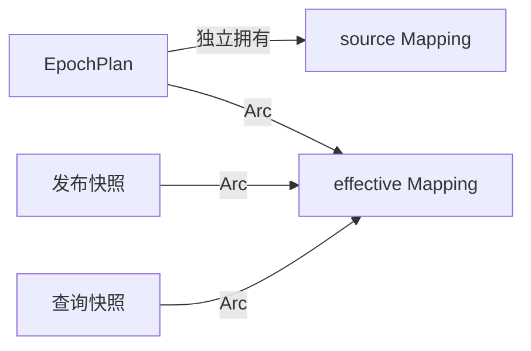

# Runtime 配置堆分配优化计划

**日期：** 2026-10-18

**状态：** 已按顺序实施并验证：先借用式 diff，再 effective 共享。

**工作区：** 沿用 `memory-profiling` worktree。第一阶段在 `perf/provider-cache-summary`、PR #5831 交付；该 PR 合并后，第二阶段由最新 main 上的 `perf/runtime-effective-sharing` 承接。runtime 从调查起点锁定的 `9aaabb1cb97875860aa19af3c0947bbcd95b33aa` 切出 `perf/config-heap-sharing`，不混入上游其他改动。继续使用 worktree 自有的 `backend/target`；不创建跨 worktree 的共享可写 target。

依据 [堆分配调查](../review/2026-10-18-heap-allocation-profile.md)，本次依次处理以下两项；provider 摘要优化已经完成，其 [计划与结果](2026-10-18-provider-cache-summary.md) 保留原测量基线。

## 1. 借用式根 Mapping diff

`config/diff.rs::diff` 当前将两个借用的根 `Mapping` 克隆为临时 `Value::Mapping` 后才比较。改为直接借用根 mapping，复用同一递归比较逻辑，只在输出 `DiffEntry.new` 时复制对应目标子树；实际变更的遍历仍保留排序键集合、查找键与路径所需的小额分配。保持路径排序、增删语义、数组整体替换、空 mapping 与类型替换的行为。

验收：

- 覆盖相等但独立分配的树、大数组、嵌套增删、标量/mapping 替换、空 mapping 和确定的路径顺序；既有 Mihomo 分类测试通过。
- 使用包含实际 diff 源码的计数程序，将改动前后的函数放在同一程序中对照。原调查的 62,020 字节配置和 843,153 字节合成配置，Noop 临时分配分别为 936,102 和 7,600,876 字节；目标为 0，不把整个 apply 流程的其他准备成本算作 diff 成本。本次直接使用 provider 实验冻结的 62,021 字节 portable 产物，另外复用原合成配置。
- 测试和格式/Clippy 通过后，单独提交该完整阶段，再开始下一项。

## 2. effective 与发布快照共享

将 `EpochPlan.effective_document` 改为 `Arc<Mapping>`；仅在配置准备、控制通道和原生路径改写全部完成后，从拥有的 mapping 构造一次 Arc。冷启动、普通 apply 和 graceful full-plan 构建均使用这一规则。发布 `EffectiveConfigSnapshot` 与 `effective_config()` 查询只克隆 Arc，继续在原控制锁下绑定实例身份和 revision。

source mapping 保留独立所有权；不让 source 指向 effective，不改写已发布的 mapping，不共享 mutable mapping，不使用 `Arc::make_mut` 延迟掩盖复制。graceful bootstrap、配置分类、序列化顺序、语义哈希、落盘产物、提交/恢复时序和 revision fencing 均沿用原语义，公共快照类型不变。

验收：

- 查询之间、查询与发布快照使用 `Arc::ptr_eq` 验证共享；Noop 保持原文档分配。
- 持有旧快照后进行 patch、reload/restart、hard/graceful switch，旧文档保持不变，新 revision 使用对应的新文档；失败回滚恢复旧计划的内容与共享关系。
- 运行 manager 单元测试和相关集成测试，覆盖配置 apply、control channel、graceful、恢复、原生路径和 reconcile；检查父仓库消费者可编译。
- 使用冻结 portable 输入做改造前后 DHAT 对照，检查 effective 发布栈深拷贝消失、三份 Mapping 减为两份；预计回收本样本一棵树约 468,051 字节（0.446 MiB），实际结果单独记录。临时 diff 收益与常驻收益分别报告。

## 交付与复核

两个阶段按顺序形成独立、可构建的 runtime 提交，推送可获取的子模块提交，再更新主 PR 的 gitlink 和计划验证记录。PR 标题与描述按最终 provider + 配置堆优化范围重写，并关联 runtime 变更供审阅。原始配置、节点数据、DHAT 和诊断计数程序保留在 gitignored target，不提交私有输入。

最终复核：每行变更对应上述目标；没有全局服务状态、Tauri 依赖或兼容层；runtime 自身 rustfmt/Clippy 与父仓库相关检查通过；明确区分单次 Noop 临时分配、Rust 存活堆和系统 RSS。

## 实施记录

### 第一阶段：借用式 diff

根 mapping 直接借用，根与递归值均先比较相等性；只有不相等的 mapping 才收集、排序其借用的字符串键。叶子替换继续克隆输出值，空 mapping 与非字符串键的原有退化行为保留。没有为了借用而引入临时 `Value` 包装或新的缓存。

同一计数程序包含锁定基线的旧 diff 与改造后的实际源码；先构造两个独立但内容相等的 mapping，再单独计数 diff 调用。另对 169 组空值、类型与嵌套组合逐一核对新旧函数输出，全部一致。额外以根标量字段增量检查输出等价性和非 Noop 分配：

| 输入               | YAML 字节 | 原 Noop 分配 | 借用式 Noop 分配 | 原单字段变更分配 | 借用式单字段变更分配 |
| ------------------ | --------: | -----------: | ---------------: | ---------------: | -------------------: |
| 冻结 portable 配置 |    62,021 |      936,104 |                0 |          937,650 |                1,523 |
| 原合成大配置       |   843,153 |    7,600,876 |                0 |        7,601,758 |                  859 |

portable 产物比原调查输入多 1 字节，一棵树实测为 468,052 字节，因此旧 diff 的复制成本比原记录多 2 字节；对照始终让新旧函数读取同一输入。结果与输入哈希保存在 `backend/target/runtime-config-measurement/diff-allocation.json`，计数程序在同目录 `diff-probe/`，旧源码保存在 `diff-before.rs`。这些临时工具与私有输入不提交。

改动前配置相关单元测试 23 项通过；增加 7 项 diff 测试后配置相关 30 项通过。扩大运行全部 manager 单元测试，122 项通过、1 项按原标记忽略，另有 2 项原生路径测试在 Windows 失败：预期硬编码 `/data/ui` 与 `/data/providers/local.yaml`，实际为 Windows 分隔符。切回原始 diff 源码、强制重新编译后相同两项仍失败（原始共 118 项，选中 2 项、过滤 116 项），证据为 `baseline-windows-path-tests.log`；本次没有修改这些无关路径逻辑或隐藏失败。

第一阶段 runtime Clippy（全部 targets/features）与该包 rustfmt 检查通过，提交为 `0ee1054`，已推送子模块分支。Clippy 仍有既有告警，本次 diff 文件没有新增告警。主仓库提交 `ae48a8b55` 已更新第一阶段 gitlink。包含此阶段、尚未共享 effective 的 profiling 基线构建成功（10 分 44 秒），随后从冻结输入正常采样并退出，以便第二阶段只测共享改动的常驻收益。

### 第二阶段：effective 共享

runtime 提交 `a130ca7` 已实现共享并推送。冷启动、apply 和 graceful full-plan 都在准备文档不再改写后构造 `Arc<Mapping>`；`publish_instance` 和 `effective_config()` 克隆同一个 Arc。`PreparedConfig` 在控制通道和原生路径改写阶段仍持有普通可变 mapping，source 也仍独立拥有。公共 `EffectiveConfigSnapshot` 类型保持不变。



先扩展已有 control-channel 测试：在控制面完成关闭后核对连续两次查询的指针与发布快照的指针。改造前该测试因 `Arc::ptr_eq` 失败，日志为 `shared-snapshot-red-test.log`；实现后通过。新增共享断言还覆盖 Noop、patch、带持久化告警的提交、reload、重启、失败回滚、revision 冲突和 hard/graceful switch。旧快照继续保留原字段，回滚复用旧文档但发布新实例身份；graceful 发布的是完整文档的非零监听端口。

使用 runtime 自己的 manifest/lockfile 运行该包全部单元测试及 8 个相关集成测试文件：**202 项通过、5 项按原标记忽略**。只有上述已在原始代码确认失败的 2 项路径测试被显式过滤；没有新增忽略标记。命令：

```powershell
cargo test --manifest-path backend/nyanpasu-runtime/Cargo.toml -p nyanpasu-core-manager --all-features --lib --test config_apply --test control_channel --test graceful_switch --test manager_orchestration --test reconcile --test native_store --test orphan_recovery --test dns_override --target-dir backend/target --locked -- --skip native_store::paths::tests --test-threads=4
```

runtime 的 Clippy（该包全部 targets/features）和 rustfmt 再次通过；父仓库 workspace 全 targets/features Clippy 通过，使用同一 worktree 内独立的 `backend/target/provider-cache-clippy`。相关日志、汇总为 `phase2-clippy.log`、`parent-clippy.log`、`shared-snapshot-tests.log`、`test-summary.json`。

父仓库相同 target 下的 provider 相关测试 16 项、`client::runtime_inspection::tests` 7 项及 `core::actor_v2` 100 项通过，分别保存在 `parent-provider-tests.log`、`parent-inspection-tests.log`、`parent-core-actor-tests.log`；architecture ledger gate 通过。三个筛选范围可能重叠，不把它们相加作为独立测试总数。

### effective 共享的同输入 DHAT 对照

两次均构建 `pnpm build:profiling --features verge-dev,dhat-heap`。共享前 runtime 为 `0ee1054`，共享后为 `a130ca7`，因此两次都已包含借用式 diff。每次启动前均从 provider 实验的冻结 seed 恢复 portable 目录，核对全部 144 个文件的 SHA256；原目录移入本实验归档，未删除。DHAT 记录分别为 90.50 和 90.49 秒，两次正常退出，退出码均为 0。写出分别另用 184.75 和 180.43 秒，不计入采样时长。

| 指标                                |  共享前字节 |  共享后字节 | 变化                            |
| ----------------------------------- | ----------: | ----------: | ------------------------------- |
| source Mapping 克隆存活             |     468,052 |     468,052 | 保持独立                        |
| effective 准备时的 Mapping 克隆存活 |     468,052 |     468,052 | 保留最终文档                    |
| 发布路径的 Mapping 克隆存活         |     468,117 |           0 | 移除 0.446 MiB                  |
| 上述 Mapping 克隆合计               |   1,404,221 |     936,104 | 1.34 MiB → 0.89 MiB             |
| 总存活堆 `eb`                       |   6,904,390 |   6,523,232 | 6.58 MiB → 6.22 MiB，减少 5.52% |
| 峰值堆 `gb`                         |  10,983,411 |  10,580,925 | 减少 402,486 字节               |
| 累计分配 `tb`                       | 164,556,545 | 164,613,435 | 增加 56,890 字节                |

Mapping 归因同时匹配 YAML Mapping 的 clone 调用栈和最近的真实应用函数，分别对应 source 构建、effective 准备与快照发布；泛型参数包含应用类型不算应用调用者。两份独立树的克隆存活量不变，第三份的克隆消失。整个发布路径仍保留 revision 等元数据，从 468,739 降为 534 字节，不能把整条发布路径写成零分配。provider 相关存活保持 9,832 字节。

总存活堆净降 381,158 字节，小于移除的 Mapping：其他存活分配净增 86,959 字节，主要为两条日志路径合计增加 63,354 字节、Tokio 任务分配增加 22,752 字节。按同一应用函数归并、消除地址和行号差异后，完整明细见 `live-site-deltas.json`。不把运行时缓冲差异算作共享收益；累计量的小幅增加也不否定直接测得的 Noop 零分配或已移除的常驻树。本次单组约 90 秒 idle 不构成长期增长判断，DHAT 只覆盖 Rust 分配器，不包含 RSS、WebView2 原生堆和 Go 内核。

两次运行后的 `runtime/clash-config.yaml` 均与冻结输入逐字节一致，SHA256 为 `f1f77486e2ca8c17d298ef5e49e83fb32de10d7b64e6c1205f572f483fb6acaf`。相同输入的测试和实测均未改变落盘语义。

证据保存在 worktree 的 gitignored `backend/target/runtime-config-measurement/`，不提交配置、节点或原始堆文件：

- `before-sharing/`、`after-sharing/` 各含 `binary.json`、`run.json`、`samples.json`、`run-console.txt`、`dhat.json`、`analysis.json`、`site-stacks.json`；输入清单哈希记录在 `binary.json`。
- DHAT SHA256：共享前 `424cefd8edd013d29f06870fa7c993287f73cc55c15fc1239127a8d889a7d0e8`；共享后 `e1307e7ce31a7a8b488cf6d112279d9fa2a4566167149f595e06ddd1f129864c`。
- `comparison.json` 及 `compare.py` 核对总量与控制台、进程 ID、退出码、输入清单、产物哈希，以及第三份树消失、另两份不变。复算：`python backend/target/runtime-config-measurement/compare.py`。
- `build-before-sharing.log`、`build-after-sharing.log` 保存 profiling 构建记录。实验结束后已检查没有本 worktree profiling 目录启动的进程遗留。

源码审阅入口：[runtime PR #448](https://github.com/libnyanpasu/nyanpasu-runtime/pull/448)。两个 runtime 阶段分别为 `0ee1054`、`a130ca7`。

[PR #5831](https://github.com/libnyanpasu/clash-nyanpasu/pull/5831) 于 2026-10-18 15:12:05 UTC 合并，实际 head 为 `ae48a8b55`，包含 provider 优化与借用式 diff，尚未包含 effective 共享。因此第二阶段在 `perf/runtime-effective-sharing` 跟进；新基线 main `d72ad2af0` 与已验证的 `ae48a8b55` 文件树完全一致，搬运的共享代码与上述实测相同，未重写已推送历史。
