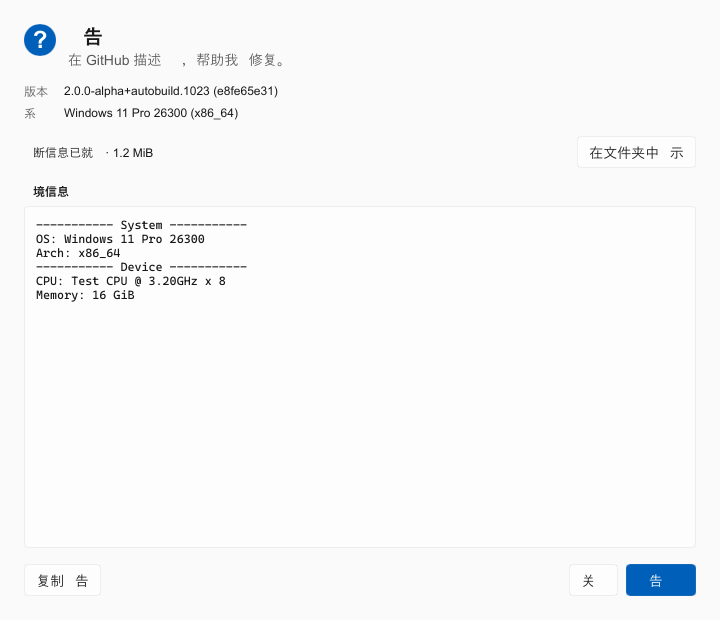
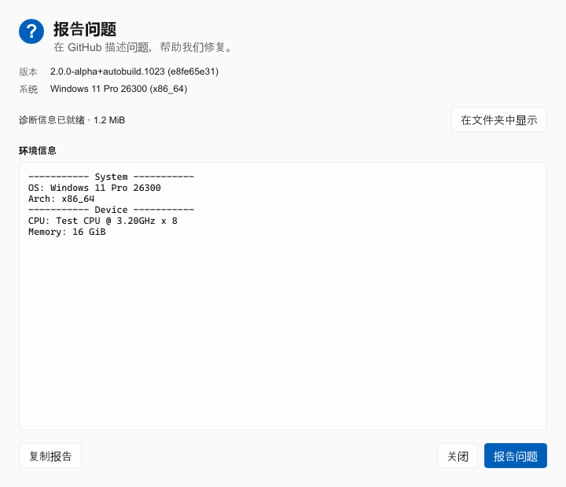
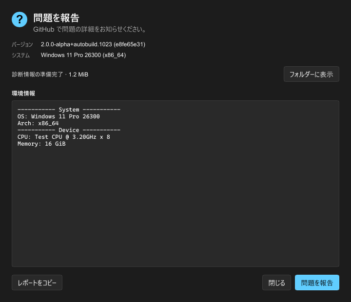

# 错误报告窗口在日语区域环境下缺字

## 现象与调查范围

在 Windows 的 `ja-JP` 区域格式下打开“报告问题”，中文标题、说明和按钮出现空白：
“报告问题”只剩“告”，“系统”只剩“系”，“关闭”只剩“关”。诊断归档已经生成，
收集过程并未因此失败。本次没有提交或上传 GitHub Issue。

调查基线是 `d8febf392`，用户截图中的应用版本是 `2.0.1-alpha+87453ce`。
本机区域格式为日语，Windows UI 语言和应用当前配置均为 `zh-CN` / `zh-cn`。
区域格式、系统显示语言、应用语言是三个独立输入；窗口显示中文本身不是翻译损坏。

## 根因

报告窗口使用 Slint 1.18.1 的 winit/software 渲染器，没有显式配置 CJK 回退链。
Fontique 0.11.1 的 Windows 后端通过脚本样本文字调用 DirectWrite，得到一个
字体家族；这并不保证该字体覆盖整个脚本。

本机汉字的默认回退字体为 `Yu Gothic UI`。直接检查字符映射发现，该字体不包含：

```text
报 问 题 统 环 请 们 诊 绪 显 闭
```

这些字符与窗口中的空白逐一对应。原有等宽字体解析仅确定报告正文的首选字体，
没有为普通 UI 或正文中的混合语言内容补充缺字回退。

同一个测试二进制在默认配置下复现缺字；仅对测试进程设置
`SLINT_DEFAULT_FONT=C:/Windows/Fonts/msyh.ttc` 后，文字完整，确认问题位于
字体选择 / 回退路径。环境变量只用于调查，不是生产修复方案。

## 修复

### 扩充渲染器的 CJK 回退链

在选择 Slint 后端后、创建报告窗口前，通过公开的
`slint::fontique_011::shared_collection()` 配置字体集合：

- 为 Han、Hiragana、Katakana、Hangul 脚本追加已安装的 Windows、macOS、Noto、
  Source Han 等 CJK 字体家族。
- 保留原有字体顺序，对追加项去重，跳过未安装的字体。
- 普通 UI 和报告正文共同受益，正文继续使用原有等宽首选字体。
- 从 Slint 的公开版本化接口获取 Fontique 类型，移除单独引入的 0.12.0，
  避免字体解析与实际渲染器使用不同版本。

这项修复依赖系统至少安装一种覆盖相应字符的字体，不会下载字体或修改系统设置。
Slint 已锁定精确版本；升级时需要同时核对版本化字体接口。

### 继承应用语言

报告进程原先在启动后重新检测系统 UI 语言，忽略应用内的语言选择。
这不是此次截图缺字的直接原因，但会在应用语言与系统语言不一致时打开错误语言的窗口。
现在手动报告从应用配置快照读取语言，崩溃报告读取当前已生效的后端语言，
通过 `--language` 显式传给子进程。CLI 使用现有 `I18nLanguage` 的反序列化契约，
不另行维护一份语言表；独立启动且没有传入语言时继续使用系统默认。

## 验证与对照

以下截图来自固定示例数据的无窗口渲染测试，不包含真实用户日志。

修复前，中文文案缺字：



修复后，不设置字体环境变量，中文文案完整：



修复后的日语深色窗口：



原有 12 项测试在缺字时仍然通过，因为主要检查状态和截图尺寸。
现在渲染测试包含两份自行生成的 CC0 微型字体：首选字体只覆盖“告”，
后备字体覆盖本次回归字符。测试隔离系统通用字体，逐字检查截图是否真正绘制了像素，
不依赖本机语言、已安装的 CJK 字体或某个操作系统的截图基准。
移除追加回退的实现时，该测试以 `missing rendered glyph for 报` 失败。

六种语言均覆盖浅色 / 深色、崩溃 / 手动报告、收集中 / 完成 / 部分失败，
并保留 1× / 2× 缩放和最小窗口尺寸检查。

### 本轮检查记录

在 Windows 上从仓库根目录执行：

| 检查                                                                                                        | 结果                                                     |
| ----------------------------------------------------------------------------------------------------------- | -------------------------------------------------------- |
| `cargo test --manifest-path backend/Cargo.toml -p nyanpasu-crash-reporter --lib --locked`                   | 12 项通过，包含逐字像素回归与六种语言的渲染矩阵          |
| `cargo test --manifest-path backend/Cargo.toml -p clash-nyanpasu --lib cmds::tests --all-features --locked` | 3 项通过，覆盖两种报告命令的语言参数、默认行为和非法输入 |
| `cargo clippy --manifest-path backend/Cargo.toml --all-targets --all-features`                              | 通过，两个代码提交均执行了仓库提交钩子                   |
| `cargo fmt --manifest-path backend/Cargo.toml --all -- --check`                                             | 通过                                                     |
| `deno task lint:architecture-ledger`                                                                        | 通过                                                     |
| 修改文档的 Prettier 检查                                                                                    | 通过                                                     |

本轮没有在 macOS、Linux 本机执行；跨平台验证仍由相应 CI 环境完成。
构建中存在原有弃用、未使用项和增量缓存目录访问提示，不影响上述测试通过。

## 后续防范

1. **把混合语言环境作为正式回归场景。** 至少验证日语区域格式 + 中文应用语言、
   中文系统 UI + 日语应用语言。不要把区域格式等同于系统 UI 语言或应用语言。
2. **验证字形，而不只验证字符串和布局。** 翻译存在、UTF-8 正确、截图尺寸正确，
   都不能证明用户看得见文字。保留逐字像素测试，修改字体链时必须执行。
3. **新增语言时补充字符覆盖与可视检查。** 更新对应 locale 的渲染矩阵，检查按钮、
   进度、错误状态，以及正文中的非拉丁路径；如果引入新的脚本或新的缺字字符，
   扩展回退策略与确定性字体样本。
4. **升级 Slint / Fontique 时重新核对接口与行为。** 检查公开版本化字体 API、
   默认回退是否变化、重复字体依赖是否重新出现，并在 Windows、macOS、Linux CI
   执行字体回归。不要通过修改生产进程环境变量或强制全局中文字体绕过问题。
5. **人工验收留存有代表性的截图。** 发布涉及原生窗口字体、语言或渲染器的变更前，
   生成六种语言的明暗主题预览，检查缺字、截断和字体风格。自动像素测试能阻止空白，
   但不能证明字形样式、地域字形或视觉布局完全正确。

测试与评审要求同时记录在 [Testing and review](../development/testing.md)。

## 参考

- [Slint 字体处理文档](https://docs.slint.dev/latest/docs/slint/guide/development/fonts/)
- [Fontique 项目说明](https://github.com/linebender/parley/blob/main/fontique/README.md)
- 本机 Slint 1.18.1 的公开 `fontique_011` API 文档与 Fontique 0.11.1 的
  `src/backend/dwrite.rs`、`src/collection/query.rs`。
