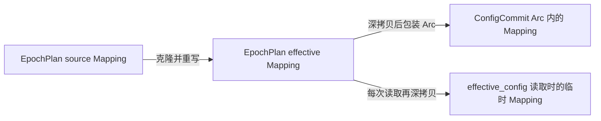

# 当前 Rust 堆分配与后续优化

**日期：** 2026-10-18

**基线：** `origin/main@1648f00006c99bad67c961f2d662285fd20dc7fb`；runtime 子模块锁定在 `9aaabb1cb97875860aa19af3c0947bbcd95b33aa`，没有改用子模块上游的最新提交。

沿用 [Windows 内存剖析](2026-10-06-windows-memory-profile.md) 和 [运行时快照对照](2026-10-07-runtime-snapshot-memory-profile.md) 的 DHAT 方法，核对当前常驻对象、构建与读取过程的临时分配，以及可以继续消除的副本。调查不改业务实现。

当前样本 Rust 存活堆为 **8.20 MiB**，全局峰值 **11.61 MiB**。三份 Mapping 仍常驻，合计 **1.34 MiB**；provider 分配栈还保留 **1.47 MiB**，本样本的 provider 全是页面不展示的 Compatible 类型。优先处理 provider 缓存裁剪与 effective 共享，再减少 diff 的临时复制；source/effective 结构共享属于后续较大的改造。

后续实施分别记录在 [provider 缓存摘要化](../plan/2026-10-18-provider-cache-summary.md) 和 [借用式 diff、effective 共享](../plan/2026-10-18-runtime-config-heap.md)；下文保留优化前的调查基线。

## 测量条件

- 复用 `memory-profiling` worktree，在保留原窗口分支的前提下切出 `scratch/heap-allocation-2026-10-18`，执行 `git fetch origin main` 和 `git rebase origin/main`，再同步锁定的子模块。
- Windows，G: 为 ReFS。worktree 使用独立 Cargo target；没有使用共享 target、硬链接或未经验证的克隆。sidecar/resources 沿用已有链接，前端产物独立生成。
- 构建命令为 `pnpm build:profiling --features verge-dev,dhat-heap`。输入取自本机 dev 配置的独立 portable 副本；自动订阅刷新、更新检查、系统代理、TUN 与服务模式关闭。mixed-port 起点改为 17891，HTTP controller 起点改为 19092，均允许端口回退。
- 开启内建增强，使用本地 mihomo-alpha。配置与数据分别放在可执行文件旁的 `.config/clash-nyanpasu-dev` 与 `.data/clash-nyanpasu-dev`，不写原 dev 配置。
- 主窗口打开，经 Win32 窗口枚举确认 `Tauri Window` 可见。启动后约 90.99 秒，向该进程自己的 `TAURI_SHUTDOWN_HOOK` 窗口发 `WM_QUERYENDSESSION`，在退出请求处写出 DHAT。存活量来自 `eb`，全局峰值来自各分配点在同一时刻的 `gb` 之和，累计分配来自 `tb`；不累加各分配点各自的局部最大值 `mb`。

DHAT 只统计经过 Rust global allocator 的请求字节，不包含 WebView2 子进程、Go 内核、Win32 原生分配或分配器碎片。它也会明显放慢启动和分配，因此这里的运行时长不作性能基准。旧报告与本次配置、依赖和应用版本均有差异，不构成前后 A/B。

## 实测堆分配

| 指标                    | 字节或块数 |    MiB |
| ----------------------- | ---------: | -----: |
| 退出请求前存活字节 `eb` |    8600251 |   8.20 |
| 全局峰值字节 `gb`       |   12170462 |  11.61 |
| 累计分配字节 `tb`       |  178010351 | 169.76 |
| 退出请求前存活块数      |      59183 |      — |
| 累计分配块数            |    1005116 |      — |

DHAT 的记录时长为 90.97 秒，峰值发生在 6.93 秒。写出与关闭另外用了 205.11 秒，进程退出码为 0。JSON 中三个总量与进程打印的 DHAT 总量逐字节一致；同一分析脚本重算保留的 10 月 6 日数据，也得到原报告的 16.33 / 26.33 MiB。

按调用栈中最靠近分配端的应用函数归属，未命中应用函数时取非标准库函数，存活字节分组如下。函数的泛型参数包含应用类型，不视为应用函数；例如 `Vec<Proxy>` 的分配继续沿栈查找实际调用者。分组互斥，总和为 8.20 MiB：

| 类别              | 存活 MiB | 主要内容                                                                                                                         |
| ----------------- | -------: | -------------------------------------------------------------------------------------------------------------------------------- |
| 代理数据          |    1.675 | API 解码、完整 providers、统一 nodes 与组视图；其中栈含 `ProxyProvider` 或 `ProviderMap` 的存活分配为 1540495 字节，即 1.469 MiB |
| core-manager 配置 |    1.352 | 三棵树合计 1404221 字节，即 1.339 MiB，另有少量 plan 与哈希元数据                                                                |
| 托盘              |    0.779 | 各组成员的 check item、muda 菜单结构                                                                                             |
| core logs 与 redb |    0.679 | app 日志存储批次、manager log sink 与 redb 缓冲；不含下行列出的独立 appender                                                     |
| websocket         |    0.611 | 四个约 128 KiB 读缓冲及流任务等                                                                                                  |
| runtime 快照      |    0.596 | ConfigValue 关键帧、共享正文、effective 文本和图元数据                                                                           |
| 日志 appender     |    0.126 | 4096 行通道及少量结构                                                                                                            |
| 其余              |    2.383 | Tauri/context、正则、异步运行时、actor、键盘布局、其他存储等                                                                     |

栈中的 provider 类型用于细分上表的代理数据，**不能再与 1.675 MiB 相加**。API 计数取自运行中另一次 core 读取；其历史条数不保证与最后一次 backend 缓存刷新同时。

全局峰值时最大的单项为 **Brotli 解压约 4.03 MiB**，调用链明确经过 `tauri_utils::assets::EmbeddedAssets::get` 与 Tauri asset protocol；这组分配到 t-end 为 0，累计约 13.49 MiB。它属于前端嵌入资源的启动临时成本。若目标是继续压低启动峰值，应先核对启动请求的资产与加载时机，再评估分包、懒加载和压缩策略，同时测包体与 CPU 成本。

## 三份 Mapping 的实际所有权

当前 runtime 仍有三棵独立的全量 YAML 树：

| 常驻位置                                               | 产生方式                                                                      | 用途                                             |
| ------------------------------------------------------ | ----------------------------------------------------------------------------- | ------------------------------------------------ |
| `EpochPlan.source_document`                            | `manager/switching.rs:419`、`manager/apply.rs:186` 克隆 `snapshot.document()` | 与下一份 source 比较，决定 Noop、Patch 或 Switch |
| `EpochPlan.effective_document`                         | `config/mod.rs:145` 先克隆 source，再改控制通道与原生路径，最后移动进 plan    | 已提交运行配置、变更分类与恢复                   |
| `config_commits` 中的 `EffectiveConfigSnapshot.config` | `manager/publish.rs:51` 深拷贝 effective，再 `Arc::new`                       | 向提交订阅者保留最近一次提交                     |

文件均位于 `backend/nyanpasu-runtime/crates/nyanpasu-core-manager/src/`。`EpochPlan` 故意没有实现 `Clone`；重复来自其构建和发布路径，不是 plan 的自动克隆。



`Arc::new(plan.effective_document.clone())` 并没有共享 plan 中的树，只让发布后的订阅者共享那份新副本。`manager/mod.rs:595` 的 `effective_config()` 同样深拷贝整棵树；Tauri 的 `core/actor_v2/endpoint.rs:197` 随即把它序列化成 YAML，再释放临时树。

source 与 effective 不能直接视为同一份文档：本地控制通道、HTTP controller 策略和原生文件路径可能不同。`config/mihomo.rs` 的分类器显式同时读取两者。最小改动是让 **effective、提交发布与查询共用 `Arc<Mapping>`**，从三棵常驻树降到两棵，并消除查询时的整树克隆。只把 source/effective 都包进 `Arc`，再用 `Arc::make_mut` 重写，仍会深拷贝整棵 `Mapping`。

本次应用产物为 62021 字节，提交给 manager 的 `staging/reconcile-source.yaml` 为 61990 字节，两者解析后的内容相同；effective 产物为 62058 字节。运行中比较应用产物与 effective 的所有顶层键，唯一差异为 `external-controller-pipe`，没有原生路径重写差异。这说明大部分内容相同，但两者的控制通道语义确实不同。effective 文件在正常停止时由 manager 清理，差异键与大小保存在 `runtime-data.json`。

要进一步接近一棵树的成本，需要 source/effective 在未修改的分支上共享结构，或另行设计可还原的派生表示。不能直接删 source、让 source 指向 effective，或把应用层 `ConfigValue` 强行反向引入 runtime 子模块。旧报告“三份变一份，约省 0.9 MiB”的估算应按这两个阶段拆开理解。

## 其余重复和临时分配

### Provider 节点列表

`backend/tauri/src/core/proxies.rs` 的 `Snapshot` 同时持有 `Proxies` 与完整 `IndexMap<ProviderName, ProxyProvider>`。`core/clash/proxies.rs:255` 会把 provider 中被组引用、但不在 `/proxies` 中的节点深拷贝进 `Proxies.nodes`。该表内部按节点名去重，但没有与 provider 列表共享节点。组自身还同时保留在 `nodes` 的原始 `Proxy` 与 `groups/global` 的派生视图中，各自持有成员名。

前端 `frontend/query/src/ipc/use-clash-proxies-provider.ts` 只保留名称、类型、vehicle、更新时间、订阅信息和 `proxyCount`，不展示节点列表。然而裁剪发生在 RPC 完整返回之后：`ProxiesClient::providers()` 先克隆完整 providers，再传输所有节点与 history，前端最后取 `proxies.length`。

本次在采样进程的 core 上读取 API，得到 `/proxies` 157 条记录、`/group` 48 个组；49 个 provider **全部为 Compatible**，累计含 1122 条节点记录、1136 条 history 及 1136 条 per-URL history。1122 条记录按名称去重只有 154 个名称，且全部已在 `/proxies` 中，其中 153 个名称被组引用。该样本没有“provider-only 节点必须补进 nodes”的情况，重复主要来自 Compatible 列表之间以及它们与 `/proxies` 的重叠。相同名称不代表不同采样时刻的所有字段必然逐字节相等。

这些 Compatible provider 既被 `provider_proxy_index` 排除，又被前端 provider hook 排除，仍在后端缓存中完整保留，是本样本最直接的裁剪目标。HTTP/File/Inline provider 则必须继续参与节点组装。

可将 provider 元数据投影提前到后端，并在组装 `nodes` 后只常驻 summary。组装前仍须读取 provider 节点：新版 Mihomo 的 `/proxies` 不一定返回 provider-owned 节点，不能直接停止调用 `/providers/proxies`。修改时应更新 DTO、Unified RPC 元数据、生成绑定和全部调用者，不保留只为旧返回类型服务的兼容层；同时检查 HTTP 消费者的 API 变更。

`ProxiesClient::get()` 也会克隆完整 `Proxies`，随后 `trim_for_frontend` 才丢掉不用的 per-URL history。可以评估直接按展示视图构造返回值，减少“先复制再丢弃”的临时分配。原始缓存的 delay 数据范围应单独审视，不能因一个页面不用就删掉别的消费者仍需的数据。

### 配置哈希与 inspection 查询

runtime 的 `config/diff.rs:17` 只为把根 `&Mapping` 包成 `Value::Mapping`，就先深拷贝 current 与 desired 两棵树；随后才检查相等。即使是 Noop，也支付两棵树的分配。`mihomo::classify` 可能先比较 source，再比较 effective。可以让根 mapping 的比较直接借用原值，复用下面的递归逻辑，只在产出确实改变的 `DiffEntry.new` 时复制。这是独立于常驻表示迁移的小改动，应覆盖相等、大数组、增删键和空 mapping 的等价性。

独立计数 allocator 实验直接通过 `#[path]` 编译本次基线的 `config/diff.rs`，使用相同 git revision 的 serde-yaml-ng，release 构建。先解析输入并克隆一份，再单独计数一次相同配置的 diff；另测借用相等比较的分配量：

| 输入                                          | YAML 字节 | 一棵 Mapping 深拷贝的存活字节 | 当前 Noop diff 累计分配字节 | 借用相等比较分配字节 |
| --------------------------------------------- | --------: | ----------------------------: | --------------------------: | -------------------: |
| dev 配置原有运行产物                          |     62020 |                        468051 |                      936102 |                    0 |
| 合成 500 节点、50 组各含 500 成员、10000 规则 |    843153 |                       3800438 |                     7600876 |                    0 |

这量化了现有 Noop 路径可避免的复制：约 0.89 MiB 或 7.25 MiB，均为临时分配，不是常驻收益；借用相等比较也不是完整 diff 改造的行为等价证明。脚本和输出保留在 worktree 的 `backend/target/heap-investigation/`。

runtime 的 `semantic_hash` 通过 `document.clone()`、递归 canonicalize、完整 YAML 序列化后才计算哈希。这些对象不常驻，但会抬高 rebuild 的累计分配与峰值。优化需要保持现有键序无关哈希、数值与 YAML 序列化语义；单纯替换哈希函数解决不了复制成本。

`client/runtime_inspection.rs:329` 为判断摘要中的 `applied`，调用完整 `effective_config()`，但最终只比较 revision。effective 共享可先移除临时树；若此查询仍为热点，再为身份验证提供窄查询，避免只读 revision 时仍序列化、传输完整配置，同时保留 host/generation 的前后 fence。

### Websocket 与托盘

当前 `clash-api` 通过 `reqwest-websocket` 升级 websocket，没有传配置；所用 tungstenite 0.28 默认读缓冲为 128 KiB。`reqwest-websocket` 0.6.0 已提供 `web_socket_config`，因此可以在适配层按流设置读缓冲，优先试 traffic/memory 这类小消息，验证大消息、重连与吞吐。缓冲大小不是消息长度上限，不应为了省缓冲同时降低消息上限。

托盘仍为各组成员生成原生菜单项，成本随组成员总数增长，同一节点属于多个组时会产生多个菜单项。折叠、按需生成或限制组数涉及交互和跨平台菜单生命周期，优先级应结合本次采样占比决定。

## 已完成的旧优化

以下不能继续使用旧报告的收益作为本次剩余空间：

- 日志 appender 的通道上限已为 4096，而不是 128000。
- 代理 fingerprint 已是流式序列化到 `SeaHasher` 的 `u64`，没有常驻整份 JSON 缓冲。
- `RuntimeSnapshot` 已保留共享正文和 Full/Delta inspection 图，没有为每个步骤常驻完整 JSON。
- runtime 子模块的备用 Tokio runtime worker 已封顶为 4；“两个 runtime 各 32 个 worker”的旧估算不适用于当前实现。

## 优化优先级

| 顺序 | 改动                                                        | 本样本对应空间                                          | 范围与取舍                                                                                     |
| ---- | ----------------------------------------------------------- | ------------------------------------------------------- | ---------------------------------------------------------------------------------------------- |
| 1    | 后端 provider summary；不常驻无消费者的 Compatible 节点列表 | provider 栈约 1.47 MiB，可回收量需扣除 summary 并做 A/B | 主仓库；收益随重复节点增长，需要一起迁移 RPC DTO 和消费者                                      |
| 2    | effective、config commit 与读取共享 `Arc<Mapping>`          | 常驻约 0.446 MiB，另减少每次读取时的整树克隆            | runtime 子模块；已有 `EffectiveConfigSnapshot` 就使用 `Arc<Mapping>`，不需要新增缓存或全局状态 |
| 3    | 借用式根 mapping diff                                       | 每次 Noop diff 临时分配约 0.89 MiB；合成样本约 7.25 MiB | runtime 子模块纯函数；改动较小，与前两项独立，可先落地                                         |
| 4    | 小消息 websocket 读缓冲从 128 KiB 试降至 16 KiB             | 两个流约 0.219 MiB；四个流理论约 0.438 MiB              | clash-api 适配层；先验证 traffic/memory，再考虑大帧流                                          |
| 5    | source/effective 未修改分支共享；减少 canonical hash 临时树 | 本样本再接近一棵 Mapping 的约 0.446 MiB，以及构建临时量 | runtime 的表示层改造；保持键序、分类、落盘字节与恢复语义                                       |
| 6    | 托盘按需生成；前端资源启动加载调整                          | 托盘总量 0.779 MiB；Brotli 为本次峰值贡献约 4.03 MiB    | 分别涉及菜单交互和启动峰值，独立评估，不将其总量直接当作可回收收益                             |

上表是基于归因与结构的收益估计，没有实施优化后的 A/B。前三项解决的副本不同，但 Noop diff 的临时收益不能与常驻收益相加。

## 后续改动的验证要求

1. effective 共享：用大配置验证 plan、发布快照和查询共享同一分配；持有旧订阅快照再提交新配置，旧内容须保持不变。覆盖 start、live patch、hard/graceful switch、rollback 与 revision fencing，再用相同输入做 DHAT A/B。
2. provider summary：覆盖 provider-only 节点、多组共用节点、Compatible/HTTP/File/Inline provider、计数、订阅元数据、健康检查后刷新和节点 delay；验证新 DTO 与生成绑定，检查两个 RPC transport。
3. 临时分配：将 startup/rebuild 与稳态查询分开测量，固定节点数、组数、规则数及查询次数；分别比较 `eb`、`gb` 和 `tb`，避免把累计分配当作泄漏。
4. websocket：按流调整，保持大帧能力，测吞吐、延迟、重连和 idle 常驻量。托盘优化另做实际菜单操作验证。

## 数据与复现

本次原始文件与临时工具均在 `memory-profiling` worktree 内，未加入版本控制：

- `backend/target/profiling/.data/clash-nyanpasu-dev/logs/dhat-heap-2026-10-18_20-43-04.json`：原始 DHAT，SHA256 为 `98f194fd56df44d827e7fb36b517b7164f1dbd2e8ca2c9fcf90d4db75d87814f`。
- `backend/target/heap-investigation/run.json`、`samples.json`、`windows.json`：进程、时长、线程/子进程与窗口可见性记录。
- 同目录的 `analyze.py`、`analysis.json`、`site-stacks.json`、`categories.json`：分配点归因与聚合结果；`runtime-data.json` 保存无节点名称、URL 或凭据的 API 计数。
- 同目录的 `diff-bench/`、`diff-probe.json` 与 `synthetic-large.yaml`：直接编译当前 diff 的计数实验、结果和合成输入。portable 配置含私有订阅数据，只在本机使用。

重新聚合已保存的 DHAT：

```powershell
python backend/target/heap-investigation/analyze.py backend/target/profiling/.data/clash-nyanpasu-dev/logs/dhat-heap-2026-10-18_20-43-04.json
```

构建、正常退出与 DHAT 总量核对已完成；独立 Noop 分配实验通过；报告通过 Prettier。业务代码未修改，因此未追加与本次报告无关的完整测试运行。原始采样仅覆盖约 91 秒 idle，不能据此判断长时间运行是否增长，也没有替代原生堆与 RSS 的测量。
