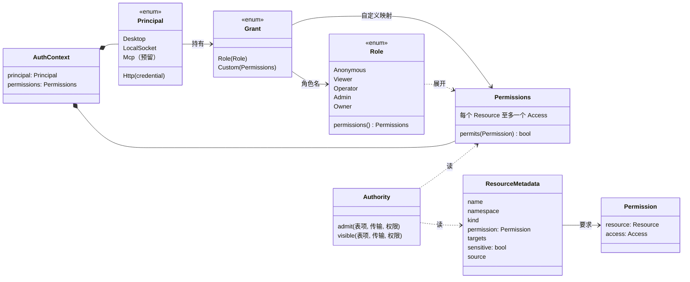
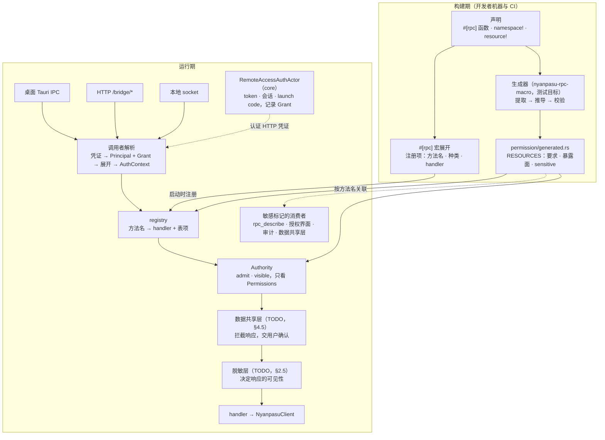
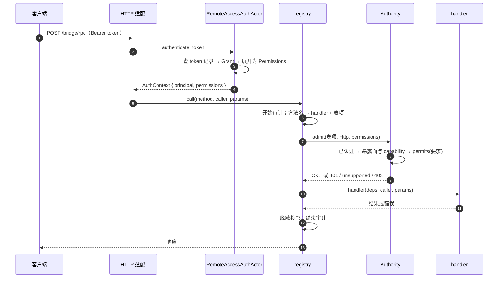
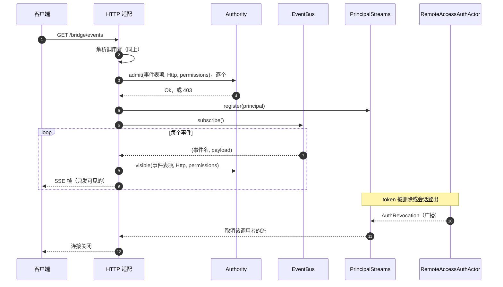
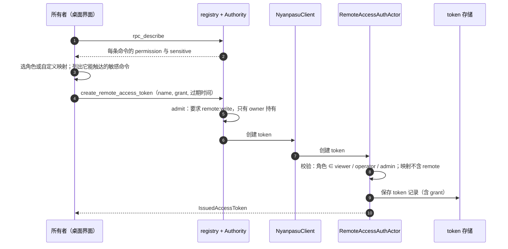
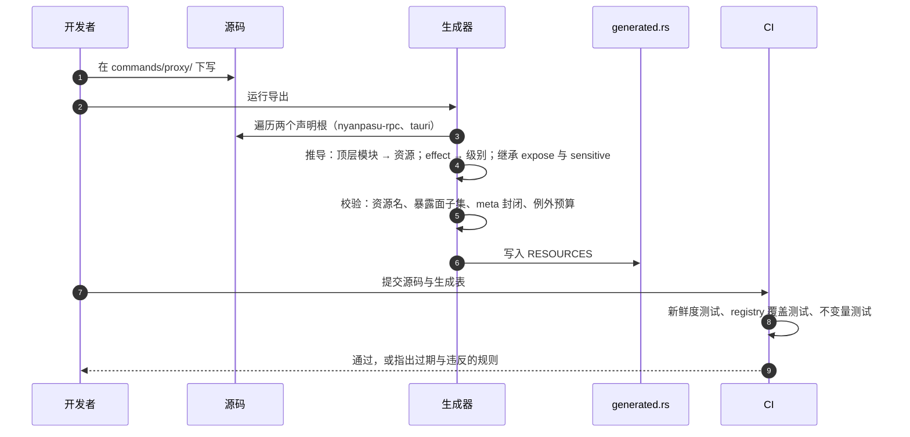
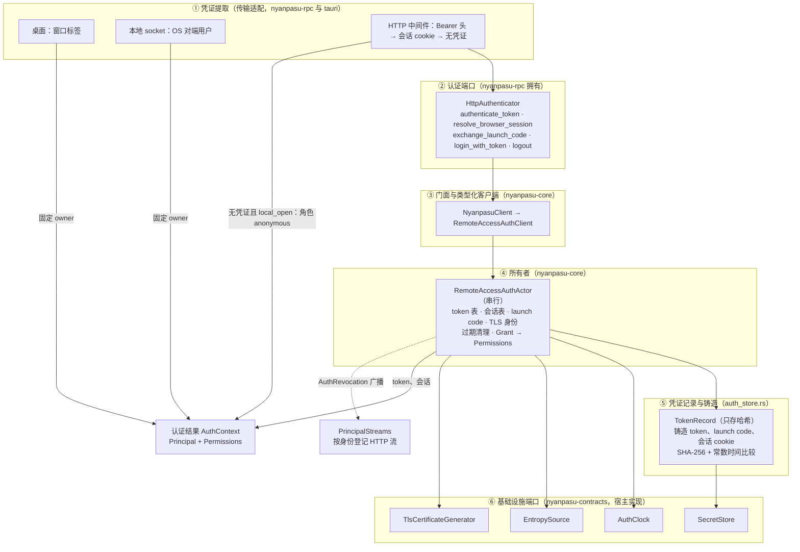
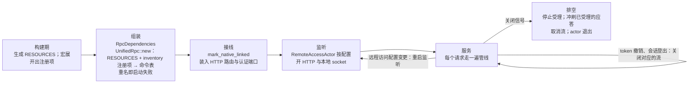
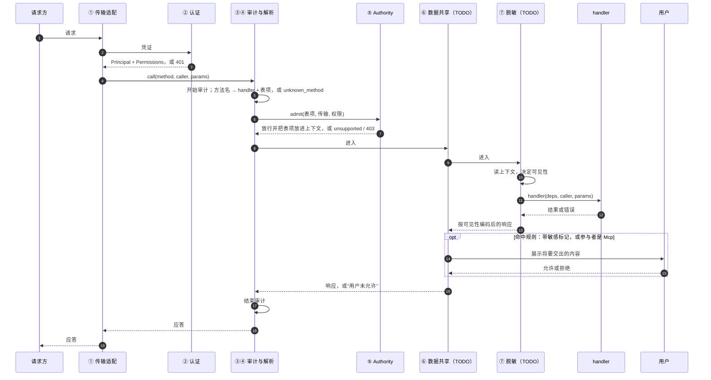
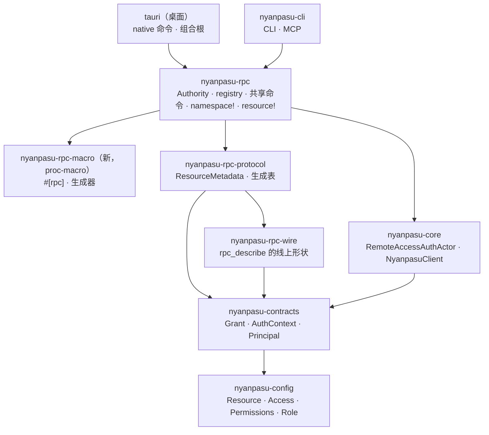

# RPC 权限层：角色 → 权限（资源 × 级别），由命名空间推导

**日期：** 2026-11-16

**状态：** 设计稿 r6，未实施；八项裁定已定，余三处待确认（§10）。

- r1–r4 经 codex（gpt-6-astra）审查四轮（48 → 73 → 85 → 72）。其中仍适用的结论列在 §12。
- r5 按用户的两条裁定修订，**未送审**；其后补充了领域概念（§2.6）、架构总览与时序（§4.1、§4.3）、依赖与模块结构（§5.1、§5.2），不改变设计内容：（1）不用 `secrets` 权限保护“响应可能含敏感信息”的操作，改为命令元数据上的一个标记；（2）在权限层之外引入角色，角色继承一组默认权限。两项都依据对现有框架源码的调研（§13）。

- r6 按用户对 D-1 至 D-8 的裁定修订，**仍未送审**：参与者是 `Desktop`、`LocalSocket`、`Http` 三种，匿名是角色（§2.2、§2.4）；`operator` 含 `settings` 的写；敏感内容与脱敏都不在权限层处理，而在 RPC 管线内侧的层里，本稿只标出位置（§4.5、§4.6）；补充示范代码（§3.5）、认证组件的内部分层（§4.4）、RPC 的生命周期与请求管线（§4.6）。

**基线：** 远程访问栈顶 `origin/feat/remote-access-pr7-lan-tls@a5b135695`（#6378–#6394，均为 draft）。文中“现状”与行号均指该提交；后端路径相对 `backend/`。

**输入：** [权限 scope 推导横向调研](../../audit/2026-11-16-rpc-permission-scope-derivation-survey.md)；[远程访问设计](../2026-11-12-remote-access-and-cli/design.md) §5；[Unified RPC](../../development/rpc.md)。

**权威顺序：** 当前 AGENTS.md 与 development guides > 本 spec。改规则的 PR 同时改 guide。

**执行清单：** [tasks.md](tasks.md)。

## 1. 背景与目标

### 1.1 现状

| 事实                                                                                                                                                      | 位置                                                                                 |
| --------------------------------------------------------------------------------------------------------------------------------------------------------- | ------------------------------------------------------------------------------------ |
| 每条命令用 `#[nyanpasu_macro::rpc(…)]` 声明：`http`、`local` 各自显式开启；mutation 必须写 `scope = …`，query 默认 `read`                                 | `nyanpasu-macro/src/unified_command.rs`（1774 行）                                   |
| 189 条命令，对外暴露 128 条，其中 88 条的 scope 是逐条手写的                                                                                              | `nyanpasu-macro/tests/fixtures/capability-inventory.txt`                             |
| `Scope` 是 7 个相互独立的手写值：`read`、`sensitive_read`、`proxy`、`profile`、`settings`、`system`、`remote_admin`；定义在 config，被 token 与配置持久化 | `nyanpasu-config/src/application/scope.rs:19`                                        |
| `sensitive_read` 保护 34 条命令、7 个事件、1 条路由；内容不只是秘密，还有路径、完整状态、诊断文本、任意存储值                                             | 能力清单；`nyanpasu-rpc-protocol/src/event.rs:79–105`；`http/routes.rs:277`          |
| 对无 `sensitive_read` 的调用者，错误以及声明了 `privacy` 的结果类型做脱敏投影                                                                             | `nyanpasu-rpc/src/privacy.rs:64–123`                                                 |
| 没有角色：token 创建时逐个勾选 scope；本地 socket 与桌面持有全部；launch code 会话持有除 `remote_admin` 外的全部；匿名持有配置的 `local_open_scopes`      | `nyanpasu-core/src/client/mod.rs:814–823`；`application/remote_access.rs:73,137–143` |
| 路由代码里三处字面量 scope；16 个事件的 scope 是手写表；授权判断是 `policy.rs` 的自由函数                                                                 | `nyanpasu-rpc/src/http/routes.rs`；`policy.rs`                                       |
| 依赖方向：protocol → config、protocol → contracts → config、protocol → wire → contracts                                                                   | 各 `Cargo.toml`                                                                      |
| `rpc` 宏与四个通用 derive 同在 `nyanpasu-macro`                                                                                                           | `nyanpasu-macro/src/lib.rs`                                                          |

### 1.2 参照框架的共同结构

两路调研读了十个系统的源码（Shiro、Casbin、Spring Security、ASP.NET Core、Cedar；Kubernetes、Grafana、GitLab、Vault、Gitea）和两个闭源系统的官方文档（GitHub、Cloudflare）。它们的结构一致：

```text
调用者 ──分配──▶ 角色 ──包含──▶ 角色
                  │ 展开
                  ▼
              权限集合 ──▶ 执行点只检查“这个操作要求的权限”（默认拒绝）

操作上的元数据（Cedar 注解、.NET DataClassification、Vault 路径属性）在这条链旁边，
不参与授权判定，由审计、界面、脱敏等消费者各自读取。
```

| 结论                                                                          | 依据                                                                                                                              |
| ----------------------------------------------------------------------------- | --------------------------------------------------------------------------------------------------------------------------------- |
| 角色是一组命名的权限，可以包含别的角色；它在权限层之上，权限层不引用它        | Shiro `SimpleRole{name, Set<Permission>}`；GitLab `config/authz/roles/*.yml` 的 `inherits_from`；Kubernetes `admin ⊇ edit ⊇ view` |
| 执行点检查权限，不检查角色；handler 声明的是权限                              | Shiro `@RequiresRoles` 的 javadoc；Spring `hasRole` 只是 `hasAuthority` 的简写；Grafana `authorize(ac.EvalPermission(…))`         |
| 权限的形状是“资源 + 读/写”，由路由分组与方法推出                              | Gitea `tokenRequiresScopes(category)`：类别取自路由组，级别取自 HTTP 方法（`routers/api/v1/api.go:277–307`）                      |
| 写包含读由权限自身的蕴含规则实现                                              | Gitea 位图“for all categories, write implies read”（`models/auth/access_token_scope.go:56`）                                      |
| 内置角色是代码里的常量，数量很少，命名为 viewer / editor / admin / owner 一类 | Grafana 基础角色 Viewer < Editor < Admin；Kubernetes `view`/`edit`/`admin`/`cluster-admin`                                        |
| 每个已认证调用者有一份隐含的默认权限（自省）                                  | Kubernetes `system:basic-user` + `system:discovery`；Vault `default` 策略                                                         |
| 能给别人授权的权力单独留给最高角色                                            | Kubernetes `admin` 与 `cluster-admin` 之分；Cloudflare Administrator “Cannot manage members”                                      |
| 不得授予超过自己持有的权限                                                    | Vault “child policies must be subset of parent”；Grafana “can not assign a role higher than user's role”                          |
| “可能泄露信息”可以只是操作上的元数据                                          | Cedar 注解“不影响策略求值，供应用读取”；.NET `DataClassificationAttribute` 可标在返回值上                                         |

### 1.3 目标

1. **角色层**：少数内置角色，各自是一组权限并可继承。调用者被分配角色；权限层不知道角色。
2. **权限 = `资源:级别`**。资源是一张手写的小表，级别只有读和写，写包含读。
3. **敏感标记是元数据**，不是权限：标在命令上，不参与准入判定，由审计、界面、能力发现读取。
4. 命令要求哪个权限由位置推导：顶层模块就是资源，effect 就是级别。
5. 命令、事件、字节路由、流在同一张生成表里，经同一个 `Authority` 入口授权。
6. RPC 宏独立成 `nyanpasu-rpc-macro`。

### 1.4 非目标

- 不做可编辑的自定义角色、角色的增删改、资源实例级授权、deny 规则、策略语言。
- 不改认证（token 格式、launch code、session、TLS）、传输、审计的采集点。
- 不改线上方法名、函数名（改名是扩展 E-1）。
- 不改 `NyanpasuClient` facade 的领域操作。

### 1.5 成功判据

1. 新增一条命令只需把函数放进对应模块并写 `#[rpc]` 或 `#[rpc(query)]`；它自动进入包含该权限的角色。
2. 清单中来源为 `override` 的条目不超过预算；`legacy` 为 0。
3. `backend/` 的非测试代码中没有 `Scope` 类型；`nyanpasu-rpc` 的准入代码中没有出现任何角色名。
4. 任务 P0-2 的变更清单逐资源列出迁移前后的要求；授权差异报告里的每一格变化都在这份清单里。
5. `nyanpasu-macro` 不含 `rpc` 相关代码；`lint:backend-boundaries` 通过。

## 2. 模型

### 2.1 权限

```rust
// nyanpasu-config::application（取代 Scope，位置不变，避免依赖环）
pub enum Resource { Meta, Proxy, Profile, Settings, System, Logs, Traffic, Remote }
pub enum Access { Read, Write }            // Write 包含 Read

pub struct Permission { pub resource: Resource, pub access: Access }
pub struct Permissions([Option<Access>; Resource::COUNT]);   // 按资源索引，None 即无权限；序列化为映射
```

| 资源       | 覆盖                                                                   |
| ---------- | ---------------------------------------------------------------------- |
| `meta`     | 只有能力发现（`rpc_describe`）；每个已解析的调用者自动持有 `meta:read` |
| `proxy`    | 运行中的路由：代理组与节点的读取、选择、延迟测试、模式切换、关闭连接   |
| `profile`  | 存储的配置定义：配置文件与订阅的增删改、链、激活、代理组的布局与文件夹 |
| `settings` | 应用与 Clash 的普通偏好；前端的通用键值存储                            |
| `system`   | 内核状态与启停切换、系统代理、TUN、服务模式、OS 集成                   |
| `logs`     | 应用与内核日志的读取、清空、前端事件上报                               |
| `traffic`  | 流量、连接列表与历史、历史的录制与清空                                 |
| `remote`   | 远程访问设置、token、会话、证书；不对 HTTP 暴露                        |

> **E-6（已实施）：** `Resource` 由生成器从顶层的 `namespace!` 声明生成：每个顶层 `namespace!` 一个变体，按名字排序，文档取该模块文档的第一段。做法与护栏见 §9 E-6。

没有 `secrets` 资源。现在由 `sensitive_read` 保护的操作各回各的领域，要求该领域的 `read`（`query_logs` 等例外见 §3.3），并带上 §2.3 的敏感标记。

### 2.2 角色

角色是代码里的常量，定义在权限类型旁边；它只是一个到 `Permissions` 的函数，权限层与准入代码从不看角色名。

```rust
pub enum Role { Anonymous, Viewer, Operator, Admin, Owner }

impl Role {
    /// 展开为权限集合。继承在这里一次算完，不在运行时走图。
    pub const fn permissions(self) -> Permissions;
}
```

| 角色        | 继承        | 在继承之上增加                                                        | 谁持有                                    | 先例                                                                     |
| ----------- | ----------- | --------------------------------------------------------------------- | ----------------------------------------- | ------------------------------------------------------------------------ |
| `anonymous` | —           | 无（只有人人都有的 `meta:read`）；可由配置附加权限，见下              | 没有出示凭证的 HTTP 请求                  | Kubernetes `system:unauthenticated`；Grafana 匿名访问的 `org_role`       |
| `viewer`    | `anonymous` | `proxy`、`profile`、`settings`、`system`、`logs`、`traffic` 的 `read` | token                                     | Grafana Viewer；Kubernetes `view`                                        |
| `operator`  | `viewer`    | `proxy`、`profile`、`traffic`、`settings` 的 `write`                  | token                                     | Kubernetes `edit`；GitHub Maintain                                       |
| `admin`     | `operator`  | `system`、`logs` 的 `write`                                           | token；launch code 会话                   | Kubernetes `admin`；Cloudflare Administrator                             |
| `owner`     | `admin`     | `remote:write`（签发 token、修改远程访问）                            | 桌面窗口、本地 socket（结构性，不可分配） | Kubernetes `cluster-admin`；Vault `root`；Cloudflare Super Administrator |

- **匿名是角色，不是参与者。** 没有出示凭证的 HTTP 请求，参与者仍然是 `Http`，它的角色是 `anonymous`（§2.4）。
- `anonymous` 是唯一可以由配置附加权限的内置角色：`anonymous_permissions` 是一张权限映射，默认为空，上限是 `operator` 的展开结果，不能含 `remote`。它取代现有的 `local_open_scopes`。
- `admin` 与 `owner` 的区别只有 `remote`：能给别人授权的权力留在 `owner`。`remote` 不对 HTTP 暴露，这与现有的“`remote_admin` 不走 HTTP、token 不能持有它”等价。
- `operator` 含 `settings:write` 是裁定（D-4）；`settings` 之后可以再细分，届时是往资源表里加项，不改模型。
- 新命令通过它推导出的权限自动进入各角色，不需要改角色定义（与 Kubernetes 的聚合、Grafana 的 `Grants` 效果相同）。

### 2.3 敏感标记

```rust
pub struct ResourceMetadata {
    // …
    pub sensitive: bool,   // 响应可能含凭证、订阅 URL、配置原文、路径、诊断文本等
}
```

标记不参与准入判定（D-2 已定）。敏感内容要不要交出去，由 RPC 管线内侧的数据共享层决定（§4.5）。读标记的消费者：

| 消费者             | 行为                                                                                 | 先例                                          |
| ------------------ | ------------------------------------------------------------------------------------ | --------------------------------------------- |
| 能力发现           | `rpc_describe` 的每条命令带 `sensitive` 字段                                         | Cedar 的 schema 注解                          |
| 授权界面与 CLI     | 创建 token、配置匿名角色的权限时，列出所选角色或权限能触达的带标记命令的数量与名单   | Vault `DisplayAttributes.Sensitive`           |
| 数据共享层（预留） | 拦截带标记的（或全部）响应，交给用户确认，允许后才返回给请求方（§4.5）；不在本稿范围 | —                                             |
| 审计               | 带标记操作的调用总是记录（现有审计本来就不记录响应内容）                             | Vault 审计默认对值做哈希；.NET 按分类脱敏遥测 |

标记来自位置（§3.2 的 `sensitive` 命名空间设置）或命令上的 `sensitive`。一组独立的测试钉住带标记的集合：它须包含现有的 34 条命令、7 个事件与日志归档路由，增删都是评审过的变更。

### 2.4 参与者、凭证与授权

认证组件（§4.4）对每个请求产出两样东西，权限层只接收第二样：

- **参与者** `Principal`：这次调用从哪条通道进来、凭哪一条凭证。读它的只有审计（记录是谁）、流的撤销（该关掉哪些连接）、`rpc_describe`（告诉对方自己是谁），以及预留的数据共享层（§4.5）。
- **授权** `Permissions`：由参与者持有的角色或权限映射展开而来。准入只读它。

参与者按通道分为三种（D-8）；第四种 `Mcp` 随数据共享层加入，本稿只保留这个名字。

| 参与者                 | 凭什么相信                                     | 凭证（认证组件的可选能力）                                                  | 授权来自                                                                          |
| ---------------------- | ---------------------------------------------- | --------------------------------------------------------------------------- | --------------------------------------------------------------------------------- |
| `Desktop { window }`   | 调用来自应用自己的窗口，不经过网络             | 无                                                                          | 固定为 `owner`                                                                    |
| `LocalSocket { user }` | 操作系统给出的对端用户；只有同一 OS 用户连得上 | 无                                                                          | 固定为 `owner`                                                                    |
| `Http { credential }`  | 取决于凭证                                     | Bearer token：请求头里的 token 与持久化的哈希匹配                           | token 记录上的 `Grant`：一个角色（`viewer`、`operator`、`admin`）或一张自定义映射 |
|                        |                                                | 浏览器会话：cookie 与内存里的会话匹配；会话由 launch code 或 token 登录建立 | launch code 建立的：`admin`；token 登录的：该 token 的 `Grant`                    |
|                        |                                                | 没有凭证：只在监听策略是 `local_open` 时受理                                | 角色 `anonymous`（§2.2）                                                          |
| `Mcp`（预留）          | 连接自己声明“我在替一个模型调用”               | 与它所走的通道相同                                                          | 与它所走的通道相同；数据共享层对它的响应另行处理（§4.5）                          |

没带凭证而策略不是 `local_open` 的请求，在权限判定之前即 `401`。

**token 与会话是凭证，不是参与者。** 它们是认证组件为 HTTP 提供的两种可选认证能力，各有自己的表与生命周期：token 持久化、由所有者撤销、可设过期；会话只在内存里、有空闲超时、可登出，并且可能挂在某个 token 之下（撤销 token 要连带关闭它的会话）。这个区别只留在 `Http` 的 `credential` 字段里，供撤销与审计使用；权限层看不到它（§4.2）。

**“匿名”是什么。** 每个请求都有发起方，“匿名”指它**没有出示凭证，因而没有可验证的身份**。它只出现在 HTTP 上：回环 TCP 不带对端用户信息，本机任何 OS 用户的任何进程都能连上（本地 socket 由操作系统给出对端用户，所以没有这种情况）。现状里这种请求由 HTTP 适配层直接受理（`nyanpasu-rpc/src/http/mod.rs:933–938`），只在监听策略是 `local_open` 时才有；策略默认是 `local_authenticated`，HTTP 监听本身默认关闭。本设计保留它（D-8），并把它表达为角色：参与者是 `Http`、凭证为空、角色是 `anonymous`。

**`LocalSocket` 不改名**（D-7）：服务端验证的是“同一 OS 用户”，不是对端是哪个程序。

**持久化与展开。**

- token 记录上持久化的是角色名或映射本身：`{ "role": "viewer" }` 或 `{ "permissions": { "proxy": "write", "logs": "read" } }`，二者取一（D-5）。存角色名意味着升级后新增的命令随角色自动可用——Kubernetes 与 Grafana 的行为；想要不随升级变化的授权就用自定义映射——GitHub 与 Gitea 的行为。
- 之后可以放宽为多个角色的并集或角色加映射；`Grant` 是一个枚举，届时加变体，展开结果仍是一张 `Permissions`，权限层不受影响。
- 自定义映射不能含 `remote`。本应用只有一个所有者，他持有全部权限，所以“不得超过授予者”的检查退化为这一条。
- `Grant` 在认证组件里展开成 `Permissions`；之后的一切判定只看 `Permissions`。

### 2.5 脱敏投影

现有投影（错误详情、声明了 `privacy` 的结果类型）以“是否持有 `sensitive_read`”为判据，判断写在宏展开出来的包装里（`ResponseVisibility::for_auth`）。按 D-3 的裁定，脱敏是 RPC 管线里的一层（§4.6），不属于权限层：

- **判定**移到这一层：它读调用上下文里的表项与 `Permissions`，得出这次调用的 `ResponseVisibility`，写回上下文。
- **执行**留在原处：结果类型的投影是带类型的，必须在 JSON 擦除之前做，所以仍由宏展开的包装按上下文里的 `ResponseVisibility` 编码。
- 这一层的规则本身是待办。切换（P3-3）时 `sensitive_read` 消失，需要一条过渡规则；本稿的过渡规则是**持有被调用资源的 `write` 才得到未脱敏的版本**，待确认（§10）。

### 2.6 领域概念

**术语。** “资源”在本文里有两个意思，下面分开命名：`Resource` 是**领域资源**（8 项，权限的一半）；`ResourceMetadata` 是生成表里的一个**表项**，即一个受保护的对象（一条命令、一个事件、一条字节路由或一条流，现状共 208 个）。

| 术语     | 类型                                                     | 含义                                                                                                 | 定义在                 |
| -------- | -------------------------------------------------------- | ---------------------------------------------------------------------------------------------------- | ---------------------- |
| 参与者   | `Principal`                                              | 这次调用从哪条通道进来、凭哪一条凭证：`Desktop`、`LocalSocket`、`Http`（预留 `Mcp`）。权限层看不到它 | contracts（现有，改）  |
| 凭证     | `HttpCredential`                                         | 认证组件为 HTTP 提供的可选认证能力：token、会话；没有凭证即角色 `anonymous`                          | contracts；验证在 core |
| 授权     | `Grant`                                                  | 持久化在 token 记录或配置上的东西：一个角色名，或一张自定义权限映射                                  | contracts              |
| 角色     | `Role`                                                   | 命名的权限集合；只在分配与展开时出现                                                                 | config                 |
| 领域资源 | `Resource`                                               | 权限按它划分的 8 个领域                                                                              | config                 |
| 权限     | `Permission`、`Permissions`                              | 领域资源 + 级别；一个调用者持有一张映射                                                              | config                 |
| 表项     | `ResourceMetadata`                                       | 一个受保护的对象及其全部授权元数据                                                                   | protocol（生成）       |
| 要求     | `ResourceMetadata::permission`                           | 调用这个表项需要的那一个权限；每个表项恰好一个                                                       | 生成表                 |
| 暴露面   | `ResourceMetadata::targets`                              | 这个表项对哪些传输可见（`Desktop`、`Http`、`Local`）                                                 | 生成表                 |
| 敏感标记 | `ResourceMetadata::sensitive`                            | 响应可能泄露信息的声明；不参与准入                                                                   | 生成表                 |
| 认证结果 | `AuthContext`                                            | 认证组件的产出：`Principal` 加展开后的 `Permissions`。权限层只取其中的 `Permissions`                 | contracts（现有，改）  |
| 准入     | `Authority::admit`、`visible`                            | 这次调用、这次订阅、这条投递放不放行                                                                 | rpc                    |
| 披露     | 数据共享层、脱敏层（均为管线里的层，§4.6）；标记的消费者 | 放行之后数据怎样交给对方、向人提示什么                                                               | rpc、前端、CLI         |

**领域模型。**



**领域划分。** 六个领域各回答一个问题；右栏是它被设计成不知道的东西，也是评审时检查越界的依据。

| 领域     | 回答的问题                     | 归属                                                                                        | 输入 → 输出                                                | 不知道                           |
| -------- | ------------------------------ | ------------------------------------------------------------------------------------------- | ---------------------------------------------------------- | -------------------------------- |
| 认证     | 你是谁，凭什么相信             | 认证组件（§4.4）：rpc 的传输适配提取凭证，core 的 `RemoteAccessAuthActor` 验证              | 凭证 → `Principal` + `Permissions`                         | 命令、要求                       |
| 授权模型 | 角色与权限是什么，谁蕴含谁     | config（`Role::permissions`、`Permissions::permits`）                                       | `Grant` → `Permissions`                                    | 调用者、命令、传输               |
| 目录     | 有哪些受保护的对象，各要求什么 | `nyanpasu-rpc-macro` 的生成器（构建期）；protocol 的生成表                                  | 源码位置 + effect + 命名空间设置 → `RESOURCES`             | 调用者、角色                     |
| 准入     | 这次调用放不放行               | rpc 的 `permission/`（`Authority`）                                                         | 表项 + 传输 + `Permissions` → 放行或 `RpcError`            | 身份、认证方式、角色名、敏感标记 |
| 披露     | 放行之后数据怎样交给对方       | rpc 管线里 `Authority` 内侧的两层：数据共享（预留）与脱敏（§4.6）；`rpc_describe`、授权界面 | 结果 + 上下文里的参与者、表项与 `Permissions` → 交出的数据 | 不改变准入结果                   |
| 审计     | 发生了什么                     | rpc 的 `audit.rs`（现有，不改采集点）                                                       | 调用 → 记录                                                | 不改变准入结果与返回内容         |

**状态的归属。** 可变状态只有两处，各有现成的串行所有者：token 与会话记录（含 `Grant`）属于 `RemoteAccessAuthActor`；匿名角色的附加权限 `anonymous_permissions` 是远程访问设置的一部分，经 `RemoteAccessActor` 提交。生成表是静态数据，`Authority` 启动后不再变化，判定是同步的纯函数，不需要锁。

**不变量。** 每条都对应 §6 的一组测试。

1. 每个表项恰好有一个要求、一个暴露面、一个敏感标记，且只来自生成表。
2. 准入的入口只接收 `Permissions`：签名里没有 `Principal`、`AuthContext`、`Role`。身份与认证方式留在认证组件、审计与流的撤销里。
3. `Role::permissions` 是常量函数，每个角色的展开结果由手写期望钉住。
4. `write` 满足 `read`；`meta:read` 对已解析的调用者恒真；映射里未列出的领域资源即无权限。
5. `remote` 的表项不对 HTTP 暴露；能持久化的 `Grant` 不含 `remote`（`owner` 不可分配，自定义映射拒绝 `remote`）。
6. 暴露面沿命名空间树只能收窄。
7. 敏感标记不出现在 `admit` 与 `visible` 的任何分支里。

## 3. 推导

### 3.1 命名空间即模块路径，顶层即资源

```text
nyanpasu-rpc/src/commands/proxy/selection.rs   fn select_proxy            #[rpc]         → proxy:write
nyanpasu-rpc/src/commands/proxy/groups.rs      fn get_proxies             #[rpc(query)]  → proxy:read
nyanpasu-rpc/src/commands/remote/tokens.rs     fn create_remote_access_token #[rpc]      → remote:write
tauri/src/ipc/system/dialog.rs                 fn open_native_file_dialog #[rpc]         → system:write
```

提取器在遍历模块时带上逻辑模块段与 crate 标识。两个声明根映射到同一棵树。推导模式下的顶层模块名必须是 `Resource` 的一个变体，否则生成失败。

### 3.2 规则

| 步骤 | 规则                                                                                  |
| ---- | ------------------------------------------------------------------------------------- |
| 1    | 资源 = 顶层模块                                                                       |
| 2    | 级别 = effect（query → `read`，mutation → `write`）；命令写了 `access = …` 时以它为准 |
| 3    | 事件、路由、流：级别为 `read`                                                         |
| 4    | 路径上任一层声明了 `sensitive`，或命令自己写了 `sensitive`：元数据的 `sensitive` 为真 |

两个命名空间设置，写在模块里，下层继承：

```rust
// commands/proxy/mod.rs —— 顶层必须声明暴露面
nyanpasu_rpc::namespace!(expose = [http, local]);

// commands/profile/content.rs
nyanpasu_rpc::namespace!(sensitive);

// commands/remote/mod.rs
nyanpasu_rpc::namespace!(expose = [local]);
```

| 设置           | 含义                           | 继承                                           |
| -------------- | ------------------------------ | ---------------------------------------------- |
| `expose = […]` | 对哪些传输暴露；`desktop` 恒含 | 顶层必须声明；下层与命令只能取子集，省略时继承 |
| `sensitive`    | 该子树的资源带敏感标记         | 任一祖先声明即生效                             |

`meta` 是封闭的：生成器只允许 `rpc_describe` 一条命令位于其下，并有独立的测试钉住这个集合。

### 3.3 例外

effect 与级别不一致的命令在声明上写 `access = …`，记为 `override` 并计入预算：

| 情形                                                                                                         | 写法                            | 数量（现状） |
| ------------------------------------------------------------------------------------------------------------ | ------------------------------- | ------------ |
| 是 query 但会产生副作用（延迟测试触发代理流量）                                                              | `#[rpc(query, access = write)]` | 3            |
| 是 mutation 但只分配或推进调用者自己的读侧资源（日志游标的开、推进、关；连接详情的订阅与退订；`query_logs`） | `#[rpc(access = read)]`         | 6            |

预算 `MAX_OVERRIDES` 的初值取 9，P0-2 确认。

### 3.4 生成表

推导只在一处实现：`nyanpasu-rpc-macro` 里的生成器（开发期工具，沿用“显式导出 + 提交 + 新鲜度测试”）。输出 `nyanpasu-rpc-protocol/src/permission/generated.rs`，取代 `command_catalog.rs`：

```rust
pub const RESOURCES: &[ResourceMetadata] = &[
    ResourceMetadata {
        name: "read_profile_file",
        namespace: "profile.content",
        kind: ResourceKind::Command(CommandKind::Shared),
        effect: Effect::Query,
        permission: Permission { resource: Resource::Profile, access: Access::Read },
        source: PermissionSource::Derived,   // Derived | Override | Legacy
        sensitive: true,
        targets: &[RpcTarget::Desktop, RpcTarget::Http, RpcTarget::Local],
        capabilities: &[], optional_capabilities: &[],
    },
];
```

registry 仍在启动时按方法名把 handler 与表关联。宏的注册项只带实现事实（方法名、种类、签名是否传输中性、handler）；授权元数据只来自生成表；规则校验都在生成器里。新鲜度测试与 registry 覆盖测试是 CI 必跑项。

### 3.5 示范：从声明到判定

下面用现有的几条命令走一遍。命令放进哪个模块以 P0-2 的映射表为准，这里的归属只是示意；宏与类型的写法是目标形态，细节由对应的任务卡定稿。

**（一）关键类型。**

```rust
// nyanpasu-config/src/application/permission.rs —— 手写
// E-6 之后 Resource 由生成器从顶层的 namespace! 声明生成（permission/generated.rs）；其余类型保持手写。
#[derive(Debug, Clone, Copy, PartialEq, Eq, Hash, Serialize, Deserialize, Type,
         strum::EnumCount, strum::EnumIter, strum::Display)]
#[serde(rename_all = "snake_case")]
#[strum(serialize_all = "snake_case")]
#[repr(u8)]
pub enum Resource { Meta, Proxy, Profile, Settings, System, Logs, Traffic, Remote }

/// 派生的顺序就是蕴含关系：`Write >= Read`。
#[derive(Debug, Clone, Copy, PartialEq, Eq, PartialOrd, Ord, Serialize, Deserialize, Type)]
#[serde(rename_all = "snake_case")]
pub enum Access { Read, Write }

/// 一个要求，写作 `proxy:write`。
#[derive(Debug, Clone, Copy, PartialEq, Eq)]
pub struct Permission { pub resource: Resource, pub access: Access }

/// 一个调用者持有的全部权限。线上与磁盘上是映射：`{ "proxy": "write", "logs": "read" }`。
#[derive(Debug, Clone, Copy, PartialEq, Eq)]
pub struct Permissions([Option<Access>; Resource::COUNT]);

impl Permissions {
    pub const NONE: Self = Self([None; Resource::COUNT]);

    pub const fn with(mut self, resource: Resource, access: Access) -> Self {
        self.0[resource as usize] = Some(access);
        self
    }

    /// `write` 满足 `read`；`meta:read` 对任何已通过认证的调用者成立。
    pub fn permits(&self, required: Permission) -> bool {
        required == Permission::META_READ
            || self.0[required.resource as usize].is_some_and(|held| held >= required.access)
    }
}
```

```rust
// nyanpasu-config/src/application/role.rs —— 手写（E-6 之后仍然手写）
#[derive(Debug, Clone, Copy, PartialEq, Eq, Serialize, Deserialize, Type)]
#[serde(rename_all = "snake_case")]
pub enum Role { Anonymous, Viewer, Operator, Admin, Owner }

impl Role {
    pub const fn permissions(self) -> Permissions {
        use {Access::*, Resource::*};
        match self {
            Self::Anonymous => Permissions::NONE,
            Self::Viewer => Self::Anonymous.permissions()
                .with(Proxy, Read).with(Profile, Read).with(Settings, Read)
                .with(System, Read).with(Logs, Read).with(Traffic, Read),
            Self::Operator => Self::Viewer.permissions()
                .with(Proxy, Write).with(Profile, Write).with(Traffic, Write).with(Settings, Write),
            Self::Admin => Self::Operator.permissions().with(System, Write).with(Logs, Write),
            Self::Owner => Self::Admin.permissions().with(Remote, Write),
        }
    }
}
```

```rust
// nyanpasu-contracts/src/auth/
/// token 记录与 launch code 上保存的授权。`{ "role": "viewer" }` 或 `{ "permissions": { … } }`。
#[derive(Debug, Clone, PartialEq, Eq, Serialize, Deserialize, Type)]
#[serde(rename_all = "snake_case")]
pub enum Grant {
    Role(Role),
    #[serde(rename = "permissions")]
    Custom(Permissions),
}

/// 这次调用从哪条通道进来。权限层不读它。
pub enum Principal {
    Desktop { window: String },
    LocalSocket { user: String },
    Http { credential: Option<HttpCredential> },
    // Mcp：随数据共享层加入（§4.5）
}

/// 认证组件为 HTTP 提供的两种凭证；`None` 即没有出示凭证，角色是 `anonymous`。
pub enum HttpCredential {
    Token { id: String, name: String },
    Session { id: String },
}

/// 认证组件的产出。
pub struct AuthContext {
    pub principal: Principal,
    pub role: Option<Role>,          // 自定义映射时为 None；只用于 rpc_describe 与界面
    pub permissions: Permissions,    // 准入只读这一个字段
}
```

```rust
// nyanpasu-rpc-protocol/src/permission/mod.rs —— 手写（表项的形状）；表本身在 generated.rs，是生成的
pub struct ResourceMetadata {
    pub name: &'static str,
    pub namespace: &'static str,
    pub kind: ResourceKind,              // Command(Shared | Native) | Event | Route | Stream
    pub effect: Effect,
    pub permission: Permission,
    pub source: PermissionSource,        // Derived | Override | Legacy
    pub sensitive: bool,
    pub targets: &'static [RpcTarget],
    pub capabilities: &'static [ShellCapability],
    pub optional_capabilities: &'static [ShellCapability],
}
```

**（二）命令怎么写。** 现在每条命令自己写暴露面与 scope（`nyanpasu-rpc/src/commands/clash.rs`）：

```rust
#[nyanpasu_macro::rpc(local, http, optional_capabilities(presentation), query)]
#[specta::specta]
pub async fn get_proxies(client: RpcState<'_, NyanpasuClient>) -> Result<Proxies> {
    Ok(client.get_proxies().await?)
}

#[nyanpasu_macro::rpc(local, http, optional_capabilities(presentation), privacy, scope = proxy)]
#[specta::specta]
pub async fn select_proxy(
    client: RpcState<'_, NyanpasuClient>,
    group: String,
    name: String,
) -> Result<RpcUnitMutationOutcome> {
    Ok(client.select_proxy(group, name).await?.into())
}

#[nyanpasu_macro::rpc(local, http, optional_capabilities(presentation), query, scope = proxy)]
#[specta::specta]
pub async fn clash_api_get_proxy_delay(/* … */) -> Result<ProxyDelay> { /* … */ }
```

之后，暴露面写在模块上，权限由位置与 effect 推出：

```rust
// nyanpasu-rpc/src/commands/proxy/mod.rs
nyanpasu_rpc::namespace!(expose = [http, local]);

pub mod delay;
pub mod groups;
pub mod selection;
```

```rust
// nyanpasu-rpc/src/commands/proxy/groups.rs
#[nyanpasu_rpc::rpc(query, optional_capabilities(presentation))]      // → proxy:read
#[specta::specta]
pub async fn get_proxies(client: RpcState<'_, NyanpasuClient>) -> Result<Proxies> {
    Ok(client.get_proxies().await?)
}

// nyanpasu-rpc/src/commands/proxy/selection.rs
#[nyanpasu_rpc::rpc(optional_capabilities(presentation), privacy)]    // → proxy:write
#[specta::specta]
pub async fn select_proxy(
    client: RpcState<'_, NyanpasuClient>,
    group: String,
    name: String,
) -> Result<RpcUnitMutationOutcome> {
    Ok(client.select_proxy(group, name).await?.into())
}

// 现状只对 http 暴露的命令，在命令上把模块的暴露面收窄。
#[nyanpasu_rpc::rpc(expose = [http], optional_capabilities(presentation), privacy)]
#[specta::specta]
pub async fn clear_proxy_fixed(/* … */) -> Result<RpcUnitMutationOutcome> { /* … */ }

// nyanpasu-rpc/src/commands/proxy/delay.rs
// 例外：是 query，但会触发代理流量。写出来，计入预算。
#[nyanpasu_rpc::rpc(query, access = write, optional_capabilities(presentation))]   // → proxy:write
#[specta::specta]
pub async fn clash_api_get_proxy_delay(/* … */) -> Result<ProxyDelay> { /* … */ }
```

```rust
// nyanpasu-rpc/src/commands/remote/mod.rs
nyanpasu_rpc::namespace!(expose = [local]);      // 整个子树不对 HTTP 暴露

// nyanpasu-rpc/src/commands/remote/tokens.rs
#[nyanpasu_rpc::rpc(query)]                       // → remote:read
#[specta::specta]
pub async fn list_remote_access_tokens(
    client: RpcState<'_, NyanpasuClient>,
) -> Result<Vec<AccessTokenSummary>> {
    Ok(client.list_remote_access_tokens().await?)
}

#[nyanpasu_rpc::rpc]                              // → remote:write
#[specta::specta]
pub async fn create_remote_access_token(
    client: RpcState<'_, NyanpasuClient>,
    request: CreateRemoteAccessTokenRequest,      // { name, grant, expires_at_ms }
) -> Result<CreatedRemoteAccessToken> { /* … */ }
```

带敏感标记的命令与非命令的表项：

```rust
// 命令上直接标；或在模块上写 namespace!(sensitive) 让整个子树带标记。
#[nyanpasu_rpc::rpc(query, expose = [http], sensitive)]
#[specta::specta]
pub async fn clash_api_get_configs(/* … */) -> Result<ClashConfigs> { /* … */ }

// 事件、字节路由、流不是函数，用 resource! 在所属模块里声明，生成器一并收入表里。
nyanpasu_rpc::resource!(route logs_archive, expose = [http], sensitive);      // → logs:read
```

**（三）宏展开出什么。** 只有实现事实，没有授权元数据：

```rust
// #[nyanpasu_rpc::rpc] 展开后的注册项（省略参数解码与结果编码）
::inventory::submit! {
    ::nyanpasu_rpc::registry::CommandEntry {
        name: "select_proxy",
        kind: CommandKind::Shared,
        handler: __select_proxy_handler,
        // fn(Arc<RpcDependencies>, RpcCallMeta, RpcCaller, Value) -> Result<RpcFuture, RpcError>
    }
}
```

**（四）生成出来的权限表。** 生成器遍历两个声明根，输出并提交：

```rust
// nyanpasu-rpc-protocol/src/permission/generated.rs
// Generated by export_rpc_permissions; do not edit.
pub const RESOURCES: &[ResourceMetadata] = &[
    ResourceMetadata {
        name: "get_proxies",
        namespace: "proxy.groups",
        kind: ResourceKind::Command(CommandKind::Shared),
        effect: Effect::Query,
        permission: Permission { resource: Resource::Proxy, access: Access::Read },
        source: PermissionSource::Derived,
        sensitive: false,
        targets: &[RpcTarget::Desktop, RpcTarget::Http, RpcTarget::Local],
        capabilities: &[],
        optional_capabilities: &[ShellCapability::Presentation],
    },
    ResourceMetadata {
        name: "select_proxy",
        namespace: "proxy.selection",
        kind: ResourceKind::Command(CommandKind::Shared),
        effect: Effect::Mutation,
        permission: Permission { resource: Resource::Proxy, access: Access::Write },
        source: PermissionSource::Derived,
        sensitive: false,
        targets: &[RpcTarget::Desktop, RpcTarget::Http, RpcTarget::Local],
        capabilities: &[],
        optional_capabilities: &[ShellCapability::Presentation],
    },
    ResourceMetadata {
        name: "clash_api_get_proxy_delay",
        namespace: "proxy.delay",
        kind: ResourceKind::Command(CommandKind::Shared),
        effect: Effect::Query,
        permission: Permission { resource: Resource::Proxy, access: Access::Write },
        source: PermissionSource::Override,          // access = write
        sensitive: false,
        targets: &[RpcTarget::Desktop, RpcTarget::Http, RpcTarget::Local],
        capabilities: &[],
        optional_capabilities: &[ShellCapability::Presentation],
    },
    ResourceMetadata {
        name: "create_remote_access_token",
        namespace: "remote.tokens",
        kind: ResourceKind::Command(CommandKind::Shared),
        effect: Effect::Mutation,
        permission: Permission { resource: Resource::Remote, access: Access::Write },
        source: PermissionSource::Derived,
        sensitive: false,
        targets: &[RpcTarget::Desktop, RpcTarget::Local],     // 没有 Http
        capabilities: &[],
        optional_capabilities: &[],
    },
    ResourceMetadata {
        name: "logs_archive",
        namespace: "logs",
        kind: ResourceKind::Route,
        effect: Effect::Query,
        permission: Permission { resource: Resource::Logs, access: Access::Read },
        source: PermissionSource::Derived,
        sensitive: true,
        targets: &[RpcTarget::Http],
        capabilities: &[],
        optional_capabilities: &[],
    },
    // …
];
```

**（五）判定。** 准入只有这一个函数（示意；`unknown_method` 在此之前由 registry 按方法名查表时给出）：

```rust
impl Authority {
    pub(crate) fn admit(
        &self,
        resource: &'static ResourceMetadata,
        target: RpcTarget,
        caller: Option<&Permissions>,
    ) -> Result<(), RpcError> {
        let caller = caller.ok_or_else(|| RpcError::unauthorized("authentication required"))?;
        if !resource.targets.contains(&target) || !self.provides(resource.capabilities) {
            return Err(RpcError::unsupported(resource.name));
        }
        if !caller.permits(resource.permission) {
            return Err(RpcError::forbidden(resource.permission));   // missing permission proxy:write
        }
        Ok(())
    }
}
```

几个调用者对上面几个表项的结果：

| 调用                                               | `anonymous`（默认） | `viewer` token | `operator` token | 自定义 `{ "proxy": "write" }` | 桌面、本地 socket（`owner`） |
| -------------------------------------------------- | ------------------- | -------------- | ---------------- | ----------------------------- | ---------------------------- |
| `rpc_describe`（`meta:read`）                      | 放行                | 放行           | 放行             | 放行                          | 放行                         |
| `get_proxies`（`proxy:read`）                      | `403`               | 放行           | 放行             | 放行（写含读）                | 放行                         |
| `select_proxy`（`proxy:write`）                    | `403`               | `403`          | 放行             | 放行                          | 放行                         |
| `clash_api_get_proxy_delay`（`proxy:write`，例外） | `403`               | `403`          | 放行             | 放行                          | 放行                         |
| `GET /bridge/logs/archive`（`logs:read`）          | `403`               | 放行           | 放行             | `403`                         | —（只对 HTTP 暴露）          |
| `create_remote_access_token`（`remote:write`）     | `unsupported`       | `unsupported`  | `unsupported`    | `unsupported`                 | 放行                         |

最后一行：HTTP 上的调用者在暴露面这一步就被拒绝，轮不到权限判断；`remote` 不对 HTTP 暴露是结构性的，不靠某个角色“没有”它。

**（六）线上与磁盘上的形状。**

```jsonc
// rpc_describe 的响应（节选）
{
  "principal": {
    "http": {
      "credential": { "token": { "id": "tok_8f2c", "name": "dashboard" } },
    },
  },
  "role": "operator",
  "permissions": {
    "proxy": "write",
    "profile": "write",
    "traffic": "write",
    "settings": "write",
    "system": "read",
    "logs": "read",
  },
  "commands": [
    {
      "name": "select_proxy",
      "permission": "proxy:write",
      "sensitive": false,
      "allowed": true,
    },
    {
      "name": "clash_api_get_configs",
      "permission": "proxy:read",
      "sensitive": true,
      "allowed": true,
    },
  ],
}
```

```jsonc
// 认证组件持久化的 token 记录（只存哈希）
{ "id": "tok_8f2c", "name": "dashboard", "grant": { "role": "operator" }, "hash_hex": "…", "created_at_ms": 0 }
{ "id": "tok_1a90", "name": "widget", "grant": { "permissions": { "proxy": "read", "traffic": "read" } }, "hash_hex": "…", "created_at_ms": 0 }
```

```jsonc
// 远程访问设置里匿名角色的附加权限（默认为空）
{
  "http": {
    "strategy": "local_open",
    "anonymous_permissions": { "proxy": "read", "traffic": "read" },
  },
}
```

## 4. 权限层

### 4.1 架构总览

构建期产出一张静态表；运行期的三种传输各自解析调用者，然后走同一条管线：查表 → 准入 → 数据共享层 → 脱敏层 → 执行（逐层见 §4.6）。



- 桌面窗口与本地 socket 的调用者在连接建立处直接构造（`AuthContext::desktop`、`AuthContext::local_socket`），持有 `owner` 展开后的权限，不经过认证 actor。
- HTTP 的调用者由 `HttpAuthenticator` 端口解析，实现落在 `NyanpasuClient` → `RemoteAccessAuthActor`；`Grant` 在 actor 里展开，`AuthContext` 带着 `Permissions` 回来。
- `Authority` 之后没有第二处授权判断：handler 是薄适配，`NyanpasuClient` 的领域操作不接收调用者。

### 4.2 入口

`nyanpasu-rpc/src/policy.rs` 改为 `nyanpasu-rpc/src/permission/`，一个同步入口：

```rust
impl Authority {
    /// 顺序固定：已认证 → 传输暴露与 capability → 权限。
    pub(crate) fn admit(&self, resource: &'static ResourceMetadata, target: RpcTarget,
                        caller: Option<&Permissions>) -> Result<(), RpcError>;
    pub(crate) fn visible(&self, resource: &'static ResourceMetadata, target: RpcTarget,
                          caller: &Permissions) -> bool;
}

impl Permissions {
    /// `write` 满足 `read`；`meta:read` 恒真（调用者已解析是 `admit` 的前置条件）。
    pub fn permits(&self, required: Permission) -> bool;
}
```

`Authority` 只接收 `Permissions`：身份（`Principal`）、认证方式与 `Role` 都不出现在它的签名里。调用方从认证结果里取出 `Permissions` 传入；`None` 表示没有通过认证。拒绝顺序与错误码不变：`401` → `unknown_method` → `unsupported` → `403`；`403` 写出缺少的权限（`missing permission proxy:write`）。

| 入口                 | 现状                               | 之后                                          |
| -------------------- | ---------------------------------- | --------------------------------------------- |
| 命令分发（三种传输） | `admit_resolved_command`           | `authority.admit(handler.metadata, …)`        |
| 图标、日志归档路由   | `admit_route(Scope::…)`            | `authority.admit(resource!(logs_archive), …)` |
| 连接详情流           | `admit_route(Scope::Read)`（两处） | 同上                                          |
| 事件订阅与投递筛选   | `admit_event`、`event_visible_to`  | `admit` / `visible`                           |

事件、路由、流用 `resource!` 在所属模块里声明，生成器一并收入表里；线上事件名与流的行为不变。

### 4.3 时序

**（一）HTTP 调用者用 token 调用一条命令。** 桌面与本地 socket 的路径从第 5 步开始，调用者在连接处已经构造好。



**（二）事件订阅、投递与撤销。** 订阅时对每个事件做一次准入，投递时再按表项筛选；撤销沿现有的广播关闭流，本设计不改这条路径。



**（三）所有者签发 token。** 角色只在这里与“配置匿名角色的权限”处出现；敏感标记在这里被读出来给人看。



**（四）新增一条命令（构建期）。**



### 4.4 上游：认证组件的内部分层

认证组件在权限层的上游，回答“你是谁、凭什么相信”，产出 `Principal` 与 `Permissions`。它已经存在于远程访问栈里；本设计只改它记录与产出的授权（`ScopeSet` → `Grant` → `Permissions`），不改它的分层、凭证格式与存储格式以外的行为。



| 层             | 位置                                                                 | 职责                                                                                                     | 本设计的改动                                                                     |
| -------------- | -------------------------------------------------------------------- | -------------------------------------------------------------------------------------------------------- | -------------------------------------------------------------------------------- |
| ① 凭证提取     | `nyanpasu-rpc/src/http/mod.rs`、`local/server.rs`；tauri 的命令入口  | 从请求里取出凭证；按顺序尝试 Bearer 头、会话 cookie；都没有时按监听策略决定以 `anonymous` 角色受理或拒绝 | 桌面与本地 socket 取 `owner` 的展开；无凭证的请求取 `anonymous` 加配置的附加权限 |
| ② 认证端口     | `nyanpasu-rpc/src/http/auth.rs` 的 `HttpAuthenticator`               | rpc 消费的窄接口；组合根在 `NyanpasuClient` 建好后装入实现（弱引用，避免成环）                           | 无                                                                               |
| ③ 门面与客户端 | `NyanpasuClient`；`remote_access/mod.rs` 的 `RemoteAccessAuthClient` | 领域操作与类型化的 actor 客户端；等待所有者的真实答复                                                    | 签发 token 的请求带 `Grant`                                                      |
| ④ 所有者       | `remote_access/auth_actor.rs` 的 `RemoteAccessAuthActor`             | 串行持有全部认证状态：token 表、会话表、未兑换的 launch code、TLS 身份；验证凭证；过期清理；广播撤销     | 记录里的 `ScopeSet` 换成 `Grant`；产出认证结果时展开                             |
| ⑤ 记录与铸造   | `remote_access/auth_store.rs`                                        | token 的持久化形状（只存哈希）与版本；生成 token、launch code、会话 cookie；哈希与常数时间比较           | 存储记录的 `scopes` 字段换成 `grant`（栈未发布，不需要迁移）                     |
| ⑥ 基础设施     | `nyanpasu-contracts/src/auth/ports.rs`、`tls.rs`；实现在宿主一侧     | 时钟、随机数、密钥存储、证书生成                                                                         | 无                                                                               |

- **状态在哪。** 只有 token（及 TLS 身份）持久化；会话与未兑换的 launch code 只在 actor 的内存里，重启即失效。
- **认证方式是可选能力。** token 与会话是 ④ 和 ⑤ 提供的两种凭证，各有自己的表；不签发 token、不发 launch code 就等于没有启用。它们都是 `Http` 这一种参与者的凭证。`Desktop` 与 `LocalSocket` 不经过 ②–⑥，在 ① 就结束。
- **没有凭证不是一种认证方式。** 它是 ① 在没有凭证时按监听策略给出的兜底，不经过 actor，也没有可撤销的凭证，所以 `PrincipalStreams` 不登记它的流。这种请求的参与者仍是 `Http`，角色是 `anonymous`。
- **权限层与它的接口只有一个值。** 认证组件交出 `Permissions`，权限层据此准入；`Principal` 交给审计、`PrincipalStreams` 与 `rpc_describe`。

### 4.5 预留：`Authority` 内侧的数据共享层

敏感内容不在权限层处理（D-2）。它由 RPC 管线里 `Authority` 内侧的一层处理，这里暂称数据共享层：

- 它拦截已经放行的调用的**响应**。命中规则时（带敏感标记的响应，或者对某类参与者是全部响应），把内容交给用户确认；用户允许，才把内容返回给请求方；用户拒绝，请求方得到一个错误。
- 它据以判断的东西都在调用上下文里：参与者（`Principal`）、命中的表项（含 `sensitive`）、这次调用的 `Permissions`。
- 它需要知道请求方是不是在替一个模型调用，所以参与者要增加 `Mcp` 一种。

**这一层的设计不在本稿范围内**，名字也未定。本稿只做三件事：

1. 在管线里标出它的位置（§4.6）。
2. 保证接缝：`Authority` 准入通过后，把命中的表项（`&'static ResourceMetadata`）放进调用上下文；上下文里同时有 `Principal` 与 `Permissions`。内侧的层从上下文读取，不自己再查表。
3. 约束：内侧的层只能在已放行的调用上拦截或改写要交出的数据，不能放行 `Authority` 拒绝的调用。

留给它自己的设计的问题：`Mcp` 参与者如何建立（连接自己声明，还是另一种凭证）、确认界面在哪里、请求方等待确认期间的期限与取消、对流与事件怎么处理。

### 4.6 RPC 的生命周期与请求管线

**生命周期。** 下图里只有“组装”一步因本设计而变：命令表的元数据来源从 `COMMAND_CATALOG` 换成生成的 `RESOURCES`，其余是远程访问栈的现状。



**请求管线。** 由外向内七层；请求自上而下，响应原路返回。标 TODO 的两层只有位置，没有设计。

| 层         | 位置                                 | 请求方向做什么                                         | 响应方向做什么                     | 失败时               | 状态                         |
| ---------- | ------------------------------------ | ------------------------------------------------------ | ---------------------------------- | -------------------- | ---------------------------- |
| ① 传输适配 | `http/`、`local/`；tauri 的 IPC 入口 | 收帧、限流、期限、内容类型                             | 编码应答                           | 传输自己的错误       | 现有                         |
| ② 认证     | 认证组件（§4.4）                     | 凭证 → `Principal` + `Permissions`                     | —                                  | `401`                | 现有；产出改为 `Permissions` |
| ③ 审计     | `audit.rs`                           | 记录开始                                               | 记录结果                           | —                    | 现有                         |
| ④ 解析     | `registry.rs`                        | 方法名 → handler + 表项                                | —                                  | `unknown_method`     | 现有；表项来自生成表         |
| ⑤ 准入     | `permission/` 的 `Authority`         | 暴露面与 capability；`permits(要求)`；把表项放进上下文 | —                                  | `unsupported`、`403` | 本设计                       |
| ⑥ 数据共享 | 待定                                 | 读上下文，决定这次响应要不要确认                       | 拦截响应，交用户确认，允许后才放行 | 用户拒绝             | **TODO**（§4.5）             |
| ⑦ 脱敏     | 待定；执行仍在宏展开的包装里         | 读上下文，决定 `ResponseVisibility`                    | 结果与错误按可见性编码             | —                    | **TODO**（§2.5）；有过渡规则 |
| handler    | `commands/`、`tauri/src/ipc/`        | 解码参数，调用 `NyanpasuClient`                        | 返回结果或错误                     | 领域错误             | 现有                         |



- ⑥ 在 ⑦ 的外侧：用户确认的是脱敏之后真正要交出去的内容。
- ③ 包住 ⑤ 以内的全部：被拒绝的调用、用户拒绝交出的调用都会留下审计记录。
- 事件与流走同一条管线的前五层；⑥、⑦ 对逐条投递怎么处理，留给它们的设计。
- 现状里 ④、⑤ 以及“开始审计”都在 `UnifiedRpc::call_with_admission` 这一个函数里。本设计不要求把它们拆成通用的中间件链，只要求顺序与接缝；是否做成链由 ⑥、⑦ 的设计决定。

## 5. 包与依赖

## 5. 包与依赖

### 5.1 依赖方向



只画了与本设计有关的边，省略了可由传递得到的直接边（例如 protocol → config）。相对现状只多一个节点（`nyanpasu-rpc-macro`）与一条边（rpc 对它的依赖，取代对 `nyanpasu-macro` 里 `rpc` 的使用）。权限与角色的类型放在最底层的 config，是因为 contracts 的 `AuthContext` 与 protocol 的生成表都要用它们；放在更上层会成环（§12）。

### 5.2 模块结构

目标布局。文件名是建议，P1-1、P2-1、P3-1 各自定稿；标“现有”的不动。

```text
backend/
├─ nyanpasu-rpc-macro/                 新，proc-macro
│  ├─ src/lib.rs                       #[rpc] 入口
│  ├─ src/command.rs                   声明的解析与展开（自 nyanpasu-macro/src/unified_command.rs）
│  ├─ src/catalog/                     生成器与新鲜度测试，#[cfg(test)]（自 nyanpasu-macro/src/command_catalog.rs）
│  │  ├─ extract.rs                    遍历声明根，带上模块路径与 crate 标识
│  │  ├─ derive.rs                     §3.2 的规则与校验、例外预算
│  │  └─ render.rs                     输出 generated.rs
│  └─ tests/                           只放 fixtures 与能力清单这类数据
├─ nyanpasu-config/src/application/
│  ├─ permission.rs                    手写：Access、Permission、Permissions（取代 scope.rs）；Resource 由 E-6 生成
│  ├─ role.rs                          手写：Role 与展开
│  └─ remote_access.rs                 anonymous_permissions（现有文件）
├─ nyanpasu-contracts/src/auth/
│  ├─ mod.rs                           Principal、AuthContext { principal, permissions }（现有文件）
│  └─ types.rs                         Grant；token 与会话的摘要类型（现有文件）
├─ nyanpasu-rpc-protocol/src/permission/
│  ├─ mod.rs                           ResourceMetadata、ResourceKind、PermissionSource
│  └─ generated.rs                     生成：RESOURCES（取代 command_catalog.rs）
├─ nyanpasu-rpc/src/
│  ├─ permission/
│  │  ├─ mod.rs                        Authority：admit、visible
│  │  ├─ describe.rs                   rpc_describe 的可见集合（自 policy.rs 的 describe_commands）
│  │  └─ tests.rs                      不变量测试与隔离测试
│  ├─ commands/                        推导模式的声明根之一
│  │  ├─ meta/                         只有 rpc_describe
│  │  ├─ proxy/  profile/  settings/  system/  logs/  traffic/
│  │  └─ remote/                       namespace!(expose = [local])
│  ├─ http/  local/                    传输适配（现有）；路由、流用 resource! 声明
│  ├─ registry.rs                      方法名 → handler + 表项（现有）
│  ├─ privacy.rs  audit.rs             披露与审计（现有）
│  └─ events.rs                        EventBus（现有）；事件表项用 resource! 声明
├─ nyanpasu-core/src/client/remote_access/
│  └─ auth_actor.rs  auth_store.rs     token 记录持有 Grant；解析时展开（现有文件）
└─ tauri/src/ipc/                      另一个声明根：native 命令，与 commands/ 同一棵命名空间树
   └─ system/ …
```

现有的 `nyanpasu-rpc/src/commands/` 是按功能平铺的十几个文件（`clash.rs`、`profiles.rs`、`storage.rs` 等），其中几个文件里的命令分属不同的领域资源。每个文件拆到哪些顶层模块由 P0-2 的映射表给出，本稿不预先指定。

### 5.3 各包的变化

| 包                         | 变化                                                                                                                              |
| -------------------------- | --------------------------------------------------------------------------------------------------------------------------------- |
| `nyanpasu-rpc-macro`（新） | proc-macro crate：`rpc` 属性宏与生成器（生成器仅在测试目标里）                                                                    |
| `nyanpasu-macro`           | 只留四个通用 derive                                                                                                               |
| `nyanpasu-config`          | `Scope` → `Resource`、`Access`、`Permission`、`Permissions`、`Role`；`local_open_scopes` → `anonymous_permissions`                |
| `nyanpasu-contracts`       | `ScopeSet` 删除；token 的授权是 `Grant::{Role(Role), Custom(Permissions)}`；`AuthContext` 持有展开后的 `Permissions`              |
| `nyanpasu-rpc-wire`        | `rpc_describe`：调用者的 `permissions`（映射）与可选的 `role`；每条命令的 `permission` 与 `sensitive`；协议版本递增               |
| `nyanpasu-rpc-protocol`    | `permission/`：`ResourceMetadata` 与生成的表，取代 `command_catalog.rs`                                                           |
| `nyanpasu-rpc`             | 重新导出 `rpc`；定义 `namespace!`、`resource!`；`policy.rs` → `permission/`                                                       |
| `nyanpasu-core`            | token 记录持有 `Grant`；会话与各调用者的构造点分配角色                                                                            |
| 前端、`nyanpasu-cli`       | token 创建：选角色，或展开“自定义”按资源选 无 / 读 / 写，并显示可触达的敏感命令；`useCapabilities` 与 MCP 的 `--scope` 改用新形式 |

类型留在 config，依赖方向不变。声明写作 `#[nyanpasu_rpc::rpc]`。

## 6. 约束与测试

- **独立的不变量测试**（手写期望，不从生成表推导）：带敏感标记的集合（§2.3）；对 HTTP 暴露且要求 `system:write` 的集合；`remote` 的全部资源及“无一对 HTTP 暴露”；`meta` 只含 `rpc_describe`；每个角色展开后的权限映射。
- **迁移差异报告**：比较迁移前后两份资源表在 `传输 × 调用者` 上的准入结果。调用者取未解析者加旧 scope 的全部 128 个子集，按 §7 的换算。
- **新模型的隔离测试**：空授权、每个资源单独的 `read` 与 `write`、五个角色，对表里每一个要求逐格断言；§2.4 的每个调用者构造点各一组。
- **预算**：`MAX_OVERRIDES` 计命令级 `access =`；`MAX_LEGACY` 只许下降，终值 0。

## 7. 行为变化

这不是行为等价的迁移。差异比较用下面的换算把旧授权映射到新授权（仅用于比较与测试；远程访问未发布，没有真实数据要换）：

| 现有 scope       | 新授权                                                                |
| ---------------- | --------------------------------------------------------------------- |
| `read`           | `proxy`、`profile`、`settings`、`system`、`logs`、`traffic` 的 `read` |
| `sensitive_read` | 无对应（见下表第一行）                                                |
| `proxy`          | `proxy:write`                                                         |
| `profile`        | `profile:write`                                                       |
| `settings`       | `settings:write`、`logs:write`、`traffic:write`                       |
| `system`         | `system:write`                                                        |
| `remote_admin`   | `remote:write`                                                        |

允许出现的变化只有下面五类，并且必须逐资源列在 P0-2 的变更清单里；清单之外的差异都是缺陷。

| 类别               | 内容                                                                                                                          | 方向       |
| ------------------ | ----------------------------------------------------------------------------------------------------------------------------- | ---------- |
| 敏感读不再单独设防 | 现在要求 `sensitive_read` 的 34 条命令、7 个事件、日志归档路由，改为要求所在领域的 `read`，并带敏感标记                       | **放宽**   |
| 写包含读           | 只持有某个领域写权限的调用者，现在也能读该领域                                                                                | 放宽       |
| 写回到所属资源     | 清空日志、前端事件上报 → `logs:write`；清空与录制流量历史 → `traffic:write`                                                   | 换算后不变 |
| 读可以按资源授予   | 可以新建只读部分资源的 token                                                                                                  | 新能力     |
| 匿名的默认值       | `local_open` 下无凭证请求的默认权限从“`read`”变为 `anonymous` 角色的只有能力发现；要读需在 `anonymous_permissions` 里显式加上 | 收紧       |

**第一类的后果要明确：** `viewer`（以及任何持有 `profile:read`、`settings:read`、`system:read` 的自定义授权）可以读到订阅 URL、Clash secret、配置原文、完整状态里的端点与诊断文本。给 `anonymous` 附加这些领域的读权限时，本机任何 OS 用户的任何进程都可以读到它们。这是裁定（D-2）接受的结果：准入不为敏感内容设防。本稿做两件事：匿名角色默认没有任何领域权限；配置匿名权限与创建 token 的界面列出可触达的敏感命令。把内容交出去之前的确认由预留的数据共享层（§4.5）负责，本稿不提供。

现有按权限拆分出来的“安全视图”（`get_profiles_listing` 等）在新模型下与完整视图要求相同的权限。它们是否保留是清理项，不在本设计范围内。

远程访问与 CLI 尚未发布，没有已持久化的授权与外部调用方需要迁移。**本设计须在该栈首次发布前落地**。

## 8. 迁移

1. **搬宏**（P1）：建 `nyanpasu-rpc-macro`，行为不变。
2. **生成表**（P2）：提取器带模块路径；现有声明记为 `legacy`，表里的要求仍是 `Scope`；注册项只带实现事实。行为不变。
3. **权限层换到生成表上**（P3-1）：`Authority` 取代自由函数；事件、路由、流成为资源。仍用 `Scope`，行为不变。
4. **新类型**（P3-2）：`Resource`、`Access`、`Permissions`、`Role`、`Grant`、序列化、校验、P0-2 的映射表与隔离测试；生产授权不切换。
5. **切换**（P3-3）：授权、准入、脱敏判据、持久化与线上字段、前端与 CLI 一次换到新模型，删除 `Scope`。唯一改变线上契约与授权行为的一步。
6. **推导引擎**（P4-0）：`namespace!`、规则、校验、预算，只有 fixtures。
7. **按资源搬迁**（P4-1 起，串行）：移动模块，去掉 `permission`、`http`、`local`。行为不变。
8. **收尾**（P5）：删除 `legacy`。

`legacy` 与推导按位置划界：位于声明了 `namespace!` 的顶层模块之下即推导模式；登记一个现有顶层模块前，其中归属别的资源的声明必须已搬走。

## 9. 扩展（各自独立裁定）

- **E-1 native 包装只经 `call_rpc` 生成；方法名改为路径。** native 命令现在套着 `#[tauri::command]` 与 `#[specta::specta]`，同名函数无法共存。让 `#[rpc]` 自己生成 native 包装后，方法名可以是 `proxy.selection.update`。
- **E-2 连接级收窄。** local 握手协商一个更低的角色或更小的权限映射，由服务端对该连接求交；`nyanpasu-cli mcp` 的“默认只读”由此变成服务端约束（例如 MCP 连接降为 `viewer`）。
- **E-3 披露的类型标注。** 秘密建成 newtype，返回类型含秘密而命令未带 `sensitive` 标记即编译失败，使标记不依赖人工。

- **E-4 数据共享层（预留）。** §4.5。`Authority` 内侧的一层，按上下文里的表项元数据控制数据怎样交出；MCP 是它的第一个使用者。单独设计，本稿只留接缝。

- **E-6 `Resource` 枚举由生成器生成（已实施，P5 之后单独一个提交）。** 生成器一并写出 `nyanpasu-config/src/application/permission/generated.rs`，变体按名字排序。实施前的调研结论（子代理在基线分支上核对了现有生成器的源码）：
  - **不会形成循环依赖。** 现有的生成器是 `nyanpasu-macro` 里一个 `#[ignore]` 的测试（`command_catalog.rs:201–209`），整个模块只在测试下编译（`lib.rs:5–6`）；它用 `syn` 读源码文本，按 `CARGO_MANIFEST_DIR` 的相对路径找两个声明根，宿主 crate 只依赖 `syn`、`quote`、`proc-macro2`。它写文件，不产生 cargo 的依赖边。让它多写一个 `nyanpasu-config` 里的文件，同样没有边。
  - **真正的风险是自举，不是环。** 生成器必须在生成文件损坏或过期时仍然编译得过。现状满足这一点：宿主不依赖它要重写的 crate。所以 `nyanpasu-rpc-macro` 不得有任何会把 `nyanpasu-config` 带进编译的依赖（含 dev-dependencies），并用一个测试钉住。
  - **做法：** 沿用“显式导出 + 提交 + 新鲜度测试”。生成器从两个声明根顶层的 `namespace!` 收集资源名，同时输出 config 里的枚举与 protocol 里的表，共用一个新鲜度测试。不用 `build.rs`（会让最底层的 crate 在每次改命令文件后重编，并让基础层去读 GUI crate 的源码），也不用编译期的过程宏读兄弟目录（稳定版没有路径跟踪，增量构建会拿到过期结果）。
  - **护栏：** 资源名取各平台 `cfg` 的并集，按固定顺序输出；资源名集合与序列化名各有手写的快照测试（它们进入持久化数据，改名即迁移）；`Role::permissions` 保持手写，并断言 `owner` 覆盖每一个变体，否则新增的资源连桌面都调不了；只认 `namespace!` 声明，不把 `types` 这类非命令模块算成资源。
  - **备选：** 枚举继续手写，生成器只校验“枚举的变体集合 = 顶层 `namespace!` 的集合”。效果接近，改动更小。

## 10. 裁定与待确认

已裁定（2026-11-16）：

| 编号 | 问题                   | 裁定                                                                                                                              |
| ---- | ---------------------- | --------------------------------------------------------------------------------------------------------------------------------- |
| D-1  | 与远程访问栈的先后     | 在该栈首次发布前落地                                                                                                              |
| D-2  | 敏感标记是否参与准入   | 不参与。敏感内容由 `Authority` 内侧的数据共享层处理：拦截响应，交用户确认后放行或拦截；参与者为此增加 `Mcp`。该层预留，不在本稿内 |
| D-3  | 脱敏放在哪             | RPC 管线里的一层（§4.6 的 ⑦），不在权限层                                                                                         |
| D-4  | 角色表                 | `operator` 加入 `settings:write`；`settings` 之后可再细分                                                                         |
| D-5  | token 存角色还是映射   | 都支持，二者取一；之后可考虑多角色或完全自定义                                                                                    |
| D-6  | 例外预算与扩展         | 预算 9；E-1 单独立项，E-2 做，E-3 迁移后做，E-4 预留，E-6 待办                                                                    |
| D-7  | `LocalSocket` 是否改名 | 不改                                                                                                                              |
| D-8  | 匿名                   | 保留。参与者只有 `Desktop`、`LocalSocket`、`Http`；匿名是角色 `anonymous`                                                         |

已确认（2026-11-18，都是落实裁定时我做的取舍，按本稿采纳）：

| 编号 | 问题                               | 本稿的取舍                                                                                                                                                             |
| ---- | ---------------------------------- | ---------------------------------------------------------------------------------------------------------------------------------------------------------------------- |
| C-1  | `anonymous` 的权限怎么配置         | 角色本身只有能力发现；配置项 `anonymous_permissions`（一张映射，上限为 `operator` 的展开）往上加。另一种做法是让配置直接选一个角色，但那样“匿名”就不再是一个角色了     |
| C-2  | 切换时脱敏的过渡规则               | ⑦ 的规则是待办，但 P3-3 删除 `sensitive_read` 时必须有一条规则顶上：持有被调用资源的 `write` 才得到未脱敏的版本。另外的选择：只对 `anonymous` 脱敏；或过渡期一律不脱敏 |
| C-3  | launch code 建立的会话是否 `admin` | 是（等价于现在的“除 `remote_admin` 外全部”）                                                                                                                           |

## 11. 风险

| 风险                                         | 对策                                                                          |
| -------------------------------------------- | ----------------------------------------------------------------------------- |
| 敏感读放宽后，低信任调用者读到凭证           | 匿名角色默认无领域权限；界面列出可触达的敏感命令；数据共享层（§4.5，预留）    |
| 角色定义改动放大已签发 token 的权限          | 角色展开结果有独立的不变量测试，改动即评审；需要固定权限的 token 用自定义映射 |
| P3-3 一步改动面大                            | 它只换类型与判定，不搬命令；之前两步已把表与新类型备好                        |
| 敏感标记漏标                                 | 独立测试钉住现有集合；E-3 提供机制保证                                        |
| 资源名与角色名进入持久化数据，日后调整即迁移 | P0-2 定稿后再动工                                                             |
| 生成表过期                                   | 新鲜度测试与 registry 覆盖测试                                                |

## 12. 沿用的审查结论

| 结论                                                         | 在 r5 中                             |
| ------------------------------------------------------------ | ------------------------------------ |
| 授权类型放在 protocol 或 contracts 会形成依赖环              | 类型留在 config（§5）                |
| 暴露面必须是只能收窄的上限                                   | §3.2                                 |
| 同名函数与 Specta/Tauri 的辅助宏冲突                         | 主线不改函数名与方法名（§1.4）       |
| 编译期查表绑定不划算；去掉标注后宏无法再给出授权元数据       | 不做查表；注册项只带实现事实（§3.4） |
| 迁移差异须在足够细的调用者集合上比较，并另有新模型的隔离测试 | §6                                   |
| 按位置划界使搬迁卡必须串行                                   | §8                                   |
| `meta` 不应装别的命令                                        | 封闭，只含 `rpc_describe`（§3.2）    |
| 旧 scope 到新要求不是机械换算，须逐资源给出                  | P0-2 的映射表（§7、§8）              |
| 准入与披露是两件事                                           | §2.3、§2.5                           |
| 每个调用者构造点须写明并测试                                 | §2.4、§6                             |

r4 审查关于 `secrets` 的结论（“现有 `sensitive_read` 的全部资源必须留在 `secrets:read` 之后”“匿名不得持有 `secrets`”）被用户的裁定取代；它指出的风险原样记在 §7 与 §11。

## 13. 证据说明

- **读过源码的**（克隆在本机临时目录，未构建未运行）：Apache Shiro、Casbin 与 casbin-rs、Spring Security、ASP.NET Core 与 dotnet/extensions、Cedar 的文档与示例仓库；Kubernetes、Grafana、GitLab（GitHub 镜像）、Vault、Gitea。§1.2 的路径与行号出自调研时各仓库默认分支的 HEAD。
- **只读官方文档的**：GitHub、Cloudflare。未能确认的两点：Cloudflare “Edit 包含 Read”没有明文；GitHub fine-grained 权限“write 包含 read”在所读页面里没有明文（workflow `permissions` 的文档有）。
- 调研的一条共同结论与用户的裁定直接相关：**没有哪个框架提供“会改变访问结果、却又不是权限或许可级别”的敏感标记**。不参与判定的元数据有先例（Cedar、.NET）；一旦要它拦截调用，实质上就是一个权限（Vault 的 `Root` 路径由 `sudo` 能力把关，Kubernetes 用单独的资源）。D-2 与 D-3 就是这个取舍。
