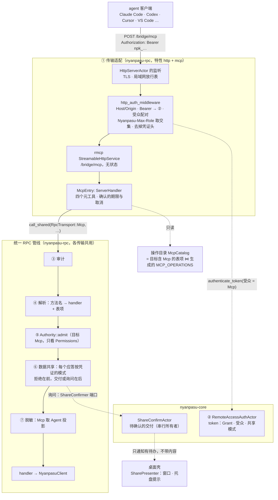
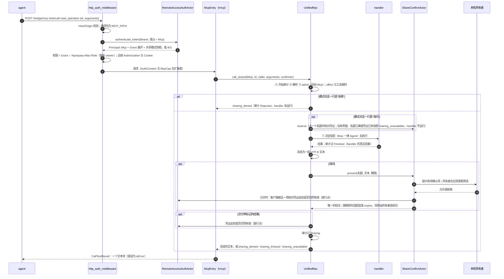
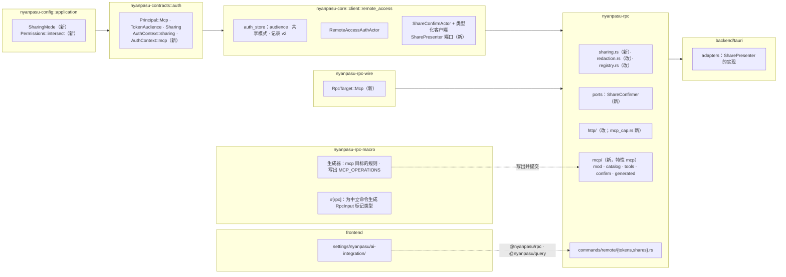
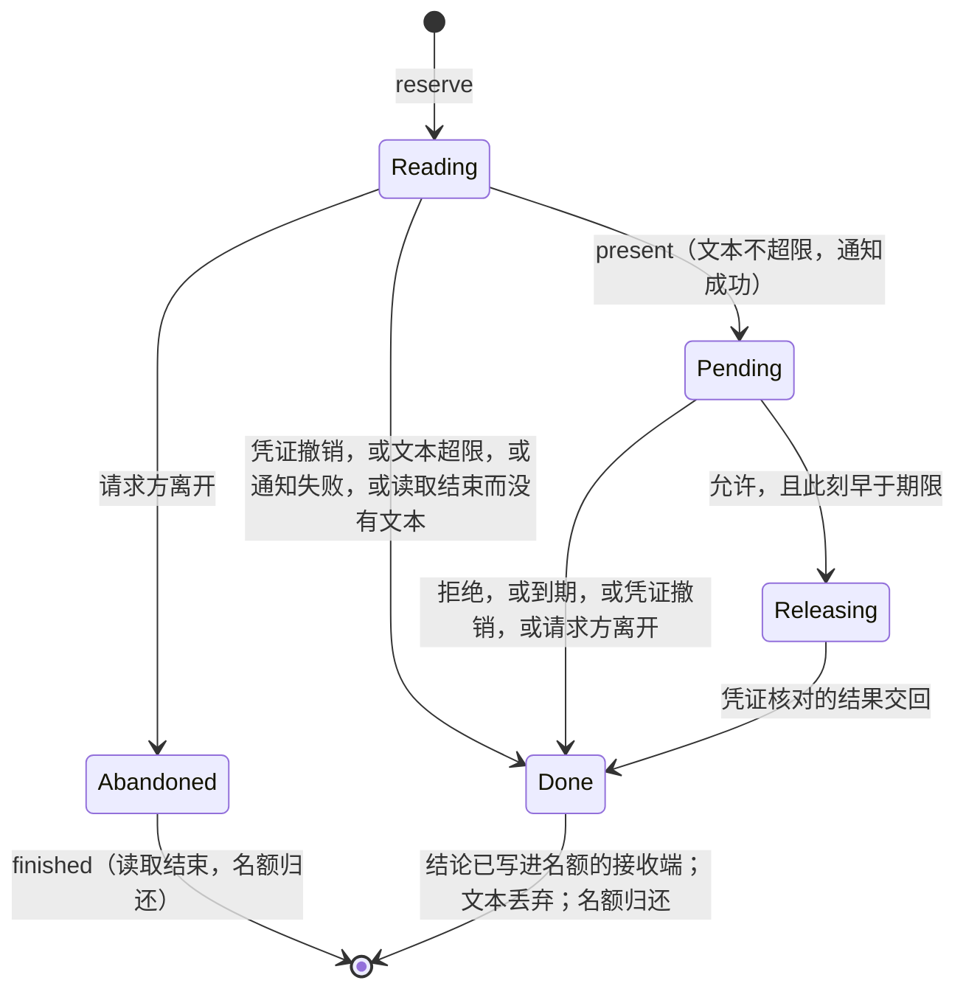
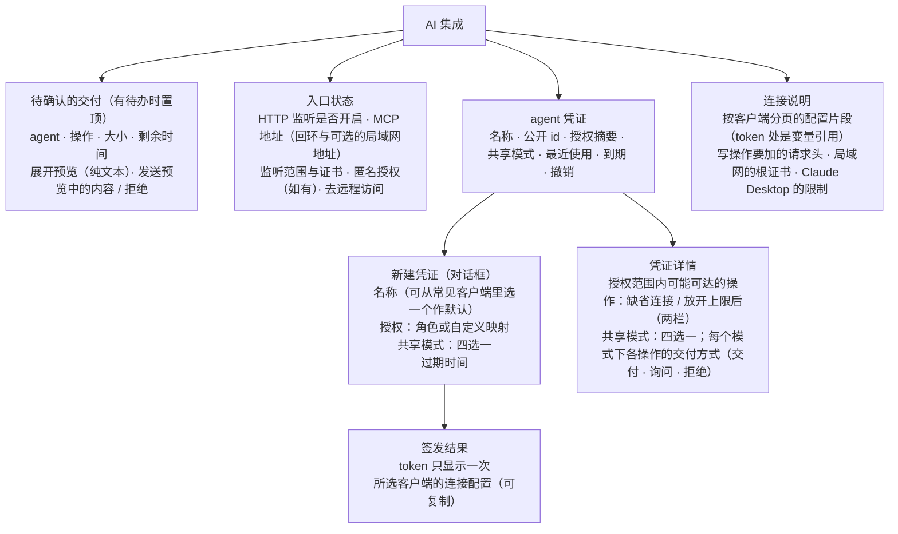

# MCP 入口：由应用经 Streamable HTTP 提供，渐进披露，按 agent 授权

**日期：** 2026-11-20；r9 于 2026-11-21

**状态：** 设计稿 r8，未实施。十八项取舍全部已裁定（§11 的 D-1 至 D-18，2026-11-21），没有待裁定的问题。独立评审（codex gpt-6.2-astra）已做满三轮（r3、r5、r6），结论都是“需要修改”；r7 是对第三轮的修订并按用户的裁定改了两处结构（D-15、D-16），r8 记入其后的两项裁定。r9 是 team-lead 自核 r8 后的四处更正。r7 至 r9 没有再送评审。

- r1 是我独立写成的初稿，十项取舍待裁定。
- r2 按用户的八项裁定修订，并采纳一份独立提案（codex gpt-6.2-astra，下称“独立提案”）里经我复核的事实与机制；两稿不一致而未采纳的地方列在 §13。
- r3 记入用户对余下四项的裁定（D-9 至 D-12，均与 r2 的建议一致）。
- r4 按独立评审修订：入口改为恰好匹配的路由并补上 Origin 的判定；确认的生命周期改为“先占名额、显式撤回、放行点”；预览与交付改为同一段冻结的文本；审计保留 handler 的真实结果；纠正日志、降级、协议修订与若干引用。逐条处置见 §13.2。
- r5 记入用户对 r4 两项待裁定问题的裁定（D-13、D-14）：首版暴露面去掉五条没有标记的查询，余 23 条；MCP 凭证与其他 token 同在一份记录里，升到 v2。
- r6 按第二轮评审修订：待确认项的整个生命周期收归 core 的一个串行所有者（§7.3），适配层只等它的结论；按 D-12 的“只剔除”规则再去掉两条查询，首版为 21 条；统一执行工具的错误次序；审计加 `Sharing` 阶段；纠正 schema、Origin、日志、卡片顺序与若干事实。逐条处置见 §13.3。
- r7：共享策略由“凭证 × 资源的三态”改为每条凭证一个模式，管每一个应答（D-15）；新增 `Agent` 投影，每条暴露的命令必须声明（D-16）；首版回到 23 条；确认的状态机补上结论的留存、名额随读取结束才归还、所有者不等认证所有者；逐条处置见 §13.4。
- r8 记入用户对 r7 两项待裁定问题的裁定：逐资源的矩阵不保留，只有模式（D-17）；整段文本的敏感结果在 `Agent` 投影里先过凭据级的文本脱敏（D-18）。
- r9（team-lead 自核）：`uuid` 等是凭据而不是分享级的标识，凭据键的名单要补；`query_core_logs` 是结构化的结果，脱敏落在每行的 `payload` 上；订阅 URL 的用户信息与查询参数的值其实已被现有规则抹掉；列全 `ResponseVisibility` 加一档要改的每一处。

**基线：** 提交 `9107b62bb`（分支 `renovate/zbus-6.x`；与本地 `main` 的合并基是 `3f73c81b1`，与 `origin/main` 的合并基是 `eb8d01aeb`；分支自己的两个提交与本题无关）；后端路径相对 `backend/`。

**对应 issue：** 本稿是 #6493 的设计，并裁定 #6489（数据共享层）、#6492（连接级收窄）的 HTTP/MCP 一侧，以及 #6491（脱敏规则）里 `Mcp` 所需的部分（§7、§6.3、§10）。父 issue #6495。

**输入：** [权限命名空间设计](../2026-11-16-rpc-permission-namespace/design.md) §2.3–§2.5、§4.4–§4.6、§9、§10；[远程访问设计](../2026-11-12-remote-access-and-cli/design.md) §9.2；[Unified RPC](../../development/rpc.md)；[调研记录](research.md)。

**权威顺序：** 当前 AGENTS.md 与 development guides > 本 spec。改规则的 PR 同时改 guide。

**执行清单：** [tasks.md](tasks.md)。

## 1. 背景与目标

### 1.1 现状

- `nyanpasu-cli mcp`（stdio）已在 `fb9bfa77e` 删除。理由记在 `nyanpasu-cli/src/lib.rs:21-24` 的 `TODO(mcp)`：服务器放在 CLI 二进制里，agent 被绑在一个会被应用更新替换的 CLI 上；服务端分不出 MCP 连接和其他调用方，限制只能在客户端做。
- 旧实现：一张手写的工具表（删除时 27 项；CLI 现存的精选表是 25 项，`nyanpasu-cli/src/commands.rs:190-416`）；`effective_scopes` 取 `read` 加 `--scope` 再与连接的能力求交，永不给 `remote_admin`；可选的通用工具 `call_method`；注解只由 effect 推出。
- 权限模型已合入：`资源 × 级别`，`Authority::admit` 只看 `Permissions`，`sensitive` 不参与准入（D-2）。
- 管线里 ⑥ 数据共享、⑦ 脱敏两层只有位置：接缝是 `RpcCallMeta::resource`（`nyanpasu-rpc/src/registry.rs:128-134`）与 `registry.rs:575` 的注释；⑦ 用过渡规则 C-2（`nyanpasu-rpc/src/redaction.rs:7-21`）。
- `Principal` 有五种（`nyanpasu-contracts/src/auth/mod.rs:39-62`），`Mcp` 只保留了名字。`RpcTarget` 有 `Desktop`、`Http`、`Local`（`nyanpasu-rpc-wire/src/describe.rs:9-17`）。
- 持有领域 `read` 的调用者现在就能读到订阅 URL、Clash secret 与配置原文。

### 1.2 目标

1. 应用在自己的 HTTP 监听上提供 MCP 入口（Streamable HTTP，`rmcp` 3.11.0），随应用一起更新。
2. MCP 调用走统一 RPC 管线的同一个 registry 与 `Authority`。
3. 哪些命令对 MCP 可达，是一个显式、经评审的暴露面（`RpcTarget::Mcp`），默认关闭；首版只开一小组。
4. 入口只暴露四个固定的元工具，agent 逐级发现；操作目录从生成表推出，入参的 JSON Schema 由 `schemars` 从参数类型派生。
5. 每个 agent 配置一条独立的、只在 MCP 入口上有效的凭证；默认只读且只能查询，由服务端约束。
6. 交给 agent 的每个应答都先投影（去掉识别性的字段），再按这条凭证的共享模式交付：全部允许、敏感内容需询问、全部询问、拒绝敏感内容。“询问”由本机所有者在应用里看过预览后决定。
7. 设置里有“AI 集成”页：签发与撤销凭证、选择共享模式、处理待确认的交付、给出各客户端的连接配置。

### 1.3 非目标

- **不做 OAuth**（§6.5）。
- 不用 MCP 征询做确认（D-1）；它至多是提示，列为扩展。
- 不提供“允许后发送未脱敏的完整版本”（D-2）；列为扩展。
- 不经 MCP 提供事件、流与字节路由；不做 prompts、sampling、roots、tasks、Skills 扩展（D-4）。
- 不做输出 schema（MCP 的 `outputSchema`，§5.4）。
- 不为 `Token`、`Session`、`Anonymous` 设计数据共享规则，不取代 C-2 的通用部分；`Agent` 投影只对 `Mcp` 生效，其他传输看到的形状不变（#6489、#6491 的余下范围）。
- 不做 #5946 的按等级、带一致占位符的导出脱敏（§7.2 说明两者的关系）。
- 不做本地 socket 握手的收窄：E-2 的那一半留在 #6492（§6.3）。
- 不恢复 CLI 里的 MCP 服务器；不做 CLI 写入各 agent 配置文件。

### 1.4 成功判据

1. Claude Code 与 Codex CLI 用各自文档里的静态请求头配置连上 `/bridge/mcp`（Cursor、VS Code 同样验证，通不过的如实记为未验证，不算通过），完成“发现 → 查摘要 → 敏感结果被拒 → 敏感结果经确认后交付 → 写被拒 → 撤销后全部失败”。
2. 新增一条 `#[rpc]` 命令默认不进入 MCP；把它所在的命名空间或它自己加上 `mcp` 并重新导出后，它出现在目录里，不改 `mcp/` 下任何手写代码。参数类型缺 `JsonSchema` 时 `nyanpasu-rpc` 在 `mcp` 特性下编译失败。
3. 不带 `Nyanpasu-Max-Role` 的请求只能调用查询，且权限不超过 `viewer`；带头的请求不超过 `Grant ∩ 该角色`。有测试。
4. MCP 凭证在 `/bridge/mcp` 之外的任何入口（含 `/bridge/login`）被拒绝；其他凭证在 `/bridge/mcp` 上被拒绝。有测试。
5. 模式对这一档是拒绝时 handler 不运行；要询问而没有界面时 handler 同样不运行；确认之前、拒绝、超时、取消、以及凭证在放行点（§7.6）之前被撤销或过期这几种情况下，冻结的文本不出现在发给 agent 的任何字节里。有测试。
6. 交付给 agent 的文本块与所有者预览到的那段冻结的文本逐字节相同（§7.3）。有测试。
7. 每条对 MCP 暴露的命令都声明了投影；§5.5 表里列出的字段、以及文本类结果里凭据键（`secret`、`password`、`token`、`private-key`、`uuid`、`psk` 等）的值，不出现在任何模式下发给 agent 的字节里，而同一条命令在 `/bridge/rpc` 上的结果不变。有测试。
8. 现有五种参与者的准入、共享与可见性不变：权限基线里原有的行在 `Desktop`、`Http`、`Local` 三个目标上不变，新增的行逐条列在各卡里；`redaction` 现有测试不改期望。
9. `Authority::admit` 与 `visible` 的签名不变：只收表项、目标与 `Permissions`，看不到 `Principal` 与共享模式（`RpcTarget::Mcp` 是目标，照常出现）；`lint:backend-boundaries`、`lint:architecture-ledger` 通过。

## 2. 已核实的事实

原文、路径与网址在 [research.md](research.md)；r2 新增的复核在其 §6。

| 编号 | 事实                                                                                                                                                                                                                                                                     | 来源                                                                                              | 可信度                                 |
| ---- | ------------------------------------------------------------------------------------------------------------------------------------------------------------------------------------------------------------------------------------------------------------------------ | ------------------------------------------------------------------------------------------------- | -------------------------------------- |
| F-1  | MCP 规范的当前修订是 2026-07-28：无会话、无 `initialize` 握手，服务端到客户端的请求改为 MRTR                                                                                                                                                                             | 规范 versioning 页；`rmcp-3.11.0/src/model.rs:169-209`                                            | 高                                     |
| F-2  | rmcp 的 `StreamableHttpService` 是 `tower_service::Service`；`with_legacy_session_mode(false)` 配 `NeverSessionManager::default()` 时两个协议时代都无状态；默认配置是 `legacy_session_mode: true`                                                                        | `tower.rs:336-352`、`:1473-1495`；`session/never.rs:17-21`                                        | 高（源码），未编译                     |
| F-3  | rmcp 把请求的 `http::request::Parts`（含中间件写入的扩展）放进 `RequestContext::extensions`；服务工厂无参，拿不到本次身份                                                                                                                                                | `tower.rs:1410-1470`、`:1554`                                                                     | 高                                     |
| F-4  | rmcp 默认只放行回环 `Host`，默认**不校验** `Origin`（空表）                                                                                                                                                                                                              | `tower.rs:251-272`、`:344-346`                                                                    | 高                                     |
| F-5  | rmcp 对普通的 JSON-RPC 错误回 HTTP 200。在 2026-07-28 的请求上，协议版本、请求头不符等回 400，未知方法回 404；握手时代的请求不经这层映射，一律是 HTTP 200 的 JSON-RPC 错误                                                                                               | `tower.rs:789-805`                                                                                | 高                                     |
| F-6  | rmcp 在 DEBUG 级别输出完整的请求与成功结果（`received request`、`response message`），在 TRACE 输出消息体，部分 WARN 带调用方控制的值与错误对象                                                                                                                          | `rmcp/src/service.rs:1628`、`:1634`、`:1681-1685`；`tower.rs:654-663`、`:1619`、`:1655`、`:2471`  | 高                                     |
| F-7  | rmcp 用 `ServerHandler::get_tool` 取工具的输入 schema 来校验协议头；默认实现返回 `None`                                                                                                                                                                                  | `handler/server.rs:633`；`tower.rs:1741`、`:2406`                                                 | 高                                     |
| F-8  | rmcp 的 `server` 特性启用 `schemars`，版本要求 `1.0`；仓库锁文件里已有 `schemars 1.2.2`（另有传递依赖带入的 0.8.22、0.9.0），工作区内没有 crate 直接依赖它                                                                                                               | rmcp `Cargo.toml:117-122`、`:924-927`；`Cargo.lock`                                               | 高                                     |
| F-9  | 规范里授权是可选的；实现授权就必须是 OAuth 2.1；静态 Bearer 不在规范内，也不被禁止                                                                                                                                                                                       | 规范 authorization 页                                                                             | 高；“不被禁止”为解读，中               |
| F-10 | Claude Code、Codex CLI、Cursor、VS Code、Windsurf 都能在配置里写静态请求头；Claude Desktop 的远程连接器由 Anthropic 云端发起，连不上本机与局域网                                                                                                                         | 各客户端文档                                                                                      | 高                                     |
| F-11 | Claude Code 的文档区分三种情况：配置了静态 `Authorization` 头的服务器在**连接阶段**收到 `401`/`403` 是连接失败，不回退到 OAuth；动态的 `headersHelper` 在工具调用上另有重试；其余才走 OAuth。连接成功之后一次工具调用收到 HTTP 403 会怎样，文档没有说（D-11 下不会发生） | `code.claude.com/docs/en/mcp`（两节：authenticate with remote MCP servers、dynamic headers）      | 连接阶段：高（一手）；连接之后：无来源 |
| F-12 | Claude Code、Codex、Cursor 已自带工具延迟加载；VS Code 每个请求至多 128 个工具，Windsurf 至多 100 个；靠 `list_changed` 动态增减工具不可靠                                                                                                                               | 各客户端文档；GitHub PR #2512                                                                     | 高 / 中                                |
| F-13 | Claude Code 的允许规则只按工具名匹配；Codex 的 `writes` 审批模式看 `readOnlyHint`                                                                                                                                                                                        | 各客户端文档                                                                                      | 高                                     |
| F-14 | 对 HTTP 暴露的命令 120 条，其中敏感 29 条；敏感的变更只有 `query_logs` 一条                                                                                                                                                                                              | 对 `permission/generated.rs` 的统计                                                               | 高                                     |
| F-15 | 命令没有 JSON Schema。宏手里有每个线上参数的名字与类型（语法层面）。`#[rpc]` 在中立 handler 的函数体里生成一个局部的 `struct Args`（`Deserialize`、`rename_all = "camelCase"`）解码参数；`namespace!` 展开为空，宏看不到命名空间的暴露面                                 | `nyanpasu-rpc-macro/src/unified_command.rs:647-661`；`nyanpasu-rpc/src/lib.rs:27-29`              | 高                                     |
| F-16 | 暴露面沿命名空间树继承且只能收窄：生成器检查子级是父级的子集，并且只认 `http`、`local` 两个名字                                                                                                                                                                          | `nyanpasu-rpc-macro/src/resource_table.rs:159-182`、`:204-250`、`:270-272`                        | 高                                     |
| F-17 | HTTP 认证中间件只在 `/bridge/*` 上接受 Bearer，把 `AuthContext` 写进请求扩展；所有路由都在它之内                                                                                                                                                                         | `nyanpasu-rpc/src/http/mod.rs:728-762`、`:909-1008`、`:1117-1122`                                 | 高                                     |
| F-19 | axum 的 `nest_service` 同时注册该路径、带尾斜杠的形式与其下的通配；`route_service` 只注册这一个路径                                                                                                                                                                      | `axum-0.8.9/src/routing/path_router.rs:256-279`                                                   | 高                                     |
| F-20 | rmcp 在自己派生的任务里运行 handler；请求被取消经 `RequestContext::ct` 传达。无状态传输下，另一个请求送来的 `notifications/cancelled` 被接受并忽略，不会触发原请求的取消信号                                                                                             | `rmcp/src/service.rs:1392`、`:1648-1689`；`tower.rs:2425-2463`、`:2491-2494`                      | 高                                     |
| F-21 | 外层中间件把读不出来的 `Origin` 当作没有，只读第一个 `Origin`，并把它当完整的 URL 解析后比较（带尾斜杠的值也能通过）                                                                                                                                                     | `nyanpasu-rpc/src/http/mod.rs:873-883`、`:891-906`、`:919-938`                                    | 高                                     |
| F-18 | 秘密记录带 `version`，读到别的版本就拒绝加载；但记录类型不拒绝未知字段，所以只加字段不升版本时，旧版应用会把 MCP 凭证当成通用 token。记录在构造 `NyanpasuClient` 时加载，加载失败即启动失败                                                                              | `nyanpasu-core/src/client/remote_access/auth_store.rs:55-61`、`:149-156`；`client/mod.rs:539-542` | 高                                     |

## 3. 架构

### 3.1 层次



| 用户草图里的层 | 落点                                                                                                            | 说明                                                                 |
| -------------- | --------------------------------------------------------------------------------------------------------------- | -------------------------------------------------------------------- |
| 传输层         | 现有的 HTTP 监听与 `http_auth_middleware`                                                                       | 不新开监听。Host/Origin、TLS、局域网放行表、凭证解析全部复用（F-17） |
| rmcp 入口      | `nyanpasu-rpc/src/mcp/`，恰好挂在 `/bridge/mcp` 上的 `StreamableHttpService`                                    | 只做协议翻译、确认的期限与取消，不含授权判断                         |
| 数据共享层     | `nyanpasu-rpc/src/sharing.rs` 与 registry 的入口 `call_shared`，包住 ⑦ 与 handler（接缝原在 `registry.rs:575`） | 属于管线，不属于 MCP 适配层                                          |
| 脱敏层         | `nyanpasu-rpc/src/redaction.rs`（判定）与宏展开的包装（执行）                                                   | 判定多读一个输入：`AuthContext::sharing`                             |
| 客户端 API     | 现有 handler → `NyanpasuClient`                                                                                 | 不变                                                                 |

- **同一个 registry 与 `Authority`。** MCP 适配层调用 registry 的 `call_shared`，它与 `http_call` 用的 `call_with_admission`（`http/routes.rs:638-648`、`registry.rs:551`）共用解析、准入与审计，目标是新的 `RpcTarget::Mcp`（D-3）。`RpcTransport::Mcp` 是审计用的新变体（`audit.rs:90-95`）。目标、传输、参与者是三个维度：目标决定暴露面，传输进审计，参与者是凭证的身份。
- **⑥、⑦ 不在 rmcp 入口里。** 放在入口里只约束这一个入口；凭证与入口的绑定由认证层保证（§6.2），所以走别的入口绕不过去。

### 3.2 请求时序



- 不需要服务端向客户端发请求，所以对握手时代与 2026-07-28 都无状态：没有会话表，GET 与 DELETE 回 `405`（F-2）。握手时代的无状态互通是 M0 的硬性条件，不通过就回到设计，不以有状态会话兜底。
- 进程内等待真实结果。只有“等所有者答复”有期限，由 MCP 适配层起算（§7.4）。
- rmcp 在自己派生的任务里运行 handler，HTTP 请求的 future 被丢弃**不会**连带丢弃它；取消经 `RequestContext::ct` 传达（F-20）。所以适配层从占到名额起就显式地看着这个取消信号与监听的关闭信号（§7.5）。所有者已启动的领域工作照常跑完。

### 3.3 包与模块



- **MCP 适配层是 `nyanpasu-rpc` 的特性 `mcp = ['http', 'dep:rmcp']`**，与 `http`、`local-server` 并列（`nyanpasu-rpc/Cargo.toml:8-37`），不新建 crate：它要用 `pub(crate)` 的 `call_with_admission` 与 HTTP 中间件，`backend-packages.md:22` 已把 HTTP 适配归在这个包里。`backend/tauri` 与 `nyanpasu-server` 各自打开特性。特性分两步出现：卡 C-1 建立默认关闭的 `mcp`（当时只带 `schemars` 与各 crate 的 `schemars` 转发），卡 E-1 再把 `dep:rmcp` 加进去；在它出现之前，各卡只跑当时存在的特性组合。
- rmcp 只进 `nyanpasu-rpc`，版本写成 `=3.11.0`（25 天内 3.8 → 3.11，升级须过一遍各修订的互通测试）。生产依赖的特性集是 `default-features = false` 加 `server`、`transport-streamable-http-server`；测试用的 rmcp 客户端是 dev-dependency，另有一项只构建生产特性集的检查，免得特性合并掩盖缺失的依赖；不启用 `macros`、`elicitation`、`skills-fs`、`auth`（后者是 OAuth 客户端）。
- `schemars = '1'` 进工作区依赖表，与 rmcp 的要求同一个主版本（F-8）。
- 待确认交付的所有者是 core 里的一个 actor，不碰 Tauri；怎样把“有待办”呈现给人是它自己拥有的 `SharePresenter` 端口（与在途项的类型一起放在 core），桌面壳实现它，无界面的 `nyanpasu-server` 不注入。管线消费的 `ShareConfirmer` 端口在 `nyanpasu-rpc`，由 `nyanpasu-rpc` 在 facade 之上实现（§4.3）。

## 4. 关键类型与示例代码

示例只为说明形状，不是最终代码。

### 4.1 身份、受众、共享模式

```rust
// nyanpasu-config::application::permission —— 与 Permissions 并列，进入持久化
/// 这条凭证的应答怎样交付。每个成功的应答都按它处理；`sensitive` 标记决定一行属于哪一档。
#[serde(rename_all = "snake_case")]
pub enum SharingMode {
    AllowAll,        // 普通：交付；敏感：交付
    #[default]
    AskSensitive,    // 普通：交付；敏感：询问（默认，D-10）
    AskAll,          // 普通：询问；敏感：询问
    DenySensitive,   // 普通：交付；敏感：拒绝，命令不执行
}

impl Permissions {
    /// 逐资源取较低的级别，任一侧没有即没有。
    pub const fn intersect(self, other: Permissions) -> Permissions;
}

// nyanpasu-contracts::auth
pub enum Principal {
    // … 现有五种不变
    Mcp { id: String, name: String },              // audit_label: "mcp:<id>"
}

/// 一条 token 凭证只在哪个入口上受理。
#[serde(rename_all = "snake_case")]
pub enum TokenAudience {
    #[default]
    RemoteAccess,   // /bridge/* 的 RPC、事件、路由与浏览器登录；不含 /bridge/mcp
    Mcp,            // 只有 /bridge/mcp
}

/// 数据共享层对这个调用者做什么。准入不读它。
pub enum Sharing {
    All,                       // 不受约束：现有五种参与者的现状
    Policy(SharingMode),       // Mcp
}

pub struct AuthContext {
    pub principal: Principal,
    pub role: Option<Role>,
    pub permissions: Permissions,
    pub sharing: Sharing,                           // 新
}

pub struct CreateAccessTokenRequest {
    pub name: TokenName,
    pub grant: Grant,
    pub expires_at_ms: Option<i64>,
    pub audience: TokenAudience,                    // 新
    pub sharing: SharingMode,                       // 新；只对受众 Mcp 有意义
}
```

- 现有的 `AuthContext` 构造函数一律给 `Sharing::All`。`Principal::Mcp` 只能经新的 `AuthContext::mcp(id, name, grant, mode)` 构造，它必带共享模式；`AuthContext::new` 拒绝 `Principal::Mcp`。字段是公开的，所以 registry 在分派前再核对一次配对——`Principal::Mcp` 当且仅当 `Sharing::Policy`——不一致即拒绝，不运行 handler。这样不存在“`Mcp` 参与者却不受共享约束、还按 `write` 拿到 `Full`”的上下文。
- 共享模式是数据共享层自己的数据，不进 `Grant`、不进 `Permissions`：`Authority` 的签名与行为都不变（D-2）。
- 一条 MCP 凭证代表一个安装配置（“工作机上的 Cursor”）。稳定标识是 token id；名字与客户端自报的 `clientInfo.name` 都不证明是哪个产品，所以不持久化“agent 种类”。

### 4.2 秘密记录的版本

`StoredToken` 加 `audience` 与 `sharing`。旧版读记录时不拒绝未知字段（F-18），只加字段会让降级后的旧应用把 MCP 凭证当成通用 token，所以要让旧版读不了它。做法是同一份记录升到 v2（D-14）。**后果由用户接受：记录是 v2 时，旧版应用启动失败，直到在新版里撤销全部 MCP 凭证。**

- **两个版本各有自己的解码类型。** v1 的 token 没有这两个字段，一律是 `RemoteAccess`；v1 记录里出现它们即拒绝加载。v2 的每条 token 必须写明合法的受众，缺失或未知即拒绝加载——持久化的形状不带默认值，默认值只在签发请求的 DTO 上（旧请求缺省即普通 token）。
- **写：** 记录里有任何 `Mcp` 受众的 token 时写 v2，否则写 v1。撤销最后一条 MCP 凭证后记录回到 v1。
- **降级的后果。** 认证 actor 在构造 `NyanpasuClient` 时加载这份记录，加载失败即启动失败（`nyanpasu-core/src/client/mod.rs:539-542`、`remote_access/mod.rs:223`）。因此记录是 v2 时，旧版应用**启动不了**，而不只是远程访问不可用。恢复办法：重新打开新版，撤销全部 MCP 凭证（记录回到 v1，TLS 根与普通 token 原样），再降级。升级说明里写明。
- 整份记录原子替换；写失败不得回报签发成功，内存里也不留这条凭证。
- **撤销的落盘失败。** 现有行为是先在内存里撤销并广播、再落盘，失败只报告、不回滚（`auth_actor.rs:500-510`）——这对安全是对的，保留。但此时这条 token 已不在内存里，再按 id 撤销会得到“不存在”，而磁盘上的记录还是 v2、还带着它，新版重启后它会重新出现。补两点。其一，这种失败用一个可区分的结果带出命令（“已在本次运行中撤销，尚未保存”），与“没有这个 id”、与请求没有到达所有者的传输错误都不同。其二，所有者记下**哪些 id** 的撤销还没写出；只有对这些 id 再次撤销才重写整份记录并返回这次写入的结果，别的不存在的 id 仍是“不存在”。页面只在收到那个可区分的结果时提示“本次运行已失效，尚未保存，请重试”，并在列表刷新后仍留着这一行供重试；其他错误显示“结果未确认”。**可以降级的判据是最后一次写入成功且记录是 v1**，不是“列表里看不到 MCP 凭证”。
- **新客户端对旧宿主（#6493 的 CLI 一侧）。** 现在的签发请求不拒绝未知字段（`commands/remote/tokens.rs:13-21`），旧宿主收到带 `audience: mcp` 的请求会签出一条**普通** token。所以 CLI 签发 MCP 凭证之前先确认宿主支持（本地发现结果里有 `set_mcp_sharing_mode`），签发之后先核对返回摘要里的受众是 `mcp`，再以任何格式输出密钥；不符即撤销这条 token 并报错。页面与宿主同版本，没有这个问题。

### 4.3 数据共享层与脱敏层

所有者与呈现端口在 core（消费方拥有自己的端口），RPC 一侧的端口在 `nyanpasu-rpc`，由 `nyanpasu-rpc` 自己在 facade 之上实现——依赖方向与 `HttpAuthenticator` / `NyanpasuClientHttpAuthenticator` 相同（`nyanpasu-rpc/src/http/auth.rs:29-35`、`:62-74`），core 不反向依赖 RPC。

**一个待确认项的状态只由 core 的 `ShareConfirmActor` 改。** 期限到、请求取消、凭证撤销、所有者作答都作为消息到达它；适配层只读它给出的唯一结论（§7.4）。它自己不等别的 actor：需要向认证所有者核对凭证的两处，由类型化客户端在它的邮箱之外去问，再把结果交回（§7.4）。

```rust
// nyanpasu-core::client::remote_access::share（新）
/// 桌面壳实现；无界面的宿主不注入。
pub trait SharePresenter: Send + Sync + 'static {
    /// 新增了一项：可以打扰人（窗口提示或托盘通知）。只带计数。
    fn announce(&self, pending: usize) -> Result<(), PresentationFailed>;
    /// 可见的列表变了（有项离开）：只让界面重新查询，不打扰人。
    fn changed(&self);
}
/// 所有者铸造的不透明标识：随机、不复用，与线上的请求 id、审计的调用编号都无关。
pub struct ShareId(/* 128 位随机数 */);
/// 一个名额。它带着这一项唯一的结论接收端；丢弃它即向所有者发出“请求方已离开”。
pub struct ShareTicket { /* ShareId、结论的接收端、所有者的句柄 */ }
impl ShareConfirmClient {
    /// 占一个名额：所有者先登记，客户端再向认证所有者核对凭证，失效则撤回。
    pub async fn reserve(&self, header: PendingShareHeader) -> Result<ShareTicket, ShareUnavailable>;
    /// 交出冻结的文本与绝对的单调期限。只能交一次；不等待结论。
    pub async fn present(&self, ticket: &ShareTicket, payload: Arc<str>, deadline: Instant);
    /// 期限到了。
    pub fn expire(&self, ticket: &ShareTicket);
    /// 读取结束了（不论有没有交出文本）：名额此时才归还。
    pub fn finished(&self, ticket: &ShareTicket);
    /// 桌面一侧：只看得到已交出文本、尚无结论的项。
    pub async fn list(&self) -> Vec<PendingShare>;
    pub async fn preview(&self, id: ShareId) -> Option<Arc<str>>;
    pub async fn resolve(&self, id: ShareId, answer: ShareAnswer) -> ResolveOutcome;
}
impl ShareTicket { pub async fn verdict(&mut self) -> ShareVerdict; }
pub enum ShareVerdict { Released, Denied, Expired, Revoked, Unavailable }
pub enum ResolveOutcome { Released, Denied, Revoked, Gone }

// nyanpasu-rpc/src/ports.rs —— 管线消费的窄端口
#[async_trait]
pub trait ShareConfirmer: Send + Sync + 'static {
    async fn reserve(&self, request: ShareRequest) -> Result<Box<dyn ShareReservation>, RpcError>;
}
#[async_trait]
pub trait ShareReservation: Send {
    /// 请求方已离开：不再呈现；名额要到 `finished` 才归还。
    fn abandon(&self);
    /// 读取结束。有文本则呈现并等结论；`None` 表示没有可呈现的（handler 出错或已放弃）。
    async fn finish(self: Box<Self>, payload: Option<Arc<str>>) -> ShareOutcome;
}
pub enum ShareOutcome { Released, Denied, TimedOut, Unavailable }

// nyanpasu-rpc/src/sharing.rs（新）
/// 请求方向：这条凭证的模式对这一行意味着什么。只能拒绝，不能放行 Authority 拒绝的调用。
pub fn admit(resource: &ResourceMetadata, mode: SharingMode) -> Result<Delivery, RpcError>;
pub enum Delivery { Release, Confirm }
/// 把结果冻结成将要发出的那段文本：字符串结果取其本身，其余取紧凑的 JSON 文本。
pub fn freeze(value: &serde_json::Value) -> Arc<str>;

// nyanpasu-rpc-protocol/src/error.rs（改）
pub enum ResponseVisibility { Full, Public, Agent }     // Agent：比 Public 再多去掉识别性的字段

// nyanpasu-rpc/src/redaction.rs（改）
pub fn visibility(resource: &ResourceMetadata, auth: &AuthContext) -> ResponseVisibility {
    match auth.sharing {
        Sharing::Policy(_) => ResponseVisibility::Agent,           // Mcp：不看 write，不看模式
        Sharing::All if auth.permissions.get(resource.permission.resource) == Some(Access::Write) => ResponseVisibility::Full,
        Sharing::All => ResponseVisibility::Public,                // C-2 不变，TODO(E-5) 保留
    }
}
```

registry 多一个入口 `UnifiedRpc::call_shared`，只有 MCP 适配层调用它。**它只接受 `Principal::Mcp` 加 `Sharing::Policy` 的调用者，目标与传输固定为 `Mcp`**；`Token`、`Desktop` 等配着 `Sharing::All` 的合法上下文同样被拒，handler 不运行。它分三段：

1. **准备（在 `dispatch_with_audit` 的 `prepare` 里）：** 解析、`Authority::admit`、适配层给的检查（工具与 effect，§4.4）、`sharing::admit`。模式对这一行是拒绝即 `sharing_denied`，handler 不运行。
2. **执行（被审计的 future）：** `Delivery::Confirm` 时先 `reserve`，失败则不轮询 handler；然后运行 handler。**这一段不因请求被取消而丢弃**：取消只让名额 `abandon`，handler 照常跑完，跑完才 `finish(None)` 归还名额——所以“同时在读的需确认结果”有真正的上界（§7.4）。
3. **交付（`dispatch_with_audit` 返回之后，同一个调用编号）：** 成功值经 `freeze`。`Confirm`：`finish(Some(文本))`，等所有者的结论。`Release`：带标记的行过一次放行点（§7.6），不带标记的直接返回。handler 返回错误时 `finish(None)`，错误直接返回。

**`ResponseVisibility` 加一档要改的地方**（现在的匹配都是两个分支；`Agent` 在这些地方一律取与 `Public` 相同的分支，错误对 `Agent` 就是 `Public` 的固定文案）：`nyanpasu-rpc-protocol/src/error.rs:72`、`:85`（`RpcError` 的两个按可见性的构造）；`nyanpasu-rpc/src/privacy.rs:135`、`:194`、`:214`（三处结果投影）与 `:323`（应用错误的投影）；`nyanpasu-rpc/src/error.rs`（`application_error_for`）；`nyanpasu-rpc/src/http/routes.rs:297`、`:396`、`:509`（路由与流的错误）；`nyanpasu-rpc/src/redaction.rs`（判定本身与 `UNADMITTED`）；`tauri/src/unified_rpc/icons.rs`。`local/subscriptions.rs` 只是把值传下去。宏展开里没有对它的匹配（它调的是 `encode_for_visibility`，`unified_command.rs:602-607`），`nyanpasu-rpc-wire` 的 `describe` 不涉及。把这个枚举标成需要穷尽匹配、不留 `_` 分支，漏改的地方就编译不过。

审计各阶段见 §7.8。`call_with_admission`（现有三种传输的入口）与 `call_native` 加一条防线：拒绝 `Sharing::Policy` 的调用者，并核对 `Principal::Mcp` 当且仅当 `Sharing::Policy`（§4.1）。`call_native`（`registry.rs:596`）的可见性改用同一个 `visibility(resource, auth)`，结果不变。规则见 §7。

### 4.4 MCP 入口

```rust
// nyanpasu-rpc/src/mcp/mod.rs（新，特性 mcp）
#[derive(Clone)]
struct McpEntry { rpc: UnifiedRpc, catalog: Arc<McpCatalog>, confirmer: Option<Arc<dyn ShareConfirmer>> }

impl ServerHandler for McpEntry {
    fn get_info(&self) -> ServerConfig { /* tools 能力；静态的 instructions，见 §5.2 */ }
    fn supported_protocol_versions(&self) -> Cow<'static, [ProtocolVersion]>;     // 只公布有测试的修订
    fn get_tool(&self, name: &str) -> Option<Tool> { tools::definition(name) }    // rmcp 用它校验协议头（F-7）
    async fn list_tools(&self, _: Option<PaginatedRequestParams>, context: RequestContext<RoleServer>)
        -> Result<ListToolsResult, McpError>;                                      // 按 McpCap 省略 mutate_operation
    async fn call_tool(&self, request: CallToolRequestParams, context: RequestContext<RoleServer>)
        -> Result<CallToolResponse, McpError>;
}

/// 确认期限属于适配层：从文本交给确认端起算，单调时钟。
const SHARE_CONFIRM_LIMIT: Duration = Duration::from_secs(30);

// http/routes.rs，router()（现 :165-171）
.route("/bridge/rpc", post(http_call))
.route_service(MCP_PATH, mcp::service(rpc.clone(), confirmer, shutdown))          // 特性 mcp；恰好这一个路径
```

- **路径恰好匹配。** 用 `route_service`，不用 `nest_service`：后者同时注册该路径、带尾斜杠的形式与其下的通配（F-19），而中间件只对 `MCP_PATH` 做 MCP 的凭证选择，多出来的路径会按普通 `/bridge/*` 认证后落进 rmcp。`/bridge/mcp/` 与 `/bridge/mcp/…` 不存在。入口合入之前（卡 A-2 到 E-1 之间，其间页面的卡 F-1 已合入）`MCP_PATH` 先由一个固定回 `404` 的占位路由占住，使**恰好这个路径上**认证过的 MCP 请求不会落到 WebUI 的回退路由或开发代理；没有 `mcp` 特性的构建同样如此。保证只有这一条：它的子路径到不了 rmcp；它们按普通路径处理（普通凭证在子路径上会照常走到回退路由，MCP 凭证在那里是 `401`）。
- **注入。** 三样东西各在各的时刻给出：可选的 `confirmer` 是持久的依赖，随 `RpcHttpRoutes` 安装一次（`http/routes.rs:125-160`）；**这一次监听**的关闭信号在构造路由时传入——桌面的监听每次启动新建取消信号（`http/mod.rs:305-315`、`http/listener.rs:81-100`），`nyanpasu-server` 现在是先建好路由再有信号（`nyanpasu-server/src/run.rs:146-173`），要改成把信号交给路由的构造；**这一次请求**的取消信号在 `call_tool` 里从 `RequestContext::ct` 取。
- `mcp::service` 的配置：`with_legacy_session_mode(false)`、`NeverSessionManager::default()`、`with_json_response(true)`、`disable_allowed_hosts()`。Host 与 Origin 由外层中间件校验（§6.2）；rmcp 自己的 Host 表默认只有回环名，会把局域网模式拒掉，它默认不校验 Origin（F-4）。两项都交给外层，且只有这一处挂载。
- **公布并测试的协议修订**是三个：`2025-06-18`、`2025-11-25`、`2026-07-28`，各有一组互通测试；rmcp 默认公布它认识的全部五个（`handler/server.rs:452-454`）。这限定的是发现与版本协商里的说法，不是输入的白名单：握手时代不带 `_meta` 的请求，传输层只按 SDK 认识的修订校验请求头，带着未公布的旧修订头的请求不一定被拒。本稿不要求拒绝它们。
- 调用者从 `RequestContext` 取：`Parts.extensions` 里的 `AuthContext` 与 `McpCap`（§6.3）。缺任何一个即拒绝。rmcp 自己应答的 `initialize`、`server/discover`、`ping` 不经这四个工具，但请求已经过同一个中间件。
- `RpcOwner` 取凭证标识。首版暴露的命令都不跨调用持有游标或会话。
- **结果的形状。** 操作的结果是一个文本块，内容是冻结的那段文本（§7.3）；不带 `structuredContent`——握手时代的对端对非对象的结构化输出有不同处理，文本块两个时代都一样。
- **错误的通道（D-11）。** 应用层的拒绝与失败都是 `isError: true` 的工具结果，HTTP 200，两个时代相同。结果里只有一个文本块，内容是 `RpcError` 的紧凑 JSON（`{"kind":…,"code":…,"message":…}`，按 `Public` 投影）；`CallToolResult` 没有放 `kind`、`code` 的字段，客户端与模型从这段文本里取。协议层的错误由 rmcp 按修订处理：未知的工具名、未知的 MCP 方法在 2026-07-28 是 HTTP 404，在握手时代是 HTTP 200 的 JSON-RPC 错误；版本或协议头不符是 400（F-5）。认证失败是中间件的 401。
- **执行工具的错误次序。** `read_operation` 与 `mutate_operation` 对每个 `id` 都进入 `call_shared`，所以每次尝试恰有一条审计链，错误按管线的固定次序产生，不由目录的可见性预先过滤：

  | 次序 | 情形                                                    | 结果                                    |
  | ---- | ------------------------------------------------------- | --------------------------------------- |
  | 1    | 没有这个名字                                            | `unknown_method`                        |
  | 2    | 目标不含 `Mcp`、handler 未链接、缺必需的 capability     | `unsupported`                           |
  | 3    | 有效权限不足                                            | `forbidden`，写出缺的权限（D-11）       |
  | 4    | 工具与 effect 不符（`read_operation` 调变更，或反之）   | `invalid_params`                        |
  | 5    | `mutate_operation` 而这次请求没有带 `Nyanpasu-Max-Role` | `forbidden`，`code = max_role_required` |
  | 6    | 共享模式对这一行是拒绝                                  | `forbidden`，`code = sharing_denied`    |

  第 4、5 项是适配层交给 `call_shared` 的检查，在 `Authority::admit` 之后运行。`list_operations` 与 `describe_operation` 则按可见性过滤：`describe_operation` 对目录里没有的 `id` 一律是 `unknown_method`，不给 schema。

- **日志。** rmcp 在 DEBUG 级别输出完整的请求与结果（`received request`、`response message`），在 TRACE 输出消息体，若干 WARN 带调用方控制的字段与错误对象，ERROR 里也有格式化进去的错误文本（F-6；`rmcp/src/transport/common/server_side_http.rs:181-194`）。所以不是压低级别，而是**整体关掉 `rmcp` 目标的输出**：在两个壳的各个输出端各加一层独立的过滤，不受用户选的级别、环境变量里更具体的指令（如 `rmcp=trace`）与运行时重载的影响（现有的级别控制只管 `nyanpasu` 与 `clash_nyanpasu` 两个目标，`tauri/src/utils/init/logging.rs:153-169`、`:263-279`；`nyanpasu-server/src/logging.rs:91-114`）。诊断打包取的是同一批文件。不对 `Parts` 做 `Debug` 输出。

## 5. 渐进披露、暴露面与 schema

### 5.1 取舍（已定）

备选做法的比较见 [调研 §4](research.md#4-渐进披露的先例子代理抓取)。结论不变：全量静态工具超出客户端上限且要逐命令的 schema；手工精选表会漂移；`list_changed` 动态 toolset 不可靠（F-12）；单一通用 `call` 让客户端无法区分读写（F-13）；Skills 扩展主流编码客户端尚不消费（D-4）。采用**四个固定的元工具，调用按 effect 拆成读与写**——两份提案在这一点上一致。

### 5.2 工具面

| 工具                 | 输入                 | 注解                                                                   | 作用                                                                                                                                                             |
| -------------------- | -------------------- | ---------------------------------------------------------------------- | ---------------------------------------------------------------------------------------------------------------------------------------------------------------- |
| `list_operations`    | `{ namespace? }`     | `readOnlyHint: true`、`openWorldHint: false`                           | 调用者这次请求的有效权限与共享模式；按命名空间列出**此刻准入会放行**的操作：`id`、摘要、effect、是否带标记，以及按模式算出的交付方式（`deliver`、`ask`、`deny`） |
| `describe_operation` | `{ id }`             | 同上                                                                   | 一个操作的说明、所需权限、入参的 JSON Schema、交付方式                                                                                                           |
| `read_operation`     | `{ id, arguments? }` | `readOnlyHint: true`（不写 `openWorldHint`）                           | 调用 effect 为 `query` 的操作                                                                                                                                    |
| `mutate_operation`   | `{ id, arguments? }` | `readOnlyHint: false`、`destructiveHint: true`（不写 `openWorldHint`） | 调用 effect 为 `mutation` 的操作                                                                                                                                 |

- **名字。** r1 用的是 `catalog`、`describe`、`query`、`mutate`；独立提案是 `search_operations`、`describe_operation`、`read_operation`、`mutate_operation`。采用带 `_operation` 后缀的一组：有的客户端把各服务器的工具放在同一个名字空间里，`query` 这样的裸动词会与别的服务器撞名（MotherDuck 的只读工具就叫 `query`）；“operation”也给了 `id` 一个统一的称呼。第一个工具叫 `list_operations` 而不是 `search_operations`：首版只有二十多个操作，按命名空间筛选就够，不做按关键词匹配与排序、分页游标——那是要维护的检索逻辑，等暴露面大到需要时再加（改名即破坏兼容，所以届时是给 `list_operations` 加一个可选的 `query`）。
- **`id`** 是表项的线上名（`ResourceMetadata::name`）。权限命名空间设计的扩展 E-1（把方法名改成路径，另行立项，不是本稿的卡 E-1）落地之后，`id` 随生成结果变；找不到的旧 `id` 返回 `unknown_method` 并提示重新 `list_operations`。
- **`tools/list` 随本次请求的有效授权变化，仅此一项：** 没有可达的变更时省略 `mutate_operation`（缺省不带 `Nyanpasu-Max-Role` 的连接就是这样）。规范允许工具列表随出示的授权变化、不允许随连接或先前的请求变化；这里只取决于凭证与请求头，二者都写死在客户端配置里。直接按名字调用被省略的工具，同样被拒绝。
- **两个执行工具不声明封闭世界。** 延迟测试向调用方给的 URL 发流量，更新订阅会访问远端；`openWorldHint` 不写即取默认的 `true`。只读与是否触及外部是两件事。两个元数据工具是封闭的。
- **目录不列够不着的操作。** `rpc_describe` 会保留 `allowed: false` 的名字（`nyanpasu-rpc/src/permission/mod.rs:120`），那是给宿主自省用的；`list_operations` 只列准入会放行的。`list_operations` 与 `describe_operation` 用同一个按宿主实际情况的查找：表项是命令、目标含 `Mcp`、handler 已链接、所需 capability 齐备、`Authority::visible`、effect 与读写限制相符。`describe_operation` 对目录里没有的 `id`——包括存在但这次够不着的——一律是 `unknown_method`，不给 schema；执行工具不做这层过滤，按 §4.4 的次序给出各自的错误。“准入放行”与“能交付”是两个状态：模式对它是拒绝的操作仍在目录里，标着 `deny`；标着 `ask` 的在没有界面的宿主上会得到 `sharing_unavailable`。设置页的预览是静态的，只能说“这个授权范围内可能可达”（§8.2）。
- **第 1 级披露**是 `tools/list` 与服务端 `instructions`：512 字符以内、自成一体的一段**静态**文字（`get_info` 拿不到请求上下文；本次的有效权限由 `list_operations` 的结果给出）（先 `list_operations`，再 `describe_operation`；读用 `read_operation`；写要用户在客户端配置里放开上限；敏感结果可能要在 Nyanpasu 里确认并等待，被拒时回到目录找同一资源下不带标记的操作）。`list_operations` 的描述里列出顶层资源名，防止模型跳过发现（[调研 §4.3](research.md#43-元工具的先例)）。
- 注解只由 effect 推出。延迟测试是要求 `proxy:write` 的查询（`rpc.md:401`），归 `read_operation`；权限由 `Authority` 管。
- `tools/list` 的结果带 `cacheScope: "private"`、`ttlMs: 0`（它是带缓存提示的协议结果；工具调用的结果 `CallToolResult` 没有这两个字段）；所有应答的 HTTP 头沿用 `no-store`。

`describe_operation` 的结果：

```json
{
  "id": "select_proxy",
  "namespace": "proxy.groups",
  "effect": "mutation",
  "permission": "proxy:write",
  "sensitive": false,
  "summary": "Selects a proxy in a selector group.",
  "inputSchema": {
    "type": "object",
    "properties": {
      "group": { "type": "string" },
      "name": { "type": "string" }
    },
    "required": ["group", "name"]
  }
}
```

### 5.3 暴露面：`RpcTarget::Mcp`（D-3）

`RpcTarget` 加 `Mcp`。命令是否对 MCP 可达，写在声明里，由生成器收进 `RESOURCES` 的 `targets`，`Authority` 像对待其他目标一样判定。

现有规则是暴露面沿树继承、只能收窄，且生成器只认 `http`、`local`（F-16）。照搬的话，`mcp` 必须先写在顶层模块上，于是该资源下每个新增的子模块都默认对 MCP 开放——失败开放。所以 `mcp` 有自己的三条规则，由生成器执行：

1. **顶层模块不得写 `mcp`。** 开放的最小单位是二级命名空间或单条命令。
2. **`mcp` 不受“子集”检查：** 二级命名空间或命令可以在父级没有它的情况下写出 `mcp`。它与其他目标一样按“最近的显式 `expose` 生效”：命令自己写了 `expose` 就以命令为准，否则取最近一层写了 `expose` 的命名空间；下层写了不含 `mcp` 的 `expose` 即关闭，再下层可以重新写出。
3. **检查落在最终的行上：** 目标含 `mcp` 的行必须同时含 `http`（MCP 走 HTTP 监听）、必须声明 `privacy`（结果类型要对 `Agent` 投影表态，§7.2）、必须是命令（事件、路由、流不可对 MCP 暴露）、不得是带 `sensitive` 的变更、声明根不得是 `tauri/src/ipc.rs`（这是按声明根定的策略：那里的声明即使有中立 handler，`nyanpasu-rpc` 里生成的 schema 表也引用不到）。`cfg` 守卫照常随行带出。

```rust
// commands/proxy/groups.rs —— 整个命名空间开放
nyanpasu_rpc::namespace!(expose = [http, local, mcp]);

// commands/profile/content.rs —— 只开一条；其余属性原样保留
#[nyanpasu_rpc::rpc(operation = nyanpasu_rpc_protocol::operations::ReadProfileFile, query, sensitive,
                    expose = [http, local, mcp])]
pub async fn read_profile_file(/* … */) -> Result<String> { /* … */ }
```

命令自己的 `expose` 会取代继承来的：`proxy.groups` 里有三条命令已经写着 `expose = [http]`（`commands/proxy/groups.rs:8`、`:27`、`:35`），给命名空间加 `mcp` 开不到它们，要各自改成 `expose = [http, mcp]`——只加 `mcp`，不顺手加 `local`。卡 C-2 因此按“每条选中的命令在三个原有目标上不变、只多 `Mcp`”逐行列出改动。

护栏：一条独立的测试钉住目标含 `Mcp` 的名字集合（做法同敏感集合与 HTTP 可达的 `system:write` 集合，`rpc.md:437-438`），增删都是评审过的变更；另一条断言该集合里没有带 `sensitive` 的变更——“询问”要先执行才有东西可预览，查询没有副作用，变更会出现“已执行但结果被扣下”——默认模式下只有带标记的会被询问，所以带标记的变更不开；`ask_all` 下不带标记的变更也会如此，那是选这个模式的人接受的（§7.5）（F-14：HTTP 上只有 `query_logs` 一条，首版不开）。

权限基线的矩阵扩到 `Mcp` 一个目标；选中的行在 `Desktop`、`Http`、`Local` 三个目标上不变。

### 5.4 入参 schema：`schemars`（D-7）

**要求。** 只有对 MCP 暴露的命令，其参数类型才需要 `JsonSchema`；缺了要在编译期报错。

**难点。** `#[rpc]` 宏看不到命名空间的暴露面（F-15），所以它不知道一条命令是否对 MCP 暴露，不能有条件地加约束；无条件地给局部的 `Args` 派生 `JsonSchema`，又会要求全部 213 条命令的参数类型都实现它。

**做法。** 宏只陈述事实，生成器负责把事实与暴露面对上：

```rust
// nyanpasu-rpc::registry
/// 一条中立命令的线上参数：字段类型与线上名。宏为每条中立命令生成一个实现，不带任何约束。
pub trait RpcInput { type Fields; const NAMES: &'static [&'static str]; }

// #[rpc] 为 select_proxy 生成（与函数同模块，#[doc(hidden)]）
pub struct __select_proxy_input;
impl RpcInput for __select_proxy_input {
    type Fields = (String, String);
    const NAMES: &'static [&'static str] = &["group", "name"];
}

// nyanpasu-rpc/src/mcp/generated.rs —— 生成器写出并提交，只含目标有 Mcp 的命令
pub const MCP_OPERATIONS: &[McpOperation] = &[
    McpOperation {
        name: "select_proxy",
        summary: "Selects a proxy in a selector group.",
        input_schema: input_schema::<crate::commands::proxy::groups::__select_proxy_input>,
    },
    // …
];

// nyanpasu-rpc/src/mcp/mod.rs
/// 约束只落在这里：`I::Fields` 的每个元素都要实现 JsonSchema，否则这一行编译失败。
fn input_schema<I: RpcInput>(generator: &mut SchemaGenerator) -> Schema where I::Fields: SchemaFields;
```

- 把一条命令加进 MCP 而参数类型没有 `JsonSchema`：重新导出后，`generated.rs` 里引用它的那一行编译失败，报的是缺 `JsonSchema` 的那个类型。忘了重新导出：新鲜度测试失败。这是“显式导出 + 提交 + 新鲜度测试”的现有做法，生成器本来就遍历声明并读得到函数文档（`summary` 取其第一段）。
- 绑定了 `operation = …` 的命令走另一条路：`Fields` 取该 operation 的 `Request` 类型，生成表里写的是 `request_schema::<…>`，约束是这个请求类型整体实现 `JsonSchema`（它不是元组，不经 `SchemaFields`）。未绑定的命令写 `fields_schema::<…>`。生成器从 `#[rpc]` 的属性里看得出是哪一种。
- `SchemaFields` 为元组实现，按 `NAMES` 组装一份自包含的对象 schema（`$ref` 指向的定义都在同一份里）：`Option<T>` 的字段不进 `required`，与宏生成的 `Args` 的 serde 解码一致（`rename_all = "camelCase"` 已体现在 `NAMES` 里）。
- **`arguments` 的约定。** MCP 一侧省略 `arguments` 等同于 `{}`。无参命令的解码只接受空对象（与现有传输上的 `null`，不变），所以它的 schema 是**恰好为空**的对象：`{"type":"object","additionalProperties":false}`。有参命令的 `Args` 不拒绝未知字段，schema 不写 `additionalProperties: false`，多余的字段被 serde 忽略；本身 `deny_unknown_fields` 的 operation 请求类型照它自己的写。
- 这一机制是 M0 的硬性条件：试验里要有一个能编译的对照、同一个夹具只去掉派生后编译失败且报的是缺 `JsonSchema` 的类型、以及一条不对 MCP 暴露而参数类型没有 `JsonSchema` 的命令照常编译。做不通就回到设计，不以运行期探测兜底——那给不出编译错误（成功判据 2）。

**派生与共存。** 参数里出现的自有类型加 `#[derive(schemars::JsonSchema)]`，放在各自 crate 的可选特性 `schemars` 之后（与现有的 `specta` 特性同样的做法），只有 `nyanpasu-rpc` 的 `mcp` 特性把它们打开。

- 与 Specta 共存：两个派生互不读对方的辅助属性（`#[specta(…)]`、`#[schemars(…)]`），都读 `#[serde(…)]`。
- schemars 1 读取的 serde 属性包括 `rename`、`rename_all`、`tag`/`content`/`untagged`、`default`、`skip*`、`flatten`、`with`、`transparent`、`deny_unknown_fields`；schema 按反序列化契约生成。**已知的出入**：schemars 的派生不读 `alias`（`schemars_derive-1.2.2/src/attr/schemars_to_serde.rs:5-46`），`serde(with = …)` 的模块也不自动成为 schema 类型，用到它们的字段要显式覆盖。**须在 M0 对拍的**：手写的 `Deserialize`（例如先解码成内部完整 patch 再投影的请求类型、双层 `Option` 字段，`rpc.md:78-87`）——这类类型的派生 schema 可能与实际解码不符，要么用 `#[schemars(with = …)]`/手写实现，要么首版不暴露。
- 外部类型走 schemars 自己的特性（`indexmap2`、`url2`、`uuid1`、`chrono04`）。类型定义在 submodule（`nyanpasu-runtime`、`nyanpasu-utils`）里的，要先在上游加特性并发版；首版暴露面避开它们（D-12）。首版名单里较复杂的入参只有内核日志查询一类，在本仓库的 `nyanpasu-observers/src/logs/model.rs`；留下的那条流量查询 `get_traffic_summary` 没有入参。
- 对拍测试：每条暴露的命令，用按 schema 构造的最小与最大实例调用真实的解码；缺必填、错类型的实例被 schema 与解码一致地拒绝；多余字段在 serde 接受处被二者接受、在 DTO 拒绝处被二者拒绝；可空而必填、省略与 `null` 的区别各有实例。

**结果类型（输出 schema）本期不做。** 四个元工具是通用的，声明不了逐操作的 `outputSchema`；要在 `describe_operation` 里给出结果结构，就得让结果类型的整张类型图（代理全表、配置、运行时检查）都实现 `JsonSchema`，其中不少在 submodule 里。模型从第一次调用的结果里读结构。列为扩展 E-M3。

### 5.5 首版暴露面（D-12、D-13、D-15、D-16）

选择条件：不跨调用持有游标或会话；不是带标记的变更；参数类型在本仓库内；结果要么不含识别性的信息，要么其识别性的字段已由 `Agent` 投影去掉（§7.2），要么带 `sensitive` 标记。

D-15 之后每个应答都受共享模式管，D-16 之后识别性的字段可以投影掉，所以先前因“没有标记而策略管不到”被剔除的命令要重看一遍。结论：**首版 23 条（带标记的 4 条）**——D-12 原定的 28 条里，D-13 的五条仍然不开，其余两轮评审里点名的六条靠投影留下。仍以任务卡 C-2 逐条评审的结果为准，评审只剔除。

| 开放方式     | 范围                             | 命令                                                                                          | `Agent` 投影去掉什么                                                                                                                       |
| ------------ | -------------------------------- | --------------------------------------------------------------------------------------------- | ------------------------------------------------------------------------------------------------------------------------------------------ |
| 整个命名空间 | `proxy.groups`                   | `get_proxies`、`mutate_proxies`                                                               | 节点的出站网卡名 `interface`、`routing_mark`、所属规则集的名字与对象（`provider_name`、`provider`）。节点名与组名保留——`select_proxy` 要用 |
|              |                                  | `get_proxy_group_icons`（敏感）、`select_proxy`、`clear_proxy_fixed`                          | —                                                                                                                                          |
| 整个命名空间 | `proxy.mode`、`proxy.delay`      | `set_proxy_mode`；`clash_api_get_proxy_delay`、`clash_api_get_group_delay`                    | —                                                                                                                                          |
| 单条命令     | `traffic.usage`                  | `get_traffic_summary`                                                                         | —（只有总量）                                                                                                                              |
| 单条命令     | `system.*`                       | `get_core_status_summary`、`get_configuration_status_summary`、`get_service_status_summary`   | —（现有的摘要视图；C-2 复核）                                                                                                              |
|              |                                  | `get_sys_proxy`                                                                               | 系统代理的主机 `host` 与绕过列表 `bypass`；留下是否启用与端口                                                                              |
| 单条命令     | `profile.*`                      | `get_profiles_listing`                                                                        | 名字恰等于由该配置的订阅 URL 推出的回退名时去掉 `name`（那可能就是 URL 的最后一段，即订阅密钥）；其余名字是用户或订阅方起的，保留          |
|              |                                  | `read_profile_file`（敏感）、`get_runtime_yaml`（敏感）、`activate_profile`、`update_profile` | 文本先过凭据级脱敏（D-18）：凭据键（含 `uuid`、`psk` 等）的值换成 `<redacted>`；`server`、端口、SNI、URL 的主机与路径仍在                  |
| 单条命令     | `settings.*`                     | `get_app_settings`                                                                            | 绕过列表、用户添加的 STUN 主机、远程访问的局域网放行表                                                                                     |
|              |                                  | `get_clash_settings`                                                                          | 控制器的监听主机（留端口）、透明代理的网卡名                                                                                               |
| 单条命令     | `logs.core`、`proxy.connections` | `query_core_logs_summary`、`query_core_logs`（敏感）；`clash_api_delete_connections`          | 每行的 `payload` 过 `redact_text`（D-18）；`id` 与游标原样                                                                                 |

依据：`nyanpasu-core/src/clash/proxies.rs:464-489`；`nyanpasu-rpc/src/commands/types.rs:5-11`；`nyanpasu-core/src/client/mod.rs:305-319` 与 `nyanpasu-config/src/profile/listing_view.rs:149-163`；`nyanpasu-config/src/application/settings_view.rs:39-44`、`:67-71`、`:145-147`；`nyanpasu-config/src/clash/config/settings_view.rs:24-41`。

**仍不在首版的五条（D-13）。** `query_traffic_report`、`query_traffic_usage`、`query_traffic_usage_by_keys` 的结果就是按进程路径、源地址、目标主机分组的表（`nyanpasu-traffic/src/model.rs:60-70`）——识别性的字段是它们的全部内容，投影掉就没有东西可给。`clash_api_get_rules` 原样带出每条规则的 `payload`；`clash_api_get_providers_rules` 返回规则集的名字与元数据（`commands/proxy/rules.rs:11-22`、`nyanpasu-core/src/client/clash_api.rs:183-223`）。它们没有标记，在默认的“敏感内容需询问”下会不经询问地交出去。要开放它们，得先给它们加 `sensitive` 标记——那是改整个应用的分类，另行评审（§10 的后续项）。`proxy.rules` 整个命名空间不开，`traffic.usage` 只开 `get_traffic_summary` 一条。

`system` 的写（内核切换与重启、系统代理、TUN、服务）首版一条不开。`meta`、`remote` 不开：`rpc_describe` 的内容由 `list_operations` 以更小的形状给出。

## 6. 认证与收窄

### 6.1 凭证

沿用远程访问的 token：`npk_<公开 id>_<256 位十六进制>`，只存哈希，可设过期，可撤销（`nyanpasu-contracts/src/auth/types.rs:237-255`）。新增的只有记录上的受众与共享模式（§4.1、§4.2）。`Grant` 的可选范围与普通 token 相同（`viewer`、`operator`、`admin`，或不含 `meta`、`remote` 的自定义映射，`grant.rs:41-70`）；页面默认 `viewer`。

### 6.2 `Mcp` 参与者：受众与入口双向配对

**入口的识别。** “这是 MCP 请求”只有一个判据：路径恰为 `MCP_PATH`（§4.4 的 `route_service`）。中间件对它走单独的分支，在 launch code、cookie、匿名与页面跳转的分支之前。

**认证。**

- 路由把期望的受众传给认证端口（`HttpAuthenticator::authenticate_token` 多一个参数）。`RemoteAccessAuthActor` 在同一次验证里核对哈希、有效期与受众，**受众相符之后**才更新最近使用时间并展开 `Grant`；只有“记录是 `Mcp` 且入口是 `MCP_PATH`”才经 `AuthContext::mcp` 产出 `Principal::Mcp`。
- `Mcp` 受众的 token 在 `/bridge/rpc`、`/bridge/events`、`/bridge/connection-details`、`/bridge/logs/archive`、`/bridge/icons/*` 上无效。
- `/bridge/login` 与 `/bridge/logout` 不走 Bearer 分支（`http/mod.rs:941-946`）：登录的 token 在 JSON 请求体里，登出看的是 cookie。所以 `login_with_token` 自己核对受众，`Mcp` 受众的 token 换不到会话、不产生 `Set-Cookie`、不更新最近使用时间。这两个路由上多余的 `Authorization` 头不参与判定，行为与现在相同。
- `MCP_PATH` 不受理普通 token、会话 cookie、launch code、匿名访问——即使监听是 `auth: optional`。
- 受众不符与凭证无效**同样回 `401`**，不让探测者分辨“这是一条别处有效的 token”。`MCP_PATH` 的 `401` 带 `WWW-Authenticate: Bearer`，不带 `resource_metadata`，也不提供 `/.well-known/oauth-protected-resource`。认证所有者不可用时回 `503`（沿用 `reject_unavailable`，`http/mod.rs:820`）。`Authorization` 头重复出现即 `401`。
- 认证之后、交给 rmcp 之前，从请求里去掉 `Authorization` 与 `Cookie` 头（F-3）。
- `PrincipalStreams` 与 `is_principal_active` 把 `Principal::Mcp` 映射到现有的 token-id 撤销键。

**Host 与 Origin。** rmcp 的检查被关掉之后，规范要求的“`Origin` 存在且无效即 `403`”完全落在外层中间件上，而它现在的写法不满足（F-21）：读不出来的 `Origin` 被当成没有，只看第一个 `Origin`，`Host` 读不出来时会退用 HTTP/2 的 authority。修正（对整个监听生效，是收紧）：

- `Origin` 缺席才算缺席；存在但不是合法的可见字符串、或出现多个，都是 `403`。存在时先按序列化的 origin 的形状校验——`scheme "://" host [ ":" port ]`，没有路径（连尾斜杠也没有）、查询、片段与用户信息——通过之后才规范化 scheme、host、port 去比较。现在的写法是把它当完整的 URL 解析再看规范化后的路径（F-21），`https://host/` 这样的值会通过。
- `Host` 存在但读不出来、或出现多个，是 `403`；HTTP/2 只带 `:authority` 而没有 `Host` 的请求照常受理；二者都在而不一致仍是 `403`（现状）。

理由不变：连接自己声明不可信；只按入口判定挡不住 agent 读出配置文件里的 token 去调 `/bridge/rpc`。

### 6.3 收窄：`Grant` 加请求头上限（D-6，#6492 的 HTTP/MCP 一侧）

`/bridge/mcp` 上的每个请求读一个可选的请求头 `Nyanpasu-Max-Role`：

| 请求头                                       | 有效权限            | 变更入口                                                          |
| -------------------------------------------- | ------------------- | ----------------------------------------------------------------- |
| 缺省                                         | `Grant ∩ viewer`    | 关闭：只能 `read_operation`，`tools/list` 省略 `mutate_operation` |
| `viewer` / `operator` / `admin`              | `Grant ∩ 该角色`    | 打开；逐条仍由 `Authority` 按有效权限判定                         |
| 其他值（含大小写不同的写法）、空值、重复出现 | 请求被拒绝（`400`） | —                                                                 |

- 交集是纯函数 `Permissions::intersect`（§4.1），在中间件里认证之后逐请求计算，写回 `AuthContext::permissions`；交集恰好等于某个角色的展开时 `role` 取该角色，否则为 `None`。无状态，不依赖第一次请求或复用的连接：握手时代的客户端即使先 `initialize`，每个业务请求仍各算一遍。
- “变更入口是否打开”放在请求扩展 `McpCap { explicit: bool }` 里，只有 MCP 适配层读；`Authority` 不知道它。两条限制各管一件事：延迟测试是要 `write` 的查询，日志会话是只要 `read` 的变更（`rpc.md:399-404`），所以“只读”必须同时按权限与 effect 约束。
- “缺省只能查询”与 `viewer` 的 `Grant` 不是一回事：存在只要 `read` 的变更（`rpc.md:399-404`），带上请求头后 `viewer` 也能调到它们当中对 MCP 暴露的那些。所以“`viewer` 的凭证写不了任何东西”只对首版的暴露面成立（其中没有这样的变更）；日后暴露一条只要 `read` 的变更时，这句话要随之改。
- 请求头只能往下收，突破不了签发的 `Grant`。它不是凭证的硬上限——持有凭证的调用方可以自己改头。要一条硬性只读的凭证，就签发 `viewer` 的 `Grant`。页面把“签发的最大范围”与“缺省连接的范围”分开显示（§8）。
- 客户端的写法就是配置里多一个静态请求头，与 `Authorization` 并列；`list_operations` 的结果回显本次的有效权限。

**对 #6492 的裁定：**

| #6492 的问题                | 本稿                                                                                                                                      |
| --------------------------- | ----------------------------------------------------------------------------------------------------------------------------------------- |
| HTTP 连接怎么收窄           | 请求头 `Nyanpasu-Max-Role`，粒度是每个请求；只在 `/bridge/mcp` 上读。`/bridge/rpc` 不变（那里没有“缺省即只读”的需求，WebUI 也不发这个头） |
| 收窄与 `Mcp` 的关系         | 正交。`Mcp` 由受众建立；收窄改的是 `Permissions`                                                                                          |
| `rpc_describe` 怎么反映     | 不变：它按调用者的 `Permissions` 报告，拿到的已经是交集                                                                                   |
| 收窄后仍持有 `remote:write` | 不会：`Grant` 不能含 `remote`（`grant.rs:45-47`），`remote` 不对 HTTP 与 MCP 暴露                                                         |
| 超出交集得到 `403`          | 作为 RPC 错误 `forbidden`（HTTP 入口上映射为 403 的那一种）放在工具结果里；HTTP 状态保持 200（D-11）                                      |
| 本地 socket 握手的收窄      | **不在本稿范围**，留在 #6492。交集函数是共用的；握手帧、确认回显与“服务端不支持即失败”是 CLI 一侧的设计                                   |

### 6.4 监听（D-5）

没有独立的 MCP 开关：HTTP 监听在跑，`/bridge/mcp` 就在；能不能用取决于有没有签发 MCP 凭证。`serve_webui: false` 时照样提供。AI 集成页显示监听状态，监听关着时给出去“远程访问”打开它的入口，不替用户改监听范围。局域网与 TLS 的行为全部继承。`listen: any` 时照常提供，没有特例（D-9）。监听是 `auth: optional` 时，`/bridge/rpc` 上的匿名调用者持有 `anonymous_permissions`，那是与 MCP 凭证无关的另一份授权：`/bridge/mcp` 不受理匿名，但本机进程可以经匿名的 `/bridge/rpc` 读到某条 MCP 凭证被拒绝共享的内容。页面在监听状态旁显示这份匿名授权（§8.2）。

### 6.5 OAuth：结论

**不需要，建议不做；本稿的计划里没有它。**

- **规范不要求。** 授权是可选的（F-9）。静态 Bearer 是“不实现 MCP 授权”，偏离的只是一条 SHOULD。规范对回环与局域网没有特别豁免，也没有特别要求。
- **做了也不增加可达的客户端。** Claude Code、Codex CLI、Cursor、VS Code、Windsurf 都从文档化的配置里读静态请求头（F-10）。没有哪个目标客户端只支持 OAuth。
- **连不上的是 Claude Desktop 的远程连接器与 claude.ai**，原因是网络路径：请求从 Anthropic 云端发出，要求公网 HTTPS 的 443 端口。OAuth 解决不了。
- **OAuth 在局域网上反而更差。** Claude Code 只把 OAuth 凭证发给 HTTPS 或回环地址上的 token 端点；CIMD 的 client id 必须是 `https`。还要有一个授权服务器——规范允许它是独立的实体，但对一个本机应用而言只能自己内嵌或让用户另设。

**Claude Desktop（D-8）：只写文档。** 连接说明里给 `mcp-remote <url> --header "Authorization:${AUTH_HEADER}"` 的 stdio 桥写法（非 HTTPS 地址加 `--allow-http`，私有 CA 用 `NODE_EXTRA_CA_CERTS`），并写明云端的自定义连接器够不着本机与局域网地址。

各客户端的注意事项写进连接说明：Cline 要写 `"type": "streamableHttp"`；opencode 要写 `"oauth": false`；Gemini CLI 用 `httpUrl`；JetBrains 的请求头未见于文档。

## 7. 数据共享（⑥）与脱敏（⑦）

### 7.1 分工（D-2、D-15、D-16）

⑦ 先决定投影，⑥ 把关**同一份**投影后的结果：所有者预览到的就是会发出去的。没有“允许后改发完整版本”（那是扩展 E-M2）。

- **⑦ 对 `Mcp`：一律 `Agent` 投影**，不看是否持有 `write`，不看共享模式（§7.2）。
- **⑥ 对 `Mcp`：每一个成功的应答都按这条凭证的共享模式处理**，不只是带 `sensitive` 标记的。标记决定一行属于“敏感”还是“普通”这两档中的哪一档。

共享模式是每条凭证一个，从固定的四个里选（D-15）：

| 模式                                         | 普通（不带标记） | 敏感（带标记）   | 用在哪                     |
| -------------------------------------------- | ---------------- | ---------------- | -------------------------- |
| `allow_all` 全部允许                         | 交付             | 交付             | 自己机器上完全信任的 agent |
| `ask_sensitive` 敏感内容需询问（默认，D-10） | 交付             | 询问             | 一般情况                   |
| `ask_all` 全部询问                           | 询问             | 询问             | 想逐次看 agent 拿走了什么  |
| `deny_sensitive` 拒绝敏感内容                | 交付             | 拒绝，命令不执行 | 无人值守、无界面的宿主     |

| 这一行的处理 | 运行 handler 之前                                                        | 运行之后                                                                                                    |
| ------------ | ------------------------------------------------------------------------ | ----------------------------------------------------------------------------------------------------------- |
| 拒绝         | `sharing_denied`，handler 不运行                                         | —                                                                                                           |
| 询问         | 先占一个确认名额；没有界面、名额已满或凭证已失效即 `sharing_unavailable` | 冻结的文本交给所有者（§7.4）；它的结论是放行，或 `sharing_denied`、`sharing_timeout`、`sharing_unavailable` |
| 交付         | 放行                                                                     | 同一段冻结的文本直接交付，不预览；带标记的先过放行点（§7.6）                                                |

- **原先“凭证 × 资源”的三态矩阵不保留，只有模式**（D-17）：四个模式是“普通、敏感两档各取 交付/询问/拒绝”里有意义的组合。逐资源的例外（比如“日志总是允许、配置要问”）不再有；需要时“询问”本身就是逐次的决定，更细的预授权是扩展 E-M9。
- **错误不经确认。** 对 `Mcp`，错误是固定文案（`PublicFailure`，没有路径、URL 与错误链），直接返回。
- “交付”放行的是 `Agent` 投影后的那一份——模式省掉的是预览，不是脱敏。
- 被拒时的错误消息不点名某条替代命令：它说这条凭证不接收敏感内容，请 agent 回到 `list_operations` 找同一资源下不带标记的操作。
- **模式的生效点。** 模式随认证一起取快照，放在这次请求的 `AuthContext` 里。改模式只影响之后认证的请求：正在执行的调用按它的快照走完；已经在等确认的项不受影响。改模式由认证 actor 串行提交，先落盘后生效；落盘失败返回错误，内存与重启后的模式都还是旧的。
- 无界面的宿主上，“询问”的两个模式等同于对应那一档拒绝（`sharing_unavailable`，handler 不运行）；CLI 签发时默认 `deny_sensitive` 并写明这一点。

### 7.2 `Agent` 投影：本期的脱敏规则（D-16，#6491 里 `Mcp` 的部分）

**为什么要多一档。** 现有的 `Public` 投影管的是错误详情与声明了 `privacy` 的变更结果；普通查询的成功值原样返回（`rpc.md:276-278`）。这对浏览器里的调用者是合适的——WebUI 要显示这些字段。交给一个 agent 则不然：出站网卡名、控制器的监听地址、绕过列表里的内网域名，agent 用不着，却会随对话离开这台机器。所以 `ResponseVisibility` 加一档 `Agent`，只有 `Mcp` 调用者取它。`Full` 与 `Public` 的行为、其他传输看到的形状，一概不变。

**怎么声明。** 沿用现有的机制，不另造一套：

- **每条对 MCP 暴露的命令都必须写 `rpc(privacy)`**，其结果类型实现 `RpcResponseProjection`（`nyanpasu-rpc/src/privacy.rs:112-121`）。生成器对“目标含 `mcp` 而没有 `privacy`”的声明报错。于是暴露一条命令就必须对它的结果类型表态，漏不掉。
- 没有东西要去掉的结果类型（摘要、延迟、计数、变更回执）用一行声明实现“三档同形”。带标记的整段文本没有字段可减，它在 `Agent` 下走文本脱敏（下文，D-18）。
- 有识别性字段的结果类型，为 `Agent` 写一个**减字段**的视图类型，从原类型**穷尽解构**（不写 `..`）构造：原类型日后加字段，这里就编译不过，必须先归类。这与“不含秘密的配套查询”是同一条纪律（`rpc.md:414`）：去掉或换成显式的布尔标志，不留占位符，不返回改写过的值。
- 现有六个 `RpcResponseProjection` 实现里，`Agent` 取与 `Public` 相同的形状。

```rust
// nyanpasu-rpc/src/privacy.rs
impl RpcResponseProjection for GetSysProxyResponse {
    fn summarize_completion(&self) -> CompletionSummary { CompletionSummary::NotReported }
    fn encode_for_visibility(self, visibility: ResponseVisibility) -> Result<Value, RpcError> {
        match visibility {
            ResponseVisibility::Full | ResponseVisibility::Public => encode(self),     // 其他传输：不变
            ResponseVisibility::Agent => {
                let Self { enable, host: _, port, bypass: _ /* …穷尽 */ } = self;
                encode(SysProxyAgentView { enable, port })
            }
        }
    }
}
same_for_every_visibility!(CoreStatusSummary, TrafficSummary, /* … */);
```

**去掉什么**（首版；逐条见 §5.5 的表）：本机网络的标识（网卡名、监听与绑定地址、局域网网段）、内网的主机名与域名（绕过列表、自定义 STUN 主机）、订阅方的标识（规则集的名字，以及由订阅 URL 推出的配置名）。**不去掉**的：节点名、代理组名、配置的 uid——agent 要拿它们去调用；它们与订阅方的关联由用户自己把握。

**文本类的敏感结果（D-18）。** 三条命令的结果没有字段可减，在 `Agent` 投影里先过一遍现有的凭据级脱敏，再冻结、预览、交付：

| 命令                | 结果的形状                                                                                                                                                                                                         | `Agent` 投影                                                                                                                                                                                                |
| ------------------- | ------------------------------------------------------------------------------------------------------------------------------------------------------------------------------------------------------------------ | ----------------------------------------------------------------------------------------------------------------------------------------------------------------------------------------------------------- |
| `read_profile_file` | `String`：配置文件的原文，可能是 YAML，也可能是脚本                                                                                                                                                                | 能解析成 YAML 映射的：解析 → `redact_config` → 重新序列化成 YAML。解析不了的（脚本等）：逐行 `redact_text`                                                                                                  |
| `get_runtime_yaml`  | `String`：运行时配置的 YAML                                                                                                                                                                                        | 同上（总是 YAML）                                                                                                                                                                                           |
| `query_core_logs`   | 结构化：`CoreLogPage { rows: Vec<CoreLogRow { id, record: CoreLogRecord { source, received_at, time, type, payload }, truncated }>, cursor, more, status }`（`nyanpasu-observers/src/logs/model.rs:41-50`、`:65`） | 穷尽解构的视图：每一行的 `payload` 过 `redact_text`；`id`、`cursor`、`more`、`status` 与其余字段原样（翻页要用）。`redact_config` 在这里没有用——它只改凭据**键**下面的值，改不到日志正文里的 `password=abc` |

- **为什么 YAML 要先解析。** `redact_text` 是按行工作的；写成块标量的私钥（`private-key: |` 之后的若干行）它只会抹掉那个 `|`。解析之后按键处理就没有这个问题。代价是 `Agent` 一档里的 YAML 没有注释、格式是重新排过的——agent 读得懂就够了。
- **凭据键的名单要补（对共享的 `nyanpasu-config/src/redact.rs` 的改动）。** 现有名单是 `secret`、`password`、`token`、`private-key`、`auth-str`、`authentication`（`redact.rs:9-12` 与 `:42-44` 的三条正则，两处各写了一遍）。对照仓库里的 mihomo 配置样例（`tauri/tests/sample_clash_config.yaml`），还缺这些**用于认证的**键：`uuid`（vmess、vless、tuic 的认证凭据，`:531`、`:883` 等）、`psk`（snell，`:375`）、`pre-shared-key`（wireguard，`:834`）、`obfs-password`（hysteria2，`:808`）。本稿把它们加进去，并把名单收成一处定义，`redact_config` 与文本规则共用。样例里没有出现的键（例如 hysteria 的 `auth`）不凭印象加；卡 C-2 对照 mihomo 的字段表再核一遍。
- **这是凭据级，不是分享级。** 留在文本里的：节点的 `server` 与端口、SNI、Reality 的 `public-key` 与 `short-id`、`username`、订阅 URL 的主机与路径。它们是 #5946 的 `Share` 等级要管的（E-M10）。所以这三条命令仍带 `sensitive` 标记，仍由共享模式把关。
- **URL 并不是原样留下的。** 现有的文本规则已经把任何 URL 的用户信息（`scheme://user:pass@`）与每个查询参数的值换成 `<redacted>`（`redact.rs:40-41`）；结构化的一路只对控制器地址去用户信息。所以写在 `?token=` 里的订阅密钥在逐行脱敏的文本里已经没有了，**写在路径里的还在**；经 YAML 解析的一路里，`url` 键的值整个原样。两路的差别在卡 C-2 的测试里钉住，不在本期抹平。
- `redact_text` 另把用户主目录的路径替换成 `~`（有主目录时传入）。
- 所有者预览到并批准的是脱敏后的文本，交付的也是它——D-2 不变。
- `Full` 与 `Public` 两档、也就是其他传输上，这三条命令的结果不变。
- **名单变长连带收紧了另外两处**（它们用的是同一个模块，`redact.rs:1`）：运行时检查视图与诊断打包里，这四个键的值从此也是 `<redacted>`。这是对那两处的行为变化，列在 §9。

**与 #5946（按等级脱敏，用于导出与分享）的关系。** 不复用，也不冲突：

- #5946 要的是**一致的占位符**（`proxy-1`、`server-1`），让分享出去的配置还能看懂引用关系。agent 需要的是真名（它要拿去调用），所以这里是减字段，不是替换。
- 两者共同的底子已经在中立的 crate 里：`nyanpasu-config/src/redact.rs` 的 `redact_config` 与 `redact_text`（凭据级；本稿补全它的键名单）。D-18 用的就是它；#5946 落地更高的等级时，文本类的结果可以直接换用。
- `Agent` 视图是逐类型的、类型化的，不适合放进 #5946 那个面向 YAML 与日志文本的模块；两处各管各的输入。

### 7.3 冻结的文本：预览与交付比的是什么

JSON 值本身不规定字节：同一个值可以有多种写法，界面解析后再显示会丢大整数的精度、重排数字键，带引号与换行的字符串的 JSON 写法与它的内容也不同。所以结果在 handler 返回、投影之后**冻结一次**，之后预览、计量、交付都用这同一段 UTF-8 文本：

- 结果是 JSON 字符串时，文本就是字符串的内容本身（配置原文按原样的换行显示与发送）；其余结果是 `serde_json::to_string` 的紧凑文本。
- 所有者的预览把这段文本作为纯文本显示，不解析、不美化；1 MiB 的上限数的是它的字节数。
- 交付给 agent 的是一个文本块，内容就是这段文本。D-2 的“同一份”比的是这段文本的字节，不含 JSON-RPC 与 SSE 的外层封装。

### 7.4 确认端：一个所有者，一台状态机（D-1）



`ShareConfirmActor` 串行处理下面这些消息；它不在处理消息时等待别的 actor：

| 消息       | 来自                                             | 所有者做什么                                                                                                                                                                                                                                                             |
| ---------- | ------------------------------------------------ | ------------------------------------------------------------------------------------------------------------------------------------------------------------------------------------------------------------------------------------------------------------------------ |
| `reserve`  | 类型化客户端，在读取之前                         | 没有注入呈现端口、撤销的订阅已永久关闭、该凭证已有 4 项或全局已有 16 项：失败。否则铸造 `ShareId`，登记为 `Reading`，交回名额                                                                                                                                            |
| 撤回       | 类型化客户端：`reserve` 之后核对凭证，发现已失效 | 移除这一项                                                                                                                                                                                                                                                               |
| `present`  | 适配层，handler 返回之后                         | 该项不在 `Reading`（已被撤销、已放弃）：丢弃文本，不改状态。文本超过 1 MiB，或 `announce` 失败：结论 `Unavailable`。否则存下文本与期限，转 `Pending`，这一项才对 `list`、`preview`、`resolve` 可见                                                                       |
| `resolve`  | 桌面的确认命令                                   | 该项不在 `Pending`：回 `Gone`。此刻已到期限：结论 `Expired`，回 `Gone`。拒绝：结论 `Denied`。允许：转 `Releasing`（不再接受作答与到期），把“去核对凭证”交回给调用的客户端                                                                                                |
| 核对的结果 | 类型化客户端：在邮箱之外问过认证所有者           | 该项还在 `Releasing`：有效则结论 `Released`（这就是放行点），否则 `Revoked`。该项已不在：忽略                                                                                                                                                                            |
| `expire`   | 适配层的计时器                                   | 该项在 `Pending`：结论 `Expired`。在 `Releasing`、已有结论：不变                                                                                                                                                                                                         |
| 请求方离开 | 名额被丢弃或 `abandon`                           | `Reading`：转 `Abandoned`，名额**不**归还。`Pending`、`Releasing`：移除，文本丢弃                                                                                                                                                                                        |
| `finished` | 适配层，读取结束时                               | `Abandoned` 或没有文本的 `Reading`：移除，名额归还                                                                                                                                                                                                                       |
| 撤销       | 认证所有者的 `AuthRevocation` 广播               | 该凭证未有结论的项：结论 `Revoked`。订阅滞后：全部未有结论的项 `Revoked`，从活着的订阅继续。订阅**关闭**：全部 `Revoked`，此后的 `reserve` 一律失败，直到组合根给出新的认证所有者与订阅（现有的流驱动对两种错误也是分开处理的，`nyanpasu-rpc/src/http/auth.rs:453-469`） |

- **标识。** `ShareId` 由所有者铸造，随机、不复用，与线上的 JSON-RPC 请求 id（由对端自定，不同客户端会撞）无关。`list`、`preview`、`resolve` 只认 `Pending` 的项。
- **结论只有一个，留在名额里。** 每个名额在 `reserve` 时带上一个一次性的结论接收端。所有者给出结论时把它写进去，随即丢弃文本、从表里移除这一项；结论本身留在接收端里等适配层来读。所以“先允许后到期”“先到期后允许”两种顺序下，适配层读到的都是所有者先处理的那一个；`present` 的应答被丢弃也无妨。桌面一侧对已移除的项一律得到 `Gone`，界面显示“这一项已结束”，不区分是过期还是别的。
- **期限由适配层起算，由所有者判定。** 适配层在交出文本时算出绝对的单调期限（现在加 30 秒）随 `present` 传入，自己用 `sleep_until` 在到点时发 `expire`。所有者只做比较，不起计时器：一个“允许”只有在它被处理的那一刻严格早于期限才算数。
- **所有者不等认证所有者。** `reserve` 与“允许”各需要核对一次凭证；这两次都由类型化客户端在所有者的邮箱之外去问（认证所有者在落盘时可能很慢，`auth_actor.rs:500-517`），再把结果作为一条消息交回。于是一次迟迟不回的核对只卡住它自己那一项，别的项照常到期、撤回、从列表里消失。认证所有者不可达或答复失败：不放行。
- **名额数的是真实的读取。** 请求方在读取期间离开（客户端断开、监听关闭），这一项转 `Abandoned`：不再呈现，但名额留着，直到读取真的结束才归还。领域里的读取多半由别的 actor 代做，请求的 future 被丢弃并不能让它停下（`architecture.md:418-421`；内核日志的查询就是如此，`nyanpasu-observers/src/logs/actor.rs:274-285`）；如果名额在断开时就归还，反复断开重连的调用方能让排队的读取超过上限。
- **界面随表而动。** 一项离开可见的列表（作答、到期、撤销、请求方离开）时，所有者调 `SharePresenter::changed`，桌面壳据此发 `mcp-shares-changed`；界面重新查询并清掉这一项的预览。打扰人的 `announce` 只用于新增。
- **呈现。** 没有注入呈现端口（`nyanpasu-server`）时在 `reserve` 就失败，内容不被读出。桌面壳的通知失败是另一回事：那发生在 `present`，读取已经完成，该项以 `Unavailable` 结束、文本丢弃。
- **谁能答复。** 三条确认命令只对桌面开放，不对 HTTP、MCP、本地 socket 暴露。
- **限额的范围。** 每条凭证 4 项、全局 16 项、文本 1 MiB，都是初值。它们只约束“询问”的调用；“交付”的结果不经所有者。`ask_all` 下每个应答都占名额，并发高的 agent 会碰到上限——这是选这个模式的代价，页面上写明。

### 7.5 适配层做的事

`nyanpasu-rpc/src/mcp/confirm.rs` 里 `ShareReservation::finish` 的全部内容：

```rust
// 读取已结束。没有文本（handler 出错），或请求方在读取期间已离开：只归还名额。
let Some(payload) = payload.filter(|_| !abandoned) else { shares.finished(&ticket); return ShareOutcome::Unavailable };
let deadline = Instant::now() + SHARE_CONFIRM_LIMIT;                  // 30 秒，单调时钟
shares.present(&ticket, payload, deadline).await;
tokio::select! {
    verdict = ticket.verdict() => return verdict.into(),
    () = tokio::time::sleep_until(deadline) => shares.expire(&ticket),
}
ticket.verdict().await.into()   // 到期之后读的仍是所有者写下的那一个结论
// Released → 放行；Denied → sharing_denied；Expired → sharing_timeout；Revoked、Unavailable → sharing_unavailable
```

- `call_tool` 拿到这次请求的取消信号（`RequestContext::ct`）与这一次监听的关闭信号。**读取期间**它们触发时只调 `abandon`，不丢弃执行段；**等结论期间**它们触发时丢弃名额、放弃这次调用，没有应答可发。
- **支持的取消方式是断开连接。** rmcp 的无状态传输不会把另一个请求里送来的 `notifications/cancelled` 关联到原来那个请求上（F-20）；握手时代的客户端发了它而不断开时，这次调用照常进行到结论或期限。不为此建跨请求的取消登记表。
- 期限不进 core 的计时：core 只收到一个时刻并做比较（`architecture.md:303`、`:418-420`）。
- handler 在确认之前已经运行完。首版里会进入“询问”的命令：带标记的四条都是查询（§5.3 的护栏）；`ask_all` 下变更也会被询问，那时变更已经执行，被拒绝的只是它的回执——页面在这个模式的说明里写明，工具的错误消息也写明“操作已执行，结果未交付，不要重试”。

### 7.6 放行点与撤销

带标记的结果、以及一切经过“询问”的结果，在交给 rmcp 之前有且只有一个放行点：**认证所有者对“这条凭证此刻是否有效”的一次串行答复。**

| 路径             | 谁去问                                | 何时                                       |
| ---------------- | ------------------------------------- | ------------------------------------------ |
| 询问             | 类型化客户端，替 `Releasing` 的那一项 | 所有者接受“允许”之后、给出 `Released` 之前 |
| 交付带标记的结果 | `call_shared`（经调用方传入的回调）   | 冻结之后、返回之前                         |

- 撤销或过期在答复之前已提交：不放行（`Revoked` / `sharing_unavailable`）。
- 在答复之后才提交：这一份已经放行。之后的字节由网络栈发出，收不回；界面的说法是“阻止后续交付”。成功判据 5 说的“文本不出现”以放行点为界。
- 撤销早于名额存在：`reserve` 先登记、后核对，已撤销的凭证留不下名额，内容不被读出，也不会弹出确认。（撤销之后**新发起**的请求根本过不了认证，是 `401`；这里说的是“认证通过之后、占名额之前”被撤销的那一个。）
- 撤销落在读取期间或等待期间：所有者经广播把该项记为 `Revoked`。

与此并行，现有的中间件在认证后把这个请求登记进 `PrincipalStreams`，撤销广播到达时关掉它的响应体（`http/mod.rs:1024-1031`、`:1113-1142`）。所以撤销与等待相遇时，线上的结果可能是 `sharing_unavailable`，也可能只是一个被关闭的响应体——两种情况下冻结的文本都没有发出。

### 7.7 错误码

固定、不含正文的机器码，都是 `isError: true` 的工具结果，`kind = "forbidden"`：

| 码                    | 何时                                                                           |
| --------------------- | ------------------------------------------------------------------------------ |
| `sharing_denied`      | 模式对这一档是拒绝；或所有者拒绝了这一次                                       |
| `sharing_timeout`     | 30 秒内没有答复                                                                |
| `sharing_unavailable` | 没有可用的确认界面或通知失败；超出名额或大小上限；凭证在放行点之前已撤销或过期 |

### 7.8 审计

一条调用链，传输 `Mcp`，参与者 `mcp:<id>`，方法名是 RPC 命令名。共享的结论是一个新的阶段 `Sharing { outcome }`：它说所有者让不让发。

| 情形                                                                                       | 阶段序列                                                                                                                                                                          |
| ------------------------------------------------------------------------------------------ | --------------------------------------------------------------------------------------------------------------------------------------------------------------------------------- |
| 未知的 `id`、目标不含 `Mcp`、未链接、缺 capability、权限不足、工具与 effect 不符、模式拒绝 | `Rejected { kind, code }`                                                                                                                                                         |
| 占不到名额（handler 没有被轮询）                                                           | `Admitted` → `Finished { outcome: Failure(sharing_unavailable), completion: NotExecuted }`。`NotExecuted` 是 `CompletionSummary` 的新值，区别于“执行了但没有回执”的 `NotReported` |
| handler 返回错误                                                                           | `Admitted` → `Finished { Failure }`。没有 `Sharing`                                                                                                                               |
| 交付（不询问）                                                                             | `Admitted` → `Finished { Success }` → `Sharing { Released }`，或放行点不过时 `Sharing { Unavailable }`                                                                            |
| 询问                                                                                       | `Admitted` → `Finished { Success }` → `Sharing { Released \| Denied \| TimedOut \| Unavailable }`                                                                                 |
| 读取期间请求方离开                                                                         | `Admitted` → `Finished { … }`（读取照常跑完，记它的真实结果）→ `Sharing { Unavailable }`                                                                                          |
| 等结论期间被丢弃                                                                           | `Admitted` → `Finished { Success }` → `ObservationEnded { FutureDropped }`：`call_shared` 在交付段自己持有同一个调用编号的丢弃守卫                                                |

- `Finished` 记的始终是 handler 的真实结果与 `CompletionSummary`。
- **MCP 这条传输没有“应答已备好”的记录。** 现有的 `Delivery { ResponsePrepared }` 是普通 HTTP 路由 `http_call` 里显式记的（`http/routes.rs:39-44`、`:596-651`）；rmcp 自己构造 JSON 或 SSE 应答，不经那里。本稿不为此另设观察点：审计到 `Sharing` 为止，`Sharing { Released }` 的含义是“批准发送”，不是“已经发出”——批准之后断开或被撤销的守卫关掉响应体，文本就没有发出。界面上相应写“已批准发送”。
- 不记录参数、冻结的文本、请求头与错误链。`list_operations`、`describe_operation` 各记一条固定名字的调用。

### 7.9 对 #6489、#6491 各问题的裁定

| #6489 的问题     | 本稿                                                                                                                                                     |
| ---------------- | -------------------------------------------------------------------------------------------------------------------------------------------------------- |
| 1 名字与位置     | 数据共享层，`nyanpasu-rpc::sharing` 与 `UnifiedRpc::call_shared`；包住 ⑦ 与 handler。别的入口只有 `Sharing::All` 的调用者；事件、流、路由不受理 MCP 凭证 |
| 2 命中规则       | 调用者是 `Sharing::Policy` 时，**每个成功的应答**都按它的模式处理；`sensitive` 标记决定属于哪一档（D-15）                                                |
| 3 `Mcp` 怎么建立 | token 的受众，与 `/bridge/mcp` 双向配对（§6.2）                                                                                                          |
| 4 确认界面       | 桌面窗口；窗口不在时托盘通知打开 AI 集成页的待确认列表；没有界面即 `sharing_unavailable`                                                                 |
| 5 期限与取消     | 30 秒，由 HTTP 适配层起算、所有者判定；取消、断开、关闭各有定义（§7.4、§7.5）                                                                            |
| 6 记住选择       | 每条凭证一个模式，存在 token 记录上；在 AI 集成页改。确认框里不提供“记住”                                                                                |
| 7 流与事件       | MCP 凭证拿不到；将来开放时另行设计（E-M7）                                                                                                               |
| 8 错误与审计     | §7.7、§7.8                                                                                                                                               |

| #6491 的问题                            | 本稿（只答 `Mcp` 的部分；其余调用者仍是 C-2，`TODO(E-5)` 保留）                                         |
| --------------------------------------- | ------------------------------------------------------------------------------------------------------- |
| 1 判据看什么                            | 调用者是不是 `Sharing::Policy`：是则 `Agent`。不看 `Permissions`，不看 `sensitive`                      |
| 2 与 ⑥ 的分工                           | ⑦ 决定交多少（投影），⑥ 决定交不交（模式与确认）；⑥ 在外侧，看到的是 ⑦ 之后的那一份                     |
| 3 与“配套查询不脱敏”的界线              | 不变：其他传输上查询的成功值仍原样返回。`Agent` 是只对 `Mcp` 多出的一档，用同一条“减字段、不占位”的纪律 |
| 4 `get_profiles_listing` 一类的摘要视图 | 保留：它们是敏感查询之外 agent 的日常入口，并各有 `Agent` 视图                                          |
| 5 与 #5946 共用模块                     | 不共用投影；文本脱敏的底子（`nyanpasu-config::redact`）已经是共用的（§7.2）                             |

### 7.10 依赖标记与投影的正确性

D-15 之后，漏标不再意味着“策略完全管不到”：没有标记的应答落在“普通”一档，`ask_all` 管得到它，D-16 的投影也管得到它。但在默认模式下，普通一档不经询问就交付，所以它里面有什么仍然要紧。三道护栏：

- **投影不能漏。** 每条对 MCP 暴露的命令必须声明 `privacy`（生成器强制），有识别性字段的类型用穷尽解构的视图（编译器强制）。
- **逐条评审。** C-2 对每条命令看生产代码实际构造并返回的类型，用带标记串的真实数据过一遍 `Agent` 投影。已有的判例都写进了 §5.5：三轮评审先后点出的六条靠投影留下，五条因为识别性的字段就是全部内容而不开。
- **暴露集合是钉住的**，增删都是评审过的变更。

E-3（秘密 newtype）仍未立项；它解决的是“标记不漏”，与这里的投影互补。

## 8. “AI 集成”设置页

### 8.1 位置与权限

路由 `settings/nyanpasu/ai-integration/`，与 `remote-access/` 同级；整页包在 `RequireCapability permission="remote:write"` 里（做法同 `remote-access/index.tsx:22-39`）：管理命令只对桌面与本地 socket 开放，确认命令只对桌面开放，WebUI 里看到的是“仅桌面可用”。与 #5929（指向 Meow 的 `meow-cli` skill 的 AI 页）是同一个页面的两个区块，互不依赖。

### 8.2 信息结构



| 区块                 | 模块（`ai-integration/_modules/`）             | 数据                                                                                                        |
| -------------------- | ---------------------------------------------- | ----------------------------------------------------------------------------------------------------------- |
| 待确认的交付         | `pending-shares.tsx`、`share-preview.tsx`      | `list_pending_mcp_shares`、`get_pending_mcp_share`、`resolve_mcp_share`；事件 `mcp-shares-changed`          |
| 入口状态             | `endpoint-status.tsx`                          | `get_http_server_status`；`get_remote_access`（监听范围与匿名授权）；`list_local_networks`；常量 `MCP_PATH` |
| agent 凭证列表       | `agent-credentials.tsx`                        | `list_remote_access_tokens`，筛出受众为 `mcp` 的                                                            |
| 新建对话框与签发结果 | `create-agent-modal.tsx`                       | `create_remote_access_token`                                                                                |
| 凭证详情：可达操作   | `agent-reach.tsx`                              | 常量 `MCP_COMMANDS`、`ROLE_PERMISSIONS`                                                                     |
| 凭证详情：共享模式   | `sharing-mode-selector.tsx`                    | `set_mcp_sharing_mode`；常量 `MCP_COMMANDS`（按模式列出各操作的交付方式）                                   |
| 连接说明             | `connect-instructions.tsx`、`agent-clients.ts` | 纯前端的模板表；常量 `MCP_MAX_ROLE_HEADER`                                                                  |

- **共享模式。** 四选一（§7.1 的表），默认“敏感内容需询问”（D-10）。选中一个模式，下方按“交付 / 询问 / 拒绝”三组列出这条凭证可能可达的操作，带标记的有标识。`ask_all` 的说明写明两件事：每个应答都占确认名额，并发高的 agent 会碰到上限；变更在询问之前已经执行。页面另有一段固定的说明：交给 agent 的内容总是先去掉 §5.5 所列的字段，与模式无关。
- **待确认列表。** 默认焦点在“拒绝”；预览把冻结的文本按纯文本渲染，不解析。预览的读取不留缓存（做法同一次性密钥的 mutation 与敏感的 profile 读取，`frontend/query/src/hooks/use-remote-access.ts:146-164`）：卸载、该项被移除或已作答时取消在途的读取并删掉它的缓存项，迟到的应答不得写回。“发送”按钮只在**这一项**的预览完整载入后可用。没有“记住我的选择”——要记住就改模式，按钮旁给入口。作答后按返回的终态显示“已批准发送”“已拒绝”“凭证已失效”“这一项已结束”；不说“已发送”——批准之后连接可能已经断了（§7.8）。托盘通知打开的是同一个列表。
- **可达操作分两栏**：“缺省连接”（`Grant ∩ viewer`，只有查询）与“放开上限后”（`Grant` 的全部）。标题是“授权范围内可能可达”：静态常量不知道这台宿主上 handler 是否链接、capability 是否齐备，实际清单以 agent 的 `list_operations` 为准。数据是绑定导出的 `MCP_COMMANDS`（名字、命名空间、权限、effect、`sensitive`，来自资源表里目标含 `Mcp` 的行），前端按权限筛选，不手抄命令表——做法同现有的 `HTTP_COMMANDS` 与 `grant-reach.tsx`。
- 远程访问页的 token 列表只显示受众为 `remote_access` 的；撤销命令共用，两页同步失效。
- `permission-grid.tsx`、`grant-reach.tsx`、`permission-labels.ts` 两页都用之后，按 `typescript.md` 的模块范围规则上移到 `settings/nyanpasu/_modules/`。
- 改 `Grant` 仍是撤销后重新签发，与普通 token 一致；共享模式可以在线改。
- 文案走 paraglide，新键须手动重新编译。界面先给用户确认，再推送。

### 8.3 连接配置模板

`agent-clients.ts` 是一张前端常量表：客户端名、配置文件位置、片段模板。首批：Claude Code、Codex CLI、Cursor、VS Code、Windsurf、通用（地址与请求头），以及 Claude Desktop 的 `mcp-remote` 写法与云端连接器的限制说明（D-8）。模板优先用变量引用（如 Codex 的 `--bearer-token-env-var`），签发结果里另给一次带真实 token 的版本。写操作一栏给出要加的 `Nyanpasu-Max-Role` 头。地址不能只取监听状态里的 origin——那是宿主自己的回环地址；局域网的片段复用远程访问页选可达地址的做法（`remote-access/_modules/access-addresses.tsx:20-52`），并附根证书的导出步骤（`export_remote_access_authority` 导出的 PEM 文件，供 `NODE_EXTRA_CA_CERTS` 等引用）。来源见 [调研 §3](research.md#3-客户端支持矩阵一手为主子代理抓取)；这些片段随客户端版本变化，是文档性质的内容，不进后端。

### 8.4 页面用到的 RPC

| 命令 / 事件                                                                  | 新旧   | 命名空间        | 权限                                   | 目标               | 说明                                                                                                                 |
| ---------------------------------------------------------------------------- | ------ | --------------- | -------------------------------------- | ------------------ | -------------------------------------------------------------------------------------------------------------------- |
| `get_http_server_status`                                                     | 现有   | `system.status` | `system:read`                          | 桌面、HTTP、本地   | 监听状态、回环 origin、根证书指纹                                                                                    |
| `get_remote_access`、`list_local_networks`、`export_remote_access_authority` | 现有   | `remote`        | `remote:read`（导出为 `remote:write`） | 见 `rpc.md:89-113` | 监听范围与匿名授权；局域网地址；导出根证书                                                                           |
| `list_remote_access_tokens`                                                  | 改     | `remote`        | `remote:read`                          | 桌面、本地         | `AccessTokenSummary` 多 `audience`、`sharing`                                                                        |
| `create_remote_access_token`                                                 | 改     | `remote`        | `remote:write`                         | 桌面、本地         | 请求多 `audience`、`sharing`；缺省即普通 token                                                                       |
| `revoke_remote_access_token`                                                 | 现有   | `remote`        | `remote:write`                         | 桌面、本地         | 不变                                                                                                                 |
| `set_mcp_sharing_mode(id, mode)`                                             | **新** | `remote`        | `remote:write`                         | 桌面、本地         | 只对受众 `mcp` 的凭证，其余返回错误；由 `RemoteAccessAuthActor` 串行提交，先落盘后生效；只影响之后认证的请求（§7.1） |
| `list_pending_mcp_shares`                                                    | **新** | `remote`        | `remote:read`                          | **仅桌面**         | 只有元数据：项的 id（所有者铸造，与线上的请求 id 无关）、凭证 id 与名字、操作、资源、字节数、展示用的到期时刻        |
| `get_pending_mcp_share(id)`                                                  | **新** | `remote`        | `remote:read`，`sensitive`             | **仅桌面**         | 冻结的文本，供预览                                                                                                   |
| `resolve_mcp_share(id, decision)`                                            | **新** | `remote`        | `remote:write`                         | **仅桌面**         | `allow` 或 `deny`；只生效一次；返回这一项的终态（已批准发送、已拒绝、凭证已失效、已结束）                            |
| 事件 `mcp-shares-changed`                                                    | **新** | `remote`        | `remote:read`                          | **仅桌面**         | 不带内容，只触发重新查询。新增一项时发，一项离开可见的列表时也发（§7.4）                                             |

`remote` 命名空间是 `expose = [local]`（`commands/remote/mod.rs:7`）；三条确认命令各写 `expose = []`，收窄到只有桌面。事件用 `resource!(event "mcp-shares-changed", targets = [desktop])` 声明（事件的目标是显式的，`rpc.md:292-296`），并在 `EventName` 里登记线上标识、随绑定导出。绑定多导出常量 `MCP_PATH`、`MCP_COMMANDS`、`MCP_MAX_ROLE_HEADER`，以及 `MCP_AVAILABLE`（构建时的布尔值：占位路由时为假，卡 E-1 换上真正的入口时在同一个提交里改为真；页面据此显示“MCP 尚不可用”，监听状态里没有可以区分二者的字段）。命令都是薄适配：解析 DTO、调 `NyanpasuClient`、映射错误。不新增“预览可达范围”的命令（独立提案的 `preview_mcp_grant`）：静态的 `MCP_COMMANDS` 加前端筛选已够，与 token 对话框现有的做法一致。

## 9. 迁移与阶段

没有需要迁移的线上行为：MCP 入口与 `RpcTarget::Mcp` 是新增的；秘密记录在出现第一条 MCP 凭证时升到 v2，此后旧版应用启动失败，直到在新版里撤销全部 MCP 凭证（§4.2、D-14）；外层中间件对畸形与重复的 `Origin`、`Host` 收紧为 `403`（§6.2）；共享的凭据键名单多了 `uuid`、`psk`、`pre-shared-key`、`obfs-password`，运行时检查视图与诊断打包里它们的值从此也被抹掉（§7.2）。每张卡一个 PR，各自可构建；顺序与验证见 [tasks.md](tasks.md)。

| 阶段                        | 内容                                                                                                                                                                 | 对现有调用者                                                           |
| --------------------------- | -------------------------------------------------------------------------------------------------------------------------------------------------------------------- | ---------------------------------------------------------------------- |
| M0 试验                     | rmcp 的编译与三个修订的无状态互通；`RpcInput` 标记与生成表的编译错误；schemars 与 serde 的对拍；`rpc(privacy)` 接受普通结果类型的投影。前两项是硬性条件              | 无                                                                     |
| A 凭证受众与 `Mcp` 身份     | 类型（含共享模式）、记录 v2、认证端口带受众、入口配对与占位路由、Origin/Host 的判定、去凭证头                                                                        | 畸形或重复的 `Origin`/`Host` 由放行变为 `403`                          |
| B 收窄                      | `Permissions::intersect`、`Nyanpasu-Max-Role`、`McpCap`                                                                                                              | 无                                                                     |
| C 暴露面、schema 与投影     | `RpcTarget::Mcp`、生成器规则、`RpcInput`、`schemars` 派生；`ResponseVisibility::Agent` 与各结果类型的投影；补全 `redact.rs` 的凭据键名单；首版名单、`MCP_OPERATIONS` | 基线多一个目标；其他传输的结果形状不变；运行时检查与诊断打包多抹四个键 |
| D 数据共享                  | `sharing`（按模式）、`call_shared`、审计的 `Sharing` 阶段；确认的所有者（状态机）、两个端口、三条命令与事件                                                          | 无变化                                                                 |
| F AI 集成页                 | 页面，含待确认列表                                                                                                                                                   | 远程访问页的列表按受众筛选                                             |
| E rmcp 入口与真实客户端验收 | rmcp 依赖、四个元工具、恰好匹配的挂载、确认的适配、关掉 `rmcp` 日志；客户端冒烟                                                                                      | `/bridge/mcp` 由占位变为可用                                           |
| G 收尾                      | CLI 参数、guides、删除 `TODO(mcp)`、issue 回帖                                                                                                                       | —                                                                      |

入口（E）排在数据共享（D）与页面（F）之后：没有独立开关（D-5），入口一合入就可用，届时 ⑥ 必须已经在位，所有者也必须已经有地方作答。

## 10. 扩展（各自独立裁定）

- **E-M1 Skills 扩展（D-4）。** 用 rmcp 的 `SkillCatalog::from_dir` 提供一个专用的只读 skill 目录。前提：有目标客户端消费 SEP-2640，且有面向 MCP 工作流的 skill；不把 CLI 的 skill 目录、用户的 profiles 当作根。
- **E-M2 一次性发送完整版本（D-2）。** 在类型擦除之前为同一次执行同时生成 `Public` 与受限的 `Full` 两份候选，所有者预览并选中其一，绑定这一次交付；不能从 `Public` 反推，也不能为此再执行一遍。
- **E-M3 输出 schema。** 结果类型实现 `JsonSchema`，`describe_operation` 给出结果结构（§5.4）。
- **E-M4 MCP 征询作为提示（D-1）。** 等待确认时经征询或进度通知告诉 agent 一侧的人“请到 Nyanpasu 里查看”；不经它传内容，不接受它的答复代替所有者。两个协议时代要两套实现（[调研 §1.4](research.md#14-征询elicitation与-mrtr)）。
- **E-M5 CLI 写入 agent 配置。** `nyanpasu-cli` 签发凭证并写进某个客户端的配置文件。
- **E-M6 其他参与者的数据共享。** 给普通 token 也配共享模式（#6489 的余下范围）。`Sharing` 已在 `AuthContext` 上，不改这一层。
- **E-M7 事件与订阅。** 经 `subscriptions/listen` 提供状态事件；⑥ 届时要有逐条投递的规则。
- **E-M8 `list_operations` 的关键词检索与分页。** 暴露面大到按命名空间筛选不够用时。
- **后续项：给流量与规则查询补 `sensitive` 标记（D-13）。** 标记对所有传输生效：token 对话框、匿名设置与审计里它们从此算敏感，钉住的敏感集合要改；准入不变。单独评审，可与 E-3、#6491 一起。补上之后才谈得上把它们加回 MCP。
- **E-M10 文本类结果的更高等级脱敏。** #5946 的 `Share` 等级落地后，配置原文与日志对 `Mcp` 可以改用它（节点地址与端口、SNI、Reality 参数、URL 的主机与路径等），届时是 D-18 的同一个调用点换一个等级。
- **E-M9 逐操作的预授权。** 比“模式”更细的规则：逐资源或逐操作的交付方式（原先 D-1 的矩阵就是其中一种），绑定到具体操作与结果投影，命令或投影变化即失效。

## 11. 裁定

沿用的既有裁定：权限命名空间设计的 D-2（`sensitive` 不参与准入）、D-3（脱敏是管线里的一层）、C-2（过渡规则，对非 `Mcp` 调用者保留）、D-5（`Grant` 是角色或映射）。

已裁定（2026-11-21）：

| 编号 | 问题                                                                                                      | 裁定                                                                                                                                                                                                                                                                                                                                                                                         |
| ---- | --------------------------------------------------------------------------------------------------------- | -------------------------------------------------------------------------------------------------------------------------------------------------------------------------------------------------------------------------------------------------------------------------------------------------------------------------------------------------------------------------------------------- |
| D-1  | 确认机制                                                                                                  | 应用内的运行时确认与预先的许可并存，按凭证选。“询问”是应用内的确认：桌面窗口或托盘打开的待确认列表、预览、只答一次、HTTP 适配层起算的固定 30 秒单调期限、没有界面即 `sharing_unavailable`、固定错误码、确认命令只对桌面开放、处理撤销的竞态。MCP 征询不是确认机制。原裁定里“凭证 × 资源的三态”的粒度由 D-15 的模式取代，矩阵不保留（D-17）                                                   |
| D-2  | 允许之后交付什么                                                                                          | 只交付所有者预览到的那份投影后的内容。⑦ 对 `Mcp` 一律取 `Agent` 投影（D-16），整段文本的敏感结果在其中先过凭据级的文本脱敏（D-18）；⑥ 把关同一份；不经询问的“交付”放行同一份投影。“一次性发送完整版本”是扩展                                                                                                                                                                                 |
| D-3  | 暴露面                                                                                                    | 新的 `RpcTarget::Mcp`，经 `namespace!(expose = […])` 按命名空间显式开放，允许命令级覆盖；首版只开一小组经评审的命令                                                                                                                                                                                                                                                                          |
| D-4  | `SkillCatalog`                                                                                            | 本期不做，列为扩展                                                                                                                                                                                                                                                                                                                                                                           |
| D-5  | 入口与开关                                                                                                | 挂在远程访问的 HTTP 监听上，没有独立开关；可用性由 MCP 凭证决定                                                                                                                                                                                                                                                                                                                              |
| D-6  | 收窄                                                                                                      | `Grant` 加逐请求的上限头 `Nyanpasu-Max-Role`：缺省为 `viewer` 且只能查询；只接受 `viewer`、`operator`、`admin`；非法或重复即拒绝；有效权限 = `Grant ∩ 该角色`。这是 #6492 的 HTTP/MCP 一侧                                                                                                                                                                                                   |
| D-7  | 入参 schema                                                                                               | 给请求类型加 `schemars`；只要求对 MCP 暴露的命令的参数类型                                                                                                                                                                                                                                                                                                                                   |
| D-8  | Claude Desktop                                                                                            | 只写文档：`mcp-remote --header`；写明云端连接器够不着本机与局域网                                                                                                                                                                                                                                                                                                                            |
| D-9  | `listen: any` 时是否提供 `/bridge/mcp`                                                                    | 照常提供，没有特例。MCP 凭证比同一监听上已受理的普通 token 更窄；不挂载的做法（独立提案）不采纳                                                                                                                                                                                                                                                                                              |
| D-10 | 新凭证的共享模式默认值                                                                                    | “敏感内容需询问”（`ask_sensitive`；原裁定“每次询问”在 D-15 的模式里的对应）。没有界面的宿主上等同拒绝敏感内容，CLI 签发时默认 `deny_sensitive`                                                                                                                                                                                                                                               |
| D-11 | 准入被拒时 `/bridge/mcp` 的 HTTP 状态                                                                     | 工具结果里的 `forbidden`，HTTP 200；#6492 的“403”落在 RPC 错误这一层。不采纳经准入结果槽改写成 HTTP 403 的做法（独立提案）。理由：rmcp 把“模型应当读到的失败”定为工具结果（`rmcp/src/handler/server.rs:596-610`），改写状态码要绕过它对业务错误的映射（F-5）。r3 引为依据的“Claude Code 把 403 当作需要认证”不成立（F-11），不是依据。D-11 之下工具调用不会收到 HTTP 403，所以不为此安排实测 |
| D-12 | 首版的 MCP 暴露面                                                                                         | §5.5 的名单，以 C-2 逐条评审的结果为准，评审只剔除；参数类型在 submodule 里的先不开。原定 28 条；经 D-13、D-15、D-16 为 23 条（带标记的 4 条）：第二、三轮评审点名的六条不再剔除，改由 `Agent` 投影去掉其识别性的字段                                                                                                                                                                        |
| D-13 | 首版名单里五条结果带识别信息而没有 `sensitive` 标记的查询                                                 | 从首版去掉：`query_traffic_report`、`query_traffic_usage`、`query_traffic_usage_by_keys`、`clash_api_get_rules`、`clash_api_get_providers_rules`。D-15 之后仍然不开：识别性的字段是它们的全部内容，投影无从下手，而没有标记就会在默认模式下不经询问地交付。给它们补 `sensitive` 标记是另一项单独评审的变更，不在本计划内                                                                     |
| D-14 | MCP 凭证存在哪里                                                                                          | 与其他 token 同在一份秘密记录里，有 MCP 凭证时记录升到 v2。用户接受其后果：降级到旧版应用会启动失败，直到在新版里撤销全部 MCP 凭证（记录回到 v1）。单独一份记录的做法不采纳                                                                                                                                                                                                                  |
| D-15 | 共享策略管什么                                                                                            | **每一个 MCP 应答都经共享策略**，不只是带 `sensitive` 标记的。策略是每条凭证一个模式，从固定的几个里选：全部允许、敏感内容需询问（默认）、全部询问、拒绝敏感内容。`sensitive` 标记仍决定哪些算“敏感”一档。没有标记的结果不再绕过所有者的控制                                                                                                                                                 |
| D-16 | 本期是否纳入脱敏（⑦，#6491 / E-5）                                                                        | 纳入 `Mcp` 所需的部分：新增 `Agent` 投影，去掉首版各结果里识别性的字段（§7.2、§5.5）；每条对 MCP 暴露的命令必须声明投影。其他调用者的规则（C-2）不动                                                                                                                                                                                                                                         |
| D-17 | D-1 原定“凭证 × 资源”的三态矩阵，在模式之下还留不留                                                       | 不留。每条凭证只有一个模式，没有逐资源的覆盖表。更细的粒度是扩展 E-M9                                                                                                                                                                                                                                                                                                                        |
| D-18 | 文本类的敏感结果（`read_profile_file`、`get_runtime_yaml`、`query_core_logs`）交给 agent 之前要不要先脱敏 | 要。在 `Agent` 投影里先过现有的 `redact_config` / `redact_text`（凭据级），所有者预览并批准的是脱敏后的内容。落实时补全了共享的凭据键名单（`uuid`、`psk`、`pre-shared-key`、`obfs-password`）。节点地址、SNI、URL 的主机与路径不在这一级之内，留给 #5946 的更高等级（E-M10）                                                                                                                 |

两份提案一致、不再列为问题的：`/bridge/mcp` 挂在现有监听上；MCP 受众的 token 与入口双向配对，参与者 `Principal::Mcp`；两个协议时代都无状态；不做 OAuth；四个元工具，读写分开。

没有待裁定的问题。

OAuth 不在表内：结论与证据在 §6.5。

## 12. 风险

| 风险                                                          | 对策                                                                                                                                                                                                                      |
| ------------------------------------------------------------- | ------------------------------------------------------------------------------------------------------------------------------------------------------------------------------------------------------------------------- |
| agent 读到自己的 token 后改调别的入口                         | 受众与入口双向配对，含 `/bridge/login`；有入口矩阵测试（§6.2）                                                                                                                                                            |
| 敏感标记漏标，或投影漏了字段                                  | 没有标记的结果落在“普通”一档，默认模式下不经询问就交付，所以它里面有什么仍然要紧。每条暴露的命令必须声明投影（生成器强制），视图用穷尽解构（编译器强制），C-2 用带标记串的真实数据过生产代码的投影；钉住暴露集合（§7.10） |
| 新子模块默认对 MCP 开放                                       | 顶层不得写 `mcp`；暴露集合有独立测试钉住（§5.3）                                                                                                                                                                          |
| 派生的 schema 与实际解码不一致（手写 `Deserialize`、`alias`） | 每条暴露命令的对拍测试；不能如实描述的类型手写 schema 或首版不开（§5.4）                                                                                                                                                  |
| 降级后旧应用把 MCP 凭证当通用 token                           | 记录 v2，旧版拒绝加载。代价是旧版启动失败（D-14，用户已接受）；恢复步骤写进升级说明，并有测试覆盖“撤销最后一条 MCP 凭证后旧版能启动”（§4.2）                                                                              |
| 新版 CLI 对旧宿主签出一条普通 token                           | CLI 先确认宿主支持，再核对返回的受众，然后才输出密钥（§4.2）                                                                                                                                                              |
| `allow_all` 把将来新增的命令也一并放行                        | 页面按模式列出当前各操作的交付方式；暴露集合的变更要评审；更细的粒度是 E-M9                                                                                                                                               |
| 确认弹窗被刷屏、误点；并发的读取堆积                          | 名额在读取之前占用、读取结束才归还（请求方断开也不提前归还），每凭证与全局有上限；默认焦点在拒绝；预览大小上限；只有持有凭证的调用方才能触发                                                                              |
| 客户端的工具超时短于 30 秒                                    | 断开即撤回待确认项；`instructions` 提示敏感读取可能要等待                                                                                                                                                                 |
| 请求头上限被调用方自己改高                                    | 它不是硬上限；页面分开显示两种范围；要硬性只读就签发 `viewer`——这在首版的暴露面上成立（§6.3）                                                                                                                             |
| rmcp 版本推进快                                               | `=3.11.0`；适配层集中在 `mcp/`；只公布三个有互通测试的修订                                                                                                                                                                |
| rmcp 的日志带请求参数、已放行的结果与错误文本                 | 两个壳的输出端各有一层不可覆盖的过滤，整体关掉 `rmcp` 目标；测试用更具体的环境指令与运行时重载去试，并检查诊断包（§4.4）                                                                                                  |
| 大结果淹没 agent 的上下文                                     | 首版暴露面避开全量导出类命令；1 MiB 上限只管要给人预览的那一份，不经询问就交付的结果没有上限；本期不做整形                                                                                                                |
| 打开 HTTP 监听只为 MCP，却连带打开 WebUI 与 `/bridge/rpc`     | `auth: required` 时它们都要凭证；`auth: optional` 时回环上的匿名调用者持有 `anonymous_permissions`，可能读到某条 MCP 凭证被拒绝共享的内容。页面在监听状态旁显示这份匿名授权（§6.4）                                       |
| 一条 token 被贴进两个工具                                     | 身份归因到凭证而不是进程；页面的说法是“这条凭证能访问的范围”                                                                                                                                                              |
| 同机的 agent 改用本地 socket 或 CLI                           | MCP 凭证约束不了本机同用户的 owner 通道；页面与文档如实说明                                                                                                                                                               |

## 13. 与独立提案、独立评审的出入

### 13.1 与独立提案（r2 时）

事实上的出入只有一处；其余是取舍。采纳的部分已并入正文：`NeverSessionManager` 与显式关闭旧式会话、`Origin` 默认不校验、业务错误的 HTTP 200、受众不符回 `401`、`/bridge/login` 也拒绝、记录 v2、去凭证头、过滤 rmcp 的 TRACE、覆盖 `get_tool`、`=3.11.0`、`RpcTarget::Mcp` 的显式暴露、缺省只读且只能查询、交付预览到的候选、三条仅桌面的确认命令。

| 项                    | 独立提案                              | 本稿                                | 理由                                                                                |
| --------------------- | ------------------------------------- | ----------------------------------- | ----------------------------------------------------------------------------------- |
| 准入被拒的 HTTP 状态  | 真正的 403，经准入结果槽改写          | 工具结果，HTTP 200（D-11）          | 工具结果是 rmcp 约定的“模型读得到的失败”；改写状态码要绕过 rmcp 的映射              |
| `listen: any`         | 不挂载                                | 照常提供（D-9）                     | 见 D-9                                                                              |
| 独立的 MCP 开关       | 两个开关                              | 没有                                | 用户裁定 D-5                                                                        |
| 入参 schema 的来源    | 从 Specta 的类型图导出 JSON Schema    | `schemars` 派生                     | 用户裁定 D-7                                                                        |
| 确认的范围            | 只有逐次确认                          | 四个模式，其中两个不询问            | 用户裁定 D-1、D-15                                                                  |
| rmcp 的 `macros` 特性 | 启用，用 `#[tool]` 注册元工具         | 不启用，手工构造四个 `Tool`         | 四个定义不值得多一个过程宏依赖；`get_tool` 反正要自己提供                           |
| 第一个元工具          | `search_operations`，关键词匹配加分页 | `list_operations`，按命名空间筛选   | 首版 23 个操作；检索是要维护的逻辑（E-M8）                                          |
| 错误是否也经确认      | 待确认的内容含错误                    | 错误直接返回                        | 对 `Mcp` 错误已是固定文案，没有可预览的内容                                         |
| 可达范围的预览        | 新命令 `preview_mcp_grant`            | 常量 `MCP_COMMANDS` 加前端筛选      | 与 `HTTP_COMMANDS` 的现有做法一致，不加命令                                         |
| `call_native` 的接缝  | 补一个对应的接缝                      | 不补                                | 它只服务 `Sharing::All` 的桌面窗口；只统一可见性函数，并核对参与者与共享的配对      |
| 首期的宿主            | 只启用桌面组合                        | 桌面与 `nyanpasu-server` 都打开特性 | 无界面宿主上“询问”即 `sharing_unavailable`，其余照常；凭证经本地 socket 用 CLI 签发 |
| 受众的名字            | `RemoteAccess \| Mcp`                 | 同                                  | 采纳（r1 是 `Api`）                                                                 |

**事实出入：** r1 写“受众不符回 `403`”与“token 记录加字段用 `serde(default)` 即可、不需要迁移”。前者是取舍，已改；后者是错的——旧版读记录时不拒绝未知字段（F-18），独立提案的 v2 做法是对的，已采纳。反过来，独立提案写的“两个开关都开才挂载”与用户裁定不符，“从 Specta 导出 JSON Schema”它自己标了未验证。

### 13.2 对 r3 独立评审的处置

（表中“落点”的节号是当时那一版的。r7 重排了 §7：当时的 §7.2 冻结的文本、§7.3 确认端、§7.4 适配层、§7.5 放行点、§7.6 错误码、§7.7 审计、§7.9 标记的正确性，现在依次是 §7.3、§7.4、§7.5、§7.6、§7.7、§7.8、§7.10；§7.2 现在是 `Agent` 投影。）

32 条：30 条已修正（其中 #15 的一项建议未采纳），2 条曾转为待裁定、现已由用户裁定（D-13、D-14）。复核的深度见 §14。

| 条目                                     | 处置                                                                                                                                          | 落点               |
| ---------------------------------------- | --------------------------------------------------------------------------------------------------------------------------------------------- | ------------------ |
| 1 新 CLI 对旧宿主签出普通 token          | 已修                                                                                                                                          | §4.2、卡 G-1       |
| 2 首版里没有标记却泄露识别信息的查询     | 已裁定：去掉这五条（D-13）                                                                                                                    | §5.5、§7.9         |
| 3 日志过滤只挡 TRACE                     | 已修：`rmcp` 目标压到 ERROR                                                                                                                   | §4.4、F-6          |
| 4 入口匹配与受众匹配覆盖的路径不同       | 已修：`route_service` 恰好匹配，入口合入前用占位路由                                                                                          | §4.4、§6.2         |
| 5 外层中间件不满足 Origin 的要求         | 已修：区分缺席与读不出，重复即拒                                                                                                              | §6.2、F-21         |
| 6 撤销检查与放行没有共同的先后点         | 已修：放行点是凭证所有者的串行答复                                                                                                            | §7.5               |
| 7 断开与超时不会自动撤回在途项           | 已修：名额句柄显式撤回；适配层同时等取消、关闭与期限                                                                                          | §4.3、§7.3、§7.4   |
| 8 批准的是 JSON 值，却承诺逐字节相同     | 已修：冻结为一段 UTF-8 文本，预览与交付都用它。这是对 D-2 的落实，不改裁定                                                                    | §7.2               |
| 9 v2 降级会让应用启动不了                | 后果已如实写明并由用户接受（D-14）；恢复路径与测试已补                                                                                        | §4.2、卡 A-2       |
| 10 审计丢失 handler 的真实结果           | 已修：`Finished` 在前，`Delivery` 在后                                                                                                        | §4.3、§7.7         |
| 11 预览夸大了可达范围                    | 已修：区分准入放行与能交付；猜 `id` 拿不到 schema                                                                                             | §5.2、§8.2         |
| 12 可以构造出拿到 `Full` 的 `Mcp` 调用者 | 已修：专用构造函数加分派前的配对核对                                                                                                          | §4.1、§4.3         |
| 13 只改命名空间开不出所列的集合          | 已修：按最终的行检查，C-2 逐行列改动                                                                                                          | §5.3               |
| 14 schema 约定与现有解码有出入           | 已修：`arguments` 的约定、未知字段、`alias`                                                                                                   | §5.4               |
| 15 两个退路丢掉了验收条件                | 已修：去掉退路，改为 M0 的硬性条件。评审建议的“在声明处生成 serde 形状的输入定义”未采纳：生成器要解析各模块里的类型路径，比标记类型加元组更重 | §3.2、§5.4         |
| 16 确认端口的依赖方向反了                | 已修：呈现端口与在途类型归 core，RPC 的端口由 RPC 实现                                                                                        | §3.3、§4.3         |
| 17 策略修改的生效点未定义                | 已修：随认证取快照，先落盘后生效                                                                                                              | §7.1               |
| 18 限额管得住在途项，管不住生产方        | 已修：名额先于读取                                                                                                                            | §7.3               |
| 19 预览内容会留在查询缓存里              | 已修                                                                                                                                          | §8.2、卡 F-1       |
| 20 各卡依赖尚不存在的特性与注入点        | 已修：特性分两步出现，注入走共享的组合缝                                                                                                      | §3.3、§4.4、tasks  |
| 21 基线“不变”做不到，事件的声明写法不对  | 已修                                                                                                                                          | §1.4、§8.4、tasks  |
| 22 测试矩阵假定了 rmcp 没有的行为        | 已修：错误按修订区分，`instructions` 静态，缓存提示只在 `tools/list`                                                                          | §4.4、§5.2         |
| 23 协议修订、客户端特性与冒烟的通过条件  | 已修：只公布三个有测试的修订；冒烟的通过条件写明                                                                                              | §4.4、§1.4、卡 E-2 |
| 24 两个执行工具被标成封闭世界            | 已修                                                                                                                                          | §5.2               |
| 25 路由矩阵漏了登录与登出                | 已修                                                                                                                                          | §6.2、卡 A-2       |
| 26 “全部要求凭证”不成立                  | 已修                                                                                                                                          | §6.4、§12          |
| 27 静态 token 的依据表述有误             | 已修：F-11 改为未核实，D-11 的理由改写；OAuth 的授权服务器可以是独立实体                                                                      | §2、§6.5、§11      |
| 28 测试可以不触及最要紧的失败路径而通过  | 已修：E-1 用显式的同步点                                                                                                                      | 卡 D-2、E-1        |
| 29 被拒时指向并不存在的同命名空间查询    | 已修：改为回到目录                                                                                                                            | §5.2、§7.1         |
| 30 连接说明拿不到可用的局域网地址        | 已修                                                                                                                                          | §8.3               |
| 31 若干引用的版本、文件、行号有误        | 已修                                                                                                                                          | 通篇、research.md  |
| 32 部分检查分不出通过与失败              | 已修；“先确认再推送”保留（用户的既有约定），基准一项去掉                                                                                      | tasks              |

### 13.3 对 r5 第二轮评审的处置

（表中“落点”的节号是当时那一版的。r7 重排了 §7：当时的 §7.2 冻结的文本、§7.3 确认端、§7.4 适配层、§7.5 放行点、§7.6 错误码、§7.7 审计、§7.9 标记的正确性，现在依次是 §7.3、§7.4、§7.5、§7.6、§7.7、§7.8、§7.10；§7.2 现在是 `Agent` 投影。）

第一轮的 32 条里评审认定 17 条已解决、1 条的驳回被接受（#15）、14 条未尽。未尽的各条并入下表对应的新条目。新增 19 条全部属实并已修正，没有带出新的待裁定问题。

| 条目                                              | 处置                                                                                                  | 落点                          |
| ------------------------------------------------- | ----------------------------------------------------------------------------------------------------- | ----------------------------- |
| N1 答复可能落到别的待确认项上                     | 已修：所有者铸造不复用的 `ShareId`，只有已附上文本的项可见、可答                                      | §4.3、§7.3                    |
| N2 两条留下的查询带内网标识                       | r6 按 D-12 的“只剔除”去掉了 `get_sys_proxy`、`get_app_settings`；r7 起它们靠 `Agent` 投影留下（D-16） | §5.5、§7.9                    |
| N3 期限之后的允许仍被接受                         | 已修：所有者处理答复时与期限比较，结论只有它给的一个                                                  | §7.3                          |
| N4 撤销早于名额                                   | 已修：`reserve` 先登记后查；撤销订阅滞后或关闭即全部失败关闭                                          | §7.3、§7.5                    |
| N5 读取期间取消后预览仍在；无状态的取消通知被忽略 | 已修：从占到名额起就等取消与关闭；断开是支持的取消方式                                                | §7.3、§7.4、F-20              |
| N6 执行的查找掩盖了 D-11 的权限错误               | 已修：执行工具按固定次序出错，不做可见性过滤；错误信封在文本块里                                      | §4.4、§5.2                    |
| N7 无参与绑定 operation 的 schema                 | 已修                                                                                                  | §5.4                          |
| N8 可打印而无效的 Origin 被规范化后放行           | 已修：先校验序列化 origin 的形状                                                                      | §6.2、F-21                    |
| N9 审计对未执行与被打断的工作标注不对             | 已修：一张阶段表；`NotExecuted`；`Sharing` 与传输的 `Delivery` 分开；交付段有丢弃守卫                 | §7.7                          |
| N10 最后一条凭证的撤销落盘失败后没有重试的路      | 已修：落盘失败后记录标为待写，再次撤销同一 id 时重写                                                  | §4.2、卡 A-2                  |
| N11 `call_shared` 纸面上接受合法的普通调用者      | 已修：只接受 `Mcp` 加 `Policy`，去掉不受限的交付分支                                                  | §4.3                          |
| N12 占位路由不管子路径                            | 已修：只保证恰好这个路径                                                                              | §4.4                          |
| N13 日志测试可能没碰到真正起作用的过滤            | 已修：整体关掉 `rmcp` 目标，独立于用户级别、环境指令与重载；检查诊断包                                | §4.4                          |
| N14 卡片依赖与监听的组装                          | 已修：C-1 → D-1；页面先于入口；监听的信号在构造路由时给                                               | §4.4、§9、tasks               |
| N15 部分测试观察不到它声称的性质                  | 已修                                                                                                  | tasks                         |
| N16 公布、协商与接受旧协议头是三件事              | 已修：说明是“公布并测试”，不要求拒绝未公布的旧头；F-5 按时代限定                                      | §4.4、F-5                     |
| N17 Claude Code 连接阶段的行为有文档              | 采纳：F-11 改为有文档；M0 不再实测 403；E-2 的那一项只是 D-11 的冒烟                                  | F-11、tasks                   |
| N18 证据附录里仍有过时的说法                      | 已修                                                                                                  | 基线、§5.2、§5.4、research.md |
| N19 D-13 里规则集查询的理由写错                   | 已修：两条分别给出依据                                                                                | §5.5                          |
| 第一轮 #17 的余项                                 | 已补：阻塞中的“总是允许”改“拒绝”、落盘失败后重启两项测试                                              | 卡 A-2、D-1                   |
| 第一轮 #24、#29 的余项                            | 已修：`viewer` 的说法限定在首版；§5.5 的选择条件不再要求同命名空间的摘要                              | §6.3、§5.5                    |

### 13.4 对 r6 第三轮评审的处置

第三轮新增 10 条（R1–R10），并列出前两轮未尽的 17 条。全部属实；R1 由用户的两项裁定（D-15、D-16）改了结构来解决，其余已修正。评审已到三轮的上限，r7 没有再送评审。

| 条目                                                                          | 处置                                                                                                                                       | 落点                    |
| ----------------------------------------------------------------------------- | ------------------------------------------------------------------------------------------------------------------------------------------ | ----------------------- |
| R1 四条没有标记的命令带订阅或网络标识                                         | 结构性解决：每个应答都受模式管（D-15）；新增 `Agent` 投影去掉这些字段（D-16）。四条与第二轮剔除的两条留在首版，各有投影；D-13 的五条仍不开 | §5.5、§7.1、§7.2        |
| R2 名额在读取结束前就归还；`read_profile_file` 的同步读取打断不了             | 已修：请求方离开只标记放弃，名额到读取结束才归还；测试改用受闸门控制的、由 actor 代做的查询                                                | §4.3、§7.4、卡 D-2、E-1 |
| R3 终态移除后结论丢失                                                         | 已修：每个名额带一个一次性的结论接收端，结论留在其中；桌面对已移除的项一律 `Gone`                                                          | §4.3、§7.4              |
| R4 认证所有者迟迟不回，卡住无关的项                                           | 已修：所有者不等别的 actor，两次凭证核对由类型化客户端在邮箱之外做                                                                         | §7.4                    |
| R5 撤销界面对任何错误都说“已失效”                                             | 已修：可区分的结果；只对待写出的 id 重试                                                                                                   | §4.2、卡 A-2、F-1       |
| R6 rmcp 不经 HTTP 的审计钩子；“已发送”言过其实                                | 已修：不声称有 `Delivery` 记录；界面写“已批准发送”                                                                                         | §7.8、§8.2              |
| R7 一项离开列表时没有通知                                                     | 已修：`SharePresenter::changed`                                                                                                            | §4.3、§7.4、§8.4        |
| R8 两个真实监听的测试要求做不到的结果                                         | 已修：分开“撤销后新请求（401）”与“认证后、占名额前被撤销”；无界面宿主的重启用不需确认的操作验证                                            | 卡 E-1                  |
| R9 并行的卡依赖未声明的前置                                                   | 已修：F-1 依赖 B-1；真实的拒绝用例移到 D-1 与 C-2 之后；`MCP_AVAILABLE` 作 F-1 到 E-1 的交接                                               | §8.4、tasks             |
| R10 永久关闭的撤销订阅续不上                                                  | 已修：滞后与关闭分开处理，关闭后新名额一律失败                                                                                             | §7.4                    |
| N17、第一轮 #27 的余项                                                        | 已修：阶段表里去掉 403 的实测                                                                                                              | §9                      |
| N19 的余项                                                                    | 已修：§7 重写后不再把规则原文归到两条查询上                                                                                                | §5.5                    |
| N3、N4、N5、N9、N10、N14、N15 与第一轮 #6、#7、#10、#18、#20、#28、#32 的余项 | 并入 R2–R10                                                                                                                                | 同上                    |

### 13.5 team-lead 对 r8 的自核

抽查了 rmcp 的接口、六个 `RpcResponseProjection` 实现、`ResponseVisibility` 与三条文本命令的结果类型，四处更正，r9 已改：

| 条目 | r8 的写法                                          | 更正                                                                                                                                                                     | 落点             |
| ---- | -------------------------------------------------- | ------------------------------------------------------------------------------------------------------------------------------------------------------------------------ | ---------------- |
| 1    | 把 `uuid` 列为“仍留在文本里”的分享级标识           | `uuid` 是 vmess、vless、tuic 的认证凭据。共享的键名单补 `uuid`、`psk`、`pre-shared-key`、`obfs-password`，依据是仓库里的 mihomo 配置样例；这连带收紧运行时检查与诊断打包 | §7.2、§9、卡 C-2 |
| 2    | “已是 JSON 值的结构过 `redact_config`”             | `query_core_logs` 是结构化的，但秘密在每行的 `payload` 文本里，`redact_config` 改不到；改为对 `payload` 逐行 `redact_text`，`id` 与游标原样                              | §7.2、§5.5       |
| 3    | “订阅 URL 仍在”                                    | 现有文本规则已抹掉 URL 的用户信息与查询参数的值；留下的是主机与路径                                                                                                      | §7.2、§5.5       |
| 4    | 没有列出 `ResponseVisibility` 加一档要改的全部位置 | 列全，并要求穷尽匹配                                                                                                                                                     | §4.3、卡 C-1     |

自核之外我加了一处，team-lead 复核后同意保留：`read_profile_file` 与 `get_runtime_yaml` 的文本先解析成 YAML 再按键脱敏，因为逐行的规则管不到块标量里的私钥。代价是 `Agent` 一档里这两条没有注释、格式是重新排过的；解析不了的文本退回逐行的 `redact_text`（§7.2）。卡 C-2 有块标量私钥的用例。

## 14. 证据说明

- **读过源码的：** rmcp 3.11.0（发布包与本机 cargo registry 里的同一版本，未编译）；axum 0.8.9 的 `nest_service`；specta 2.0.0-rc.28 的 `Function`；本仓库的 registry、redaction、HTTP 适配、认证类型与存储、资源表生成器、`#[rpc]` 宏、已删除的 `mcp.rs`。r2 逐条复核了独立提案引用的 rmcp 行号（[调研 §6](research.md#6-r2-的复核)），r4、r6、r7 复核了三轮独立评审的引用（[调研 §7–§9](research.md#7-r4-的复核)）。
- **由调研子代理抓取、我未逐页复核的：** MCP 规范各页、各客户端文档、厂商博客与 issue。
- **未核实的**，都安排在 M0 的试验或各卡的验证项里：rmcp 在本仓库工具链下按所列特性集编译；三个修订的客户端在无状态模式下的实际互通；`RpcInput` 标记加生成表能否如设想给出编译错误；schemars 对手写 `Deserialize` 与嵌套类型的处理；各客户端对局域网自签 HTTPS 的行为；Claude Desktop 配置文件是否只支持 stdio。评审里关于前端查询缓存、`nyanpasu-server` 的组装点、`permission_baseline.rs` 的矩阵结构的引用，我只核对了被引的文件存在与大意，没有逐行复核。
